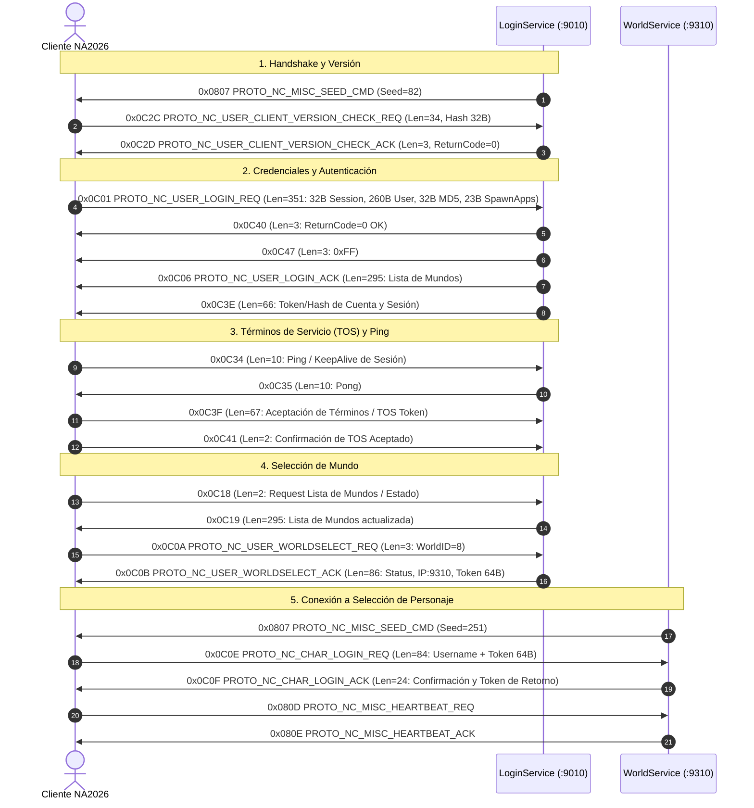

# Análisis Técnico Oficial: Protocolo NA2026 vs XelionCore
**Fecha de Captura:** 2026-10-24 19:10 - 19:23  
**Origen:** Cliente Oficial Fiesta Online NA2026 (VMware `192.168.0.15`) <---> Servidores Oficiales Gamigo/Fiesta (`162.19.147.96`)

---

## 1. Mapeo de Puertos y Servicios de NA2026

En NA2026, la arquitectura de puertos oficial es:
- **Puerto 9010**: `LoginService` (Autenticación inicial, versión, TOS y lista de mundos).
- **Puerto 9310**: `WorldService` / `CharacterServer` (Selección de personaje, creación, borrado y lista de avatares).
- **Puerto 9320 / 9350**: `ZoneService` (Mundo del juego, mapas, InGame chunk).

---

## 2. Flujo Completo de Login (`20261024_191000_login_tos_world.pcap`)

---

## 3. Detalle de Estructuras de Paquetes en NA2026

### 3.1. Chequeo de Versión
- **C2S: `0x0C2C`** (`PROTO_NC_USER_CLIENT_VERSION_CHECK_REQ` en NA2026):
  - Longitud payload: 34 bytes (2 bytes OpCode + 32 bytes de Hash MD5 en string ASCII).
  - En la captura: `"3dca91289ab564b3ce1f5c8ca1b362a6"`.
- **S2C: `0x0C2D`** (`PROTO_NC_USER_CLIENT_VERSION_CHECK_ACK` en NA2026):
  - Longitud payload: 3 bytes (`2D 0C 00` -> OpCode `0x0C2D` + `uint8 bSuccess = 0`).

### 3.2. Envío de Credenciales (Login)
- **C2S: `0x0C01`** (`PROTO_NC_USER_LOGIN_REQ`):
  - Longitud payload: 351 bytes.
  - `0x00 - 0x01`: OpCode `0x0C01` (2B).
  - `0x02 - 0x21`: Padding de sesión inicial (32B nulos).
  - `0x22 - 0x125`: Nombre de usuario `sUserName[260]` (en la captura: `"tronicv2"`).
  - `0x126 - 0x145`: Hash MD5 de la contraseña `sPassword[32]` (en la captura: `"bd4416ff6d2043ac9353f8736db02d70"`).
  - `0x146 - 0x15D`: String del cliente / spawnApps (`"Original"`).

### 3.3. Respuestas de Autenticación
- **Caso Éxito:**
  - **S2C: `0x0C40`** (3 bytes: `OpCode 0x0C40` + `0x00` -> Éxito).
  - **S2C: `0x0C47`** (3 bytes: `OpCode 0x0C47` + `0xFF`).
  - **S2C: `0x0C06`** (`PROTO_NC_USER_LOGIN_ACK`, lista de mundos): 295 bytes.
    - Contiene el número de mundos (16 mundos en la captura: Malephar, Apoline, Khazul, etc.) con sus flags de estado.
  - **S2C: `0x0C3E`**: 66 bytes con el identificador de sesión y tokens del usuario.
- **Caso Contraseña Incorrecta (`wrong_pass`):**
  - **S2C: `0x0C07`** (4 bytes: `07 0C 45 00` -> OpCode `0x0C07`, código de error `0x0045` = 69 decimal, *"Password mismatch / Invalid account"*).

### 3.4. Aceptación de Términos (TOS)
- **C2S: `0x0C3F`** (67 bytes: OpCode `0x0C3F` + Hash de 64 caracteres de aceptación de TOS).
- **C2S: `0x0C41`** (2 bytes: OpCode `0x0C41` -> confirmación de lectura y aceptación de términos).

### 3.5. Selección de Mundo y Transferencia a WorldService
- **C2S: `0x0C0A`**: `0A 0C [WorldID byte]` (en la captura: `08`, Enid ES).
- **S2C: `0x0C0B`**: 86 bytes:
  - `OpCode`: `0x0C0B`.
  - `Status`: 1 byte (`0x06`).
  - `IP`: 16 bytes ASCII (`"162.19.147.96\x00..."`).
  - `Port`: 2 bytes Little Endian (`0x245E` = puerto `9310`).
  - `Token`: 64 bytes de autenticación para WorldService.

---

## 4. Gestión de Personajes en WorldService (`:9310`)

### 4.1. Handshake en WorldService
- **S2C: `0x0807`**: Semilla XOR para el WorldService (`0x00FB`).
- **C2S: `0x0C0E`**: 84 bytes (`OpCode 0x0C0E` + `sUserName[18]` + `Token[64]`).
- **S2C: `0x0C0F`**: 24 bytes confirmando la transferencia.
- **C2S / S2C: `0x080D` / `0x080E`**: Heartbeat (Ping/Pong de conexión viva).

### 4.2. Creación de Personaje
- **Caso Nombre en Uso (`name_in_use.pcap`):**
  - **S2C: `0x1404`** (`PROTO_NC_AVATAR_CREATEFAIL_ACK`):
    - Payload: `04 14 81 01` -> OpCode `0x1404` + Error `0x0181` (385 decimal: *"Character name already exists"*).
    - **100% de coincidencia exacta con `pkg/protocol/proto_nc_char.go` de XelionCore!**
- **Caso Creación Exitosa (`create_char_success.pcap`):**
  - **S2C: `0x1406`** (`PROTO_NC_AVATAR_CREATESUCC_ACK`):
    - Payload: 164 bytes.
    - Contiene slot, nombre (`"TronicXelion"`), mapa inicial (`"Rou"`), apariencia y stats iniciales.
- **Caso Borrado de Personaje (`delete_char.pcap`):**
  - **S2C: `0x140C`** (`PROTO_NC_AVATAR_ERASESUCC_ACK`):
    - Payload: `0C 14 00` -> OpCode `0x140C` + `0x00` (Éxito).
    - **100% de coincidencia exacta con `pkg/protocol/proto_nc_char.go` de XelionCore!**

---

## 5. Entrada a Juego / InGame Chunk (`enter_char_gamechunk.pcap`)
- Al presionar entrar al juego, el cliente se conecta al **puerto `9320`** (`ZoneService`).
- Recibe la secuencia estricta de paquetes del InGame chunk documentada en XelionCore:
  - `0x1038`: `PROTO_NC_CHAR_CLIENT_BASE_CMD` (126 bytes en NA2026).
  - `0x1039`: `PROTO_NC_CHAR_CLIENT_SHAPE_CMD` (6 bytes).
  - `0x103A`: `PROTO_NC_CHAR_CLIENT_QUEST_DOING_CMD` (8 bytes).
  - `0x103B`: `PROTO_NC_CHAR_CLIENT_QUEST_DONE_CMD` (14 bytes).
  - `0x10CE`: `PROTO_NC_CHAR_CLIENT_QUEST_READ_CMD` (8 bytes).
  - `0x10D7`: `PROTO_NC_CHAR_CLIENT_QUEST_REPEAT_CMD` (8 bytes).
  - `0x103D`: `PROTO_NC_CHAR_CLIENT_SKILL_CMD` (348 bytes).
  - `0x103E`: `PROTO_NC_CHAR_CLIENT_PASSIVE_CMD` (4 bytes).
