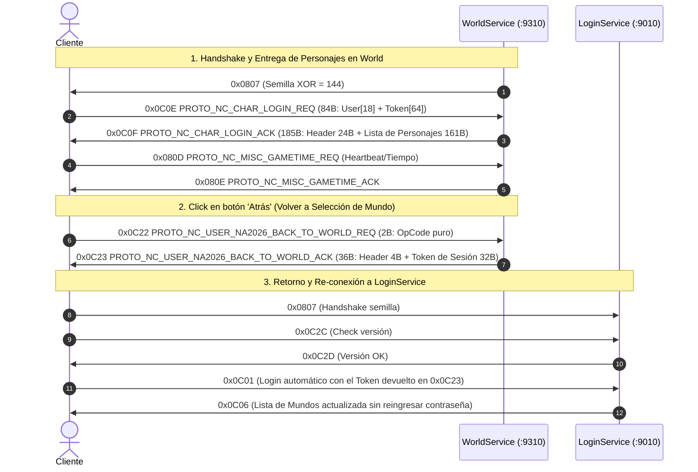

# Análisis de Captura NA2026: Entrada a Selección de Personajes y Retorno al Mundo (Click Atrás)

**Archivo PCAP:** `captures/na2026/pcaps/20261025_112800_enter_char_and_click_back_to_world.pcap`  
**Volcado Hexadecimal:** `captures/na2026/raw/20261025_112800_enter_char_and_click_back_to_world.txt`

---

## 1. Flujo de Paquetes en WorldService (`:9310`)

---

## 2. Detalle Binario de los Paquetes Identificados

### 2.1. `0x0C0F` (`PROTO_NC_CHAR_LOGIN_ACK` unificado en NA2026)
* **Emisor:** Servidor -> Cliente (S2C en puerto `:9310`).
* **Longitud:** Dinámica:
  * Con 0 personajes: **24 bytes**.
  * Con 1 personaje: **185 bytes** (24B cabecera + 161B del personaje).
* **Estructura Wire:**
  * `0x00 - 0x01`: `0x0C0F` (OpCode, 2 bytes Little Endian `0F 0C`).
  * `0x02 - 0x05`: `0x0C017B2A` (4 bytes prefijo de sesión/secuencia).
  * `0x06 - 0x15`: `IP[16]` ASCII null-padded (`"162.19.147.96\x00..."`).
  * `0x16 - 0x17`: `Port` (2 bytes Little Endian = `0x2486` -> `9350`).
  * `0x18 - Fin`: Información del avatar serializada:
    * `ChrID` (4 bytes uint32: `0x000D3475` = `865397`).
    * `Name` (20 bytes: `"TronicXelion\x00..."`).
    * `Level` (2 bytes uint16: `1`).
    * `Slot` (1 byte uint8: `0`).
    * `Map` (12 bytes: `"Rou\x00..."`).
    * Apariencia (Rostro, Cabello, Color, Género, Clase) y Equipamiento.

### 2.2. `0x0C22` (`PROTO_NC_USER_NA2026_BACK_TO_WORLD_REQ`)
* **Emisor:** Cliente -> Servidor (C2S en puerto `:9310`).
* **Disparador:** El usuario presiona el botón **"Atrás"** en la pantalla de selección de personajes para volver a elegir un servidor/mundo.
* **Longitud:** **2 bytes**.
* **Payload:** `22 0C` (sin datos adicionales).

### 2.3. `0x0C23` (`PROTO_NC_USER_NA2026_BACK_TO_WORLD_ACK`)
* **Emisor:** Servidor -> Cliente (S2C en puerto `:9310`).
* **Longitud:** **36 bytes**.
* **Payload:**
  * `0x00 - 0x01`: `0x0C23` (OpCode `23 0C`).
  * `0x02 - 0x03`: `58 1E` (2 bytes código de estado o handle).
  * `0x04 - 0x23`: Token de retorno de 32 bytes ASCII (`"d07a853c3ee671ae9eaa4b275c4586d2"`).
* **Comportamiento Cliente:** Al recibir `0x0C23`, el cliente desconecta el socket de `:9310` y se conecta inmediatamente al `LoginService` (`:9010`), entregando este token en `0x0C01` para volver a la lista de mundos sin pedir credenciales.
