# Servicios a Implementar

Documento de arquitectura para la implementación de los servicios en **Xelion Core**, mapeados contra la arquitectura oficial de **Xelion Legacy** (AstraServer / Fiesta Online).

---

## 1. Esquema de Arquitectura Simplificado

```mermaid
flowchart TD
    subgraph Red ["Servicios de Red (Frontend / Jugador)"]
        L["LoginService (9010)"]
        W["WorldService (9110)"]
        Z["ZoneService (9210)"]
    end

    subgraph Backend ["Servicios de Persistencia y Auditoría"]
        AL["AccountLogService"]
        GL["GameLogService"]
    end

    subgraph DB ["Bases de Datos MySQL (Esquema Oficial)"]
        DB_A[("Account")]
        DB_AL[("AccountLog")]
        DB_W[("World00_Character")]
        DB_GL[("World00_GameLog")]
    end

    L -->|"Auth / Validaciones"| DB_A
    L -->|"Conexiones / Desconexiones"| AL
    AL --> DB_AL

    W -->|"Carga / Creación Personajes"| DB_W
    Z -->|"Posición, Stats, Inventario"| DB_W

    W -->|"Eventos de personajes"| GL
    Z -->|"Drops, Trades, Compras, GM"| GL
    GL --> DB_GL
```

---

## 2. Comparativa: Xelion Core vs. Xelion Legacy

| Servicio en Xelion Core | Proceso en Xelion Legacy | Base de Datos (.bak) | Tablas Principales | Responsabilidad / Descripción |
| :--- | :--- | :--- | :--- | :--- |
| **`LoginService`** | `Login.exe` + `Account.exe` (`PG_AccDB`) | `Account.bak` | `tUser`, `tUserAuth`, `tUserBlock`, `tUserOption` | Autenticación de jugadores, verificación de versiones, validación de estado de cuenta y selección de mundos disponibles. |
| **`WorldService`** | `WorldManager.exe` + `Character.exe` (`PG_W00_WM`) | `World00_Character.bak` | `tCharacter`, `tCharacterShape`, `tCharacterState`, `tGuild`, `tFriend` | Gestión de personajes en la selección, chat global, gremios, academias y traspaso seguro hacia la zona de juego. |
| **`ZoneService`** | `Zone00.exe` ... `Zone04.exe` (`PG_W00_Z00`) | `World00_Character.bak` | `tCharacter`, `tItem`, `tSkill`, `tCharacterShortCut`, `tQuest` | Simulación del mapa de juego (`RouN`), movimiento, combate, inventario, habilidades, monstruos e interacciones con NPCs. |
| **`AccountLogService`** | `AccountLog.exe` (`PG_ALDB`) | `AccountLog.bak` | `tAccountLog`, `tIPBlock`, `tReport`, `tLogout` | Auditoría de sesiones (inicios/cierres), control de listas negras de IPs, reportes in-game de jugadores y estadísticas de concurrencia. |
| **`GameLogService`** | `GameLog.exe` (`PG_W00_GLDB`) | `World00_GameLog.bak` | `tGameLog` | Registro de trazabilidad económica y jugabilidad: drops de monstruos, trades entre jugadores, compras en NPCs, mejoras de armas y comandos GM. |

---

## 3. Ventajas del Enfoque Xelion Core

1. **Unificación sin intermediarios S2S**: En Legacy, `Login.exe` requería comunicarse por sockets internos con `Account.exe` y `Zone.exe` con `Character.exe`. En Go, los servicios acceden directamente al pool de conexiones de MySQL con cero latencia interna.
2. **Logs No-Bloqueantes (Goroutines y Canales)**: Los registros a `AccountLog` y `GameLog` se envían a través de canales asíncronos (`chan LogEvent`), asegurando que ni el combate ni el movimiento del servidor de zona sufran congelamientos o pérdidas de rendimiento por operaciones de disco.
3. **Carga Única de Datos Estáticos**: Los archivos oficiales `.shn` (`MapInfo.shn`, `ItemInfoServer.shn`, etc.) y `.txt` (`DefaultCharacterData.txt`) se leen y parsean en memoria una sola vez para todos los servicios del núcleo.

---

## 4. Especificaciones Técnicas Detalladas por Servicio

Documentación exhaustiva con ingeniería inversa directa de binarios, flujos TPI de PDBs, paquetes, payloads binarios y procedimientos SQL:

* 🔐 [**Login** (`Login.exe` / `Login.pdb`)](file:///Users/fedemac/Desktop/Xelion%20Online/XelionCore/docs/Servicios/Login.md) — 85 estructuras de red, sockets C2S y S2S, chequeo de versión `ClientVersionKeyInfo.txt`, zero-SQL.
* 👤 [**Account** (`Account.exe` / `Account.pdb`)](file:///Users/fedemac/Desktop/Xelion%20Online/XelionCore/docs/Servicios/Account.md) — 101 estructuras, 13 Stored Procedures, 53 SHN checksums, autenticación multirregión.
* 📋 [**AccountLog** (`AccountLog.exe` / `AccountLog.pdb`)](file:///Users/fedemac/Desktop/Xelion%20Online/XelionCore/docs/Servicios/AccountLog.md) — 106 estructuras, 12 Stored Procedures, auditoría de sesiones y baneo de IPs.
* 🌍 [**WorldManager** (`WorldManager.exe` / `WorldManager.pdb`)](file:///Users/fedemac/Desktop/Xelion%20Online/XelionCore/docs/Servicios/WorldManager.md) — 1.379 estructuras, 463 handlers de coordinación de mundo, gremios, bodas, 71 SHNs.
* ⚔️ [**Zone** (`Zone.exe` / `Zone.pdb`)](file:///Users/fedemac/Desktop/Xelion%20Online/XelionCore/docs/Servicios/Zone.md) — 1.343 estructuras, game loop, combate, inventario, 189 SHNs, 31 archivos TXT de scripts.
* 💾 [**Character** (`Character.exe`)](file:///Users/fedemac/Desktop/Xelion%20Online/XelionCore/docs/Servicios/Character.md) — 1.369 estructuras, 196 handlers, 311 Stored Procedures de persistencia de personaje.
* 📜 [**GameLog** (`GameLog.exe`)](file:///Users/fedemac/Desktop/Xelion%20Online/XelionCore/docs/Servicios/GameLog.md) — 44 estructuras, 23 Stored Procedures de auditoría económica, combate y drops.

