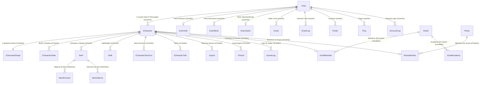

# Catálogo Completo de Tablas y Relaciones Oficiales - Xelion Legacy (176 Tablas)

Este documento contiene el inventario exhaustivo de las **176 tablas oficiales** de Fiesta Online / AstraServer extraídas directamente de los backups originales de Microsoft SQL Server (`.bak`), **con todas sus columnas, tipos de datos nativos, claves primarias y relaciones (Foreign Keys físicas y lógicas)**, sin ninguna omisión ni simplificación.

> [!NOTE]
> Para la lógica de negocio y llamadas ODBC de los servidores C++ legacy, consulta el catálogo complementario en [docs/ProcedimientosLegacy.md](file:///Users/fedemac/Desktop/Xelion%20Online/XelionCore/docs/ProcedimientosLegacy.md) (573 Stored Procedures exclusivos de Fiesta Online).

## Resumen General

| Archivo de Base de Datos | Base de Datos | Cantidad de Tablas | Claves Primarias (PK) | Claves Foráneas (FK) |
| :--- | :--- | :---: | :---: | :---: |
| `World00_Character.bak` | `World00_Character` | **114** | 84 | 39 |
| `Account.bak` | `Account` | **34** | 23 | 35 |
| `StatisticsData.bak` | `StatisticsData` | **13** | 11 | 0 |
| `AccountLog.bak` | `AccountLog` | **10** | 7 | 0 |
| `OperatorTool.bak` | `OperatorTool` | **3** | 2 | 0 |
| `World00_GameLog.bak` | `World00_GameLog` | **2** | 1 | 0 |
| **TOTAL** | | **176** | **128** | **74** |

---

## Diagrama Entidad-Relación Principal (Relaciones Nucleares del Servidor)

---

## World00_Character (`World00_Character.bak`) - 114 Tablas

| Archivo | Nombre de la Tabla | Columnas y Tipos |
| :--- | :--- | :--- |
| `World00_Character.bak` | **`QuestItemFix`** | `QuestID` (int), `ItemID` (int) |
| `World00_Character.bak` | **`TEMP_ItemCnt`** | `nOwner` (int), `nItemCnt` (int) |
| `World00_Character.bak` | **`TEMP_QuestComplete`** | `nCharNo` (int), `nQuestCompleteCnt` (int) |
| `World00_Character.bak` | **`Temp_Guar`** | `nCharNo` (int), `nSkillNo` (smallint), `nSkillLevel` (tinyint), `nSkillExp` (int), `nSkillWriteTime` (bigint), `nSkillCoolTime` (int), `nSkillPowerDemage` (tinyint), `nSkillPowerSP` (tinyint), `nSkillPowerKeepTime` (tinyint), `nSkillPowerCoolTime` (tinyint) |
| `World00_Character.bak` | **`Temp_Holy`** | `nCharNo` (int), `nSkillNo` (smallint), `nSkillLevel` (tinyint), `nSkillExp` (int), `nSkillWriteTime` (bigint), `nSkillCoolTime` (int), `nSkillPowerDemage` (tinyint), `nSkillPowerSP` (tinyint), `nSkillPowerKeepTime` (tinyint), `nSkillPowerCoolTime` (tinyint) |
| `World00_Character.bak` | **`Waits_Sysprocesses`** | `logdate` (datetime), `spid` (smallint), `Wait Time (s)` (numeric(17,6)), `lastwaittype` (nchar(32)), `waitresource` (nchar(max)), `dbid` (smallint), `uid` (smallint), `cpu` (int), `physical_io` (bigint), `memusage` (int), `last_batch` (datetime), `open_tran` (smallint), `sid` (binary(86)), `hostname` (nchar(max)), `program_name` (nchar(max)), `nt_username` (nchar(max)), `loginame` (nchar(max)), `sql_text` (varchar(64)) |
| `World00_Character.bak` | **`auditCharacterData`** | `audit_log_id` (uniqueidentifier), `audit_log_type` (char(3)), `audit_user` (nvarchar(max)), `audit_host` (char(50)), `audit_application` (char(50)), `audit_char_no` (int), `audit_char_money` (int), `audit_changed` (datetime) |
| `World00_Character.bak` | **`chr_a`** | `nCharNo` (int), `sID` (nvarchar(40)), `nUserNo` (int), `nAdminLevel` (tinyint), `nPS` (int), `nGS` (int), `dCreateDate` (datetime), `bDeleted` (tinyint), `nLoginZoneX` (int), `nLoginZoneY` (int), `nLoginZoneD` (tinyint), `nPKYellowTime` (tinyint), `dDeletedDate` (datetime), `nAP` (smallint), `sLoginZone` (varchar(16)), `nPKCount` (int), `nLevel` (smallint), `nExp` (bigint), `nSlotNo` (tinyint), `nHP` (smallint), `nSP` (smallint), `nHPS` (smallint), `nSPS` (smallint), `dLastLoginDate` (datetime), `nLoginCount` (int), `nCreateWorld` (tinyint), `nFame` (int), `nPrisonMin` (smallint), `nPlayMin` (int), `nFlags` (int), `nMoney` (bigint), `nStrength` (tinyint), `nConstitute` (tinyint), `nDexterity` (tinyint), `nIntelligence` (tinyint), `nMentalPower` (tinyint), `nRedistributePoint` (tinyint), `nKQHandle` (int), `sKQMap` (varchar(16)), `nKQX` (int), `nKQY` (int), `nKQD` (tinyint), `dKQDate` (datetime), `ngrade` (int) |
| `World00_Character.bak` | **`chr_b`** | `nCharNo` (int), `sID` (nvarchar(40)), `nUserNo` (int), `nAdminLevel` (tinyint), `nPS` (int), `nGS` (int), `dCreateDate` (datetime), `bDeleted` (tinyint), `nLoginZoneX` (int), `nLoginZoneY` (int), `nLoginZoneD` (tinyint), `nPKYellowTime` (tinyint), `dDeletedDate` (datetime), `nAP` (smallint), `sLoginZone` (varchar(16)), `nPKCount` (int), `nLevel` (smallint), `nExp` (bigint), `nSlotNo` (tinyint), `nHP` (smallint), `nSP` (smallint), `nHPS` (smallint), `nSPS` (smallint), `dLastLoginDate` (datetime), `nLoginCount` (int), `nCreateWorld` (tinyint), `nFame` (int), `nPrisonMin` (smallint), `nPlayMin` (int), `nFlags` (int), `nMoney` (bigint), `nStrength` (tinyint), `nConstitute` (tinyint), `nDexterity` (tinyint), `nIntelligence` (tinyint), `nMentalPower` (tinyint), `nRedistributePoint` (tinyint), `nKQHandle` (int), `sKQMap` (varchar(16)), `nKQX` (int), `nKQY` (int), `nKQD` (tinyint), `dKQDate` (datetime), `ngrade` (int) |
| `World00_Character.bak` | **`chr_bak`** | `nCharNo` (int), `sID` (nvarchar(40)), `nUserNo` (int), `nAdminLevel` (tinyint), `nPS` (int), `nGS` (int), `dCreateDate` (datetime), `bDeleted` (tinyint), `nLoginZoneX` (int), `nLoginZoneY` (int), `nLoginZoneD` (tinyint), `nPKYellowTime` (tinyint), `dDeletedDate` (datetime), `nAP` (smallint), `sLoginZone` (varchar(16)), `nPKCount` (int), `nLevel` (smallint), `nExp` (bigint), `nSlotNo` (tinyint), `nHP` (smallint), `nSP` (smallint), `nHPS` (smallint), `nSPS` (smallint), `dLastLoginDate` (datetime), `nLoginCount` (int), `nCreateWorld` (tinyint), `nFame` (int), `nPrisonMin` (smallint), `nPlayMin` (int), `nFlags` (int), `nMoney` (bigint), `nStrength` (tinyint), `nConstitute` (tinyint), `nDexterity` (tinyint), `nIntelligence` (tinyint), `nMentalPower` (tinyint), `nRedistributePoint` (tinyint), `nKQHandle` (int), `sKQMap` (varchar(16)), `nKQX` (int), `nKQY` (int), `nKQD` (tinyint), `dKQDate` (datetime), `ngrade` (int) |
| `World00_Character.bak` | **`deleted_item`** | `nItemKey` (bigint), `nStorageType` (tinyint), `nOwner` (bigint), `nStorage` (smallint), `nItemID` (int), `nFlags` (int), `dDate` (datetime) |
| `World00_Character.bak` | **`num`** | `num` (smallint) |
| `World00_Character.bak` | **`removeskill`** | `nCharNo` (int), `skillno` (int), `dDate` (datetime) |
| `World00_Character.bak` | **`skilldata`** | `ID` (int), `BuyPrice` (bigint), `BuyFame` (int) |
| `World00_Character.bak` | **`tArenaChallenge`** | `nCharNo` (int), `nMonsterLevel` (smallint), `nMonsterMKC` (smallint), `nMonsterKPS` (smallint), `nMonsterKills` (int) |
| `World00_Character.bak` | **`tArenaFBZ`** | `nFBZWin` (int), `nFBZLose` (int), `nFBZLadder` (int), `nCharNo` (int) |
| `World00_Character.bak` | **`tArenaGuild`** | `nGuildLose` (int), `nGuildDraw` (int), `nGuildNo` (int), `nGuildWin` (int), `nGuildLadder` (int) |
| `World00_Character.bak` | **`tArenaPvP`** | `nPvPLadder` (int), `nPvPWin` (int), `nPvPLose` (int), `nCharNo` (int), `nPvPDraw` (int) |
| `World00_Character.bak` | **`tAttendance`** | `nCharNo` (int), `dAttendanceDate` (datetime) |
| `World00_Character.bak` | **`tAttendanceReward`** | `nCharNo` (int), `dEventDate` (datetime), `dRewardDate` (datetime), `nRewardID` (int) |
| `World00_Character.bak` | **`tAutoMon`** | `nCharNo` (int), `nType` (tinyint), `nSlot` (tinyint), `nItemID` (int) |
| `World00_Character.bak` | **`tAutoPick`** | `nCharNo` (int), `IsAutoPick` (tinyint) |
| `World00_Character.bak` | **`tBugReport_20091204`** | `charNo` (int), `cnt` (int), `money` (int), `exp` (int), `fame` (int) |
| `World00_Character.bak` | **`tCharacter`** | `nCharNo` (int), `sID` (nvarchar(40)), `nUserNo` (int), `nAdminLevel` (tinyint), `nPS` (int), `nGS` (int), `dCreateDate` (datetime), `bDeleted` (tinyint), `nLoginZoneX` (int), `nLoginZoneY` (int), `nLoginZoneD` (tinyint), `nPKYellowTime` (tinyint), `dDeletedDate` (datetime), `nAP` (smallint), `sLoginZone` (varchar(16)), `nPKCount` (int), `nLevel` (smallint), `nExp` (bigint), `nSlotNo` (tinyint), `nHP` (smallint), `nSP` (smallint), `nHPS` (smallint), `nSPS` (smallint), `dLastLoginDate` (datetime), `nLoginCount` (int), `nCreateWorld` (tinyint), `nFame` (int), `nPrisonMin` (smallint), `nPlayMin` (int), `nFlags` (int), `nMoney` (bigint), `nStrength` (tinyint), `nConstitute` (tinyint), `nDexterity` (tinyint), `nIntelligence` (tinyint), `nMentalPower` (tinyint), `nRedistributePoint` (tinyint), `nKQHandle` (int), `sKQMap` (varchar(16)), `nKQX` (int), `nKQY` (int), `nKQD` (tinyint), `dKQDate` (datetime), `nFriendPoint` (int), `nLastFriendPoint` (int) |
| `World00_Character.bak` | **`tCharacterChangeID`** | `nRowNo` (int), `sys_create_date` (datetime), `sys_update_date` (datetime), `nUserNo` (int), `nCharNo` (int), `bFlag` (bit), `bInit` (bit), `sOldID` (nvarchar(50)), `sNewID` (nvarchar(50)) |
| `World00_Character.bak` | **`tCharacterChargedBuffer`** | `nNo` (int), `nCharNo` (int), `nKey` (int), `nID` (smallint), `dUseDate` (datetime), `dEndDate` (datetime) |
| `World00_Character.bak` | **`tCharacterGameOption`** | `nCharNo` (int), `sys_create_date` (datetime), `nOptionNo` (smallint), `nValue` (tinyint) |
| `World00_Character.bak` | **`tCharacterKeyMap`** | `nCharNo` (int), `nFunctionNo` (smallint), `sys_create_date` (datetime), `sys_update_date` (datetime), `nExtendedKey` (tinyint), `nASCIICode` (tinyint) |
| `World00_Character.bak` | **`tCharacterLoading`** | `nCharNo` (int), `nSeqNo` (int), `dWorldTime` (datetime), `dDBTime` (datetime), `sLoadingMapName` (varchar(16)), `nFailType` (smallint), `nLoadingFailCnt` (smallint) |
| `World00_Character.bak` | **`tCharacterOptions`** | `nCharNo` (int), `sShortCutData` (varbinary(max)), `sShortCutSize` (varbinary(24)), `sVideo` (varbinary(60)), `sSound` (varbinary(1)), `sGame` (varbinary(64)), `sWindowsPos` (varbinary(136)), `sKeyMapping` (varbinary(52)) |
| `World00_Character.bak` | **`tCharacterShape`** | `nCharNo` (int), `nClass` (tinyint), `nRace` (tinyint), `nGender` (tinyint), `nHairType` (tinyint), `nHairColor` (tinyint), `nFaceShape` (tinyint) |
| `World00_Character.bak` | **`tCharacterShortCut`** | `nCharNo` (int), `nSlotNo` (tinyint), `sys_create_date` (datetime), `sys_update_date` (datetime), `nCodeType` (smallint), `nCodeNo` (smallint), `nValue` (int) |
| `World00_Character.bak` | **`tCharacterSingleOption`** | `nCharNo` (int), `sys_create_date` (datetime), `sys_update_date` (datetime), `bMysteryBolt` (bit), `bAutoPick` (bit), `dRestExpLastExecuteTime` (datetime), `nChatBan` (int), `nAutoBuff` (tinyint), `nAutoChargedBuff` (tinyint) |
| `World00_Character.bak` | **`tCharacterState`** | `nCharNo` (int), `nStateNo` (smallint), `nStateLevel` (smallint), `nStateTime` (int), `nStateCount` (smallint), `nStatePowerDemage` (tinyint), `nStatePowerSP` (tinyint), `nStatePowerKeepTime` (tinyint), `nStatePowerCoolTime` (tinyint), `nSetItemIndexA` (smallint), `nSetItemValueA` (smallint), `nSetItemIndexB` (smallint), `nSetItemValueB` (smallint), `nSetItemIndexC` (smallint), `nSetItemValueC` (smallint), `nSetItemIndexD` (smallint), `nSetItemValueD` (smallint), `nRestTime` (int), `nCasterLevel` (smallint), `nCasterAttackPower` (int) |
| `World00_Character.bak` | **`tCharacterState_Backup`** | `nCharNo` (int), `nStateNo` (smallint), `nStateLevel` (smallint), `nStateTime` (int), `nStateCount` (smallint), `nStatePowerDemage` (tinyint), `nStatePowerSP` (tinyint), `nStatePowerKeepTime` (tinyint), `nStatePowerCoolTime` (tinyint) |
| `World00_Character.bak` | **`tCharacterState_isSaveZero_BackUp`** | `nCharNo` (int), `nStateNo` (smallint), `nStateLevel` (smallint), `nStateTime` (int), `nStateCount` (smallint), `nStatePowerDemage` (tinyint), `nStatePowerSP` (tinyint), `nStatePowerKeepTime` (tinyint), `nStatePowerCoolTime` (tinyint), `nSetItemIndexA` (smallint), `nSetItemValueA` (smallint), `nSetItemIndexB` (smallint), `nSetItemValueB` (smallint), `nSetItemIndexC` (smallint), `nSetItemValueC` (smallint), `nSetItemIndexD` (smallint), `nSetItemValueD` (smallint) |
| `World00_Character.bak` | **`tCharacterTitle`** | `nNo` (bigint), `dDate` (datetime), `nCharNo` (int), `nType` (tinyint), `nElementNo` (tinyint), `nElementValue` (bigint) |
| `World00_Character.bak` | **`tChatBlock`** | `nUserNo` (int), `nCharNo` (int), `dDate` (datetime) |
| `World00_Character.bak` | **`tChatColor`** | `nCharNo` (int), `nFontColorID` (tinyint), `nBalloonColorID` (tinyint), `dDate` (datetime) |
| `World00_Character.bak` | **`tCollectionCard`** | `nCharNo` (int), `nCardID` (int), `nSerialNo` (bigint), `nStarNumber` (tinyint), `dDate` (datetime) |
| `World00_Character.bak` | **`tCollectionFavorites`** | `nCharNo` (int), `nSlotNo` (tinyint), `nCardID` (int), `dDate` (datetime) |
| `World00_Character.bak` | **`tCollectionReward`** | `nCharNo` (int), `nReward` (int), `dDate` (datetime) |
| `World00_Character.bak` | **`tCollectionSerialCount`** | `nCardID` (int), `sys_create_date` (datetime), `sys_update_date` (datetime), `nCount` (bigint) |
| `World00_Character.bak` | **`tDice`** | `nGameNo` (int), `nCharNo` (int), `nItemKey` (bigint), `sDice` (nvarchar(3)), `dDate` (datetime) |
| `World00_Character.bak` | **`tDiceLog`** | `nGameNo` (int), `nCustomCharNo` (int), `nSlotNo` (tinyint), `nBattingMoney` (bigint), `nBattingRate` (int), `bStatus` (bit), `nTaxRate` (int), `nDividend` (bigint) |
| `World00_Character.bak` | **`tDicePayLog`** | `nCharNo` (int), `nItemKey` (bigint), `nTotalDividend` (bigint), `dDate` (datetime) |
| `World00_Character.bak` | **`tDiceResult`** | `nGameNo` (int), `nCustomCharNo` (int), `nBeforeMoney` (bigint), `nTotalDividend` (bigint), `nAfterMoney` (bigint) |
| `World00_Character.bak` | **`tExp`** | `level` (int), `NextExp` (bigint), `sExp` (bigint), `eExp` (bigint) |
| `World00_Character.bak` | **`tFriend`** | `nCharNo` (int), `nFriendCharNo` (int), `nFlags` (tinyint), `dDate` (datetime) |
| `World00_Character.bak` | **`tGMItemReward`** | `nGroupNo` (bigint), `sys_create_date` (datetime), `sys_update_date` (datetime), `sOperID` (nvarchar(20)), `sIP` (nvarchar(30)), `sCause` (nvarchar(104)) |
| `World00_Character.bak` | **`tGMItemRewardLog`** | `nGroupNo` (bigint), `nLogNo` (bigint), `sys_create_date` (datetime), `sys_update_date` (datetime), `nCharNo` (int), `nStorageType` (tinyint), `nItemID` (int), `nItemKey` (bigint) |
| `World00_Character.bak` | **`tGambleCoin`** | `nCharNo` (int), `sys_update_date` (datetime), `nCoin` (bigint), `dDate` (datetime) |
| `World00_Character.bak` | **`tGambleCoinExchangeLog`** | `nLogNo` (bigint), `nCharNo` (int), `dDate` (datetime), `nExchangedCoin` (bigint), `nStatus` (tinyint), `nBeforeCoin` (bigint), `nAfterCoin` (bigint), `nBeforeMoney` (bigint), `nAfterMoney` (bigint) |
| `World00_Character.bak` | **`tGambleDice`** | `nGameNo` (int), `sDice` (nvarchar(3)), `dDate` (datetime) |
| `World00_Character.bak` | **`tGambleDiceLog`** | `nGameNo` (int), `nCharNo` (int), `nSlotNo` (tinyint), `nBattingMoney` (bigint), `nBattingRate` (int), `bStatus` (bit), `nTaxRate` (int), `nDividend` (bigint), `dDate` (datetime) |
| `World00_Character.bak` | **`tGambleDiceResult`** | `nGameNo` (int), `nCharNo` (int), `nBeforeMoney` (bigint), `nTotalDividend` (bigint), `nAfterMoney` (bigint), `dDate` (datetime) |
| `World00_Character.bak` | **`tGambleJackpot`** | `sGameName` (nvarchar(20)), `nBattingUnit` (bigint), `sys_create_date` (datetime), `sys_update_date` (datetime), `nJackpotCoin` (bigint) |
| `World00_Character.bak` | **`tGambleJackpotLog`** | `nLogNo` (bigint), `sGameName` (nvarchar(20)), `nBattingUnit` (bigint), `sID` (nvarchar(80)), `nJackpotCoin` (bigint), `nGameNo` (bigint) |
| `World00_Character.bak` | **`tGambleSlotMachineLog`** | `nGameNo` (bigint), `nCharNo` (int), `dDate` (datetime), `nBattingUnit` (bigint), `nBatting` (tinyint), `sGameResult` (nvarchar(10)), `bIsWin` (bit), `nPrizeCoin` (bigint) |
| `World00_Character.bak` | **`tGameOptionInit`** | `nOptionNo` (smallint), `sys_create_date` (datetime), `sys_update_date` (datetime), `nDefaultValue` (tinyint), `bIsActive` (bit), `sDescription` (nvarchar(100)), `sDescriptionLocal` (nvarchar(100)) |
| `World00_Character.bak` | **`tGuild`** | `nNo` (int), `sName` (nvarchar(18)), `sPassword` (nvarchar(10)), `nMaxMembers` (smallint), `nMoney` (bigint), `nType` (tinyint), `nGrade` (tinyint), `nFame` (int), `nStoneLevel` (smallint), `nExp` (bigint), `dCreateDate` (datetime), `dWarRequestDate` (datetime), `dWarStartDate` (datetime), `dWarEndDate` (datetime), `nWarEnemy` (int), `nWarWinCount` (int), `nWarLoseCount` (int), `nWarDrawCount` (int), `nDismissStatus` (tinyint), `dDismissDate` (datetime), `sIntro` (nvarchar(max)), `dNotifyDate` (datetime), `sNotifyCharID` (nvarchar(17)), `sNotify` (nvarchar(max)) |
| `World00_Character.bak` | **`tGuildAcademy`** | `nNo` (int), `nMasterCharNo` (int), `nMaxMember` (smallint), `nMoney` (bigint), `nPoint` (int), `dBuffEndTime` (datetime), `dNotifyDate` (datetime), `sNotify` (varchar(max)), `sIntro` (nvarchar(max)) |
| `World00_Character.bak` | **`tGuildAcademyGraduate`** | `nNo` (int), `nCharNo` (int), `sID` (nvarchar(40)), `nClass` (tinyint), `nJoinLevel` (smallint), `dJoinDate` (datetime), `nGraduateLevel` (smallint), `dGraduateDate` (datetime) |
| `World00_Character.bak` | **`tGuildAcademyHistory`** | `nAcademyID` (int), `nCharNo` (int), `sID` (nvarchar(50)), `dDate` (datetime), `nAction` (int) |
| `World00_Character.bak` | **`tGuildAcademyMember`** | `nNo` (int), `nCharNo` (int), `nJoinLevel` (smallint), `dJoinDate` (datetime), `nGrade` (tinyint), `sIntro` (nvarchar(max)), `nChatBanTime` (int) |
| `World00_Character.bak` | **`tGuildAcademyRanking`** | `nRowNo` (int), `dDate` (datetime), `nRanking` (int), `nGuildNo` (int), `sGuildName` (nvarchar(18)), `nMasterNo` (int), `sMasterID` (nvarchar(40)), `nPoint` (int), `nCount` (int) |
| `World00_Character.bak` | **`tGuildAcademyReward`** | `nNo` (int), `nLevel` (smallint), `nTypeID` (tinyint), `nValue` (bigint), `nItemID` (int) |
| `World00_Character.bak` | **`tGuildAcademyRewardType`** | `nTypeID` (tinyint), `sTypeName` (nvarchar(20)) |
| `World00_Character.bak` | **`tGuildAcademy_Backup`** | `nNo` (int), `nMasterCharNo` (int), `nMaxMember` (smallint), `nMoney` (bigint), `nPoint` (int), `dBuffEndTime` (datetime), `dNotifyDate` (datetime), `sNotify` (nvarchar(max)), `sIntro` (nvarchar(max)) |
| `World00_Character.bak` | **`tGuildEmblem`** | `nGuildNo` (int), `nColor` (int), `nIcon` (int), `dCreated` (datetime), `dUpdated` (datetime), `nUnk` (int) |
| `World00_Character.bak` | **`tGuildMember`** | `nNo` (int), `nCharNo` (int), `dJoinDate` (datetime), `nGrade` (tinyint), `nFlags` (int), `nExpRatio` (smallint), `sIntro` (nvarchar(64)) |
| `World00_Character.bak` | **`tGuildToken`** | `nNo` (int), `nToken` (bigint) |
| `World00_Character.bak` | **`tGuildTournament`** | `nGTNo` (int), `nType` (smallint), `nData` (int), `nGuildNo` (int) |
| `World00_Character.bak` | **`tGuildTournamentRegist`** | `nGTNo` (int), `nNo` (int), `nMoney` (bigint), `dDate` (datetime), `nSeed` (int), `bChoice` (bit) |
| `World00_Character.bak` | **`tHolyPromise`** | `nCharNo` (int), `nUpCharNo` (int), `nFlags` (tinyint), `dRegDate` (datetime), `dRejoinableDate` (datetime), `dMemberAcceptableDate` (datetime) |
| `World00_Character.bak` | **`tHolyPromiseReward`** | `nCharNo` (int), `nSeqNo` (int), `nType` (tinyint), `nMoney` (bigint), `nRemainMoney` (bigint), `nReceiptCharNo` (int), `dDate` (datetime) |
| `World00_Character.bak` | **`tInGameGuide`** | `nCharNo` (int), `nGuideNo` (int) |
| `World00_Character.bak` | **`tItem`** | `nItemKey` (bigint), `nStorageType` (tinyint), `nOwner` (bigint), `nStorage` (smallint), `nItemID` (int), `nFlags` (int), `dDate` (datetime) |
| `World00_Character.bak` | **`tItemActionCoolTime`** | `nCharNo` (int), `nActionGroup` (smallint), `sys_create_date` (datetime), `dEndTime` (datetime) |
| `World00_Character.bak` | **`tItemEnchant`** | `nItemKey` (bigint), `nSlot` (tinyint), `nGemItemID` (int), `nRestCount` (tinyint) |
| `World00_Character.bak` | **`tItemMobList`** | `nItemKey` (bigint), `nMobID` (smallint), `nGrade` (tinyint), `nKillCount` (int) |
| `World00_Character.bak` | **`tItemOptions`** | `nItemKey` (bigint), `nOptionType` (smallint), `nOptionData` (bigint) |
| `World00_Character.bak` | **`tItemStorageFindEmpty`** | `nStorage` (int) |
| `World00_Character.bak` | **`tItemTitle`** | `nItemKey` (bigint), `nTitleType` (smallint), `sTitle` (nvarchar(24)), `nTitleCharNo` (int) |
| `World00_Character.bak` | **`tItem_deleted`** | `nItemKey` (bigint), `nStorageType` (tinyint), `nOwner` (bigint), `nStorage` (smallint), `nItemID` (int), `nFlags` (int), `dDate` (datetime) |
| `World00_Character.bak` | **`tKeyMapInit`** | `nFunctionNo` (smallint), `sys_create_date` (datetime), `sys_update_date` (datetime), `nExtendedKey` (tinyint), `nASCIICode` (tinyint), `sDescription` (nvarchar(104)) |
| `World00_Character.bak` | **`tKingdomQuest`** | `nQuestNo` (smallint), `sData` (varchar(max)) |
| `World00_Character.bak` | **`tLog_GuildMasterChange`** | `nRowNo` (bigint), `nGuildNo` (int), `dDate` (datetime), `nOldGuildMaster` (int), `nNewGuildMaster` (int) |
| `World00_Character.bak` | **`tMarriage`** | `nCharNo` (int), `nPartnerCharNo` (int), `nStatus` (tinyint), `nSubStatus` (tinyint), `dWhen` (datetime), `dSubWhen` (datetime), `nMarriageCount` (tinyint), `nDivorceCancel` (tinyint) |
| `World00_Character.bak` | **`tMasterPupils`** | `nPupils` (int), `nMaster` (int), `nFlags` (int), `dRegDate` (datetime) |
| `World00_Character.bak` | **`tMimic_100610`** | `charNo` (int), `cnt` (int) |
| `World00_Character.bak` | **`tMinihouse`** | `nCharNo` (int), `nVisitor` (int), `dDate` (datetime) |
| `World00_Character.bak` | **`tMinihouseGate`** | `nCharNo` (int), `nItemID` (int), `bType` (tinyint), `dDate` (datetime), `dEndDate` (datetime) |
| `World00_Character.bak` | **`tMinihouseGuest`** | `nArticleNo` (int), `nCharNo` (int), `nWriterNo` (int), `sWriterID` (nvarchar(40)), `sContent` (nvarchar(104)), `dDate` (datetime) |
| `World00_Character.bak` | **`tParty`** | `nFlags` (int), `nMasterCharNo` (int), `nPartyNo` (int) |
| `World00_Character.bak` | **`tPartyMember`** | `nCharNo` (int), `nFlag` (tinyint), `nPartyNo` (int) |
| `World00_Character.bak` | **`tPet`** | `nStorage` (smallint), `nPetNumber` (tinyint), `nOwner` (bigint), `nPetKey` (bigint), `nPetID` (int), `sInfo` (varchar(32)), `nFlags` (int), `nAssignName` (nvarchar(24)), `nLevel` (smallint), `nExp` (bigint), `nSatiety` (tinyint), `nSpeed` (tinyint), `nAbilityType` (tinyint), `nAbilityValue` (tinyint), `nSkinColor` (tinyint), `dDate` (datetime) |
| `World00_Character.bak` | **`tPetNew`** | `nPetNo` (int), `nOwnerNo` (int), `sPetName` (nvarchar(20)), `nPetMind` (tinyint), `nPetStress` (tinyint) |
| `World00_Character.bak` | **`tPetSkill`** | `nSkillLevel` (tinyint), `nSkillNo` (int), `nSkillExp` (int), `nPetKey` (bigint) |
| `World00_Character.bak` | **`tPrison`** | `nPrisonNum` (bigint), `nCharID` (int), `dPrisonDate` (datetime), `nMinute` (smallint), `sReason` (nvarchar(16)), `nRegNumber` (bigint), `sGmID` (nvarchar(16)), `sRemark` (nvarchar(64)) |
| `World00_Character.bak` | **`tQuest`** | `nCharNo` (int), `nQuestNo` (int), `nStatus` (tinyint), `sData` (varbinary(100)) |
| `World00_Character.bak` | **`tQuestTimes`** | `nCharNo` (int), `nQuestNo` (int), `nTimes` (int), `dLastComplete` (datetime) |
| `World00_Character.bak` | **`tQuest_BackUp`** | `nCharNo` (int), `nQuestNo` (int), `nStatus` (tinyint), `sData` (varbinary(100)) |
| `World00_Character.bak` | **`tRestExp`** | `nCharNo` (int), `dRestExpLastExcuteTime` (datetime) |
| `World00_Character.bak` | **`tSkill`** | `nCharNo` (int), `nSkillNo` (smallint), `nSkillLevel` (tinyint), `nSkillExp` (int), `nSkillWriteTime` (bigint), `nSkillCoolTime` (int), `nSkillPowerDemage` (tinyint), `nSkillPowerSP` (tinyint), `nSkillPowerKeepTime` (tinyint), `nSkillPowerCoolTime` (tinyint) |
| `World00_Character.bak` | **`tSpamBlockTime`** | `nCharNo` (int), `sys_create_date` (datetime), `sys_update_date` (datetime), `nBlockTime` (int), `nStandbyTime` (int) |
| `World00_Character.bak` | **`tSpamFilter`** | `nUserNo` (int), `sys_create_date` (datetime), `sys_update_date` (datetime), `bIsSpamSpread` (bit), `bIsSpamBlock` (bit), `nSpamFilterRate` (tinyint) |
| `World00_Character.bak` | **`tStatCharLevel`** | `dDate` (nvarchar(10)), `nLevel` (smallint), `nTotalBefore` (int), `nBefore` (int), `nTotalAfter` (int), `nAfter` (int) |
| `World00_Character.bak` | **`tStatGameMoney`** | `dDate` (nvarchar(10)), `nLevel030` (bigint), `nLevel060` (bigint), `nLevel110` (bigint), `nLevel120` (bigint), `nUserMoney` (bigint), `nGuildMoney` (bigint) |
| `World00_Character.bak` | **`tStatisticsGameMoney`** | `nRowNo` (bigint), `dDate` (datetime), `sCode` (nvarchar(20)), `nMoney` (bigint) |
| `World00_Character.bak` | **`tTEMP_ItemClass`** | `nItemKey` (bigint), `nItemID` (int), `nOptionType` (bigint), `nCount` (int) |
| `World00_Character.bak` | **`tTutorial`** | `nUserNo` (int), `nCharNo` (int), `nState` (tinyint), `nStep` (tinyint), `dDate` (datetime) |
| `World00_Character.bak` | **`tUserMoney`** | `nUserNo` (int), `nUserMoney` (bigint) |
| `World00_Character.bak` | **`temp_GA`** | `nNo` (int), `nCharNo` (int), `num` (int) |

---

## Account (`Account.bak`) - 34 Tablas

| Archivo | Nombre de la Tabla | Columnas y Tipos |
| :--- | :--- | :--- |
| `Account.bak` | **`Event_Christmas_Item`** | `rowNo` (int), `expirationDate` (datetime), `goodsNo` (int) |
| `Account.bak` | **`Event_Christmas_Log`** | `rowNo` (int), `userNo` (int), `giveDate` (datetime), `goodsNo` (int) |
| `Account.bak` | **`FOUS`** | `GameAccountTitle` (nvarchar(127)), `GameAccountGameServerReference` (float), `GameAccountKey` (float), `GameVersionKey` (nvarchar(127)) |
| `Account.bak` | **`last2_onson_users_1`** | `Column 0` (varchar(50)), `Column 1` (varchar(50)), `Column 2` (varchar(200)), `Column 3` (varchar(50)) |
| `Account.bak` | **`last2_onson_users_2`** | `Column 0` (varchar(50)), `Column 1` (varchar(50)), `Column 2` (varchar(200)), `Column 3` (varchar(50)) |
| `Account.bak` | **`login_issue_check`** | `userid` (int), `username` (varchar(255)), `usedpwd` (varchar(255)) |
| `Account.bak` | **`onson_0419`** | `userid` (varchar(50)), `sparkid` (varchar(50)), `email` (varchar(200)), `password` (varchar(200)), `bisBlock` (varchar(50)) |
| `Account.bak` | **`onson_users_0314`** | `Column 0` (varchar(50)), `Column 1` (varchar(200)), `Column 2` (varchar(200)), `Column 3` (varchar(200)) |
| `Account.bak` | **`tCash`** | `userNo` (int), `cashtype` (tinyint), `cash` (int), `status` (bit) |
| `Account.bak` | **`tCashLog`** | `rowNo` (int), `userNo` (int), `logType` (tinyint), `cashType` (tinyint), `cash` (int), `reference` (nvarchar(20)), `vaildDate` (datetime), `issueDate` (datetime) |
| `Account.bak` | **`tChannelLog`** | `rowNo` (int), `userNo` (int), `channel` (nvarchar(20)), `issueDate` (nvarchar(20)), `dDate` (datetime) |
| `Account.bak` | **`tCharacterMoveLog`** | `nOldCharNo` (int), `nFromWorld` (tinyint), `nNewCharNo` (int), `nToWorld` (tinyint), `nUserNo` (int), `dMovedDate` (datetime) |
| `Account.bak` | **`tChargeItem`** | `rowNo` (int), `userNo` (int), `orderNo` (int), `goodsNo` (int), `amount` (int), `registerDate` (datetime), `isDraw` (tinyint), `drawDate` (datetime) |
| `Account.bak` | **`tChargeItemDelLog`** | `rowNo` (int), `userNo` (int), `orderNo` (int), `goodsNo` (int), `amount` (int), `registerDate` (datetime), `DeleteDate` (datetime) |
| `Account.bak` | **`tDrawComment`** | `nLogNo` (int), `nUserNo` (int), `nCauseNo` (tinyint), `sComment` (nvarchar(104)), `sUserIP` (nvarchar(30)), `dDate` (datetime) |
| `Account.bak` | **`tItem`** | `goodsNo` (int), `billingNo` (int), `category` (nvarchar(10)), `groupNo` (int), `name` (nvarchar(100)), `imageName` (nvarchar(100)), `itemType` (nvarchar(20)), `unit` (int), `unitDescription` (nvarchar(20)), `price` (int), `discount` (int), `discountStartDate` (datetime), `discountEndDate` (datetime), `isNew` (bit), `isPopular` (bit), `isRecommand` (bit), `isSell` (bit), `sellStartDate` (datetime), `sellEndDate` (datetime), `sellCount` (int), `registerDate` (datetime), `description` (nvarchar(104)) |
| `Account.bak` | **`tItemCategory`** | `category` (nvarchar(10)), `name` (nvarchar(20)), `parent` (nvarchar(10)), `status` (bit), `registerDate` (datetime) |
| `Account.bak` | **`tLv120`** | `userNo` (int) |
| `Account.bak` | **`tOrder`** | `orderNo` (int), `orderDate` (datetime), `orderType` (tinyint), `userNo` (int), `toUserNo` (int), `goodsNo` (int), `goodsPrice` (int), `amount` (int), `discount` (int), `orderPrice` (int), `cashType` (tinyint), `isPay` (bit), `userIP` (nvarchar(30)), `pcbangNo` (int) |
| `Account.bak` | **`tPasswordLog`** | `nLogNo` (int), `nUserNo` (int), `sPrevPW` (nvarchar(20)), `sCurrPW` (nvarchar(20)), `sUserIP` (nvarchar(30)), `dDate` (datetime) |
| `Account.bak` | **`tPay`** | `orderNo` (int), `userNo` (int), `payNo` (int), `cash` (int), `userIP` (nvarchar(30)), `registerDate` (datetime) |
| `Account.bak` | **`tPayAgreement`** | `rowNo` (int), `userNo` (int), `name` (nvarchar(10)), `juminNo` (nvarchar(20)), `phoneNo` (nvarchar(20)), `status` (tinyint), `issueDate` (datetime), `vaildDate` (datetime) |
| `Account.bak` | **`tPayResult`** | `orderNo` (int), `result` (int), `resultDate` (datetime), `pgTID` (nvarchar(50)) |
| `Account.bak` | **`tPayType`** | `payNo` (int), `name` (nvarchar(20)), `company` (nvarchar(20)), `isActive` (bit), `registerDate` (datetime) |
| `Account.bak` | **`tReturnUser`** | `nRowNo` (int), `dDate` (datetime), `nUserNo` (int), `nItemNo` (int) |
| `Account.bak` | **`tSerialKey`** | `userNo` (int), `serialKey` (bigint), `registerDate` (datetime) |
| `Account.bak` | **`tTutorial`** | `nUserNo` (int), `nCharNo` (int), `nState` (tinyint), `nStep` (tinyint), `dDate` (datetime) |
| `Account.bak` | **`tUser`** | `nUserNo` (int), `sUserID` (nvarchar(60)), `sUserPW` (nvarchar(32)), `sUserName` (nvarchar(60)), `bIsBlock` (bit), `bIsDelete` (bit), `nAuthID` (tinyint), `sUserIP` (nvarchar(30)), `dDate` (datetime), `sUserNo` (int), `blsBlock` (tinyint), `blsDelete` (tinyint) |
| `Account.bak` | **`tUserAuth`** | `nAuthID` (tinyint), `sAuthName` (nvarchar(11)), `bIsLoginAble` (tinyint) |
| `Account.bak` | **`tUserBlock`** | `nBlockNo` (int), `nUserNo` (int), `nType` (tinyint), `dBlockDate` (datetime), `nTimeValue` (int), `dEndDate` (datetime), `bStatus` (bit), `sComment` (nvarchar(72)) |
| `Account.bak` | **`tUserMergeYet`** | `nuserno` (int) |
| `Account.bak` | **`tUserOption`** | `nUserNo` (int), `sEmail` (nvarchar(72)), `sJuminNo` (nvarchar(50)), `sPhoneNo` (nvarchar(20)), `nZipNo` (int), `sAddress` (nvarchar(90)), `bIsMail` (bit), `sChannel` (nvarchar(20)), `nAffiliateID` (varchar(50)), `szAffiliateSubID` (varchar(50)), `szCountryCode` (varchar(50)) |
| `Account.bak` | **`tbSellitem`** | `baseDate` (type_40), `goodsNo` (int), `amount` (int) |
| `Account.bak` | **`tuseroption_2`** | `nUserNo` (int), `sEmail` (nvarchar(72)), `sJuminNo` (nvarchar(50)), `sPhoneNo` (nvarchar(20)), `nZipNo` (int), `sAddress` (nvarchar(90)), `bIsMail` (bit), `sChannel` (nvarchar(20)), `nAffiliateID` (varchar(50)), `szAffiliateSubID` (varchar(50)), `szCountryCode` (varchar(50)) |

---

## StatisticsData (`StatisticsData.bak`) - 13 Tablas

| Archivo | Nombre de la Tabla | Columnas y Tipos |
| :--- | :--- | :--- |
| `StatisticsData.bak` | **`TopCharacter`** | `nUserNo` (int), `nLevel` (int) |
| `StatisticsData.bak` | **`TopCharacter_MAY`** | `nUserNo` (int), `nLevel` (int) |
| `StatisticsData.bak` | **`tAge`** | `nLogNo` (int), `sLogDate` (nvarchar(10)), `nAge` (tinyint), `nCount` (int), `nYear` (smallint), `nMonth` (tinyint), `nDay` (tinyint), `nWeek` (tinyint), `nWeekDay` (tinyint) |
| `StatisticsData.bak` | **`tDayActiveUser`** | `nIndex` (int), `dDate` (datetime), `nActiveCount` (int), `nNetmarbleCount` (int), `nTotalUserCount` (int) |
| `StatisticsData.bak` | **`tDayClassLevel`** | `nIndex` (int), `dDate` (datetime), `nWorld` (tinyint), `nClass` (tinyint), `nLevel` (smallint), `nCount` (int) |
| `StatisticsData.bak` | **`tDayClassLevelPlay`** | `nIndex` (int), `dDate` (datetime), `nWorld` (tinyint), `nClass` (tinyint), `nLevel` (smallint), `nPlayMin` (int), `nConnectCount` (int) |
| `StatisticsData.bak` | **`tDayUser`** | `nIndex` (int), `dDate` (datetime), `nUserCount` (int), `nConnectCount` (int) |
| `StatisticsData.bak` | **`tGender`** | `nLogNo` (int), `sLogDate` (nvarchar(10)), `nGender` (tinyint), `nCount` (int), `nYear` (smallint), `nMonth` (tinyint), `nDay` (tinyint), `nWeek` (tinyint), `nWeekDay` (tinyint) |
| `StatisticsData.bak` | **`tLocation`** | `nLogNo` (int), `sLogDate` (nvarchar(10)), `sLocation` (nvarchar(2)), `nCount` (int), `nYear` (smallint), `nMonth` (tinyint), `nDay` (tinyint), `nWeek` (tinyint), `nWeekDay` (tinyint) |
| `StatisticsData.bak` | **`tQuestTimesQ20016`** | `ServerNo` (int), `sID` (nvarchar(40)), `nTimes` (int), `dLastComplete` (char(17)) |
| `StatisticsData.bak` | **`tQuestTimesQ2079`** | `ServerNo` (int), `sID` (nvarchar(40)), `nTimes` (int), `dLastComplete` (char(17)) |
| `StatisticsData.bak` | **`tQuestTimesQ63011`** | `ServerNo` (int), `sID` (nvarchar(40)), `nTimes` (int), `dLastComplete` (char(17)) |
| `StatisticsData.bak` | **`tSameTimeChar`** | `nIndex` (int), `dDate` (datetime), `nWorld` (tinyint), `nCount` (int) |

---

## AccountLog (`AccountLog.bak`) - 10 Tablas

| Archivo | Nombre de la Tabla | Columnas y Tipos |
| :--- | :--- | :--- |
| `AccountLog.bak` | **`tAccountLog`** | `nLogNo` (bigint), `sUserID` (nvarchar(16)), `nType` (tinyint), `nUserNo` (int), `nPlayMin` (smallint), `sUserPassword` (nvarchar(16)), `nWorldNo` (tinyint), `nErrorCode` (smallint), `sIP` (varchar(16)), `dDate` (datetime) |
| `AccountLog.bak` | **`tEventWorldCup`** | `nEventCharNo` (int), `nEventUserNo` (int), `nLevel` (tinyint), `nWorldNo` (tinyint) |
| `AccountLog.bak` | **`tEvent_Friend`** | `nEventUserNo` (int), `nEventCharNo` (int), `nFriendUserNo` (int), `nFriendCharNo` (int), `nWorldNo` (tinyint), `bEventComplete` (tinyint), `dDate` (datetime) |
| `AccountLog.bak` | **`tEvent_Friend_HideMsg`** | `nUserNo` (int) |
| `AccountLog.bak` | **`tEventiPad`** | `nUserNo` (int), `nTicket` (int), `sys_create_date` (datetime), `sys_update_date` (datetime) |
| `AccountLog.bak` | **`tIPBlock`** | `sIPStart` (nvarchar(20)), `sIPEnd` (nvarchar(20)), `sDesc` (nvarchar(30)), `dDate` (datetime) |
| `AccountLog.bak` | **`tLogout`** | `rowNo` (int), `logDate` (datetime), `worldNo` (tinyint), `userNo` (int), `charNo` (int), `class` (tinyint), `level` (tinyint), `experience` (bigint), `playTime` (smallint) |
| `AccountLog.bak` | **`tReport`** | `nRegNumber` (int), `nReporter` (int), `sReporterCharID` (nvarchar(16)), `nWorldNo` (tinyint), `dReportDate` (datetime), `sHarmer` (nvarchar(16)), `sReportType` (nvarchar(16)), `sReason` (nvarchar(max)), `sChatLog` (ntext), `nResult` (tinyint), `sRemark` (nvarchar(max)) |
| `AccountLog.bak` | **`tUser`** | `userNo` (int), `gender` (int), `age` (int), `registerDate` (datetime) |
| `AccountLog.bak` | **`tUserLog`** | `rowNo` (int), `joinDate` (nvarchar(10)), `userNo` (int) |

---

## OperatorTool (`OperatorTool.bak`) - 3 Tablas

| Archivo | Nombre de la Tabla | Columnas y Tipos |
| :--- | :--- | :--- |
| `OperatorTool.bak` | **`tMenuAuth`** | `no` (tinyint), `menu` (char(20)), `auth` (tinyint) |
| `OperatorTool.bak` | **`tOpLog`** | `nNo` (int), `dDate` (datetime), `nOperNo` (smallint), `sIP` (nvarchar(20)), `nType` (smallint), `nUserNo` (int), `sServer` (nvarchar(50)), `nCharNo` (int), `sDesc` (nvarchar(max)) |
| `OperatorTool.bak` | **`tOperator`** | `nOperNo` (int), `sOperID` (nvarchar(20)), `sOperPW` (nvarchar(20)), `nOperLevel` (tinyint), `dRegDate` (datetime) |

---

## World00_GameLog (`World00_GameLog.bak`) - 2 Tablas

| Archivo | Nombre de la Tabla | Columnas y Tipos |
| :--- | :--- | :--- |
| `World00_GameLog.bak` | **`TEMP_QuestComplete`** | `nCharNo` (int), `nQuestCompleteCnt` (int) |
| `World00_GameLog.bak` | **`tGameLog`** | `nLogNo` (bigint), `dDate` (datetime), `nType` (int), `nCharNo` (int), `sMap` (varchar(16)), `nMapX` (int), `nMapY` (int), `nMapZ` (int), `nTargetCharNo` (int), `nTargetID` (int), `nItemKey` (bigint), `nInt1` (int), `nInt2` (int), `nInt3` (int), `nBigint1` (bigint) |

---

## Mapa Detallado de Relaciones (Foreign Keys Oficiales)

A continuacion se detallan las relaciones por Clave Foranea (FK) registradas fisicamente en los esquemas de bases de datos y las relaciones de negocio esenciales entre servicios:

### 1. Relaciones de Cuentas y Autenticacion (`Account.bak`)
| Tabla Origen (FK) | Columna FK | Tabla Destino (PK) | Columna Referenciada | Constraint Oficial |
| :--- | :--- | :--- | :--- | :--- |
| `tUser` | `nAuthID` | `tUserAuth` | `nAuthID` | `FK__tUser__nAuthID__7E6CC920` |
| `tUserOption` | `nUserNo` | `tUser` | `nUserNo` | `FK_tUserOption_nUserNo` |
| `tUserBlock` | `nUserNo` | `tUser` | `nUserNo` | `FK__tUserBloc__nUser__0BC6C43E` |
| `tCash` | `userNo` | `tUser` | `nUserNo` | `FK__tCash__userNo__1BFD2C07` |
| `tCashLog` | `userNo` | `tUser` | `nUserNo` | `FK__tCashLog__userNo__1FCDBCEB` |
| `tChannelLog` | `userNo` | `tUser` | `nUserNo` | `FK__tChannelL__userN__173876EA` |
| `tDrawComment` | `nUserNo` | `tUser` | `nUserNo` | `FK__tDrawComm__nUser__0F975522` |
| `tPasswordLog` | `nUserNo` | `tUser` | `nUserNo` | `FK__tPassword__nUser__1367E606` |
| `tSerialKey` | `userNo` | `tUser` | `nUserNo` | `FK__tSerialKe__userN__5629CD9C` |
| `tOrder` | `userNo` | `tUser` | `nUserNo` | `FK__tOrder__userNo__48CFD27E` |
| `tOrder` | `toUserNo` | `tUser` | `nUserNo` | `FK__tOrder__toUserNo__49C3F6B7` |
| `tPay` | `userNo` | `tUser` | `nUserNo` | `FK__tPay__userNo__276EDEB3` |
| `tPay` | `payNo` | `tPayType` | `payNo` | `FK__tPay__payNo__2BFE89A6` |
| `tPayAgreement` | `userNo` | `tUser` | `nUserNo` | `FK__tPayAgree__userN__30F848ED` |
| `tPayResult` | `orderNo` | `tOrder` | `orderNo` | `FK__tPayResul__order__30C33EC3` |
| `tItem` | `category` | `tItemCategory` | `category` | `FK__tItem__category__1BC821DD` |
| `tItemCategory` | `parent` | `tItemCategory` | `category` | `FK__tItemCate__paren__2180FB33` |

### 2. Relaciones del Mundo y Personajes (`World00_Character.bak`)
| Tabla Origen (FK) | Columna FK | Tabla Destino (PK) | Columna Referenciada | Constraint Oficial |
| :--- | :--- | :--- | :--- | :--- |
| `tCharacter` | `nUserNo` | `Account.tUser` | `nUserNo` | *Relacion de Negocio (Cross-DB)* |
| `tCharacterShape` | `nCharNo` | `tCharacter` | `nCharNo` | *Relacion 1:1 de Apariencia* |
| `tCharacterState` | `nCharNo` | `tCharacter` | `nCharNo` | *Relacion 1:N de Buffs/Estados* |
| `tItem` | `nOwner` | `tCharacter` | `nCharNo` | *Relacion 1:N de Inventario/Equipo* |
| `tSkill` | `nCharNo` | `tCharacter` | `nCharNo` | *Relacion 1:N de Habilidades* |
| `tQuest` | `nCharNo` | `tCharacter` | `nCharNo` | *Relacion 1:N de Misiones* |
| `tCharacterChangeID` | `nCharNo` | `tCharacter` | `nCharNo` | `FK_tCharacter_tCharacterChangeID_nCharNo` |
| `tCharacterChargedBuffer` | `nCharNo` | `tCharacter` | `nCharNo` | `FK_tCharacterChargedBuffer_tCharacter` |
| `tCharacterGameOption` | `nCharNo` | `tCharacter` | `nCharNo` | `FK_tCharacterGameOption_tCharacter_nCharNo` |
| `tCharacterGameOption` | `nOptionNo` | `tGameOptionInit` | `nOptionNo` | `FK_tCharacterGameOption_tGameOptionInit_nOptionNo` |
| `tCharacterKeyMap` | `nCharNo` | `tCharacter` | `nCharNo` | `FK_tCharacter_tCharacterKeyMap_nCharNo` |
| `tCharacterKeyMap` | `nFunctionNo` | `tKeyMapInit` | `nFunctionNo` | `FK_tKeyMapInit_tCharacterKeyMap_nFunctionNo` |
| `tCharacterShortCut` | `nCharNo` | `tCharacter` | `nCharNo` | `FK_tCharacter_tCharacterShortCut_nCharNo` |
| `tCharacterSingleOption` | `nCharNo` | `tCharacter` | `nCharNo` | `FK_tCharacter_tCharacterSingleOption_nCharNo` |
| `tCharacterTitle` | `nCharNo` | `tCharacter` | `nCharNo` | `FK_tCharacterTitle_tCharacter` |
| `tItemActionCoolTime` | `nCharNo` | `tCharacter` | `nCharNo` | `FK_tCharacter_tItemActionCoolTime_nCharNo` |
| `tItemEnchant` | `nItemKey` | `tItem` | `nItemKey` | `FK_tItemEnchant_tItem_nItemKey` |
| `tItemMobList` | `nItemKey` | `tItem` | `nItemKey` | `FK_tItem_tItemMobList_nItemKey` |
| `tItemOptions` | `nItemKey` | `tItem` | `nItemKey` | `FK_tItem_tItemOptions_nItemKey` |
| `tItemTitle` | `nItemKey` | `tItem` | `nItemKey` | `FK_tItem_tItemTitle_nItemKey` |
| `tGuildMember` | `nGuildNo` | `tGuild` | `nGuildNo` | `FK_tGuildMember_tGuild` |
| `tGuildMember` | `nCharNo` | `tCharacter` | `nCharNo` | *Relacion Miembro Gremio* |
| `tGuildAcademyMember`| `nGuildNo` | `tGuildAcademy` | `nGuildNo` | `FK__tGuildAcade__nNo__66161CA2` |
| `tPartyMember` | `nPartyNo` | `tParty` | `nPartyNo` | `FK__tPartyMem__nPart__74643BF9` |
| `tPartyMember` | `nCharNo` | `tCharacter` | `nCharNo` | *Relacion Miembro Grupo* |
| `tPetSkill` | `nPetKey` | `tPet` | `nPetKey` | `FK__tPetSkill__nPetK__0EF836A4` |
| `tCollectionCard` | `nCharNo` | `tCharacter` | `nCharNo` | `FK_tCollectionCard_tCharacter_nCharNo` |
| `tHolyPromise` | `nCharNo` | `tCharacter` | `nCharNo` | `FK_tHolyPromise_tCharacter` |
| `tMinihouse` | `nCharNo` | `tCharacter` | `nCharNo` | `FK__tMinihous__nChar__7187CF4E` |

### 3. Relaciones de Auditoria y Logs (`AccountLog.bak` y `World00_GameLog.bak`)
| Tabla Log | Columna Referencia | Tabla Entidad (PK) | Columna Referenciada | Evento Registrado |
| :--- | :--- | :--- | :--- | :--- |
| `tAccountLog` | `nUserNo` | `Account.tUser` | `nUserNo` | Inicios, cierres de sesion e IP de conexion |
| `tLogout` | `userNo` / `charNo` | `tUser` / `tCharacter` | `nUserNo` / `nCharNo` | Minutos jugados, EXP y nivel al desconectar |
| `tReport` | `nReporter` / `sHarmer` | `tUser` / `tCharacter` | `nUserNo` / `sID` | Denuncias entre jugadores y chat log |
| `tGameLog` | `nCharNo` | `World00_Character.tCharacter` | `nCharNo` | Drops, compras, muertes, trades y comandos GM |
| `tGameLog` | `nItemKey` | `World00_Character.tItem` | `nItemKey` | Movimiento y destruccion de objetos |

