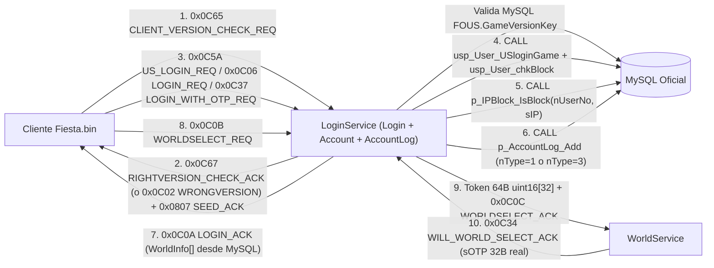

# Plan Maestro Exhaustivo (100% Fidelidad PDB + MySQL): `Login`, `Account` y `AccountLog`

> [!IMPORTANT]
> **Alcance y Reglas de este Plan (Auto-Contenido para Ejecución Directa):**
> - **Cero omisiones y cero resúmenes:** Se inventaría el **100%** de las tablas, vistas, procedimientos almacenados (ODBC, `.bak` y operativos), funciones despachadoras (`fc_NC_*`), códigos de operación (`NETCOMMAND = (department << 10) | command`) y las **292 estructuras C++** (`85` de `Login.pdb` + `101` de `Account.pdb` + `106` de `AccountLog.pdb`), más los **49 archivos `.shn`** de verificación criptográfica.
> - **100% MySQL como única fuente de verdad:** Todo estado persistente, validación de versión (`FOUS` / `ClientVersionKeyInfo.txt`), lista de mundos, ratios de admisión (`LOGIN_USER_RATABLE`), creación automática (`r_`), cuentas, sanciones, bloqueos de IP, OTP/transferencias, Cash/ItemShop, retornos, tutoriales, reportes, concurrencia (CCU) y auditoría proviene exclusivamente de **MySQL**, eliminando por completo `MemoryAccountRepository` y `accounts.json`.
> - **Única exclusión autorizada:** `OpTool` (`OperatorTool.exe`, paquetes `PROTO_NC_OPTOOL_*` Dept `10`, procedimientos `usp_OPT_*`, `p_Report_*_OPT` y base `OperatorTool.bak`), documentados explícitamente en la **Sección 7** para trazabilidad total contra los PDBs.

---

## 0. Decisiones de Arquitectura Cerradas y Obligatorias

Quien ejecute este plan debe aplicar **sin excepción ni reinterpretación** las siguientes 3 decisiones ya aprobadas:

1. **Base de Datos Única en MySQL (`xelion_online`):**
   - No se crean múltiples bases/schemas separados en MySQL. Todas las tablas de `Account.bak`, `AccountLog.bak`, `StatisticsData.bak`, `World00_Character.bak` y `World00_GameLog.bak` viven unificadas en **`xelion_online`**.
   - Resolución definitiva y obligatoria de las 3 colisiones de nombres entre `.bak`:
     * `Account..tItem` (catálogo de Item Shop de 22 columnas) se nombra **`tAccountItem`** (conservando `tItem` para el inventario de personajes de `World00_Character.bak`), y sobre `tAccountItem` se crean las vistas oficiales **`VT_ITEM_SELL`** y **`VT_ITEM_GROUP`**.
     * `AccountLog..tUser` (tabla demográfica `userNo, gender, age, registerDate`) se nombra **`tAccountDemographics`** (conservando `tUser` para la tabla maestra de cuentas de `Account.bak`).
     * `Account..tTutorial` y `World00_Character..tTutorial` (idénticas en columnas) quedan unificadas en **una única tabla `tTutorial`**, eliminando la definición duplicada en [database/schema.sql](../../database/schema.sql#L1658).
2. **100% Stored Procedures Nativos en MySQL (`CREATE PROCEDURE` + `CALL`) y Reemplazo Total del SQL Inline Existente:**
   - **Prohibido dejar consultas SQL inline (`SELECT`/`INSERT`/`UPDATE`/`DELETE`) en Go** para operaciones de `Login`, `Account`, `AccountLog` y `StatisticsData`.
   - Se deben crear todos los Stored Procedures nativos en MySQL (`database/procedures_account.sql`, `database/procedures_accountlog.sql`, `database/procedures_statistics.sql`, `database/procedures_login_session.sql`) **y reemplazar también los 20 métodos ya existentes en [pkg/database/mysql_account.go](../../pkg/database/mysql_account.go)** para que invoquen exclusivamente `CALL <procedure>(...)` (ver mapeo 1 a 1 en la **Sección 3.5**).
   - **Convención técnica obligatoria para `go-sql-driver/mysql` + Pool `*sql.DB`:**
     * Nunca usar variables de sesión `@out` en dos queries separadas (`CALL proc(@out); SELECT @out;`) porque `*sql.DB` balancea entre distintas conexiones del pool y corrompería lecturas concurrentes.
     * Todo Stored Procedure en MySQL que deba devolver valores escalares, códigos de retorno o filas debe emitir un **`SELECT ...` final dentro del propio procedimiento**, consumido desde Go en una sola operación atómica con `db.QueryRowContext(ctx, "CALL usp_...", args...).Scan(...)` o `db.QueryContext(ctx, "CALL usp_...", args...)` cerrando siempre `defer rows.Close()`.
     * Asegurar `parseTime=true&multiStatements=true&charset=utf8mb4` en el DSN de conexión MySQL ([pkg/config/config.go](../../pkg/config/config.go) / `pkg/database`).
3. **Activación del 100% de las Variantes Regionales y de Plataforma:**
   - Se deben implementar y activar **todas** las variantes regionales y de portal presentes en los 3 PDBs tanto en structs (`pkg/protocol`) como en el dispatcher C2S y pipeline interno de `LoginService`:
     * **Norteamérica (`US`):** `0x0C5A` (`US_LOGIN_REQ`) -> `0x0C5B`/`0x0C5C` (`US_PASSWORD_CHECK`) -> `0x0C5D`/`0x0C5E` (`US_IS_IP_BLOCK`).
     * **Estándar / Internacional:** `0x0C06` (`LOGIN_REQ`) -> `0x0C07`/`0x0C08` (`PASSWORD_CHECK`) -> `0x0C2A`/`0x0C2B` (`IS_IP_BLOCK`).
     * **Re-Login por OTP (Retorno a Selección de Mundo):** `0x0C35`/`0x0C36` (`CREATE_OTP`) -> `0x0C34` (`WILL_WORLD_SELECT_ACK`) -> `0x0C37` (`LOGIN_WITH_OTP_REQ`).
     * **Alemania (`GER`):** `0x0C39` (`GER_PASSWORD_CHECK_REQ`) -> `0x0C3A` (`GER_PASSWORD_CHECK_ACK`) -> `0x0C3B` (`GER_IS_IP_BLOCK_REQ`) -> `0x0C3C` (`GER_IS_IP_BLOCK_ACK`).
     * **Taiwán (`TW`):** `0x0C3E` (`TW_PASSWORD_CHECK_REQ`) -> `0x0C3F` (`TW_PASSWORD_CHECK_ACK`) -> `0x0C40` (`TW_IS_IP_BLOCK_REQ`) -> `0x0C41` (`TW_IS_IP_BLOCK_ACK`).
     * **Japón (`JP`):** `0x0C4B` (`JP_PASSWORD_CHECK_REQ`) -> `0x0C4C` (`JP_PASSWORD_CHECK_ACK`) -> `0x0C4D` (`JP_IS_IP_BLOCK_REQ`) -> `0x0C4E` (`JP_IS_IP_BLOCK_ACK`).
     * **China (`CH`):** `0x0C53` (`CH_PASSWORD_CHECK_REQ`) -> `0x0C54` (`CH_PASSWORD_CHECK_ACK`) -> `0x0C2A`/`0x0C2B` (`IS_IP_BLOCK`).
     * **Netmarble (Corea):** `0x0C1D` (`LOGIN_NETMARBLE_REQ`) -> `0x0C1E` (`LOGIN_NETMARBLE_DB_REQ`).
     * **Outspark (Token Web):** `0x0C20` (`LOGIN_OUTSPARK_REQ`) + `0x081D` (`WEB_DB_KEY_REQ`).
     * **Control Parental / Menores (`Teenager`):** `0x0C26` (`TEENAGER_REQ`) -> `0x0C27` (`TEENAGER_ACK`), `0x0C28` (`TEENAGER_SET_CMD`) y `PROTO_NC_USER_TEENAGER_CMD`.

---

## 1. Diagnóstico de Brechas y 14 Errores Críticos Detectados en el Código Actual

La auditoría cruzada entre `Login.pdb`, `Account.pdb`, `AccountLog.pdb`, `Account_all_procedures.sql`, `AccountLog_all_procedures.sql`, `StatisticsData_all_procedures.sql`, [schema.sql](../../database/schema.sql) y el código Go actual reveló **14 desviaciones críticas** respecto al comportamiento oficial:

| # | Severidad | Componente Actual | Bug / Brecha Detectada | Comportamiento Oficial en PDB / SQL |
| :---: | :---: | :--- | :--- | :--- |
| **1** | **CRÍTICO** | [opcodes.go](../../pkg/protocol/opcodes.go#L418) | `PROTO_NC_USER_CLIENT_WRONGVERSION_CHECK_ACK` está definido como `(3 << 10) \| 102` (`0x0C66`). | En `Login.pdb` es `Dept 3, Cmd 2` = **`0x0C02`** (`3074`), struct de `1 byte` (`n dummy`). Con `0x0C66` el cliente jamás reconoce el rechazo de versión. |
| **2** | **CRÍTICO** | [mysql_account.go](../../pkg/database/mysql_account.go#L280-L288) | `UpdateLoginSession` ejecuta `UPDATE tUser SET sUserIP = ?, dDate = NOW()`, sobrescribiendo la fecha de creación de la cuenta en cada login. | En `p_AccountLog_Add` (`@nType = 1`), SQL Server **solo ejecuta** `UPDATE Account..tUser SET sUserIP = @sIP WHERE nUserNo = @nUserNo`. Sobrescribir `dDate` destruye `usp_User_GetDatediffCreated` (siempre da `0`) y rompe `ReturnUser`. |
| **3** | **CRÍTICO** | [proto_nc_char.go](../../pkg/protocol/proto_nc_char.go#L56-L62) y [login/handler.go](../../pkg/server/login/handler.go#L46) | `New_PROTO_NC_USER_WILL_WORLD_SELECT_ACK` (`0x0C34`) envía `32 bytes` en cero como `sOTP`, y `LoginService` enruta `0x0C37` (`PROTO_NC_USER_LOGIN_WITH_OTP_REQ`, `32 bytes` `Name8 sOTP`) a `handleLoginReq` intentando leer `username + password`. | `WorldManager` solicita a `Login` `PROTO_NC_USER_CREATE_OTP_REQ` (`0x0C35`) -> recibe `PROTO_NC_USER_CREATE_OTP_ACK` (`0x0C36`, `sOTP[32]`), lo entrega al cliente en `0x0C34`, y el cliente reconecta a `Login` enviando `0x0C37` con `sOTP[32]`. |
| **4** | **CRÍTICO** | [login/handler.go](../../pkg/server/login/handler.go#L161) y [mysql_account.go](../../pkg/database/mysql_account.go#L245-L266) | Se chequea `IsIPBlocked(clientIP)` **antes** de autenticar al usuario, sin pasar `nUserNo`, y con comparación lexicográfica de strings. | En `Login.exe` -> `Account.exe` -> `AccountLog.exe`, primero se ejecuta `usp_User_USloginGame` (obteniendo `nUserNo`) y luego `p_IPBlock_IsBlock(@nUserNo, @sIP)`, el cual **permite el paso** si la cuenta ya posee historial previo de login exitoso (`EXISTS (SELECT 1 FROM tAccountLog WHERE nUserNo = @nUserNo AND nType = 1)`). |
| **5** | **ALTO** | [schema.sql](../../database/schema.sql#L152) y [mysql_account.go](../../pkg/database/mysql_account.go#L341-L343) | `tCash.status` tiene `DEFAULT 1` y `AddCash` inserta `status = 1`; `GetCash` ignora `status` y falta `UseCash` (`usp_Cash_useCash`). | En `Account_all_procedures.sql` (`usp_Cash_getCash`, `usp_Cash_setCash`, `usp_Cash_useCash`), las filas activas de `tCash` tienen **`status = 0`** (`WHERE userNo = @userNo AND cashType = @cashType AND status = 0`). |
| **6** | **ALTO** | [schema.sql](../../database/schema.sql#L1030) y [schema.sql](../../database/schema.sql#L1450) | Al unificar `Account` y `World00_Character` en un solo esquema `xelion_online`, la tabla `Account..tItem` (catálogo de tienda `goodsNo, billingNo, category...`) desapareció por colisión con `World00_Character..tItem` (inventario `nItemKey...`), y `tTutorial` quedó definida dos veces (`L1450` y `L1658`). | `Account..tItem` + vistas `VT_ITEM_SELL`, `VT_ITEM_GROUP` y `VT_PAY` son requeridas por los 18 SPs `usp_Item_*` y `usp_Stat_sellitem`. `Account..tUser` vs `AccountLog..tUser` también colisionan en nombre. |
| **7** | **ALTO** | [mysql_account.go](../../pkg/database/mysql_account.go#L136-L242) | `GetAccountByUsername` lee una columna inexistente en el `.bak` (`u.bIsLoginAble`), no soporta login alternativo por `tUserOption.sEmail`, no ejecuta `usp_User_chkBlock` completo (desbloqueo automático solo si no queda otro bloqueo activo en `tUserBlock`), y el prefijo `r_` no consulta `Auto_Account_Creation` en MySQL. | `usp_User_USloginGame` busca en `tUser.sUserID` y si no existe en `tUserOption.sEmail` (cuando `bIsDelete = 0`), verifica `Auto_Account_Creation.Allow_Creation = 1` para prefijo `r_`, invoca `usp_User_chkBlock`, valida `tUserAuth.bIsLoginAble` y devuelve códigos exactos (`-1..-5` o `nUserNo + nAuthID`). |
| **8** | **ALTO** | [cmd/LoginService/main.go](../../cmd/LoginService/main.go#L84) y [cmd/ZoneService/main.go](../../cmd/ZoneService/main.go#L105) | `LoginService` inserta cada 60s `AddSameTimeChar(w.ID, 0)` con `0` hardcodeado (contaminando `tSameTimeChar`), `ZoneService` hardcodea `level = 1` en `AddSameTimeCharClass`, y `World.Status` es estático en vez de calcularse desde CCU real / `MaxOfUser` / `LOGIN_USER_RATABLE` en MySQL. | `WorldManager` reporta CCU real (`PROTO_NC_MISC_USER_COUNT_CMD` `0x0808` y `PROTO_NC_SYSLOG_SERVER_CCU` `0xC811`), actualiza `WorldStatus` dinámicamente (`LOW`/`MEDIUM`/`HIGH`/`FULL`/`MAINTENANCE`), y `p_SameTimeCharClass_Add` agrupa por `(nWorld, nClass, nLevel)` reales. |
| **9** | **ALTO** | [database.go](../../pkg/database/database.go) y `pkg/server/login/data/accounts.json` | Persisten `MemoryAccountRepository`, `accounts.json` y una interfaz `AccountRepository` de solo 2 métodos que obliga a hacer type-assertions `h.repo.(*database.MySQLAccountRepository)`. | Eliminación total de repositorios en memoria/JSON; `AccountRepository`, `AccountLogRepository` y `LoginConfigRepository` deben operar 100% contra MySQL sin fallbacks en memoria. |
| **10** | **ALTO** | [config.go](../../pkg/config/config.go) y [cmd/LoginService/main.go](../../cmd/LoginService/main.go) | La versión del cliente (`ClientVersionKeyInfo.txt` = `10022024000000`), la lista de mundos, IPs, puertos, `MaxOfUser`, mantenimiento y `LOGIN_USER_RATABLE` viven hardcodeados o en JSON local. | Tabla `FOUS` (`GameVersionKey`) + tablas operativas MySQL (`tWorldServer`, `Auto_Account_Creation`) deben gobernar versión, mundos, cupos y estados en caliente desde MySQL. |
| **11** | **MEDIO** | [login/handler.go](../../pkg/server/login/handler.go#L220-L240) | Durante `US_LOGIN_REQ` se inserta automáticamente `SetReturnUserItem` en vez de responder al flujo S2S/C2S `PROTO_NC_USER_RETURN_CHECK_REQ` (`0x0C60`) -> `ACK` (`0x0C61`) y `PROTO_NC_USER_SET_RETURN_CMD` (`0x0C64`); además nunca se consulta `usp_Tutorial_getIsSkip` para enviar `PROTO_NC_USER_TUTORIAL_CAN_SKIP_CMD` (`0x0C5F`). | `Account.exe` solo evalúa elegibilidad en `fc_NC_USER_RETURN_CHECK_REQ` (comparando `usp_User_GetDatediffCreated` y `usp_AccountLog_GetDateDiffLastlogout` + `usp_ReturnUser_GetDatediffLastlog`) y solo inserta el premio cuando recibe `fc_NC_USER_SET_RETURN_CMD`. |
| **12** | **MEDIO** | [zone/handler.go](../../pkg/server/zone/handler.go) y [mysql_account.go](../../pkg/database/mysql_account.go#L270) | Al desconectar cuenta no se registra `PROTO_NC_LOG_USER_LOGOUT` (`0x0722`, `p_AccountLog_Add` con `nType = 2` y `nPlayMin`), `LogLogout` usa `worldNo = 0` fijo, y `LogAccount` en fallo (`nType = 3`/`0x0720`) guarda `sUserPassword = ''`. | `p_AccountLog_Add` registra `nType = 1` (Login), `nType = 2` (Logout con `nPlayMin`), y login fallido con `nErrorCode` y `sUserPassword` truncado a 16 chars; sin `nType = 2` el SP `p_DayConnectionTime` no puede calcular minutos diarios de cuenta. |
| **13** | **MEDIO** | [proto_nc_user.go](../../pkg/protocol/proto_nc_user.go) y [login/handler.go](../../pkg/server/login/handler.go) | Uso activo de nombres no oficiales / alias deprecados: `PROTO_NC_USER_FILE_CHECK_REQ/ACK`, `PROTO_NC_USER_WORLDSTATUS_REQ/ACK`, `PROTO_NC_MISC_SEED_CMD`. | Regla de Oro #1 (`AGENTS.md`): usar exclusivamente `PROTO_NC_USER_XTRAP_REQ` (`0x0C04`), `PROTO_NC_USER_XTRAP_ACK` (`0x0C05`), `PROTO_NC_USER_WORLD_STATUS_REQ` (`0x0C1B`), `PROTO_NC_USER_WORLD_STATUS_ACK` (`0x0C1C`) y `PROTO_NC_MISC_SEED_ACK` (`0x0807`). |
| **14** | **MEDIO** | [world/handler.go](../../pkg/server/world/handler.go#L301) y [transfer.go](../../pkg/database/transfer.go) | `PROTO_NC_USER_WORLD_LOGIN_REQ` (`0x0C0F`) trunca `validate_new` (`unsigned short[32]` = `64 bytes`) leyendo solo 32 bytes con un fallback legacy de `18+32` bytes, y no gestiona expulsión de sesión duplicada (`KICKOFFFROMWORLD_CMD` / `CONNECTCUT_CMD`). | Validar los `64 bytes` íntegros (`uint16[32]`) persistidos en MySQL (`tActiveAccountSession`) y desconectar ordenadamente sesiones duplicadas activas antes de autorizar `WILLLOGIN_ACK` (`0x0C0E`). |

---

## 2. Inventario Exhaustivo de Tablas y Vistas MySQL (Cero Omisiones)

### Esquema Único `xelion_online`: Resolución Canónica de Colisiones entre `.bak`
Todas las tablas residen en la base única **`xelion_online`** ([schema.sql](../../database/schema.sql)). Las 3 únicas colisiones de nombre entre bases SQL Server oficiales quedan resueltas de forma fija así:
1. `Account..tItem` (catálogo de tienda Cash) vs `World00_Character..tItem` (inventario de personajes) -> tabla física **`tAccountItem`** + vistas oficiales **`VT_ITEM_SELL`**, **`VT_ITEM_GROUP`** y **`VT_PAY`** apuntando a `tAccountItem` (todos los SPs `usp_Item_*` y `usp_Stat_sellitem` referenciarán `tAccountItem`).
2. `Account..tUser` (cuenta maestra) vs `AccountLog..tUser` (demografía `userNo, gender, age, registerDate`) -> `tUser` para `Account..tUser` y **`tAccountDemographics`** para `AccountLog..tUser` (referenciada por `p_UserAgeReport` y `p_UserGenderTest`).
3. `Account..tTutorial` vs `World00_Character..tTutorial` (ambas tienen exactamente las mismas 5 columnas `nUserNo, nCharNo, nState, nStep, dDate`) -> eliminar la definición duplicada en [schema.sql](../../database/schema.sql#L1658) dejando una única tabla canónica **`tTutorial`** con PK `(nUserNo, nCharNo)`.

### 2.1. Las 34 Tablas Oficiales de `Account.bak` + 3 Vistas + 11 Tablas Referenciadas por SPs/ODBC

| # | Tabla / Vista Oficial (`Account`) | Columnas Exactas (`Account.bak` / SQL) | Estado en `schema.sql` | Acción Requerida en MySQL |
| :---: | :--- | :--- | :---: | :--- |
| 1 | `Event_Christmas_Item` | `rowNo INT`, `expirationDate DATETIME`, `goodsNo INT` | Presente | Verificar PK `rowNo AUTO_INCREMENT` e índice por `expirationDate`. |
| 2 | `Event_Christmas_Log` | `rowNo INT`, `userNo INT`, `giveDate DATETIME`, `goodsNo INT` | Presente | Verificar PK `rowNo AUTO_INCREMENT` y FK/índice `(userNo, giveDate)`. |
| 3 | `FOUS` | `GameAccountTitle VARCHAR(127)`, `GameAccountGameServerReference DOUBLE`, `GameAccountKey DOUBLE`, `GameVersionKey VARCHAR(127)` | Presente (vacía) | Sembrar fila canónica con `GameVersionKey = '10022024000000'` (idéntico a `ClientVersionKeyInfo.txt`) para validación desde MySQL en `0x0C65`. |
| 4 | `last2_onson_users_1` | `Column 0 VARCHAR(50)`, `Column 1 VARCHAR(50)`, `Column 2 VARCHAR(200)`, `Column 3 VARCHAR(50)` | Presente | Mantener por fidelidad 1:1 con `Account.bak`. |
| 5 | `last2_onson_users_2` | `Column 0 VARCHAR(50)`, `Column 1 VARCHAR(50)`, `Column 2 VARCHAR(200)`, `Column 3 VARCHAR(50)` | Presente | Mantener por fidelidad 1:1 con `Account.bak`. |
| 6 | `login_issue_check` | `userid INT`, `username VARCHAR(255)`, `usedpwd VARCHAR(255)` | Presente | Mantener por fidelidad 1:1 con `Account.bak`. |
| 7 | `onson_0419` | `userid VARCHAR(50)`, `sparkid VARCHAR(50)`, `email VARCHAR(200)`, `password VARCHAR(200)`, `bisBlock VARCHAR(50)` | Presente | Mantener por fidelidad 1:1 con `Account.bak`. |
| 8 | `onson_users_0314` | `Column 0 VARCHAR(50)`, `Column 1 VARCHAR(200)`, `Column 2 VARCHAR(200)`, `Column 3 VARCHAR(200)` | Presente | Mantener por fidelidad 1:1 con `Account.bak`. |
| 9 | `tCash` | `userNo INT`, `cashtype TINYINT UNSIGNED`, `cash INT`, `status TINYINT(1)` | **BUG (`DEFAULT 1`)** | Corregir a **`status TINYINT(1) NOT NULL DEFAULT 0`**, PK `(userNo, cashtype)`, FK a `tUser(nUserNo)`. |
| 10 | `tCashLog` | `rowNo INT AUTO_INCREMENT`, `userNo INT`, `logType TINYINT`, `cashType TINYINT`, `cash INT`, `reference VARCHAR(20)`, `vaildDate DATETIME`, `issueDate DATETIME` | **Divergente (`validDate` vs `vaildDate`)** | Unificar columna `vaildDate DATETIME NULL` (nombre exacto en `Account.bak` y `usp_Cash_setCash` / `usp_Cash_useCash`), FK a `tUser(nUserNo)`. |
| 11 | `tChannelLog` | `rowNo INT AUTO_INCREMENT`, `userNo INT`, `channel VARCHAR(20)`, `issueDate VARCHAR(20)`, `dDate DATETIME` | Presente | Verificar FK a `tUser(nUserNo)` para `usp_User_setChannelLog`. |
| 12 | `tCharacterMoveLog` | `nOldCharNo INT`, `nFromWorld TINYINT`, `nNewCharNo INT`, `nToWorld TINYINT`, `nUserNo INT`, `dMovedDate DATETIME` | Presente | Mantener con índice en `nUserNo`. |
| 13 | `tChargeItem` | `rowNo INT AUTO_INCREMENT`, `userNo INT`, `orderNo BIGINT`, `goodsNo INT`, `amount INT`, `registerDate DATETIME`, `isDraw TINYINT`, `drawDate DATETIME` | **BUG (`orderNo INT`)** | Cambiar `orderNo` a `BIGINT` (usado como `@orderNo BIGINT` en `usp_Charge_ItemInsert`), índice `(userNo, isDraw)`. |
| 14 | `tChargeItemDelLog` | `rowNo INT`, `userNo INT`, `orderNo BIGINT`, `goodsNo INT`, `amount INT`, `registerDate DATETIME`, `DeleteDate DATETIME` | **BUG (`AUTO_INCREMENT`, `orderNo INT`)** | Quitar `AUTO_INCREMENT` de `rowNo` (copia el `rowNo` original de `tChargeItem` en `usp_Charge_ItemDel`) y cambiar `orderNo` a `BIGINT`. |
| 15 | `tDrawComment` | `nLogNo INT AUTO_INCREMENT`, `nUserNo INT`, `nCauseNo TINYINT`, `sComment VARCHAR(1000)`, `sUserIP VARCHAR(30)`, `dDate DATETIME` | **BUG (`VARCHAR(104)`)** | Ampliar `sComment` a `VARCHAR(1000)` como exige `usp_User_setDrawComment(@sComment VARCHAR(1000))`. |
| 16 | `tItem` *(Account Shop -> `tAccountItem`)* | `goodsNo INT PK`, `billingNo INT`, `category VARCHAR(10)`, `groupNo INT`, `name VARCHAR(100)`, `imageName VARCHAR(100)`, `itemType VARCHAR(20)`, `unit INT`, `unitDescription VARCHAR(20)`, `price INT`, `discount INT`, `discountStartDate DATETIME`, `discountEndDate DATETIME`, `isNew TINYINT(1)`, `isPopular TINYINT(1)`, `isRecommand TINYINT(1)`, `isSell TINYINT(1)`, `sellStartDate DATETIME`, `sellEndDate DATETIME`, `sellCount INT`, `registerDate DATETIME`, `description VARCHAR(104)` | **FALTANTE (colisión)** | Crear **`tAccountItem`** en `xelion_online` con las 22 columnas exactas y FK `category -> tItemCategory(category)`. |
| 17 | `tItemCategory` | `category VARCHAR(10) PK`, `name VARCHAR(20)`, `parent VARCHAR(10)`, `status TINYINT(1)`, `registerDate DATETIME` | Presente | Verificar auto-FK `parent -> tItemCategory(category)`. |
| 18 | `tLv120` | `userNo INT PK` | Presente | Mantener. |
| 19 | `tOrder` | `orderNo INT AUTO_INCREMENT PK`, `orderDate DATETIME`, `orderType TINYINT`, `userNo INT`, `toUserNo INT`, `goodsNo INT`, `goodsPrice INT`, `amount INT`, `discount INT`, `orderPrice INT`, `cashType TINYINT`, `isPay TINYINT(1)`, `userIP VARCHAR(30)`, `pcbangNo INT NULL` | **BUG (`pcbangNo NOT NULL`)** | Permitir `pcbangNo INT DEFAULT NULL` y FKs `userNo`/`toUserNo` a `tUser(nUserNo)`. |
| 20 | `tPasswordLog` | `nLogNo INT AUTO_INCREMENT PK`, `nUserNo INT`, `sPrevPW VARCHAR(32)`, `sCurrPW VARCHAR(32)`, `sUserIP VARCHAR(30)`, `dDate DATETIME` | Presente (`VARCHAR(20)`) | Ampliar `sPrevPW`/`sCurrPW` a `VARCHAR(32)` para hashes MD5 de 32 chars en `usp_User_updatePassword`. |
| 21 | `tPay` | `orderNo INT AUTO_INCREMENT PK`, `userNo INT`, `payNo INT`, `cash INT`, `userIP VARCHAR(30)`, `registerDate DATETIME` | **BUG (sin `AUTO_INCREMENT`)** | Activar `AUTO_INCREMENT` en `orderNo` (`usp_Pay_setOrder` usa `LAST_INSERT_ID()` / `@@IDENTITY`). |
| 22 | `tPayAgreement` | `rowNo INT AUTO_INCREMENT PK`, `userNo INT`, `name VARCHAR(10)`, `juminNo VARCHAR(20)`, `phoneNo VARCHAR(20)`, `status TINYINT`, `issueDate DATETIME`, `vaildDate DATETIME` | Presente | Verificar nombre `vaildDate` para `usp_Pay_getAgreement` / `usp_Pay_setAgreement`. |
| 23 | `tPayResult` | `orderNo INT PK`, `result INT`, `resultDate DATETIME`, `pgTID VARCHAR(50) NULL` | **BUG (`pgTID NOT NULL`)** | Permitir `pgTID VARCHAR(50) DEFAULT NULL` para `usp_Pay_setResult`. |
| 24 | `tPayType` | `payNo INT PK`, `name VARCHAR(20)`, `company VARCHAR(20)`, `isActive TINYINT(1)`, `registerDate DATETIME` | Presente | Sembrar tipos de pago base si está vacía. |
| 25 | `tReturnUser` | `nRowNo INT AUTO_INCREMENT PK`, `dDate DATETIME`, `nUserNo INT`, `nItemNo INT` | Presente | Índice compuesto `(nUserNo, dDate DESC)`. |
| 26 | `tSerialKey` | `userNo INT`, `serialKey BIGINT PK`, `registerDate DATETIME` | **BUG (`PK (userNo)`)** | En `usp_Item_setSerialKey`, un usuario puede canjear múltiples `serialKey` únicos; PK `(serialKey)` e índice `(userNo)`. |
| 27 | `tTutorial` | `nUserNo INT`, `nCharNo INT`, `nState TINYINT`, `nStep TINYINT`, `dDate DATETIME` | **DUPLICADA en `schema.sql`** | Consolidar única definición con PK `(nUserNo, nCharNo)` e índice `(nUserNo, nState)`. |
| 28 | `tUser` | `nUserNo INT AUTO_INCREMENT PK`, `sUserID VARCHAR(60)`, `sUserPW VARCHAR(32)`, `sUserName VARCHAR(60)`, `bIsBlock TINYINT(1)`, `bIsDelete TINYINT(1)`, `nAuthID TINYINT`, `sUserIP VARCHAR(30)`, `dDate DATETIME`, `sUserNo INT NULL`, `blsBlock TINYINT DEFAULT 0`, `blsDelete TINYINT DEFAULT 0` | **Parcial** | Alinear las **12 columnas exactas** de `Account.bak` (quitar `bIsLoginAble` inventada en `tUser`, agregar `sUserNo`, `blsBlock`, `blsDelete`), `UNIQUE (sUserID)` y FK `nAuthID -> tUserAuth(nAuthID)`. |
| 29 | `tUserAuth` | `nAuthID TINYINT PK`, `sAuthName VARCHAR(11)`, `bIsLoginAble TINYINT` | Presente | Sembrar niveles oficiales (`nAuthID = 1` Normal `bIsLoginAble = 1`, `2` Tester, `3` GM, `9` Admin). |
| 30 | `tUserBlock` | `nBlockNo INT AUTO_INCREMENT PK`, `nUserNo INT`, `nType TINYINT`, `dBlockDate DATETIME`, `nTimeValue INT`, `dEndDate DATETIME NULL`, `bStatus TINYINT(1)`, `sComment VARCHAR(72)` | Presente | Índice `(nUserNo, bStatus, dEndDate)` para `usp_User_chkBlock`. |
| 31 | `tUserMergeYet` | `nuserno INT PK` | Presente | Mantener. |
| 32 | `tUserOption` | `nUserNo INT PK`, `sEmail VARCHAR(256)`, `sJuminNo VARCHAR(50) NULL`, `sPhoneNo VARCHAR(20) NULL`, `nZipNo INT NULL`, `sAddress VARCHAR(90) NULL`, `bIsMail TINYINT(1) DEFAULT 0`, `sChannel VARCHAR(20) NULL`, `nAffiliateID VARCHAR(50) NULL`, `szAffiliateSubID VARCHAR(50) NULL`, `szCountryCode VARCHAR(50) NULL` | **BUG (`NOT NULL`, `VARCHAR(72)`)** | Ampliar `sEmail` a `VARCHAR(256)` con índice `(sEmail)` para login por email en `usp_User_USloginGame` y hacer anulables los campos opcionales. |
| 33 | `tbSellitem` | `baseDate VARCHAR(10)`, `goodsNo INT`, `amount INT`, PK `(baseDate, goodsNo)` | **BUG (`type_40`)** | Definir `baseDate VARCHAR(10) NOT NULL` (`YYYY-MM-DD`) requerido por `usp_Stat_sellitem`. |
| 34 | `tuseroption_2` | Mismas 11 columnas que `tUserOption` | Presente | Mantener por fidelidad 1:1 con `Account.bak`. |
| 35 | Vista `VT_ITEM_SELL` | Proyección de ítems activos en venta (`isSell = 1` y ventana `sellStartDate..sellEndDate`) sobre `tAccountItem` | **FALTANTE** | Crear `CREATE OR REPLACE VIEW VT_ITEM_SELL` requerida por `usp_Item_get*`. |
| 36 | Vista `VT_ITEM_GROUP` | Agrupación por `groupNo` de `tAccountItem` | **FALTANTE** | Crear `CREATE OR REPLACE VIEW VT_ITEM_GROUP` requerida por `usp_Item_getGroup*`. |
| 37 | Vista `VT_PAY` | Join entre `tPay`, `tPayType` y `tPayResult` | **FALTANTE** | Crear `CREATE OR REPLACE VIEW VT_PAY` requerida por `usp_Pay_chkLimit` y `usp_User_getPay*`. |
| 38 | `Auto_Account_Creation` | `Allow_Creation TINYINT(1) NOT NULL DEFAULT 1` | **FALTANTE** | Crear y sembrar (`1` en dev / configurable en prod), leída por `usp_User_USloginGame` para cuentas `r_`. |
| 39 | `tPcbang` | `pcbangNo INT PK AUTO_INCREMENT`, `sIPStart VARCHAR(20)`, `sIPEnd VARCHAR(20)`, `sName VARCHAR(50)`, `bIsActive TINYINT(1)` | **FALTANTE** | Requerida por el SP ODBC `usp_Pcbang_chkIP` de `Account.exe`. |
| 40 | `tUserKey` | `nUserNo INT PK`, `sWebKey VARCHAR(64)`, `dIssueDate DATETIME`, `dExpireDate DATETIME` | **FALTANTE** | Requerida por `p_UserKey_Get_FromAccount` (`fc_NC_MISC_WEB_DB_KEY_REQ` `0x081D` y login Outspark `0x0C20`). |
| 41 | `tUserPlayRemainTime` | `nUserNo INT PK`, `nRemainSec INT`, `bIsTeenager TINYINT(1)`, `dLastUpdate DATETIME` | **FALTANTE** | Requerida por `p_UserPlayRemainTime_Get_FromAccount` y `p_UserPlayRemainTime_Set_FromAccount` (`0x0C26` / `0x0C28`). |
| 42 | `tZipcode` | `nZipNo INT PK`, `sZipCode VARCHAR(10)`, `sSido VARCHAR(30)`, `sGugun VARCHAR(30)`, `sDong VARCHAR(60)`, `sBunji VARCHAR(40)` | **FALTANTE** | Requerida por `usp_User_searchZipcode`. |
| 43–48 | `tbl_user`, `tbl_user_test`, `tUserTemp`, `tUserTemp2`, `tUser_ori`, `temp_newUser` | Tablas auxiliares referenciadas por SPs legacy de migración (`usp_User_chkRegister`, `usp_User_getLogin`) | **FALTANTES** | Crear definiciones compatibles para que los 68 SPs no-OpTool compilen sin errores en MySQL. |

### 2.2. Las 10 Tablas Oficiales de `AccountLog.bak` + 3 Tablas ODBC/Handlers de `AccountLog.exe`

| # | Tabla Oficial (`AccountLog`) | Columnas Exactas (`AccountLog.bak` / SQL) | Estado en `schema.sql` | Acción Requerida en MySQL |
| :---: | :--- | :--- | :---: | :--- |
| 1 | `tAccountLog` | `nLogNo BIGINT AUTO_INCREMENT PK`, `sUserID VARCHAR(60)`, `nType TINYINT`, `nUserNo INT`, `nPlayMin SMALLINT`, `sUserPassword VARCHAR(32)`, `nWorldNo TINYINT`, `nErrorCode SMALLINT`, `sIP VARCHAR(30)`, `dDate DATETIME` | Presente (`VARCHAR(16)`) | Ampliar `sUserID` a `VARCHAR(60)` y `sUserPassword` a `VARCHAR(32)` (evita truncamiento con `sUserID` de US Login), índices `(nUserNo, nType, dDate)` y `(dDate, nType)`. |
| 2 | `tEventWorldCup` | `nEventCharNo INT`, `nEventUserNo INT`, `nLevel TINYINT`, `nWorldNo TINYINT` | **BUG (PK incorrecta)** | PK `(nEventCharNo, nLevel, nWorldNo)` según `p_Event_WorldCup_Enter`. |
| 3 | `tEvent_Friend` | `nIndex INT AUTO_INCREMENT PK`, `nEventUserNo INT`, `nEventCharNo INT`, `nFriendUserNo INT`, `nFriendCharNo INT`, `nWorldNo TINYINT`, `bEventComplete TINYINT`, `dRegDate DATETIME`, `dCompleteDate DATETIME NULL`, `dDate DATETIME` | **BUG (faltan `nIndex`, `dRegDate`, `dCompleteDate`)** | Alinear con `p_Event_Friend_Get`, `p_Event_Friend_EventComplete`, `p_Event_Friend_Giveup` y `p_Event_Friend_DelRequest`. |
| 4 | `tEvent_Friend_HideMsg` | `nUserNo INT PK` | Presente | Usada por `p_Event_Friend_SetHideMsg`. |
| 5 | `tEventiPad` | `nUserNo INT PK`, `nTicket INT`, `sys_create_date DATETIME`, `sys_update_date DATETIME` | Presente | Usada por `usp_EventiPad_setTicket`, `usp_EventiPad_getTicket`, `usp_EventiPad_getList`. |
| 6 | `tIPBlock` | `sIPStart VARCHAR(20)`, `sIPEnd VARCHAR(20)`, `sDesc VARCHAR(30)`, `dDate DATETIME`, `nIPStartNum INT UNSIGNED GENERATED`, `nIPEndNum INT UNSIGNED GENERATED` | Parcial | Agregar columnas generadas/indexadas `INET_ATON(sIPStart)` y `INET_ATON(sIPEnd)` + PK `(sIPStart, sIPEnd)` para búsqueda numérica instantánea IPv4 en `p_IPBlock_IsBlock`. |
| 7 | `tLogout` | `rowNo BIGINT AUTO_INCREMENT PK`, `logDate DATETIME`, `worldNo TINYINT`, `userNo INT`, `charNo INT`, `class TINYINT`, `level SMALLINT UNSIGNED`, `experience BIGINT`, `playTime SMALLINT` | Presente (`level TINYINT`) | Ampliar `level` a `SMALLINT UNSIGNED` (soporta niveles > 127 hasta 150) e índice `(userNo, logDate DESC)` para `usp_AccountLog_GetDateDiffLastlogout`. |
| 8 | `tReport` | `nRegNumber INT AUTO_INCREMENT PK`, `nReporter INT`, `sReporterCharID VARCHAR(20)`, `nWorldNo TINYINT`, `dReportDate DATETIME`, `sHarmer VARCHAR(20)`, `sReportType VARCHAR(20)`, `sReason TEXT`, `sChatLog MEDIUMTEXT`, `nResult TINYINT DEFAULT 0`, `sRemark TEXT`, `dDealDate DATETIME NULL`, `sOperID VARCHAR(20) NULL` | **BUG (`VARCHAR(16)`, faltan `dDealDate`, `sOperID`)** | Ampliar `sReporterCharID`, `sHarmer`, `sReportType` a `VARCHAR(20)` (`PROTO_NC_DATA_REPORT_ADD_REQ` envía `char[20]`) y añadir `dDealDate`/`sOperID`. |
| 9 | `tAccountDemographics` *(`AccountLog..tUser`)* | `userNo INT PK`, `gender INT`, `age INT`, `registerDate DATETIME` | **FALTANTE (colisión)** | Crear `tAccountDemographics` para soportar métricas demográficas de `StatisticsData` (`p_UserAgeReport`, `p_UserGenderTest`). |
| 10 | `tUserLog` | `rowNo INT AUTO_INCREMENT PK`, `joinDate VARCHAR(10)`, `userNo INT` | Presente | Índice `(joinDate, userNo)`. |
| 11 | `tEvent_L20` | `nRowNo INT AUTO_INCREMENT PK`, `nUserNo INT`, `sUserID VARCHAR(60)`, `nWorldNo TINYINT`, `nCharNo INT`, `bRewarded TINYINT(1)`, `dDate DATETIME` | **FALTANTE** | Requerida por los SPs ODBC `p_Event_L20_Get` y `p_Event_L20_Set` (`fc_NC_MISC_EVENT_L20_DB_REQ` `0x082C`). |
| 12 | `tHackScanLog` | `nLogNo BIGINT AUTO_INCREMENT PK`, `nUserNo INT`, `nCharNo INT`, `nWorldNo TINYINT`, `nHackType SMALLINT`, `sDetail VARCHAR(64)`, `dDate DATETIME` | **FALTANTE** | Requerida por `fc_NC_MISC_HACK_SCAN_STORE_DB_CMD` (`0x0835`, `51 bytes`). |
| 13 | `tSyslog` | `nLogNo BIGINT AUTO_INCREMENT PK`, `nOpCode SMALLINT UNSIGNED`, `nUserNo INT`, `sUserID VARCHAR(60)`, `sIP VARCHAR(30)`, `nWorldNo TINYINT`, `nCCU INT`, `nErrorCode SMALLINT`, `dDate DATETIME` | **FALTANTE** | Requerida por `fc_NC_SYSLOG_ACCOUNT_LOGIN_SUCCESS` (`0xC801`), `FAILURE` (`0xC802`), `LOGOUT` (`0xC803`) y `SERVER_CCU` (`0xC811`). |

### 2.3. Las 13 Tablas de `StatisticsData.bak` + 2 Tablas Operativas MySQL de `LoginService`

| # | Tabla | Columnas Exactas | Rol en `Login` / `AccountLog` / `World` |
| :---: | :--- | :--- | :--- |
| 1–2 | `TopCharacter`, `TopCharacter_MAY` | `nUserNo INT`, `nLevel INT` | Ranking histórico de nivel por cuenta (`StatisticsData.bak`). |
| 3 | `tAge` | `nLogNo INT AUTO_INCREMENT PK`, `sLogDate VARCHAR(10)`, `nAge TINYINT`, `nCount INT`, `nYear SMALLINT`, `nMonth TINYINT`, `nDay TINYINT`, `nWeek TINYINT`, `nWeekDay TINYINT` | Alimentada por `p_UserAgeReport` y consultada por `p_UserAge_Query`. |
| 4 | `tDayActiveUser` | `nIndex INT AUTO_INCREMENT PK`, `dDate DATETIME`, `nActiveCount INT`, `nNetmarbleCount INT`, `nTotalUserCount INT` | Usuarios activos diarios (`StatisticsData.bak`). |
| 5 | `tDayClassLevel` | `nIndex INT AUTO_INCREMENT PK`, `dDate DATETIME`, `nWorld TINYINT`, `nClass TINYINT`, `nLevel SMALLINT`, `nCount INT` | Alimentada por `p_SameTimeCharClass_Add` y `p_DayClassLevel_Add`. |
| 6 | `tDayClassLevelPlay` | `nIndex INT AUTO_INCREMENT PK`, `dDate DATETIME`, `nWorld TINYINT`, `nClass TINYINT`, `nLevel SMALLINT`, `nPlayMin INT`, `nConnectCount INT` | Alimentada por `p_DayClassLevelPlay_Add` desde `tLogout`. |
| 7 | `tDayUser` | `nIndex INT AUTO_INCREMENT PK`, `dDate DATETIME`, `nUserCount INT`, `nConnectCount INT` | Alimentada por `p_DayUser` / `p_DayUser_Add` leyendo `tAccountLog`. |
| 8 | `tGender` | `nLogNo INT AUTO_INCREMENT PK`, `sLogDate VARCHAR(10)`, `nGender TINYINT`, `nCount INT`, `nYear SMALLINT`, `nMonth TINYINT`, `nDay TINYINT`, `nWeek TINYINT`, `nWeekDay TINYINT` | Alimentada por `p_UserGenderTest` y consultada por `p_UserGender_Query`. |
| 9 | `tLocation` | `nLogNo INT AUTO_INCREMENT PK`, `sLogDate VARCHAR(10)`, `sLocation VARCHAR(2)`, `nCount INT`, `nYear SMALLINT`, `nMonth TINYINT`, `nDay TINYINT`, `nWeek TINYINT`, `nWeekDay TINYINT` | Consultada por `p_UserLocation_Query`. |
| 10–12 | `tQuestTimesQ20016`, `tQuestTimesQ2079`, `tQuestTimesQ63011` | `ServerNo INT`, `sID VARCHAR(40)`, `nTimes INT`, `dLastComplete CHAR(17)` | Alimentadas por `p_getQuestTimes`. |
| 13 | `tSameTimeChar` | `nIndex INT AUTO_INCREMENT PK`, `dDate DATETIME`, `nWorld TINYINT`, `nCount INT` | Alimentada por `p_SameTimeChar_Add` con CCU real por mundo (eliminar inserción de `0` en `LoginService`). |
| 14 | **`tWorldServer`** *(Operativa MySQL)* | `nWorldNo TINYINT PK`, `sWorldName VARCHAR(16)`, `sWorldIP VARCHAR(16)`, `nWorldPort SMALLINT UNSIGNED`, `nMaxUser SMALLINT UNSIGNED DEFAULT 1500`, `nUserRatable TINYINT UNSIGNED DEFAULT 100`, `bIsMaintenance TINYINT(1) DEFAULT 0`, `nCurrentCCU INT DEFAULT 0`, `dLastHeartbeat DATETIME` | Reemplaza toda configuración estática de mundos (`ServerInfo_Login.txt` / `config.json`), permitiendo que `PROTO_NC_USER_LOGIN_ACK` (`0x0C0A`) y `PROTO_NC_USER_WORLD_STATUS_ACK` (`0x0C1C`) lean estado, IP, puerto, cupo y `LOGIN_USER_RATABLE` 100% desde MySQL. |
| 15 | **`tActiveAccountSession`** *(Operativa MySQL)* | `nUserNo INT PK`, `sUserID VARCHAR(60)`, `nWorldNo TINYINT`, `sClientIP VARCHAR(30)`, `abValidateToken BINARY(64)`, `sOTP CHAR(32) NULL`, `dTokenExpire DATETIME NULL`, `dOTPExpire DATETIME NULL`, `nState TINYINT`, `dLoginTime DATETIME`, `dUpdatedAt DATETIME` | Persiste en MySQL los tokens oficiales `unsigned short validate[32]` (`64 bytes`) para `WORLDSELECT_ACK` (`0x0C0C`) -> `WORLD_LOGIN_REQ` (`0x0C0F`), el `Name8 sOTP` (`32 bytes`) para `CREATE_OTP_REQ` (`0x0C35`) -> `LOGIN_WITH_OTP_REQ` (`0x0C37`), y el control de sesiones simultáneas (`LoginTime` para `nPlayMin` en logout). |

---

## 3. Catálogo Completo de Procedimientos Almacenados (ODBC + `.bak`)

### 3.1. Los 13 Procedimientos ODBC Invocados Directamente por `Account.exe` (`Account.pdb`)

| # | Stored Procedure ODBC (`Account.pdb`) | Firma ODBC Oficial | Tablas Involucradas | Estado Actual | Implementación Exacta Planificada |
| :---: | :--- | :--- | :--- | :---: | :--- |
| 1 | `usp_User_USLoginGame` | `{CALL usp_User_USLoginGame(?,?,?,?,?,?)}` (`@sUserID`, `@sUserPW`, `@sUserIP`, OUT `@nUserNo`, OUT `@nAuthID`, RET) | `tUser`, `tUserOption`, `tUserAuth`, `tUserBlock`, `Auto_Account_Creation` | **Parcial / Con bugs** | 1) Buscar `sUserID` en `tUser`; si no existe, buscar `sEmail` en `tUserOption` (`bIsDelete = 0`). 2) Si `sUserID LIKE 'r_%'` y `Auto_Account_Creation.Allow_Creation = 1` y no existe, crear cuenta con MD5. 3) Si `bIsDelete = 1` -> `-1`. 4) Comparar MD5 case-insensitive -> si falla `-2`. 5) Ejecutar `usp_User_chkBlock(@nUserNo)` -> si sigue `bIsBlock = 1` -> `-3`. 6) Leer `tUserAuth.bIsLoginAble` -> si `0` -> `-4`. 7) Retornar `nUserNo`, `nAuthID` y código `0` (éxito). |
| 2 | `usp_User_loginGame` | `{CALL usp_User_loginGame(?,?,?,?,?,?)}` (`@sUserID`, `@sUserPW`, `@sUserIP`, OUT `@nUserNo`, OUT `@nAuthID`, RET) | `tUser`, `tUserAuth`, `tUserBlock` | Faltante | Login estándar (`PROTO_NC_USER_LOGIN_REQ` `0x0C06` y variantes regionales GER/TW/JP/CH): misma validación de `tUser` + `usp_User_chkBlock` + `tUserAuth` sin fallback de email US. |
| 3 | `usp_User_LoginGame` | `{CALL usp_User_LoginGame(?,?,?,?,?)}` | `tUser`, `tUserAuth`, `tUserBlock` | Faltante | Sobrecarga de 5 parámetros (sin `@sUserIP`) invocada por rutas legacy de `Account.exe`. |
| 4 | `usp_User_LoginNetmarble` | `{CALL usp_User_LoginNetmarble(?,?,?,?,?)}` | `tUser`, `tUserOption`, `tUserAuth`, `tUserBlock` | Faltante | Autenticación por token/ID Netmarble (`0x0C1D` -> `0x0C1E`), validando bloqueo y `tUserAuth`. |
| 5 | `usp_Pcbang_chkIP` | `{CALL usp_Pcbang_chkIP(?,?)}` (`@sIP`, OUT `@nPcbangNo`) | `tPcbang` | Faltante | Verifica si `INET_ATON(@sIP)` cae entre `sIPStart` y `sIPEnd` de un cibercafé activo (`bIsActive = 1`), retornando `pcbangNo` (o `0`) para `bIsPCBang` / bonus. |
| 6 | `usp_ReturnUser_GetDatediffLastlog` | `{CALL usp_ReturnUser_GetDatediffLastlog(?,?)}` (`@nUserNo`, OUT `@nDiffSec`) | `tReturnUser` | Presente | `SELECT TIMESTAMPDIFF(SECOND, dDate, NOW()) FROM tReturnUser WHERE nUserNo = @nUserNo ORDER BY dDate DESC LIMIT 1` (o `-1` si nunca reclamó). |
| 7 | `usp_ReturnUser_SetUserItem` | `{CALL usp_ReturnUser_SetUserItem(?,?)}` (`@nUserNo`, `@nItemNo`) | `tReturnUser`, `tChargeItem` | Parcial (solo inserta `tReturnUser`) | Insertar registro en `tReturnUser (dDate, nUserNo, nItemNo)` **y** acreditar el paquete en `tChargeItem` (`goodsNo = @nItemNo`, `isDraw = 0`) únicamente al recibir `PROTO_NC_USER_SET_RETURN_CMD` (`0x0C64`). |
| 8 | `usp_User_GetDatediffCreated` | `{CALL usp_User_GetDatediffCreated(?,?)}` (`@nUserNo`, OUT `@nDiffSec`) | `tUser` | Presente (roto por Bug #2) | Al dejar de sobrescribir `tUser.dDate` en cada login, `TIMESTAMPDIFF(SECOND, dDate, NOW())` devolverá la antigüedad real de la cuenta. |
| 9 | `usp_Event_addCash` | `{CALL usp_Event_addCash(?,?,?)}` (`@nUserNo`, `@nCash`, `@sRef`) | `tCash`, `tCashLog` | Presente (roto por Bug #5) | Invocado por `fc_NC_MISC_EVENT_HIT3_ADD_CASH` (`0x0820`) y `MUNSANG` (`0x0838`): upsert en `tCash` con **`status = 0`** + insert en `tCashLog`. |
| 10 | `usp_Item_setSerialKey` | `{CALL usp_Item_setSerialKey(?,?,?)}` (`@userNo`, `@serialKey`, OUT `@nRet`) | `tSerialKey` | Parcial (sobrescribe clave previa) | Si `@serialKey` ya existe en `tSerialKey` retornar error de cupón duplicado (`-1`); si no, insertar `(userNo, serialKey, NOW())` y retornar `0`. |
| 11 | `p_UserKey_Get_FromAccount` | `{CALL p_UserKey_Get_FromAccount(?,?,?,?)}` (`@nUserNo`, OUT `@sWebKey`, OUT `@dExpire`, OUT `@nRet`) | `tUserKey` | Faltante | Invocado por `fc_NC_MISC_WEB_DB_KEY_REQ` (`0x081D`) y login Outspark (`0x0C20`): valida clave web vigente en `tUserKey` y devuelve `char key[32]`. |
| 12 | `p_UserPlayRemainTime_Get_FromAccount` | `{CALL p_UserPlayRemainTime_Get_FromAccount(?,?,?,?)}` | `tUserPlayRemainTime`, `tUserOption` | Faltante | Invocado por `fc_NC_USER_TEENAGER_REQ` (`0x0C26`): obtiene tiempo restante de juego para cuentas sujetas a control de menores (`PROTO_NC_USER_TEENAGER_ACK` `0x0C27`). |
| 13 | `p_UserPlayRemainTime_Set_FromAccount` | `{CALL p_UserPlayRemainTime_Set_FromAccount(?,?,?,?)}` | `tUserPlayRemainTime` | Faltante | Invocado por `fc_NC_USER_TEENAGER_SET_CMD` (`0x0C28`): descuenta/actualiza segundos jugados en `tUserPlayRemainTime`. |

### 3.2. Los 68 Procedimientos Restantes No-OpTool de `Account.bak` (`Account_all_procedures.sql`)
*(Los 9 procedimientos `usp_OPT_*` de los 77 totales se listan en la Sección 7).*

| Grupo Funcional | Procedimientos Exactos (`Account_all_procedures.sql`) | Cantidad | Implementación en MySQL + `pkg/database` |
| :--- | :--- | :---: | :--- |
| **Permisos de Acceso y Bloqueos** | `p_UserGetAuthList`, `p_UserSetAuthLoginable`, `usp_User_getAuthList`, `usp_User_setLoginable`, `usp_User_chkBlock` | 5 | `usp_User_chkBlock` verifica `tUserBlock WHERE nUserNo = ? AND bStatus = 1`: expira filas con `nType != 99 AND dEndDate <= NOW()` (`SET bStatus = 0`), y solo pone `tUser.bIsBlock = 0` si `COUNT(*)` de bloqueos activos restantes es `0`. Los 4 SPs de Auth leen/actualizan `tUserAuth`. |
| **Ciclo de Vida de Cuenta (`tUser` / `tUserOption`)** | `usp_User_chkRegister`, `usp_User_chkUserID`, `usp_User_delete`, `usp_User_getAge`, `usp_User_getLogin`, `usp_User_getOption`, `usp_User_getUser`, `usp_User_insert`, `usp_User_insert_Old`, `usp_User_insertOption`, `usp_User_insertOption_Old`, `usp_User_search`, `usp_User_searchZipcode`, `usp_User_setChannelLog`, `usp_User_setDrawComment`, `usp_User_update`, `usp_User_updatePassword`, `usp_User_USloginGame_O` | 18 | Migración completa de los SPs SQL Server a MySQL (`database/procedures_account.sql`) + métodos Go en `MySQLAccountRepository` (alta con `tUserOption`, cambio de clave con auditoría en `tPasswordLog`, baja lógica `bIsDelete = 1` con comentario en `tDrawComment`, log de canal en `tChannelLog`). |
| **Moneda Premium (`tCash` / `tCashLog`)** | `usp_Cash_getCash`, `usp_Cash_setCash`, `usp_Cash_setCash_EVENT_L20`, `usp_Cash_useCash` | 4 | `usp_Cash_useCash` deduce `cash` atómicamente con `SELECT ... FOR UPDATE` (`WHERE userNo = ? AND cashType = ? AND status = 0 AND cash >= ?`) e inserta en `tCashLog` (`logType = 2`). `usp_Cash_setCash_EVENT_L20` acredita recompensa única por nivel 20. |
| **Entrega de Ítems Premium (`tChargeItem`)** | `usp_Charge_ItemDel`, `usp_Charge_ItemDraw`, `usp_Charge_ItemInsert`, `usp_Charge_ItemSelectList` | 4 | `ItemInsert` crea entrega pendiente (`isDraw = 0`); `ItemSelectList` lista pendientes; `ItemDraw` marca `isDraw = 1, drawDate = NOW()` al entregarlo al inventario del personaje; `ItemDel` mueve fila a `tChargeItemDelLog` y borra de `tChargeItem`. |
| **Catálogo y Órdenes de Item Shop (`tAccountItem` / `tOrder`)** | `usp_Item_getBuyCount`, `usp_Item_getBuyList`, `usp_Item_getCategoryName`, `usp_Item_getEventList`, `usp_Item_getGroup`, `usp_Item_getGroupList`, `usp_Item_getGroupPrice`, `usp_Item_getItem`, `usp_Item_getOrder`, `usp_Item_getOrderList`, `usp_Item_getSubCategory`, `usp_Item_getTotalCount`, `usp_Item_getUser`, `usp_Item_setBuyOrder`, `usp_Item_setCategory`, `usp_Item_setItem`, `usp_Item_setOrder`, `usp_Stat_sellitem`, `usp_User_getBuyCount`, `usp_User_getBuyList` | 20 | Portados sobre `tAccountItem`, `tItemCategory`, `tOrder`, `tbSellitem` y las vistas `VT_ITEM_SELL` / `VT_ITEM_GROUP`. `usp_Item_setBuyOrder` ejecuta la compra completa en transacción: crea `tOrder`, descuenta `usp_Cash_useCash`, inserta en `tChargeItem`, incrementa `sellCount` y actualiza `tbSellitem`. |
| **Facturación y Pagos (`tPay*`)** | `usp_Pay_chkLimit`, `usp_Pay_getAgreement`, `usp_Pay_getOrder`, `usp_Pay_setAgreement`, `usp_Pay_setOrder`, `usp_Pay_setResult`, `usp_User_getPayCount`, `usp_User_getPayList` | 8 | Portados sobre `tPay`, `tPayAgreement`, `tPayResult`, `tPayType` y vista `VT_PAY`. `usp_Pay_setResult` acredita automáticamente `usp_Cash_setCash` cuando `@result = 0` (pago aprobado). |
| **Tutorial por Cuenta (`tTutorial`)** | `usp_Tutorial_getCharInfo`, `usp_Tutorial_getIsSkip`, `usp_Tutorial_setCharInfo` | 3 | `usp_Tutorial_getIsSkip(@nUserNo)` retorna `1` si existe cualquier personaje de la cuenta con tutorial completado (`nState >= 1`), habilitando el envío de `PROTO_NC_USER_TUTORIAL_CAN_SKIP_CMD` (`0x0C5F`) al cliente. |
| *(Ya contabilizados en 3.1 y presentes en `.bak`)* | `usp_ReturnUser_GetDatediffLastlog`, `usp_ReturnUser_SetUserItem`, `usp_User_GetDatediffCreated`, `usp_User_USloginGame`, `usp_User_loginGame`, `usp_Item_setSerialKey` | 6 | Cubiertos en la tabla 3.1 (`62 + 6 = 68` procedimientos no-OpTool + `9` `usp_OPT_*` = **77 exactos** de `Account.bak`). |

### 3.3. Los 12 Procedimientos ODBC de `AccountLog.exe` + Los 24 Procedimientos No-OpTool de `AccountLog.bak`
*(Los 3 procedimientos `p_Report_*_OPT` de los 27 totales de `AccountLog.bak` se listan en la Sección 7).*

| # | Stored Procedure | Origen (`ODBC` / `.bak`) | Propósito y Lógica Exacta en MySQL |
| :---: | :--- | :---: | :--- |
| 1 | `p_AccountLog_Add` | **ODBC + `.bak`** | Inserta en `tAccountLog (sUserID, nType, nUserNo, nPlayMin, sUserPassword, nWorldNo, nErrorCode, sIP, dDate)`. Si `@nType = 1` (Login exitoso): ejecuta `UPDATE tUser SET sUserIP = @sIP WHERE nUserNo = @nUserNo` (**sin tocar `dDate`**) y registra primer ingreso en `tUserLog` si no existe. Si `@nType = 2`: registra Logout con `@nPlayMin`. Si `@nType = 3` (o fallo `0x0720`): guarda `@nErrorCode` y `@sUserPassword`. |
| 2 | `p_IPBlock_IsBlock` | **ODBC + `.bak`** | Recibe `(@nUserNo, @sIP, OUT @bIsBlock)`. Primero comprueba si `INET_ATON(@sIP)` está en algún rango `[nIPStartNum, nIPEndNum]` de `tIPBlock`. Si NO está, retorna `0`. Si SÍ está, verifica `EXISTS (SELECT 1 FROM tAccountLog WHERE nUserNo = @nUserNo AND nType = 1 LIMIT 1)`: si la cuenta ya había logueado antes con éxito retorna `0` (whitelist oficial de cuentas veteranas), de lo contrario retorna `1` (IP bloqueada). |
| 3 | `usp_Log_setLogout` | **ODBC + `.bak`** | Inserta en `tLogout (logDate, worldNo, userNo, charNo, class, level, experience, playTime)` usando el `worldNo` real del `WorldService` / `ZoneService` (nunca `0` hardcodeado). |
| 4 | `p_Report_Add` | **ODBC + `.bak`** | Cooldown 1h por `(nReporter, nWorldNo)` -> `-1`; cooldown 24h por `(nReporter, nWorldNo, sHarmer)` -> `-2`; inserta en `tReport` y retorna `nRegNumber` para `PROTO_NC_DATA_REPORT_ADD_ACK` (`0x8008`). |
| 5 | `p_Report_Del` | **ODBC + `.bak`** | Retorna `0` (borrado), `1` (inexistente), `2` (`> 3600s`), `3` (`nResult != 0`) para `PROTO_NC_DATA_REPORT_CANCEL_ACK` (`0x800A`). |
| 6 | `p_Report_Get` | **ODBC + `.bak`** | Retorna denuncias de la última hora de `(nReporter, nWorldNo)` para `PROTO_NC_DATA_REPORT_GET_ACK` (`0x800C`). |
| 7 | `p_SameTimeChar_Add` | **ODBC + `StatisticsData.bak`** | Inserta `(NOW(), @nWorld, @nCount)` en `tSameTimeChar` invocado al recibir `PROTO_NC_SYSLOG_SERVER_CCU` (`0xC811`) / `PROTO_NC_MISC_USER_COUNT_CMD` (`0x0808`). |
| 8 | `p_SameTimeCharClass_Add` | **ODBC** | Inserta `(NOW(), @nWorld, @nClass, @nLevel, @nCount)` en `tDayClassLevel` con el desglose real `(Job, Level)` de jugadores online por mundo. |
| 9 | `p_Event_L20_Get` | **ODBC** | Consulta en `tEvent_L20` si `@nUserNo` ya cobró recompensa de evento nivel 20 (`fc_NC_MISC_EVENT_L20_DB_REQ` `0x082C` -> `ACK` `0x082D`). |
| 10 | `p_Event_L20_Set` | **ODBC** | Registra entrega de recompensa en `tEvent_L20` y acredita bono correspondiente. |
| 11 | `usp_AccountLog_GetDateDiffLastlogout` | **ODBC** | Invocado por `fc_NC_USER_LOGOUT_LAST_DAY_REQ` (`0x0C62` -> `0x0C63`): calcula días/segundos desde `MAX(logDate)` en `tLogout` (con fallback a `MAX(dDate)` en `tAccountLog WHERE nType IN (1,2)`). |
| 12 | `usp_EventiPad_setTicket` | **ODBC + `.bak`** | Invocado por `fc_NC_MISC_EVENT_LONG_TIME_PLAY_CMD` (`0x0843`): incrementa `nTicket = nTicket + 1` en `tEventiPad` por tiempo prolongado de juego. |
| 13–16 | `p_AccountLog_Get`, `p_AccountLog_GetCount`, `p_AccountLog_GetLog`, `p_AccountLog_GetLogCount` | `.bak` | Consultas paginadas y conteos de auditoría sobre `tAccountLog` por usuario, IP, rango de fechas y tipo. |
| 17–20 | `p_IPBlock_Add`, `p_IPBlock_Delete`, `p_IPBlock_Get`, `p_IPBlock_GetList` | `.bak` | ABM completo de rangos de IP bloqueadas en `tIPBlock`. |
| 21–26 | `p_Event_Friend_DelRequest`, `p_Event_Friend_EventComplete`, `p_Event_Friend_Get`, `p_Event_Friend_GetCount`, `p_Event_Friend_Giveup`, `p_Event_Friend_SetHideMsg` | `.bak` | Gestión completa del evento "Invita a un Amigo" sobre `tEvent_Friend` y `tEvent_Friend_HideMsg`. |
| 27 | `p_Event_WorldCup_Enter` | `.bak` | Registro de participación por hito de nivel en `tEventWorldCup`. |
| 28–29 | `usp_EventiPad_getList`, `usp_EventiPad_getTicket` | `.bak` | Consulta de boletos acumulados y listado general en `tEventiPad`. |

### 3.4. Los 18 Procedimientos de `StatisticsData.bak` (`StatisticsData_all_procedures.sql`)
Todos se portarán como `CREATE PROCEDURE` nativos en `xelion_online` (`database/procedures_statistics.sql`) para alimentar y consultar las métricas conectadas con `AccountLog`:
1. `pFindCCU`
2. `p_DayClassLevelPlay_Add`
3. `p_DayClassLevelPlay_Query`
4. `p_DayClassLevel_Add`
5. `p_DayClassLevel_Query`
6. `p_DayConnectionTime` *(cruza `tAccountLog` `nType=1` y `nType=2`)*
7. `p_DayUser`
8. `p_DayUser_Add`
9. `p_DayUser_Query`
10. `p_SameTimeChar_Add`
11. `p_SameTimeChar_Query`
12. `p_SameTimeWorld`
13. `p_UserAgeReport` *(lee `tAccountDemographics`)*
14. `p_UserAge_Query`
15. `p_UserGenderTest` *(lee `tAccountDemographics`)*
16. `p_UserGender_Query`
17. `p_UserLocation_Query`
18. `p_getQuestTimes`

### 3.5. Reemplazo Obligatorio de los 18 Métodos con SQL Inline Actuales en `pkg/database/mysql_account.go` + SPs Operativos de `LoginService`

Actualmente [pkg/database/mysql_account.go](../../pkg/database/mysql_account.go) ejecuta SQL crudo en Go en sus 18 métodos. **Todos sin excepción deben ser reemplazados** por invocaciones `CALL` a los Stored Procedures nativos de `xelion_online`:

| # | Método Actual en `mysql_account.go` | Línea Actual | Problema Actual | Reemplazo Obligatorio en Go (`CALL` en `xelion_online`) |
| :---: | :--- | :---: | :--- | :--- |
| 1 | `initAuxiliaryTables()` | `L26` | Ejecuta `CREATE TABLE IF NOT EXISTS` en Go con tipos divergentes (`tCash.status DEFAULT 1`, `tSerialKey PK(userNo)`). | **ELIMINAR método.** Toda estructura vive en `database/schema.sql`. |
| 2 | `GetAccountByUsername(username)` | `L136` | `SELECT` inline con columna inexistente `u.bIsLoginAble` y chequeo parcial de `tUserBlock`. | **REEMPLAZAR** por `CALL usp_User_getUser(?)` para consulta de perfil, y crear métodos dedicados de autenticación `LoginGameUS` -> `CALL usp_User_USloginGame(?, ?, ?)`, `LoginGame` -> `CALL usp_User_loginGame(?, ?, ?)` y `LoginNetmarble` -> `CALL usp_User_LoginNetmarble(?, ?, ?)`. |
| 3 | `CreateAccount(username, password)` | `L215` | `INSERT` inline con columna `bIsLoginAble` inventada en `tUser`. | **REEMPLAZAR** por `CALL usp_User_insert(?, ?, ?, ?)` + `CALL usp_User_insertOption(...)` (mientras que el alta automática `r_` ocurre dentro del SP `usp_User_USloginGame` validando `Auto_Account_Creation`). |
| 4 | `IsIPBlocked(ip)` | `L245` | `SELECT COUNT(*)` inline sin recibir `userNo` y con fallback de strings lexicográficos. | **REEMPLAZAR firma y cuerpo** por `IsIPBlocked(userNo int, ip string)` ejecutando **`CALL p_IPBlock_IsBlock(?, ?)`**. |
| 5 | `LogAccount(...)` | `L270` | `INSERT` inline con `nPlayMin = 0` y `sUserPassword = ''` fijos. | **REEMPLAZAR firma y cuerpo** por `LogAccount(userID, logType, userNo, playMin, userPW, worldNo, errorCode, ip)` ejecutando **`CALL p_AccountLog_Add(?, ?, ?, ?, ?, ?, ?, ?)`**. |
| 6 | `UpdateLoginSession(userNo, ip)` | `L280` | `UPDATE tUser SET sUserIP = ?, dDate = NOW()` inline que corrompe la fecha de creación de la cuenta. | **ELIMINAR método.** `p_AccountLog_Add` (`@nType = 1`) ya actualiza `tUser.sUserIP` dentro de MySQL sin alterar `dDate`. |
| 7 | `GetUserDateDiffCreated(userNo)` | `L292` | `SELECT TIMESTAMPDIFF(...)` inline. | **REEMPLAZAR** por **`CALL usp_User_GetDatediffCreated(?)`**. |
| 8 | `GetReturnUserDateDiffLastLog(userNo)` | `L307` | `SELECT TIMESTAMPDIFF(...)` inline. | **REEMPLAZAR** por **`CALL usp_ReturnUser_GetDatediffLastlog(?)`**. |
| 9 | `SetReturnUserItem(userNo, itemNo)` | `L322` | `INSERT` inline solo en `tReturnUser`. | **REEMPLAZAR** por **`CALL usp_ReturnUser_SetUserItem(?, ?)`** (inserta en `tReturnUser` y acredita en `tChargeItem`). |
| 10 | `AddCash(userNo, cashType, cash, ref)` | `L333` | Transacción inline en Go insertando `status = 1` (invertido). | **REEMPLAZAR** por **`CALL usp_Cash_setCash(?, ?, ?, ?, ?)`** y **`CALL usp_Event_addCash(?, ?, ?)`** (con `status = 0`). |
| 11 | `GetCash(userNo, cashType)` | `L361` | `SELECT` inline sin filtrar `status = 0` (y falta `UseCash`). | **REEMPLAZAR** por **`CALL usp_Cash_getCash(?, ?)`** y agregar `UseCash(...)` -> **`CALL usp_Cash_useCash(?, ?, ?, ?)`**. |
| 12 | `SetSerialKey(userNo, serialKey)` | `L375` | `ON DUPLICATE KEY UPDATE` inline que pisa cupones anteriores. | **REEMPLAZAR** por **`CALL usp_Item_setSerialKey(?, ?)`**. |
| 13 | `LogLogout(...)` | `L386` | `INSERT` inline en `tLogout`. | **REEMPLAZAR** por **`CALL usp_Log_setLogout(?, ?, ?, ?, ?, ?, ?)`**. |
| 14 | `GetDateDiffLastLogout(userNo)` | `L397` | `SELECT` inline en `tLogout`. | **REEMPLAZAR** por **`CALL usp_AccountLog_GetDateDiffLastlogout(?)`**. |
| 15 | `AddReport(report)` | `L415` | 3 queries SQL inline en Go para cooldowns 1h/24h e `INSERT`. | **REEMPLAZAR** por una única llamada **`CALL p_Report_Add(?, ?, ?, ?, ?, ?, ?)`**. |
| 16 | `GetReports(reporterUserNo, worldNo)` | `L462` | `SELECT` inline en `tReport`. | **REEMPLAZAR** por **`CALL p_Report_Get(?, ?)`**. |
| 17 | `DeleteReport(regNumber)` | `L490` | `SELECT` + `DELETE` inline en Go. | **REEMPLAZAR** por **`CALL p_Report_Del(?)`**. |
| 18 | `AddSameTimeChar(worldNo, count)` | `L522` | `INSERT` inline en `tSameTimeChar`. | **REEMPLAZAR** por **`CALL p_SameTimeChar_Add(?, ?)`**. |
| 19 | `AddSameTimeCharClass(...)` | `L536` | `INSERT` inline en `tDayClassLevel`. | **REEMPLAZAR** por **`CALL p_SameTimeCharClass_Add(?, ?, ?, ?)`**. |
| 20 | `GetChargedItems(userNo)` | `L547` | `SELECT` inline en `tChargeItem` (y faltan `Insert`, `Draw`, `Del`). | **REEMPLAZAR** por **`CALL usp_Charge_ItemSelectList(?)`** + agregar `InsertChargedItem` (`CALL usp_Charge_ItemInsert`), `DrawChargedItem` (`CALL usp_Charge_ItemDraw`) y `DeleteChargedItem` (`CALL usp_Charge_ItemDel`). |

Adicionalmente, para mantener la regla de **cero SQL inline** también en las tablas operativas de `LoginService` (`FOUS`, `tWorldServer`, `tActiveAccountSession`, `tHackScanLog`, `tSyslog`), se crearán en `database/procedures_login_session.sql` los siguientes 11 Stored Procedures:
1. `usp_Version_GetClientKey()` -> lee `GameVersionKey` desde `FOUS`.
2. `usp_WorldServer_GetList()` -> devuelve todos los mundos de `tWorldServer` calculando su `nWorldStatus` dinámico según `bIsMaintenance`, `nCurrentCCU`, `nMaxUser` y `nUserRatable`.
3. `usp_WorldServer_GetByNo(p_worldNo)` -> valida disponibilidad y cupo efectivo para `fc_NC_USER_WORLDSELECT_REQ` (`0x0C0B`).
4. `usp_WorldServer_UpdateCCU(p_worldNo, p_ccu)` -> actualiza `nCurrentCCU` y `dLastHeartbeat` en `tWorldServer`.
5. `usp_Session_RegisterLogin(p_userNo, p_userID, p_ip)` -> registra sesión autenticada en `tActiveAccountSession` detectando si ya existía una sesión activa previa para expulsión (`KICKOFFFROMWORLD_CMD`).
6. `usp_Session_IssueWorldToken(p_userNo, p_worldNo, p_token64)` -> guarda el `BINARY(64)` (`uint16[32]`) con TTL para `WORLDSELECT_ACK` (`0x0C0C`).
7. `usp_Session_ConsumeWorldToken(p_worldNo, p_token64, p_ip)` -> valida y consume los `64 bytes` íntegros en `WORLD_LOGIN_REQ` (`0x0C0F`).
8. `usp_Session_CreateOTP(p_userNo, p_otp32)` -> emite el `CHAR(32)` (`Name8 sOTP`) para `CREATE_OTP_REQ` (`0x0C35`) / `WILL_WORLD_SELECT_ACK` (`0x0C34`).
9. `usp_Session_ConsumeOTP(p_otp32, p_ip)` -> valida y consume de un solo uso el `sOTP` en `LOGIN_WITH_OTP_REQ` (`0x0C37`).
10. `usp_Session_CloseAndGetPlayMin(p_userNo)` -> cierra la sesión en `tActiveAccountSession` y devuelve `nPlayMin` exacto para `p_AccountLog_Add` (`nType = 2`).
11. `p_HackScan_Add(...)` y `p_Syslog_Add(...)` -> insertan en `tHackScanLog` (`0x0835`) y `tSyslog` (`0xC801`, `0xC802`, `0xC803`, `0xC811`).

---

## 4. Especificación 100% Exhaustiva de `Login` (`Login.pdb` / `Login.exe`)

### 4.1. Las 37 Entradas de Protocolo No-OpTool del Dispatcher de `Login.pdb`
*(Las 7 entradas `fc_NC_OPTOOL_*` de las 44 filas del dispatcher de `Login.md` están en la Sección 7).*

| # | OpCode | Dept / Cmd | Handler / Paquete Oficial (`Login.pdb`) | Dirección | Estado Actual | Plan de Implementación Exacto (100% MySQL) |
| :---: | :---: | :---: | :--- | :---: | :---: | :--- |
| 1 | `0x0801` | `2 / 1` | `fc_NC_MISC_S2SCONNECTION_RDY` | S2S | No usado | Soportar en listener S2S opcional (`:9011`) y canal interno `WorldService <-> LoginService`. |
| 2 | `0x0802` | `2 / 2` | `fc_NC_MISC_S2SCONNECTION_REQ` | S2S | No usado | Handshake de registro de `WorldService` actualizando `tWorldServer.dLastHeartbeat`. |
| 3 | `0x0803` | `2 / 3` | `fc_NC_MISC_S2SCONNECTION_ACK` | S2S | No usado | Confirmación S2S `PROTO_NC_MISC_S2SCONNECTION_ACK` (`3 bytes`). |
| 4 | `0x0804` | `2 / 4` | `fc_NC_MISC_HEARTBEAT_REQ` | C2S / S2S | Presente | Responder `PROTO_NC_MISC_HEARTBEAT_ACK` (`0x0805`) y refrescar `dUpdatedAt` en sesión activa. |
| 5 | `0x0805` | `2 / 5` | `fc_NC_MISC_HEARTBEAT_ACK` | S2C / S2S | Presente | Actualizar timestamp de último latido del cliente/mundo. |
| 6 | `0x0808` | `2 / 8` | `fc_NC_MISC_USER_COUNT_CMD` | S2S | Faltante | Recibir `PROTO_NC_MISC_USER_COUNT_CMD` (`4 bytes`: `worldid` + `usercount`), actualizar `tWorldServer.nCurrentCCU` en MySQL y recalcular estado dinámico del mundo. |
| 7 | `0x080B` | `2 / 11` | `fc_NC_MISC_DELIVER_WM_LOGIN_ACDB_CMD` | S2S | Faltante | En la arquitectura unificada Go, despachar directamente el payload encapsulado `WM -> Account` contra el motor `Account` de MySQL. |
| 8 | `0x080C` | `2 / 12` | `fc_NC_MISC_DELIVER_WM_LOGIN_ALDB_CMD` | S2S | Faltante | Despachar directamente el payload encapsulado `WM -> AccountLog` contra el motor `AccountLog` de MySQL. |
| 9 | `0x0823` | `2 / 35` | `fc_NC_MISC_START_THE_BOOM_CMD` | S2S | Faltante | Cierre ordenado de sesiones activas, marcando mantenimiento en `tWorldServer` y registrando logouts pendientes en `tAccountLog`. |
| 10 | `0x0C02` | `3 / 2` | `PROTO_NC_USER_CLIENT_WRONGVERSION_CHECK_ACK` *(S2C)* | S2C | **BUG (`0x0C66`)** | Corregir OpCode a **`0x0C02`** (`1 byte` payload) cuando `sVersionKey` no coincide con `FOUS.GameVersionKey` en MySQL, y cerrar socket. |
| 11 | `0x0C04` | `3 / 4` | `fc_NC_USER_XTRAP_REQ` | C2S | Parcial (nombre viejo) | Renombrar handler y struct a `PROTO_NC_USER_XTRAP_REQ` (`1 byte`) y responder `PROTO_NC_USER_XTRAP_ACK` (`0x0C05`, `1 byte` `Allow = 1`). |
| 12 | `0x0C06` | `3 / 6` | `fc_NC_USER_LOGIN_REQ` | C2S | Parcial | Deserializar los `272 bytes` (`Name5 sID` 20B + `char sPW[252]`), ejecutar `usp_User_loginGame` -> `p_IPBlock_IsBlock` -> `p_AccountLog_Add`, enviar `0x0C0A` o `0x0C09`. |
| 13 | `0x0C08` | `3 / 8` | `fc_NC_USER_PASSWORD_CHECK_ACK` | S2S (In) | Interno | Resuelto en memoria/transacción unificada tras `usp_User_loginGame` usando la semántica exacta de `PROTO_NC_USER_PASSWORD_CHECK_ACK` (`287 bytes`). |
| 14 | `0x0C09` | `3 / 9` | `PROTO_NC_USER_LOGINFAIL_ACK` *(S2C)* | S2C | Presente | Enviar `uint16 nError` oficial (`69` credenciales inválidas, `70` ya conectado, `71` bloqueado, `72` servidor cerrado/auth, `73` IP bloqueada, `74` versión/región) y auditar en `tAccountLog` + `tSyslog`. |
| 15 | `0x0C0A` | `3 / 10` | `PROTO_NC_USER_LOGIN_ACK` *(S2C)* | S2C | Parcial | Construir `nNumOfWorld` + `WorldInfo[n]` (`18 bytes` c/u: `nWorldNumber uint8`, `sWorldName[16]`, `nWorldStatus uint8`) leyendo `tWorldServer` desde MySQL en tiempo real. |
| 16 | `0x0C0B` | `3 / 11` | `fc_NC_USER_WORLDSELECT_REQ` | C2S | Parcial | Validar en MySQL `tWorldServer` (`bIsMaintenance == 0`, cupo efectivo `nMaxUser * nUserRatable / 100`), generar `validate[32]` (`64 bytes` criptográficos), persistir en `tActiveAccountSession` y enviar `0x0C0C`. |
| 17 | `0x0C0C` | `3 / 12` | `PROTO_NC_USER_WORLDSELECT_ACK` *(S2C)* | S2C | Parcial | Enviar `83 bytes` exactos: `nWorldStatus uint8` (`1B`), `sWorldIP[16]` (`16B`), `nWorldPort uint16` (`2B`), `validate uint16[32]` (`64B`). |
| 18 | `0x0C0E` | `3 / 14` | `fc_NC_USER_WILLLOGIN_ACK` | S2S (In) | Interno | Confirmación `World -> Login` (`348 bytes`) al registrar `tActiveAccountSession` (incluyendo expulsión de sesión previa si `nError` indica colisión). |
| 19 | `0x0C18` | `3 / 24` | `fc_NC_USER_NORMALLOGOUT_CMD` | C2S | Parcial | Limpiar sesión en `LoginService`, calcular `nPlayMin` desde `dLoginTime` y ejecutar `p_AccountLog_Add` (`nType = 2`) en MySQL. |
| 20 | `0x0C1B` | `3 / 27` | `fc_NC_USER_WORLD_STATUS_REQ` | C2S | Parcial (nombre viejo) | Renombrar a `PROTO_NC_USER_WORLD_STATUS_REQ` (`1 byte`), consultar `tWorldServer` en MySQL y responder `PROTO_NC_USER_WORLD_STATUS_ACK` (`0x0C1C`). |
| 21 | `0x0C1D` | `3 / 29` | `fc_NC_USER_LOGIN_NETMARBLE_REQ` | C2S | Faltante | Deserializar `PROTO_NC_USER_LOGIN_NETMARBLE_REQ` (`2 bytes` + payload variable), autenticar con `usp_User_LoginNetmarble` + `p_IPBlock_IsBlock` y responder `0x0C0A`/`0x0C09`. |
| 22 | `0x0C20` | `3 / 32` | `fc_NC_USER_LOGIN_OUTSPARK_REQ` | C2S | Faltante | Deserializar `PROTO_NC_USER_LOGIN_OUTSPARK_REQ` (`85 bytes`), validar token contra `p_UserKey_Get_FromAccount` (`tUserKey`), `usp_User_chkBlock` y `p_IPBlock_IsBlock`. |
| 23 | `0x0C27` | `3 / 39` | `fc_NC_USER_TEENAGER_ACK` | S2S (In) | Faltante | Si la cuenta tiene restricción horaria activa en `tUserPlayRemainTime`, enviar `PROTO_NC_USER_TEENAGER_CMD` o denegar login cuando `nRemainSec == 0`. |
| 24 | `0x0C2B` | `3 / 43` | `fc_NC_USER_IS_IP_BLOCK_ACK` | S2S (In) | Interno | Resuelto directamente tras `p_IPBlock_IsBlock(nUserNo, clientIP)`. |
| 25 | `0x0C35` | `3 / 53` | `fc_NC_USER_CREATE_OTP_REQ` | S2S | **ROTO (Bug #3)** | Generar `Name8 sOTP` (`32 bytes` hex aleatorio criptográfico), guardarlo en `tActiveAccountSession.sOTP` con TTL de 60s y devolver `PROTO_NC_USER_CREATE_OTP_ACK` (`0x0C36`, `36 bytes`) a `WorldService`. |
| 26 | `0x0C37` | `3 / 55` | `fc_NC_USER_LOGIN_WITH_OTP_REQ` | C2S | **ROTO (Bug #3)** | Handler dedicado para `PROTO_NC_USER_LOGIN_WITH_OTP_REQ` (`32 bytes` exactos: `Name8 sOTP`). Consume el OTP de `tActiveAccountSession` en MySQL (`sOTP = NULL`), restaura la sesión autenticada sin pedir contraseña y envía `PROTO_NC_USER_LOGIN_ACK` (`0x0C0A`). |
| 27–32 | `0x0C3A`, `0x0C3C`, `0x0C3F`, `0x0C41`, `0x0C4C`, `0x0C4E` | `3 / 58,60,63,65,76,78` | `fc_NC_USER_GER/TW/JP_PASSWORD_CHECK_ACK` y `IS_IP_BLOCK_ACK` | S2S (In) | Faltantes | Soportados de forma unificada en el pipeline de autenticación multi-región contra `usp_User_loginGame` y `p_IPBlock_IsBlock`. |
| 33 | `0x0C5A` | `3 / 90` | `fc_NC_USER_US_LOGIN_REQ` | C2S | Parcial | Deserializar los `316 bytes` exactos (`char sUserID[64]` + `char sPW[252]`), invocar `usp_User_USloginGame` -> `p_IPBlock_IsBlock(nUserNo, sIP)` -> `p_AccountLog_Add`, consultar `usp_Tutorial_getIsSkip` (`0x0C5F`) y responder `0x0C0A` o `0x0C09`. |
| 34–35 | `0x0C5C`, `0x0C5E` | `3 / 92, 94` | `fc_NC_USER_US_PASSWORD_CHECK_ACK`, `fc_NC_USER_US_IS_IP_BLOCK_ACK` | S2S (In) | Internos | Integrados directamente en el pipeline transaccional de `fc_NC_USER_US_LOGIN_REQ`. |
| 36 | `0x0C65` | `3 / 101` | `fc_NC_USER_CLIENT_VERSION_CHECK_REQ` | C2S | Parcial (hardcode) | Leer `sVersionKey[64]` (`64 bytes`) y comparar contra `FOUS.GameVersionKey` cargado desde MySQL (con sincronización inicial desde `ClientVersionKeyInfo.txt` si la tabla estuviera vacía). |
| 37 | `0x0C67` | `3 / 103` | `PROTO_NC_USER_CLIENT_RIGHTVERSION_CHECK_ACK` *(S2C)* | S2C | Presente | Enviar `0x0C67` (`1 byte`: `b XTrapCheck = 0/1`) seguido inmediatamente de `PROTO_NC_MISC_SEED_ACK` (`0x0807`, `2 bytes`: `uint16 seed` para XOR de cliente). |

### 4.2. Catálogo Completo de las 85 Estructuras C++ de `Login.pdb` (100% Sin Omisiones)

| # | Nombre Exacto de la Estructura en `Login.pdb` | OpCode | `sizeof` | Clasificación y Destino en `pkg/protocol` |
| :---: | :--- | :---: | :---: | :--- |
| 1 | `CLoginClientSession::Send_NC_MISC_SEED_ACK::__l2::PROTO_NC_MISC_SEED_ACK_SEND` | `0x0807` | `5B` | Wrapper de envío C2S (`size:1 + netcmd:2 + ack:2`) -> serializado por framing de `PROTO_NC_MISC_SEED_ACK`. |
| 2 | `CParserClient::fc_NC_USER_XTRAP_REQ::__l4::PROTO_NC_USER_XTRAP_ACK_SEND` | `0x0C05` | `4B` | Wrapper de envío C2S (`size:1 + netcmd:2 + ack:1`) -> serializado por framing de `PROTO_NC_USER_XTRAP_ACK`. |
| 3 | `CParserWorldManager::fc_NC_USER_CREATE_OTP_REQ::__l14::PROTO_NC_USER_CREATE_OTP_ACK_SEND` | `0x0C36` | `39B` | Wrapper S2S (`3B header + 36B ack`) -> cubierto por `PROTO_NC_USER_CREATE_OTP_ACK`. |
| 4 | `PROTO_NC_BRIEFINFO_ABSTATE_CHANGE_LIST_CMD` | `(7, ...)` | `3B` | Header compartido TPI (`Zone`/`World`), ya cubierto en `pkg/protocol`. |
| 5 | `PROTO_NC_CHAR_WEDDINGDATA_ACK` | `(4, ...)` | `43B` | Header compartido TPI (`Character`/`World`). |
| 6 | `PROTO_NC_CHAR_WEDDINGDATA_ACK::<unnamed-type-Partner>` | — | `24B` | Subestructura interna de `PROTO_NC_CHAR_WEDDINGDATA_ACK`. |
| 7 | `PROTO_NC_CHAR_WEDDINGDATA_ACK::<unnamed-type-Status>` | — | `1B` | Subestructura interna de `PROTO_NC_CHAR_WEDDINGDATA_ACK`. |
| 8 | `PROTO_NC_DATA_SEND1<PROTO_NC_OPTOOL_LOGIN_USER_RATABLE_GET_ACK>` | `0x2813` | `16B` | **Excluida (`OpTool`)** — ver Sección 7. |
| 9 | `PROTO_NC_DATA_SEND1<PROTO_NC_OPTOOL_LOGON_PROCESS_TIME_VIEW_ACK>` | `0x2819` | `27B` | **Excluida (`OpTool`)** — ver Sección 7. |
| 10 | `PROTO_NC_DATA_SEND1<PROTO_NC_USER_GER_IS_IP_BLOCK_REQ>` | `0x0C3B` | `316B` | Wrapper S2S de `PROTO_NC_USER_GER_IS_IP_BLOCK_REQ`. |
| 11 | `PROTO_NC_DATA_SEND1<PROTO_NC_USER_TEENAGER_CMD>` | — | `58B` | Wrapper de envío de `PROTO_NC_USER_TEENAGER_CMD`. |
| 12 | `PROTO_NC_DATA_SEND1<PROTO_NC_USER_TW_IS_IP_BLOCK_REQ>` | `0x0C40` | `37B` | Wrapper S2S de `PROTO_NC_USER_TW_IS_IP_BLOCK_REQ`. |
| 13 | `PROTO_NC_LOG_USER_LOGIN` | `0x0721` | `9B` | Struct oficial en `pkg/protocol/proto_nc_log.go` (`nUserNo:4 + nWorldNo:1 + nIP:4`). |
| 14 | `PROTO_NC_LOG_USER_LOGINFAIL` | `0x0720` | `278B` | Struct oficial en `pkg/protocol/proto_nc_log.go` (`sID:20 + sPW:252 + nIP:4 + nError:2`). |
| 15 | `PROTO_NC_LOG_USER_LOGINFAIL_SEND` | `0x0720` | `281B` | Wrapper S2S (`3B + 278B`). |
| 16 | `PROTO_NC_LOG_USER_LOGIN_SEND` | `0x0721` | `12B` | Wrapper S2S (`3B + 9B`). |
| 17 | `PROTO_NC_MISC_DELIVER_WM_LOGIN_ACDB_CMD` | `0x080B` | `2B` | Definir en `proto_nc_misc.go` (`uint16 nSize` + payload variable). |
| 18 | `PROTO_NC_MISC_DELIVER_WM_LOGIN_ALDB_CMD` | `0x080C` | `2B` | Definir en `proto_nc_misc.go` (`uint16 nSize` + payload variable). |
| 19 | `PROTO_NC_MISC_HEARTBEAT_ACK_SEND` | `0x0805` | `3B` | Header puro (`size=2 + netcmd=0x0805`). |
| 20 | `PROTO_NC_MISC_HEARTBEAT_REQ_SEND` | `0x0804` | `3B` | Header puro (`size=2 + netcmd=0x0804`). |
| 21 | `PROTO_NC_MISC_S2SCONNECTION_ACK` | `0x0803` | `3B` | Definir en `proto_nc_misc.go`. |
| 22 | `PROTO_NC_MISC_S2SCONNECTION_RDY_SEND` | `0x0801` | `3B` | Definir en `proto_nc_misc.go`. |
| 23 | `PROTO_NC_MISC_S2SCONNECTION_REQ` | `0x0802` | `7B` | Definir en `proto_nc_misc.go`. |
| 24 | `PROTO_NC_MISC_S2SCONNECTION_REQ_SEND` | `0x0802` | `10B` | Wrapper S2S (`3B + 7B`). |
| 25 | `PROTO_NC_MISC_SEED_ACK` | `0x0807` | `2B` | Renombrar `PROTO_NC_MISC_SEED_CMD` -> **`PROTO_NC_MISC_SEED_ACK`** (`uint16 seed`). |
| 26 | `PROTO_NC_MISC_USER_COUNT_CMD` | `0x0808` | `4B` | Definir en `proto_nc_misc.go` (`worldID` + `userCount`). |
| 27–35 | `PROTO_NC_OPTOOL_CLOSE_SERVER_ACK` (`0x2804`, `2B`), `PROTO_NC_OPTOOL_CONNECT_BRIF_ACK` (`0x2808`, `170B`), `PROTO_NC_OPTOOL_CONNECT_BRIF_REQ` (`0x2807`, `1B`), `PROTO_NC_OPTOOL_LOGIN_USER_RATABLE_GET_ACK` (`0x2813`, `13B`), `PROTO_NC_OPTOOL_LOGIN_USER_RATABLE_GET_REQ` (`0x2812`, `1B`), `PROTO_NC_OPTOOL_LOGIN_USER_RATABLE_SET_CMD` (`0x2814`, `13B`), `PROTO_NC_OPTOOL_LOGON_PROCESS_TIME_VIEW_ACK` (`0x2819`, `24B`), `PROTO_NC_OPTOOL_S2SCONNECT_LIST_ACK` (`0x2802`, `4B`), `PROTO_NC_OPTOOL_S2SCONNECT_LIST_REQ` (`0x2801`, `1B`) | `0x28xx` | Varios | **Excluidas (`OpTool`)** — ver Sección 7. *(Nota: el parámetro `LOGIN_USER_RATABLE` en sí se lee desde `tWorldServer.nUserRatable` en MySQL).* |
| 36 | `PROTO_NC_SYSLOG_ACCOUNT_LOGIN_FAILURE` | `0xC802` | `296B` | Definir en `proto_nc_syslog.go` y persistir en `tSyslog`. |
| 37 | `PROTO_NC_SYSLOG_ACCOUNT_LOGIN_SUCCESS` | `0xC801` | `40B` | Definir en `proto_nc_syslog.go` y persistir en `tSyslog`. |
| 38 | `PROTO_NC_USER_CH_PASSWORD_CHECK_ACK` | `0x0C54` | `287B` | Definir en `proto_nc_user.go`. |
| 39 | `PROTO_NC_USER_CLIENT_RIGHTVERSION_CHECK_ACK` | `0x0C67` | `1B` | Verificar `sizeof == 1B` exacto en `proto_nc_user.go`. |
| 40 | `PROTO_NC_USER_CLIENT_VERSION_CHECK_REQ` | `0x0C65` | `64B` | Verificar `sizeof == 64B` (`char sVersionKey[64]`) en `proto_nc_user.go`. |
| 41 | `PROTO_NC_USER_CLIENT_WRONGVERSION_CHECK_ACK` | **`0x0C02`** | `1B` | Corregir OpCode de `0x0C66` a **`0x0C02`** y `sizeof == 1B`. |
| 42 | `PROTO_NC_USER_CONNECTCUT_CMD` | `(3, ...)` | `2B` | Definir en `proto_nc_user.go` para corte limpio de sesión duplicada. |
| 43 | `PROTO_NC_USER_CONNECTCUT_CMD_SEND` | — | `5B` | Wrapper (`3B + 2B`). |
| 44 | `PROTO_NC_USER_CREATE_OTP_ACK` | `0x0C36` | `36B` | Definir en `proto_nc_user.go` (`uint16 handle/client + uint16 err + char sOTP[32]`). |
| 45 | `PROTO_NC_USER_CREATE_OTP_REQ` | `0x0C35` | `266B` | Definir en `proto_nc_user.go`. |
| 46 | `PROTO_NC_USER_GER_IS_IP_BLOCK_ACK` | `0x0C3C` | `290B` | Definir en `proto_nc_user.go`. |
| 47 | `PROTO_NC_USER_GER_IS_IP_BLOCK_REQ` | `0x0C3B` | `313B` | Definir en `proto_nc_user.go`. |
| 48 | `PROTO_NC_USER_GER_PASSWORD_CHECK_ACK` | `0x0C3A` | `287B` | Definir en `proto_nc_user.go`. |
| 49 | `PROTO_NC_USER_IS_IP_BLOCK_ACK` | `0x0C2B` | `275B` | Definir en `proto_nc_user.go`. |
| 50 | `PROTO_NC_USER_JP_IS_IP_BLOCK_ACK` | `0x0C4E` | `309B` | Definir en `proto_nc_user.go`. |
| 51 | `PROTO_NC_USER_JP_IS_IP_BLOCK_REQ` | `0x0C4D` | `332B` | Definir en `proto_nc_user.go`. |
| 52 | `PROTO_NC_USER_JP_PASSWORD_CHECK_ACK` | `0x0C4C` | `306B` | Definir en `proto_nc_user.go`. |
| 53 | `PROTO_NC_USER_KICKOFFFROMWORLD_CMD` | `(3, ...)` | `4B` | Definir en `proto_nc_user.go` (`uint32 nUserNo`) para expulsar sesión duplicada en `WorldService`. |
| 54 | `PROTO_NC_USER_KICKOFFFROMWORLD_CMD_SEND` | — | `13B` | Wrapper S2S de expulsión. |
| 55 | `PROTO_NC_USER_LOGINFAIL_ACK` | `0x0C09` | `2B` | Verificar `uint16 nError` (`2B`) en `proto_nc_user.go`. |
| 56 | `PROTO_NC_USER_LOGINFAIL_ACK_SEND` | `0x0C09` | `5B` | Wrapper (`3B + 2B`). |
| 57 | `PROTO_NC_USER_LOGIN_ACK` | `0x0C0A` | `1B + 18B*N` | Verificar cabecera `uint8 nNumOfWorld` (`1B`) + slice `WorldInfo`. |
| 58 | `PROTO_NC_USER_LOGIN_ACK::WorldInfo` | — | `18B` | Verificar `nWorldNumber:1 + sWorldName:16 + nWorldStatus:1` (`18B`). |
| 59 | `PROTO_NC_USER_LOGIN_DB` | — | `9B` | Struct interna de sesión autenticada (`nUserNo:4 + nAuthID:1 + ...`). |
| 60 | `PROTO_NC_USER_LOGIN_DB_SEND` | — | `12B` | Wrapper (`3B + 9B`). |
| 61 | `PROTO_NC_USER_LOGIN_NETMARBLE_REQ` | `0x0C1D` | `2B + var` | Definir en `proto_nc_user.go`. |
| 62 | `PROTO_NC_USER_LOGIN_OUTSPARK_REQ` | `0x0C20` | `85B` | Definir en `proto_nc_user.go` (`85B` exactos). |
| 63 | `PROTO_NC_USER_LOGIN_REQ` | `0x0C06` | `272B` | Verificar `Name5 sID[20] + char sPW[252]` (`272B`). |
| 64 | `PROTO_NC_USER_LOGIN_WITH_OTP_REQ` | `0x0C37` | `32B` | Definir `Name8 sOTP` (`[32]byte`) en `proto_nc_user.go` y testear `sizeof == 32`. |
| 65 | `PROTO_NC_USER_PASSWORD_CHECK_ACK` | `0x0C08` | `287B` | Definir en `proto_nc_user.go`. |
| 66 | `PROTO_NC_USER_PASSWORD_CHECK_REQ` | `0x0C07` | `274B` | Definir en `proto_nc_user.go`. |
| 67 | `PROTO_NC_USER_PASSWORD_CHECK_REQ_SEND` | `0x0C07` | `277B` | Wrapper (`3B + 274B`). |
| 68 | `PROTO_NC_USER_TEENAGER_ACK` | `0x0C27` | `313B` | Definir en `proto_nc_user.go`. |
| 69 | `PROTO_NC_USER_TEENAGER_CMD` | `(3, ...)` | `55B` | Definir en `proto_nc_user.go`. |
| 70 | `PROTO_NC_USER_TW_IS_IP_BLOCK_ACK` | `0x0C41` | `11B` | Definir en `proto_nc_user.go`. |
| 71 | `PROTO_NC_USER_TW_IS_IP_BLOCK_REQ` | `0x0C40` | `34B` | Definir en `proto_nc_user.go`. |
| 72 | `PROTO_NC_USER_TW_PASSWORD_CHECK_ACK` | `0x0C3F` | `8B` | Definir en `proto_nc_user.go`. |
| 73 | `PROTO_NC_USER_US_IS_IP_BLOCK_ACK` | `0x0C5E` | `356B` | Definir en `proto_nc_user.go`. |
| 74 | `PROTO_NC_USER_US_IS_IP_BLOCK_REQ` | `0x0C5D` | `379B` | Definir en `proto_nc_user.go`. |
| 75 | `PROTO_NC_USER_US_LOGIN_REQ` | `0x0C5A` | `316B` | Verificar `char sUserID[64] + char sPW[252]` (`316B`). |
| 76 | `PROTO_NC_USER_US_PASSWORD_CHECK_ACK` | `0x0C5C` | `353B` | Definir en `proto_nc_user.go`. |
| 77 | `PROTO_NC_USER_US_PASSWORD_CHECK_REQ` | `0x0C5B` | `338B` | Definir en `proto_nc_user.go`. |
| 78 | `PROTO_NC_USER_WILLLOGIN_ACK` | `0x0C0E` | `348B` | Definir en `proto_nc_user.go`. |
| 79 | `PROTO_NC_USER_WILLLOGIN_REQ` | `0x0C0D` | `347B` | Definir en `proto_nc_user.go`. |
| 80 | `PROTO_NC_USER_WORLDSELECT_ACK` | `0x0C0C` | `83B` | Verificar `WorldStatus:1 + IP:16 + Port:2 + Validate:64` (`83B`). |
| 81 | `PROTO_NC_USER_WORLDSELECT_ACK_SEND` | `0x0C0C` | `86B` | Wrapper (`3B + 83B`). |
| 82 | `PROTO_NC_USER_WORLDSELECT_REQ` | `0x0C0B` | `1B` | Verificar `uint8 WorldNo` (`1B`). |
| 83 | `PROTO_NC_USER_WORLD_STATUS_REQ` | `0x0C1B` | `1B` | Renombrar `PROTO_NC_USER_WORLDSTATUS_REQ` -> **`PROTO_NC_USER_WORLD_STATUS_REQ`** (`1B`) + `PROTO_NC_USER_WORLD_STATUS_ACK` (`0x0C1C`). |
| 84 | `PROTO_NC_USER_XTRAP_ACK` | `0x0C05` | `1B` | Renombrar `PROTO_NC_USER_FILE_CHECK_ACK` -> **`PROTO_NC_USER_XTRAP_ACK`** (`1B`). |
| 85 | `PROTO_NC_USER_XTRAP_REQ` | `0x0C04` | `1B` | Renombrar `PROTO_NC_USER_FILE_CHECK_REQ` -> **`PROTO_NC_USER_XTRAP_REQ`** (`1B`). |

---

## 5. Especificación 100% Exhaustiva de `Account` (`Account.pdb` / `Account.exe`)

### 5.1. Los 19 Handlers No-OpTool del Dispatcher de `Account.pdb`
*(Los 4 handlers `fc_NC_OPTOOL_*` de los 23 totales de `Account.md` están en la Sección 7).*

| # | OpCode | Dept / Cmd | Handler Oficial (`Account.pdb`) | Stored Procedure MySQL Invocado | Implementación Exacta en Go (`LoginService` / `WorldService`) |
| :---: | :---: | :---: | :--- | :--- | :--- |
| 1–4 | `0x0801..0x0804` | `2 / 1..4` | `fc_NC_MISC_HEARTBEAT_ACK`, `S2SCONNECTION_REQ`, `S2SCONNECTION_ACK`, `HEARTBEAT_REQ` | Ninguno | Gestión de enlace interno / S2S. |
| 5 | `0x081D` | `2 / 29` | `fc_NC_MISC_WEB_DB_KEY_REQ` | `p_UserKey_Get_FromAccount` | Consulta `tUserKey` para SSO de ItemShop Web dentro del cliente y responde `PROTO_NC_MISC_WEB_DB_KEY_ACK` (`40B`). |
| 6 | `0x0820` | `2 / 32` | `fc_NC_MISC_EVENT_HIT3_ADD_CASH` | `usp_Event_addCash` | Recibe `PROTO_NC_MISC_EVENT_HIT3_ADD_CASH` (`28B`) desde `World`/`Zone` y acredita Cash (`status = 0`) + `tCashLog`. |
| 7 | `0x082F` | `2 / 47` | `fc_NC_MISC_CONNECTFROMWHERE_DB_REQ` | `usp_Pcbang_chkIP` + `tUserOption` | Recibe `12B`, evalúa si la IP pertenece a PC Bang (`tPcbang`) y el `szCountryCode` de `tUserOption`, respondiendo `PROTO_NC_MISC_CONNECTFROMWHERE_DB_ACK` (`9B`). |
| 8 | `0x0838` | `2 / 56` | `fc_NC_MISC_EVENT_DONE_MUNSANG_WM2ACC` | `usp_Event_addCash` + `usp_Item_setSerialKey` | Recibe `13B`, valida canje único de bono cultural Munsang, acredita Cash y responde `PROTO_NC_MISC_EVENT_DONE_MUNSANG_ACC2WM` (`15B`). |
| 9 | `0x0C07` | `3 / 7` | `fc_NC_USER_PASSWORD_CHECK_REQ` | `usp_User_loginGame` + `usp_User_chkBlock` | Valida login estándar (`274B`) y retorna `PROTO_NC_USER_PASSWORD_CHECK_ACK` (`0x0C08`, `287B`). |
| 10 | `0x0C1E` | `3 / 30` | `fc_NC_USER_LOGIN_NETMARBLE_DB_REQ` | `usp_User_LoginNetmarble` | Valida credenciales Netmarble (`278B`). |
| 11 | `0x0C26` | `3 / 38` | `fc_NC_USER_TEENAGER_REQ` | `p_UserPlayRemainTime_Get_FromAccount` + `usp_User_getAge` | Evalúa edad y tiempo restante en `tUserPlayRemainTime` (`258B` -> `PROTO_NC_USER_TEENAGER_ACK` `0x0C27`, `313B`). |
| 12 | `0x0C28` | `3 / 40` | `fc_NC_USER_TEENAGER_SET_CMD` | `p_UserPlayRemainTime_Set_FromAccount` | Actualiza tiempo consumido de cuenta menor (`54B`). |
| 13 | `0x0C39` | `3 / 57` | `fc_NC_USER_GER_PASSWORD_CHECK_REQ` | `usp_User_loginGame` | Login regional Alemania (`274B` -> `0x0C3A` `287B`). |
| 14 | `0x0C3E` | `3 / 62` | `fc_NC_USER_TW_PASSWORD_CHECK_REQ` | `usp_User_loginGame` | Login regional Taiwán (`102B` -> `0x0C3F` `8B`). |
| 15 | `0x0C4B` | `3 / 75` | `fc_NC_USER_JP_PASSWORD_CHECK_REQ` | `usp_User_loginGame` | Login regional Japón (`336B` -> `0x0C4C` `306B`). |
| 16 | `0x0C53` | `3 / 83` | `fc_NC_USER_CH_PASSWORD_CHECK_REQ` | `usp_User_loginGame` | Login regional China (`274B` -> `0x0C54` `287B`). |
| 17 | `0x0C5B` | `3 / 91` | `fc_NC_USER_US_PASSWORD_CHECK_REQ` | `usp_User_USLoginGame` + `usp_User_chkBlock` | Login oficial US (`338B` -> `0x0C5C` `353B`). |
| 18 | `0x0C60` | `3 / 96` | `fc_NC_USER_RETURN_CHECK_REQ` | `usp_User_GetDatediffCreated` + `usp_ReturnUser_GetDatediffLastlog` + `usp_AccountLog_GetDateDiffLastlogout` | Evalúa si la cuenta lleva `>= 30 días` sin conectar y no reclamó retorno recientemente; responde `PROTO_NC_USER_RETURN_CHECK_ACK` (`0x0C61`, `11B`). |
| 19 | `0x0C64` | `3 / 100` | `fc_NC_USER_SET_RETURN_CMD` | `usp_ReturnUser_SetUserItem` | Recibe `4B` (`uint32 nUserNo`) y acredita el paquete de retorno en `tReturnUser` y `tChargeItem`. |

### 5.2. Los 49 Archivos `.shn` de `shndatafilechecksum.cpp` (`SHN_DATA_FILE_INDEX` `0..48`)
`Account.exe` compila `shndatafilechecksum.cpp` con exactamente los mismos 49 índices que ya implementa [`ChecksumEngine`](../../pkg/data/shn/checksum.go#L15-L65) en Go:
`0: Abstate.shn`, `1: ActiveSkill.shn`, `2: CharacterTitleData.shn`, `3: ChargedEffect.shn`, `4: ClassName.shn`, `5: Gather.shn`, `6: GradeItemOption.shn`, `7: ItemDismantle.shn`, `8: ItemInfo.shn`, `9: MapInfo.shn`, `10: MiniHouse.shn`, `11: MiniHouseFurniture.shn`, `12: MiniHouseObjAni.shn`, `13: MobInfo.shn`, `14: PassiveSkill.shn`, `15: Riding.shn`, `16: SubAbstate.shn`, `17: UpgradeInfo.shn`, `18: WeaponAttrib.shn`, `19: WeaponTitleData.shn`, `20: MiniHouseFurnitureObjEffect.shn`, `21: MiniHouseEndure.shn`, `22: DiceDividind.shn`, `23: ActionViewInfo.shn`, `24: MapLinkPoint.shn`, `25: MapWayPoint.shn`, `26: AbStateView.shn`, `27: ActiveSkillView.shn`, `28: CharacterTitleStateView.shn`, `29: EffectViewInfo.shn`, `30: ItemShopView.shn`, `31: ItemViewInfo.shn`, `32: MapViewInfo.shn`, `33: MobViewInfo.shn`, `34: NPCViewInfo.shn`, `35: PassiveSkillView.shn`, `36: ProduceView.shn`, `37: CollectCardView.shn`, `38: GTIView.shn`, `39: ItemViewEquipTypeInfo.shn`, `40: SingleData.shn`, `41: MarketSearchInfo.shn`, `42: ItemMoney.shn`, `43: PupMain.shn`, `44: ChatColor.shn`, `45: TermExtendMatch.shn`, `46: MinimonInfo.shn`, `47: MinimonAutoUseItem.shn`, `48: ChargedDeletableBuff.shn` *(más los 4 SHNs auxiliares de tabla extendida `QuestData.shn`, `SkillToolTip.shn`, `BadNameFilter.shn`, `WorldMapAvatarInfo.shn` cuando el binario compila el índice extendido de 53)*.
- **Acción:** Inicializar `shn.NewChecksumEngine` también en `LoginService`/`ZoneService` y registrar cualquier discrepancia de hash en `tHackScanLog` (`0x0835`) al fallar `VerifyDataFiles`.

### 5.3. Catálogo Completo de las 101 Estructuras C++ de `Account.pdb` (100% Sin Omisiones)

| Rango # | Estructuras Exactas en `Account.pdb` (`sizeof` y `OpCode`) | Destino en `XelionCore` |
| :---: | :--- | :--- |
| **1–46** *(Headers compartidos TPI de `Character`/`Zone`/`World` compilados por `#include` común en `Account.exe`)* | `1.` `PROTO_NC_BRIEFINFO_ABSTATE_CHANGE_LIST_CMD` (`3B`), `2.` `PROTO_NC_BRIEFINFO_CHANGEDECORATE_CMD` (`5B`), `3.` `PROTO_NC_BRIEFINFO_CHANGEUPGRADE_CMD` (`6B`), `4.` `PROTO_NC_BRIEFINFO_CHANGEWEAPON_CMD` (`9B`), `5.` `PROTO_NC_BRIEFINFO_UNEQUIP_CMD` (`3B`), `6.` `PROTO_NC_CHARSAVE_ITEMACTIONCOOLTIME_ACK` (`2B`), `7.` `PROTO_NC_CHAR_ABSTATE_CMD` (`6B`), `8.` `PROTO_NC_CHAR_ARENA_CMD` (`1B`), `9.` `PROTO_NC_CHAR_BASE_CMD` (`105B`), `10.` `PROTO_NC_CHAR_BASE_CMD::<unnamed-type-flags>` (`4B`), `11.` `PROTO_NC_CHAR_BASE_CMD::<unnamed-type-flags>::<unnamed-type-str>` (`4B`), `12.` `PROTO_NC_CHAR_BASE_CMD::LoginLocation` (`21B`), `13.` `PROTO_NC_CHAR_CHARGEDBUFF_CMD` (`2B`), `14.` `PROTO_NC_CHAR_CHESTINFO_CMD` (`2B`), `15.` `PROTO_NC_CHAR_EMBLEM_CMD` (`1B`), `16.` `PROTO_NC_CHAR_FRIEND_CMD` (`2B`), `17.` `PROTO_NC_CHAR_FRIEND_CMD_INFO` (`25B`), `18.` `PROTO_NC_CHAR_GUILD_CMD` (`4B`), `19.` `PROTO_NC_CHAR_HOUSE_CMD` (`1B`), `20.` `PROTO_NC_CHAR_MASPUP_CMD` (`1B`), `21.` `PROTO_NC_CHAR_NEWBIE_GUIDE_VIEW_LIST_CMD` (`1B`), `22.` `PROTO_NC_CHAR_OPTION_GAME` (`64B`), `23.` `PROTO_NC_CHAR_OPTION_KEYMAPPING` (`308B`), `24.` `PROTO_NC_CHAR_OPTION_SHORTCUTDATA` (`1024B`), `25.` `PROTO_NC_CHAR_OPTION_SHORTCUTSIZE` (`24B`), `26.` `PROTO_NC_CHAR_OPTION_SOUND` (`1B`), `27.` `PROTO_NC_CHAR_OPTION_VIDEO` (`60B`), `28.` `PROTO_NC_CHAR_OPTION_WINDOWPOS` (`392B`), `29.` `PROTO_NC_CHAR_PET_CMD` (`1B`), `30.` `PROTO_NC_CHAR_QUEST_DOING_CMD` (`6B`), `31.` `PROTO_NC_CHAR_QUEST_READ_CMD` (`6B`), `32.` `PROTO_NC_CHAR_QUEST_REPEAT_CMD` (`6B`), `33.` `PROTO_NC_CHAR_SEAWAR_CMD` (`1B`), `34.` `PROTO_NC_CHAR_SINGLE_OPTION_CMD` (`15B`), `35.` `PROTO_NC_CHAR_SKILL_CMD` (`9B`), `36.` `PROTO_NC_CHAR_SKILL_PASSIVE_CMD` (`2B`), `37.` `PROTO_NC_CHAR_WEDDINGDATA_ACK` (`43B`), `38.` `PROTO_NC_CHAR_WEDDINGDATA_ACK::<unnamed-type-Partner>` (`24B`), `39.` `PROTO_NC_CHAR_WEDDINGDATA_ACK::<unnamed-type-Status>` (`1B`), `40.` `PROTO_NC_CHAR_WEDDING_PARTNER_INFO_ACK` (`14B`), `41.` `PROTO_NC_CHAR_WEDDING_PARTNER_INFO_ACK::<unnamed-type-PartnerInfo>` (`8B`), `42.` `PROTO_NC_CHAT_RESTRICT_DB_LIST_CMD` (`2B`), `43.` `PROTO_NC_GUILD_TOURNAMENT_DB_REWARD_CREATE_REQ` (`12B`), `44.` `PROTO_NC_GUILD_TOURNAMENT_DB_REWARD_CREATE_REQ::ITEM_OPT` (`33B`), `45.` `PROTO_NC_ITEMDB_CHARGED_LIST_ACK` (`11B`), `46.` `PROTO_NC_ITEM_BUY_REQ` (`6B`), `47.` `PROTO_NC_ITEM_DROP_REQ` (`14B`), `48.` `PROTO_NC_ITEM_SELL_REQ` (`5B`) | Artefactos de compilación del header global `ShineCommon` incluidos en TPI de `Account.pdb` (`Account.exe` no despacha paquetes de `Zone`/`Char`, salvo `PROTO_NC_ITEMDB_CHARGED_LIST_ACK` que alimenta el retiro de `tChargeItem` en `ZoneService`). |
| **49–66** *(Paquetes `MISC` de `Account.pdb`)* | `49.` `PROTO_NC_DATA_SEND1<PROTO_NC_MISC_CONNECTFROMWHERE_DB_ACK>` (`12B`), `50.` `PROTO_NC_DATA_SEND1<PROTO_NC_MISC_EVENT_DONE_MUNSANG_ACC2WM>` (`18B`), `51.` `PROTO_NC_MISC_CONNECTER_REQ` (`0x0809`, `1B`), `52.` `PROTO_NC_MISC_CONNECTFROMWHERE_ACK` (`7B`), `53.` `PROTO_NC_MISC_CONNECTFROMWHERE_DB_ACK` (`9B`), `54.` `PROTO_NC_MISC_CONNECTFROMWHERE_DB_REQ` (`0x082F`, `12B`), `55.` `PROTO_NC_MISC_CONNECTFROMWHERE_REQ` (`10B`), `56.` `PROTO_NC_MISC_EVENT_DONE_MUNSANG_ACC2WM` (`15B`), `57.` `PROTO_NC_MISC_EVENT_DONE_MUNSANG_WM2ACC` (`0x0838`, `13B`), `58.` `PROTO_NC_MISC_EVENT_HIT3_ADD_CASH` (`0x0820`, `28B`), `59.` `PROTO_NC_MISC_HEARTBEAT_ACK_SEND` (`0x0805`, `3B`), `60.` `PROTO_NC_MISC_ITEMSHOP_URL_DB_ACK` (`8B`), `61.` `PROTO_NC_MISC_ITEMSHOP_URL_DB_REQ` (`8B`), `62.` `PROTO_NC_MISC_S2SCONNECTION_ACK` (`0x0803`, `3B`), `63.` `PROTO_NC_MISC_S2SCONNECTION_RDY_SEND` (`0x0801`, `3B`), `64.` `PROTO_NC_MISC_S2SCONNECTION_REQ` (`0x0802`, `7B`), `65.` `PROTO_NC_MISC_WEB_DB_KEY_ACK` (`40B`), `66.` `PROTO_NC_MISC_WEB_DB_KEY_REQ` (`0x081D`, `6B`) | Implementar todas las structs con nombres y tamaños exactos en `pkg/protocol/proto_nc_misc.go` y conectarlas con `tPcbang`, `tCash`, `tSerialKey` y `tUserKey` en MySQL. |
| **67–73** *(Paquetes `OPTOOL` de `Account.pdb`)* | `67.` `PROTO_NC_OPTOOL_CLOSE_SERVER_ACK` (`0x2804`, `2B`), `68.` `PROTO_NC_OPTOOL_CONNECT_BRIF_ACK` (`0x2808`, `170B`), `69.` `PROTO_NC_OPTOOL_CONNECT_BRIF_REQ` (`0x2807`, `1B`), `70.` `PROTO_NC_OPTOOL_MAP_USER_LIST_ACK` (`0x2806`, `4B`), `71.` `PROTO_NC_OPTOOL_MAP_USER_LIST_REQ` (`0x2805`, `1B`), `72.` `PROTO_NC_OPTOOL_S2SCONNECT_LIST_ACK` (`0x2802`, `4B`), `73.` `PROTO_NC_OPTOOL_S2SCONNECT_LIST_REQ` (`0x2801`, `1B`) | **Excluidas (`OpTool`)** — ver Sección 7. |
| **74–101** *(Paquetes `USER` y `USP` de `Account.pdb`)* | `74.` `PROTO_NC_USER_CH_PASSWORD_CHECK_ACK` (`0x0C54`, `287B`), `75.` `PROTO_NC_USER_CH_PASSWORD_CHECK_ACK_SEND` (`0x0C54`, `290B`), `76.` `PROTO_NC_USER_CH_PASSWORD_CHECK_REQ` (`0x0C53`, `274B`), `77.` `PROTO_NC_USER_GER_PASSWORD_CHECK_ACK` (`0x0C3A`, `287B`), `78.` `PROTO_NC_USER_GER_PASSWORD_CHECK_ACK_SEND` (`0x0C3A`, `290B`), `79.` `PROTO_NC_USER_GER_PASSWORD_CHECK_REQ` (`0x0C39`, `274B`), `80.` `PROTO_NC_USER_JP_PASSWORD_CHECK_ACK` (`0x0C4C`, `306B`), `81.` `PROTO_NC_USER_JP_PASSWORD_CHECK_REQ` (`0x0C4B`, `336B`), `82.` `PROTO_NC_USER_LOGIN_DB` (`9B`), `83.` `PROTO_NC_USER_LOGIN_NETMARBLE_DB_REQ` (`0x0C1E`, `278B`), `84.` `PROTO_NC_USER_LOGOUT_DB` (`9B`), `85.` `PROTO_NC_USER_PASSWORD_CHECK_ACK` (`0x0C08`, `287B`), `86.` `PROTO_NC_USER_PASSWORD_CHECK_ACK_SEND` (`0x0C08`, `290B`), `87.` `PROTO_NC_USER_PASSWORD_CHECK_REQ` (`0x0C07`, `274B`), `88.` `PROTO_NC_USER_RETURN_CHECK_ACK` (`0x0C61`, `11B`), `89.` `PROTO_NC_USER_RETURN_CHECK_REQ` (`0x0C60`, `6B`), `90.` `PROTO_NC_USER_SET_RETURN_CMD` (`0x0C64`, `4B`), `91.` `PROTO_NC_USER_TEENAGER_ACK` (`0x0C27`, `313B`), `92.` `PROTO_NC_USER_TEENAGER_CMD` (`55B`), `93.` `PROTO_NC_USER_TEENAGER_REQ` (`0x0C26`, `258B`), `94.` `PROTO_NC_USER_TEENAGER_SET_CMD` (`0x0C28`, `54B`), `95.` `PROTO_NC_USER_TW_PASSWORD_CHECK_ACK` (`0x0C3F`, `8B`), `96.` `PROTO_NC_USER_TW_PASSWORD_CHECK_ACK_SEND` (`0x0C3F`, `11B`), `97.` `PROTO_NC_USER_TW_PASSWORD_CHECK_REQ` (`0x0C3E`, `102B`), `98.` `PROTO_NC_USER_US_PASSWORD_CHECK_ACK` (`0x0C5C`, `353B`), `99.` `PROTO_NC_USER_US_PASSWORD_CHECK_REQ` (`0x0C5B`, `338B`), `100.` `PROTO_NC_USP_USER_CHARACTER_DELETE` (`9B`), `101.` `PROTO_NC_USP_USER_CHARACTER_INSERT` (`50B`) | Definir el 100% de las structs de payload en `pkg/protocol/proto_nc_user.go` con tests unitarios de `sizeof` byte a byte (incluyendo `PROTO_NC_USER_RETURN_CHECK_REQ/ACK`, `PROTO_NC_USER_SET_RETURN_CMD`, `PROTO_NC_USP_USER_CHARACTER_INSERT` y `DELETE`). |

---

## 6. Especificación 100% Exhaustiva de `AccountLog` (`AccountLog.pdb` / `AccountLog.exe`)

### 6.1. Los 26 Handlers No-OpTool del Dispatcher de `AccountLog.pdb`
*(Los 4 handlers `fc_NC_OPTOOL_*` de los 30 totales de `AccountLog.md` están en la Sección 7).*

| # | OpCode | Dept / Cmd | Handler Oficial (`AccountLog.pdb`) | Stored Procedure / Tabla MySQL | Estado Actual | Implementación Exacta en Go (`LoginService` / `WorldService` / `ZoneService`) |
| :---: | :---: | :---: | :--- | :--- | :---: | :--- |
| 1 | `0x0720` | `1 / 800` | `fc_NC_LOG_USER_LOGINFAIL` | `p_AccountLog_Add` (`nType = 3`) -> `tAccountLog` | **Parcial (pierde `sPW`)** | Persistir `sUserID`, `sUserPassword` (primeros 32 chars o intento fallido), `nErrorCode`, `sIP` y `dDate = NOW()`. |
| 2 | `0x0721` | `1 / 801` | `fc_NC_LOG_USER_LOGIN` | `p_AccountLog_Add` (`nType = 1`) -> `tAccountLog`, `tUser.sUserIP`, `tUserLog` | **BUG (`tUser.dDate`)** | Insertar `nType = 1`, actualizar **solo** `tUser.sUserIP` (jamás `dDate`) e insertar en `tUserLog` si es primer ingreso del día. |
| 3 | `0x0722` | `1 / 802` | `fc_NC_LOG_USER_LOGOUT` | `p_AccountLog_Add` (`nType = 2`, `nPlayMin`) -> `tAccountLog` | **FALTANTE** | Al desconectar de `LoginService`, `WorldService` o `ZoneService`, calcular `nPlayMin = TIMESTAMPDIFF(MINUTE, dLoginTime, NOW())` desde `tActiveAccountSession` y ejecutar `p_AccountLog_Add` con `nType = 2` (indispensable para `p_DayConnectionTime`). |
| 4–7 | `0x0801..0x0804` | `2 / 1..4` | `fc_NC_MISC_HEARTBEAT_ACK`, `S2SCONNECTION_REQ`, `S2SCONNECTION_ACK`, `HEARTBEAT_REQ` | Ninguno | Internos | Enlace S2S / salud interna. |
| 8 | `0x080A` | `2 / 10` | `fc_NC_MISC_CONNECTER_ACK` | `tSyslog` / topología | Faltante | Definir `PROTO_NC_MISC_CONNECTER_ACK` (`131B`) y registrar conector activo. |
| 9 | `0x081F` | `2 / 31` | `fc_NC_MISC_CHAR_LOGOFF_STATISTICS` | `usp_Log_setLogout` -> `tLogout` | **Parcial (`worldNo = 0`)** | Pasar `worldNo` real del mundo actual junto con `userNo`, `charNo`, `class`, `level`, `experience` y `playTime` en `PROTO_NC_MISC_CHAR_LOGOFF_STATISTICS` (`21B`). |
| 10 | `0x0823` | `2 / 35` | `fc_NC_MISC_START_THE_BOOM_CMD` | `p_AccountLog_Add` / `tLogout` | Faltante | Volcar a MySQL todos los logouts en vuelo antes de apagar el nodo. |
| 11 | `0x082C` | `2 / 44` | `fc_NC_MISC_EVENT_L20_DB_REQ` | `p_Event_L20_Get` / `p_Event_L20_Set` -> `tEvent_L20` | Faltante | Recibir `PROTO_NC_MISC_EVENT_L20_DB_REQ` (`272B`), validar/acreditar evento nivel 20 y responder `PROTO_NC_MISC_EVENT_L20_DB_ACK` (`0x082D`, `13B`). |
| 12 | `0x0835` | `2 / 53` | `fc_NC_MISC_HACK_SCAN_STORE_DB_CMD` | `tHackScanLog` | Faltante | Recibir `PROTO_NC_MISC_HACK_SCAN_STORE_DB_CMD` (`51B`) al detectar alteración de SHN/XTrap/speedhack e insertar en `tHackScanLog`. |
| 13 | `0x0843` | `2 / 67` | `fc_NC_MISC_EVENT_LONG_TIME_PLAY_CMD` | `usp_EventiPad_setTicket` -> `tEventiPad` | Faltante | Recibir `PROTO_NC_MISC_EVENT_LONG_TIME_PLAY_CMD` (`6B`) al superar umbral de minutos jugados y sumar boleto en `tEventiPad`. |
| 14 | `0x0C2A` | `3 / 42` | `fc_NC_USER_IS_IP_BLOCK_REQ` | `p_IPBlock_IsBlock` -> `tIPBlock` + `tAccountLog` | **BUG (orden y lógica)** | Ejecutar después de autenticar cuenta pasando `(nUserNo, clientIP)` con comparación `INET_ATON` y whitelist de cuentas con `nType = 1` previo en `tAccountLog`. |
| 15–17 | `0x0C3B`, `0x0C40`, `0x0C4D` | `3 / 59,64,77` | `fc_NC_USER_GER/TW/JP_IS_IP_BLOCK_REQ` | `p_IPBlock_IsBlock` | Faltantes | Variantes regionales unificadas sobre `p_IPBlock_IsBlock`. |
| 18 | `0x0C5D` | `3 / 93` | `fc_NC_USER_US_IS_IP_BLOCK_REQ` | `p_IPBlock_IsBlock` | **BUG (orden y lógica)** | Flujo oficial US (`379B` -> `PROTO_NC_USER_US_IS_IP_BLOCK_ACK` `0x0C5E`, `356B`). |
| 19 | `0x0C62` | `3 / 98` | `fc_NC_USER_LOGOUT_LAST_DAY_REQ` | `usp_AccountLog_GetDateDiffLastlogout` -> `tLogout` | Faltante en red | Recibir `6B`, consultar `GetDateDiffLastLogout(nUserNo)` en MySQL y responder `PROTO_NC_USER_LOGOUT_LAST_DAY_ACK` (`0x0C63`, `10B`). |
| 20 | `0x8007` | `32 / 7` | `fc_NC_DATA_REPORT_ADD_REQ` | `p_Report_Add` -> `tReport` | Presente en `Zone` | Verificar alineación exacta con `PROTO_NC_DATA_REPORT_ADD_REQ` (`2369B`) y `PROTO_NC_DATA_REPORT_ADD_ACK` (`0x8008`, `28B`) en `pkg/protocol/proto_nc_report.go`. |
| 21 | `0x8009` | `32 / 9` | `fc_NC_DATA_REPORT_CANCEL_REQ` | `p_Report_Del` -> `tReport` | Presente en `Zone` | Verificar `PROTO_NC_DATA_REPORT_CANCEL_REQ` (`6B`) -> `PROTO_NC_DATA_REPORT_CANCEL_ACK` (`0x800A`, `8B`). |
| 22 | `0x800B` | `32 / 11` | `fc_NC_DATA_REPORT_GET_REQ` | `p_Report_Get` -> `tReport` | Presente en `Zone` | Verificar `PROTO_NC_DATA_REPORT_GET_REQ` (`7B`) -> `PROTO_NC_DATA_REPORT_GET_ACK` (`0x800C`, `137B`). |
| 23 | `0xC801` | `50 / 1` | `fc_NC_SYSLOG_ACCOUNT_LOGIN_SUCCESS` | `tSyslog` + `p_AccountLog_Add` | Faltante | Persistir `PROTO_NC_SYSLOG_ACCOUNT_LOGIN_SUCCESS` (`40B`) en `tSyslog`. |
| 24 | `0xC802` | `50 / 2` | `fc_NC_SYSLOG_ACCOUNT_LOGIN_FAILURE` | `tSyslog` | Faltante | Persistir `PROTO_NC_SYSLOG_ACCOUNT_LOGIN_FAILURE` (`296B`) en `tSyslog`. |
| 25 | `0xC803` | `50 / 3` | `fc_NC_SYSLOG_ACCOUNT_LOGOUT` | `tSyslog` | Faltante | Persistir `PROTO_NC_SYSLOG_ACCOUNT_LOGOUT` (`8B`) en `tSyslog`. |
| 26 | `0xC811` | `50 / 17` | `fc_NC_SYSLOG_SERVER_CCU` | `p_SameTimeChar_Add` -> `tSameTimeChar` + `tSyslog` | **BUG (`0` fijo)** | Reemplazar el loop que escribe `0` en `LoginService` por el registro real del CCU de cada `WorldService` + desglose real `(nWorld, nClass, nLevel)` en `p_SameTimeCharClass_Add`. |

### 6.2. Catálogo Completo de las 106 Estructuras C++ de `AccountLog.pdb` (100% Sin Omisiones)

| Rango # | Estructuras Exactas en `AccountLog.pdb` (`sizeof` y `OpCode`) | Destino en `XelionCore` |
| :---: | :--- | :--- |
| **1–42 & 57–62** *(48 headers compartidos TPI de `ShineCommon`)* | `1.` `PROTO_NC_BRIEFINFO_ABSTATE_CHANGE_LIST_CMD` (`3B`), `2.` `PROTO_NC_BRIEFINFO_CHANGEDECORATE_CMD` (`5B`), `3.` `PROTO_NC_BRIEFINFO_CHANGEUPGRADE_CMD` (`6B`), `4.` `PROTO_NC_BRIEFINFO_CHANGEWEAPON_CMD` (`9B`), `5.` `PROTO_NC_BRIEFINFO_UNEQUIP_CMD` (`3B`), `6.` `PROTO_NC_CHARSAVE_ITEMACTIONCOOLTIME_ACK` (`2B`), `7.` `PROTO_NC_CHAR_ABSTATE_CMD` (`6B`), `8.` `PROTO_NC_CHAR_ARENA_CMD` (`1B`), `9.` `PROTO_NC_CHAR_BASE_CMD` (`105B`), `10.` `PROTO_NC_CHAR_BASE_CMD::<unnamed-type-flags>` (`4B`), `11.` `PROTO_NC_CHAR_BASE_CMD::<unnamed-type-flags>::<unnamed-type-str>` (`4B`), `12.` `PROTO_NC_CHAR_BASE_CMD::LoginLocation` (`21B`), `13.` `PROTO_NC_CHAR_CHARGEDBUFF_CMD` (`2B`), `14.` `PROTO_NC_CHAR_CHESTINFO_CMD` (`2B`), `15.` `PROTO_NC_CHAR_EMBLEM_CMD` (`1B`), `16.` `PROTO_NC_CHAR_FRIEND_CMD` (`2B`), `17.` `PROTO_NC_CHAR_FRIEND_CMD_INFO` (`25B`), `18.` `PROTO_NC_CHAR_GUILD_CMD` (`4B`), `19.` `PROTO_NC_CHAR_HOUSE_CMD` (`1B`), `20.` `PROTO_NC_CHAR_MASPUP_CMD` (`1B`), `21.` `PROTO_NC_CHAR_NEWBIE_GUIDE_VIEW_LIST_CMD` (`1B`), `22.` `PROTO_NC_CHAR_OPTION_GAME` (`64B`), `23.` `PROTO_NC_CHAR_OPTION_KEYMAPPING` (`308B`), `24.` `PROTO_NC_CHAR_OPTION_SHORTCUTDATA` (`1024B`), `25.` `PROTO_NC_CHAR_OPTION_SHORTCUTSIZE` (`24B`), `26.` `PROTO_NC_CHAR_OPTION_SOUND` (`1B`), `27.` `PROTO_NC_CHAR_OPTION_VIDEO` (`60B`), `28.` `PROTO_NC_CHAR_OPTION_WINDOWPOS` (`392B`), `29.` `PROTO_NC_CHAR_PET_CMD` (`1B`), `30.` `PROTO_NC_CHAR_QUEST_DOING_CMD` (`6B`), `31.` `PROTO_NC_CHAR_QUEST_READ_CMD` (`6B`), `32.` `PROTO_NC_CHAR_QUEST_REPEAT_CMD` (`6B`), `33.` `PROTO_NC_CHAR_SEAWAR_CMD` (`1B`), `34.` `PROTO_NC_CHAR_SINGLE_OPTION_CMD` (`15B`), `35.` `PROTO_NC_CHAR_SKILL_CMD` (`9B`), `36.` `PROTO_NC_CHAR_SKILL_PASSIVE_CMD` (`2B`), `37.` `PROTO_NC_CHAR_WEDDINGDATA_ACK` (`43B`), `38.` `PROTO_NC_CHAR_WEDDINGDATA_ACK::<unnamed-type-Partner>` (`24B`), `39.` `PROTO_NC_CHAR_WEDDINGDATA_ACK::<unnamed-type-Status>` (`1B`), `40.` `PROTO_NC_CHAR_WEDDING_PARTNER_INFO_ACK` (`14B`), `41.` `PROTO_NC_CHAR_WEDDING_PARTNER_INFO_ACK::<unnamed-type-PartnerInfo>` (`8B`), `42.` `PROTO_NC_CHAT_RESTRICT_DB_LIST_CMD` (`2B`), `57.` `PROTO_NC_GUILD_TOURNAMENT_DB_REWARD_CREATE_REQ` (`12B`), `58.` `PROTO_NC_GUILD_TOURNAMENT_DB_REWARD_CREATE_REQ::ITEM_OPT` (`33B`), `59.` `PROTO_NC_ITEMDB_CHARGED_LIST_ACK` (`11B`), `60.` `PROTO_NC_ITEM_BUY_REQ` (`6B`), `61.` `PROTO_NC_ITEM_DROP_REQ` (`14B`), `62.` `PROTO_NC_ITEM_SELL_REQ` (`5B`) | Artefactos de compilación del header común TPI (mismas 48 estructuras que en `Account.pdb`). |
| **43–56** *(Reportes y Wrappers `DATA_SEND1`)* | `43.` `PROTO_NC_DATA_REPORT_ADD_ACK` (`0x8008`, `28B`), `44.` `PROTO_NC_DATA_REPORT_ADD_REQ` (`0x8007`, `2369B`), `45.` `PROTO_NC_DATA_REPORT_CANCEL_ACK` (`0x800A`, `8B`), `46.` `PROTO_NC_DATA_REPORT_CANCEL_REQ` (`0x8009`, `6B`), `47.` `PROTO_NC_DATA_REPORT_GET_ACK` (`0x800C`, `137B`), `48.` `PROTO_NC_DATA_REPORT_GET_REQ` (`0x800B`, `7B`), `49.` `PROTO_NC_DATA_SEND1<PROTO_NC_DATA_REPORT_ADD_ACK>` (`31B`), `50.` `PROTO_NC_DATA_SEND1<PROTO_NC_DATA_REPORT_CANCEL_ACK>` (`11B`), `51.` `PROTO_NC_DATA_SEND1<PROTO_NC_DATA_REPORT_GET_ACK>` (`140B`), `52.` `PROTO_NC_DATA_SEND1<PROTO_NC_MISC_EVENT_L20_DB_ACK>` (`16B`), `53.` `PROTO_NC_DATA_SEND1<PROTO_NC_USER_GER_IS_IP_BLOCK_ACK>` (`293B`), `54.` `PROTO_NC_DATA_SEND1<PROTO_NC_USER_IS_IP_BLOCK_ACK>` (`278B`), `55.` `PROTO_NC_DATA_SEND1<PROTO_NC_USER_TW_IS_IP_BLOCK_ACK>` (`14B`) | Verificar `sizeof` exacto en [proto_nc_report.go](../../pkg/protocol/proto_nc_report.go) (`2369B`, `28B`, `6B`, `8B`, `7B`, `137B`). |
| **63–79** *(Paquetes `LOG` y `MISC` de `AccountLog.pdb`)* | `63.` `PROTO_NC_LOG_USER_LOGIN` (`0x0721`, `9B`), `64.` `PROTO_NC_LOG_USER_LOGINFAIL` (`0x0720`, `278B`), `65.` `PROTO_NC_LOG_USER_LOGOUT` (`0x0722`, `9B`), `66.` `PROTO_NC_MISC_CHAR_LOGOFF_STATISTICS` (`0x081F`, `21B`), `67.` `PROTO_NC_MISC_CONNECTER_ACK` (`0x080A`, `131B`), `68.` `PROTO_NC_MISC_CONNECTER_REQ` (`0x0809`, `1B`), `69.` `PROTO_NC_MISC_EVENT_L20_DB_ACK` (`0x082D`, `13B`), `70.` `PROTO_NC_MISC_EVENT_L20_DB_REQ` (`0x082C`, `272B`), `71.` `PROTO_NC_MISC_EVENT_LONG_TIME_PLAY_CMD` (`0x0843`, `6B`), `72.` `PROTO_NC_MISC_HACK_SCAN_STORE_CMD` (`2B`), `73.` `PROTO_NC_MISC_HACK_SCAN_STORE_DB_CMD` (`0x0835`, `51B`), `74.` `PROTO_NC_MISC_HEARTBEAT_ACK_SEND` (`0x0805`, `3B`), `75.` `PROTO_NC_MISC_ITEMSHOP_URL_DB_ACK` (`8B`), `76.` `PROTO_NC_MISC_ITEMSHOP_URL_DB_REQ` (`8B`), `77.` `PROTO_NC_MISC_S2SCONNECTION_ACK` (`0x0803`, `3B`), `78.` `PROTO_NC_MISC_S2SCONNECTION_RDY_SEND` (`0x0801`, `3B`), `79.` `PROTO_NC_MISC_S2SCONNECTION_REQ` (`0x0802`, `7B`) | Definir en `pkg/protocol/proto_nc_log.go` y `pkg/protocol/proto_nc_misc.go` y enlazar con `tAccountLog`, `tLogout`, `tEvent_L20`, `tHackScanLog` y `tEventiPad`. |
| **80–86** *(Paquetes `OPTOOL` de `AccountLog.pdb`)* | `80.` `PROTO_NC_OPTOOL_CLOSE_SERVER_ACK` (`0x2804`, `2B`), `81.` `PROTO_NC_OPTOOL_CONNECT_BRIF_ACK` (`0x2808`, `170B`), `82.` `PROTO_NC_OPTOOL_CONNECT_BRIF_REQ` (`0x2807`, `1B`), `83.` `PROTO_NC_OPTOOL_MAP_USER_LIST_ACK` (`0x2806`, `4B`), `84.` `PROTO_NC_OPTOOL_MAP_USER_LIST_REQ` (`0x2805`, `1B`), `85.` `PROTO_NC_OPTOOL_S2SCONNECT_LIST_ACK` (`0x2802`, `4B`), `86.` `PROTO_NC_OPTOOL_S2SCONNECT_LIST_REQ` (`0x2801`, `1B`) | **Excluidas (`OpTool`)** — ver Sección 7. |
| **87–90** *(Paquetes `SYSLOG` de `AccountLog.pdb`)* | `87.` `PROTO_NC_SYSLOG_ACCOUNT_LOGIN_FAILURE` (`0xC802`, `296B`), `88.` `PROTO_NC_SYSLOG_ACCOUNT_LOGIN_SUCCESS` (`0xC801`, `40B`), `89.` `PROTO_NC_SYSLOG_ACCOUNT_LOGOUT` (`0xC803`, `8B`), `90.` `PROTO_NC_SYSLOG_SERVER_CCU` (`0xC811`, `5B`) | Definir en `pkg/protocol/proto_nc_syslog.go` y persistir en `tSyslog` + `tSameTimeChar`. |
| **91–106** *(Paquetes `USER` de IP Block y Last Logout)* | `91.` `PROTO_NC_USER_GER_IS_IP_BLOCK_ACK` (`0x0C3C`, `290B`), `92.` `PROTO_NC_USER_GER_IS_IP_BLOCK_REQ` (`0x0C3B`, `313B`), `93.` `PROTO_NC_USER_GER_PASSWORD_CHECK_ACK` (`0x0C3A`, `287B`), `94.` `PROTO_NC_USER_IS_IP_BLOCK_ACK` (`0x0C2B`, `275B`), `95.` `PROTO_NC_USER_IS_IP_BLOCK_REQ` (`0x0C2A`, `298B`), `96.` `PROTO_NC_USER_JP_IS_IP_BLOCK_ACK` (`0x0C4E`, `309B`), `97.` `PROTO_NC_USER_JP_IS_IP_BLOCK_REQ` (`0x0C4D`, `332B`), `98.` `PROTO_NC_USER_JP_PASSWORD_CHECK_ACK` (`0x0C4C`, `306B`), `99.` `PROTO_NC_USER_LOGIN_REQ` (`0x0C06`, `272B`), `100.` `PROTO_NC_USER_LOGOUT_LAST_DAY_ACK` (`0x0C63`, `10B`), `101.` `PROTO_NC_USER_LOGOUT_LAST_DAY_REQ` (`0x0C62`, `6B`), `102.` `PROTO_NC_USER_TW_IS_IP_BLOCK_ACK` (`0x0C41`, `11B`), `103.` `PROTO_NC_USER_TW_IS_IP_BLOCK_REQ` (`0x0C40`, `34B`), `104.` `PROTO_NC_USER_TW_PASSWORD_CHECK_ACK` (`0x0C3F`, `8B`), `105.` `PROTO_NC_USER_US_IS_IP_BLOCK_ACK` (`0x0C5E`, `356B`), `106.` `PROTO_NC_USER_US_IS_IP_BLOCK_REQ` (`0x0C5D`, `379B`) *(+ `56.` `PROTO_NC_USER_US_PASSWORD_CHECK_ACK` `0x0C5C`, `353B` = **106 totales**)* | Definir en `pkg/protocol/proto_nc_user.go` con sus tamaños exactos y tests de serialización. |

---

## 7. Registro Explícito de Exclusiones Autorizadas (`OpTool`)

Por instrucción expresa del usuario (*"Lo unico que podemos obviar es OpTool que no va a ser utilizado"*), los siguientes artefactos quedan documentados pero **excluidos de implementación de red/handlers**:

1. **Handlers `OpTool` excluidos en los 3 PDBs (Dept `10` / `0x28xx`):**
   - `fc_NC_OPTOOL_S2SCONNECT_LIST_REQ` (`0x2801`) — en `Login.pdb`, `Account.pdb`, `AccountLog.pdb`.
   - `fc_NC_OPTOOL_CLOSE_SERVER_REQ` (`0x2803`) — en `Login.pdb`, `Account.pdb`, `AccountLog.pdb`.
   - `fc_NC_OPTOOL_LOGON_PROCESS_TIME_VIEW_CLR` (`0x2805` en `Login.pdb`) y `fc_NC_OPTOOL_MAP_USER_LIST_REQ` (`0x2805` en `Account.pdb` y `AccountLog.pdb`).
   - `fc_NC_OPTOOL_CONNECT_BRIF_REQ` (`0x2807`) — en `Login.pdb`, `Account.pdb`, `AccountLog.pdb`.
   - `fc_NC_OPTOOL_LOGIN_USER_RATABLE_GET_REQ` (`0x2812`) — en `Login.pdb`.
   - `fc_NC_OPTOOL_LOGIN_USER_RATABLE_SET_CMD` (`0x2814`) — en `Login.pdb` *(reemplazado por lectura directa de `tWorldServer.nUserRatable` en MySQL)*.
   - `fc_NC_OPTOOL_LOGON_PROCESS_TIME_VIEW_REQ` (`0x2818`) — en `Login.pdb`.
2. **Estructuras `PROTO_NC_OPTOOL_*` excluidas:**
   - `PROTO_NC_OPTOOL_S2SCONNECT_LIST_REQ` (`0x2801`), `PROTO_NC_OPTOOL_S2SCONNECT_LIST_ACK` (`0x2802`), `PROTO_NC_OPTOOL_CLOSE_SERVER_ACK` (`0x2804`), `PROTO_NC_OPTOOL_MAP_USER_LIST_REQ` (`0x2805`), `PROTO_NC_OPTOOL_MAP_USER_LIST_ACK` (`0x2806`), `PROTO_NC_OPTOOL_CONNECT_BRIF_REQ` (`0x2807`), `PROTO_NC_OPTOOL_CONNECT_BRIF_ACK` (`0x2808`), `PROTO_NC_OPTOOL_LOGIN_USER_RATABLE_GET_REQ` (`0x2812`), `PROTO_NC_OPTOOL_LOGIN_USER_RATABLE_GET_ACK` (`0x2813`), `PROTO_NC_OPTOOL_LOGIN_USER_RATABLE_SET_CMD` (`0x2814`), `PROTO_NC_OPTOOL_LOGON_PROCESS_TIME_VIEW_ACK` (`0x2819`) y sus dos wrappers `PROTO_NC_DATA_SEND1<...>`.
3. **Los 9 Stored Procedures `usp_OPT_*` de `Account.bak`:**
   - `usp_OPT_getBuyList`, `usp_OPT_getPayAgreement`, `usp_OPT_getUserCount`, `usp_OPT_getUserID`, `usp_OPT_getUserNo`, `usp_OPT_searchUser`, `usp_OPT_setPayAgreement`, `usp_OPT_setUserAuthID`, `usp_OPT_setUserBlock`.
4. **Los 3 Stored Procedures `p_Report_*_OPT` de `AccountLog.bak`:**
   - `p_Report_Deal_OPT`, `p_Report_Get_Count_OPT`, `p_Report_Get_OPT`.
5. **Base de datos `OperatorTool.bak` completa (3 tablas + 17 SPs):**
   - Tablas: `tMenuAuth`, `tOpLog`, `tOperator`.
   - SPs: `p_OPLog_Add`, `p_OPLog_Add_All`, `p_OPLog_Add_ToIP`, `p_OPLog_Add_ToUserNo`, `p_OPLog_Add_ToWorldNo`, `p_OPLog_Get`, `p_OPLog_GetCount`, `p_OPTMenu_GetAuth`, `p_OPTMenu_GetAuthAll`, `p_OPTMenu_GetCount`, `p_OPTMenu_SetAuth`, `p_Operator_Add`, `p_Operator_Del`, `p_Operator_GetAll`, `p_Operator_Logon`, `p_Operator_SetLevel`, `p_Operator_SetPW`.

---

## 8. Hoja de Ruta de Ejecución Ordenada en 6 Fases

### Fase 1: Saneamiento 100% de la Base Única `xelion_online` y Stored Procedures Nativos
- **Archivos a modificar / crear:**
  - [database/schema.sql](../../database/schema.sql) *(esquema único `xelion_online`)*
  - `database/procedures_account.sql` *(los 13 SPs ODBC + los 62 SPs `.bak` no-OpTool con `CREATE PROCEDURE` nativos)*
  - `database/procedures_accountlog.sql` *(los 12 SPs ODBC + los 15 SPs `.bak` no-OpTool con `CREATE PROCEDURE` nativos)*
  - `database/procedures_statistics.sql` *(los 18 SPs de `StatisticsData.bak` con `CREATE PROCEDURE` nativos)*
  - `database/procedures_login_session.sql` *(los 11 SPs operativos de versión, mundos, sesión, tokens 64B, OTP 32B, HackScan y Syslog)*
  - `database/seed_login_world.sql` *(semilla canónica de `FOUS`, `tUserAuth`, `Auto_Account_Creation`, `tWorldServer`)*
- **Entregables concretos:**
  - Corregir todos los tipos/defaults rotos (`tCash.status DEFAULT 0`, `tChargeItem.orderNo BIGINT`, `tChargeItemDelLog`, `tDrawComment`, `tOrder.pcbangNo NULL`, `tPay.orderNo AUTO_INCREMENT`, `tPayResult.pgTID NULL`, `tSerialKey`, `tUser`, `tUserOption`, `tbSellitem`, `tAccountLog`, `tEventWorldCup`, `tEvent_Friend`, `tReport`, `tLogout`, `tIPBlock` con `INET_ATON` indexado, eliminar duplicado de `tTutorial`).
  - Crear en `xelion_online` las tablas `tAccountItem`, vistas `VT_ITEM_SELL` / `VT_ITEM_GROUP` / `VT_PAY`, `Auto_Account_Creation`, `tPcbang`, `tUserKey`, `tUserPlayRemainTime`, `tZipcode`, `tAccountDemographics`, `tEvent_L20`, `tHackScanLog`, `tSyslog`, `tWorldServer` y `tActiveAccountSession`, más un script maestro de carga de todos los `procedures_*.sql`.

### Fase 2: Refactorización de `pkg/database` (Cero Memoria/JSON y 100% `CALL <SP>`)
- **Archivos a modificar / eliminar:**
  - Asegurar `parseTime=true&multiStatements=true&charset=utf8mb4` en el DSN MySQL de [pkg/config/config.go](../../pkg/config/config.go) / `pkg/database`.
  - Eliminar `MemoryAccountRepository` en [pkg/database/database.go](../../pkg/database/database.go) y borrar `pkg/server/login/data/accounts.json`.
  - **Reemplazar el 100% de los métodos con SQL inline existentes en [pkg/database/mysql_account.go](../../pkg/database/mysql_account.go)** según la tabla de la **Sección 3.5**, dividiendo limpiamente en `mysql_account.go`, `mysql_account_shop.go`, `mysql_accountlog.go` y `mysql_world_session.go`, donde **todo método ejecuta únicamente `CALL <procedure>(...)`**.
  - Reemplazar [pkg/database/transfer.go](../../pkg/database/transfer.go) en memoria por llamadas a `CALL usp_Session_*` sobre `tActiveAccountSession` (`validate[32]` de **64 bytes** íntegros + `sOTP[32]` de **32 bytes** con TTL y control de sesiones duplicadas).
  - Eliminar `initAuxiliaryTables()` y `UpdateLoginSession()` en Go.

### Fase 3: Fidelidad 100% en `pkg/protocol` (OpCodes, `sizeof`, Nomenclatura Oficial y Todas las Regiones)
- **Archivos a modificar / crear:**
  - [pkg/protocol/opcodes.go](../../pkg/protocol/opcodes.go): corregir `PROTO_NC_USER_CLIENT_WRONGVERSION_CHECK_ACK = (3 << 10) | 2` (`0x0C02`), agregar el 100% de los OpCodes de `Login.pdb`, `Account.pdb` y `AccountLog.pdb` (incluyendo todas las variantes `US`, `GER`, `TW`, `JP`, `CH`, `Netmarble`, `Outspark`, `Teenager`), y eliminar alias no oficiales (`FILE_CHECK`, `WORLDSTATUS`, `SEED_CMD`).
  - [pkg/protocol/proto_nc_user.go](../../pkg/protocol/proto_nc_user.go), `pkg/protocol/proto_nc_log.go`, `pkg/protocol/proto_nc_misc.go`, `pkg/protocol/proto_nc_syslog.go` y [pkg/protocol/proto_nc_report.go](../../pkg/protocol/proto_nc_report.go): implementar todas las estructuras de las Secciones 4.2, 5.3 y 6.2 con sus campos y offsets exactos.
  - Crear `pkg/protocol/login_account_sizeof_test.go` validando el tamaño exacto en bytes de cada paquete contra los valores del TPI de los 3 PDBs.

### Fase 4: Motor Unificado `LoginService` (`Login` + `Account` + `AccountLog` + Todas las Regiones contra `CALL` MySQL)
- **Archivos a modificar:**
  - [pkg/server/login/server.go](../../pkg/server/login/server.go), [pkg/server/login/handler.go](../../pkg/server/login/handler.go), [pkg/server/login/world_manager.go](../../pkg/server/login/world_manager.go), [cmd/LoginService/main.go](../../cmd/LoginService/main.go).
- **Entregables concretos:**
  1. Handshake `fc_NC_USER_CLIENT_VERSION_CHECK_REQ` (`0x0C65`) invocando `CALL usp_Version_GetClientKey()` -> respuesta `0x0C67` + `0x0807` (`PROTO_NC_MISC_SEED_ACK`) o rechazo `0x0C02` (`PROTO_NC_USER_CLIENT_WRONGVERSION_CHECK_ACK`).
  2. Handshake `fc_NC_USER_XTRAP_REQ` (`0x0C04`) -> `PROTO_NC_USER_XTRAP_ACK` (`0x0C05`).
  3. Pipelines activos para **todas las variantes de autenticación y región**:
     - C2S directos: `fc_NC_USER_US_LOGIN_REQ` (`0x0C5A`), `fc_NC_USER_LOGIN_REQ` (`0x0C06`), `fc_NC_USER_LOGIN_WITH_OTP_REQ` (`0x0C37`), `fc_NC_USER_LOGIN_OUTSPARK_REQ` (`0x0C20`) y `fc_NC_USER_LOGIN_NETMARBLE_REQ` (`0x0C1D`).
     - Handlers/flujos regionales completos: `GER` (`0x0C39`..`0x0C3C`), `TW` (`0x0C3E`..`0x0C41`), `JP` (`0x0C4B`..`0x0C4E`), `CH` (`0x0C53`..`0x0C54`) y `Teenager` (`0x0C26`..`0x0C28`).
     - Secuencia estricta vía Stored Procedures: `CALL usp_User_USloginGame` / `usp_User_loginGame` / `usp_User_LoginNetmarble` / `p_UserKey_Get_FromAccount` / `usp_Session_ConsumeOTP` -> `CALL p_IPBlock_IsBlock(nUserNo, clientIP)` -> `CALL usp_Pcbang_chkIP(clientIP)` -> `CALL p_UserPlayRemainTime_Get_FromAccount(nUserNo)` -> `CALL p_AccountLog_Add(...)` + `CALL p_Syslog_Add(...)`.
     - Envío de `PROTO_NC_USER_TUTORIAL_CAN_SKIP_CMD` (`0x0C5F`) vía `CALL usp_Tutorial_getIsSkip(nUserNo)` y `PROTO_NC_USER_LOGIN_ACK` (`0x0C0A`) vía `CALL usp_WorldServer_GetList()`.
  4. Selección de mundo `fc_NC_USER_WORLDSELECT_REQ` (`0x0C0B`) y consulta `fc_NC_USER_WORLD_STATUS_REQ` (`0x0C1B`) vía `CALL usp_WorldServer_GetByNo` y `CALL usp_Session_IssueWorldToken` (`64B`), respondiendo `0x0C0C`.
  5. Eliminar el goroutine de `cmd/LoginService/main.go` que insertaba `AddSameTimeChar(w.ID, 0)` cada 60s.

### Fase 5: Integración Transversal con `WorldService` y `ZoneService`
- **Archivos a modificar:**
  - [pkg/server/world/handler.go](../../pkg/server/world/handler.go), [pkg/server/world/server.go](../../pkg/server/world/server.go), [pkg/server/zone/handler.go](../../pkg/server/zone/handler.go), [cmd/WorldService/main.go](../../cmd/WorldService/main.go), [cmd/ZoneService/main.go](../../cmd/ZoneService/main.go).
- **Entregables concretos:**
  - Validar los **64 bytes completos** de `validate_new` en `PROTO_NC_USER_WORLD_LOGIN_REQ` (`0x0C0F`) invocando `CALL usp_Session_ConsumeWorldToken` y expulsar sesión duplicada previa si existiera (`KICKOFFFROMWORLD_CMD` / `CONNECTCUT_CMD`).
  - Al volver a selección de mundos (`PROTO_NC_USER_WILL_WORLD_SELECT_REQ` `0x0C33`), invocar `CALL usp_Session_CreateOTP` (`CREATE_OTP` `0x0C35`/`0x0C36`) y devolver el `sOTP[32]` real en `PROTO_NC_USER_WILL_WORLD_SELECT_ACK` (`0x0C34`).
  - Conectar `PROTO_NC_USER_RETURN_CHECK_REQ` (`0x0C60` -> `0x0C61`), `PROTO_NC_USER_SET_RETURN_CMD` (`0x0C64`), `PROTO_NC_USER_LOGOUT_LAST_DAY_REQ` (`0x0C62` -> `0x0C63`), `WEB_DB_KEY_REQ` (`0x081D`), `CONNECTFROMWHERE` (`0x082F`), `EVENT_HIT3_ADD_CASH` (`0x0820`), `EVENT_DONE_MUNSANG` (`0x0838`), `EVENT_L20` (`0x082C`), `EVENT_LONG_TIME_PLAY` (`0x0843`), `HACK_SCAN_STORE` (`0x0835` + `ChecksumEngine` 49 SHNs) y retiro/uso de `tCash` / `tChargeItem` 100% vía `CALL`.
  - Registrar en desconexión tanto `CALL usp_Log_setLogout` (`tLogout` con `worldNo` real) como `CALL usp_Session_CloseAndGetPlayMin` + `CALL p_AccountLog_Add` (`nType = 2`, `nPlayMin` real) + `PROTO_NC_SYSLOG_ACCOUNT_LOGOUT` (`0xC803`), y corregir el cron de `ZoneService`/`WorldService` para grabar CCU real vía `CALL usp_WorldServer_UpdateCCU`, `CALL p_SameTimeChar_Add` y `CALL p_SameTimeCharClass_Add` agrupando por `(nWorld, nClass, nLevel)` reales.

### Fase 6: Suite Exhaustiva de Pruebas contra `xelion_online` y Stored Procedures Reales
- **Archivos de prueba:**
  - `pkg/protocol/login_account_sizeof_test.go`: verificación estricta de OpCodes y `sizeof` de cada paquete C++ de los 3 PDBs (incluyendo todas las regiones `US`, `GER`, `TW`, `JP`, `CH`, `Netmarble`, `Outspark`, `Teenager`).
  - `pkg/database/mysql_account_sp_test.go`: pruebas de integración ejecutando los `CALL` reales en `xelion_online` para `usp_User_USloginGame` (ID, email, `r_` con `Auto_Account_Creation = 0/1`, `usp_User_chkBlock` con bloqueos múltiples temporales y permanentes, preservación intacta de `tUser.dDate`), `usp_User_loginGame`, `usp_User_LoginNetmarble`, `p_UserKey_Get_FromAccount`, `p_IPBlock_IsBlock` (`INET_ATON` + whitelist de cuenta veterana), `tCash` (`status = 0`, `usp_Cash_getCash`, `usp_Cash_setCash`, `usp_Cash_useCash`), `tChargeItem`, `tAccountItem` + `tOrder` + `tPay`, `tReturnUser`, `tTutorial`, `tReport` (cooldowns 1h/24h y cancelación), `tLogout`, `tAccountLog` (`nType = 1, 2, 3`) y `usp_Session_*` (`validate` 64B y `sOTP` 32B).
  - Actualizar y ampliar [pkg/server/login/e2e_login_test.go](../../pkg/server/login/e2e_login_test.go): flujo completo C2S contra MySQL para todas las variantes (`0x0C65` versión válida e inválida `0x0C02` -> `0x0C04` XTrap -> `0x0C5A` US / `0x0C06` Estándar / `0x0C1D` Netmarble / `0x0C20` Outspark / Regionales -> `0x0C0A` World List dinámica -> `0x0C0B` World Select con token 64B -> `0x0C0F` World Login -> `0x0C33`/`0x0C34` OTP 32B -> `0x0C37` Re-login con OTP -> Logout con `nPlayMin` en `tAccountLog`).

---

## 9. Auditoría Automatizada de Completitud 100% (Criterio Obligatorio de Cierre)

Para garantizar matemáticamente —sin depender de revisión manual ni de la palabra de quien implemente— que el **100% del plan fue ejecutado sin omitir ni una sola tabla, procedimiento, struct, handler o regla**, el entregable final obligatorio del plan incluye el test auditor `pkg/audit/login_account_completeness_test.go` y el comando `scripts/verify_login_account_100.sh`.

El plan **NO se considera finalizado** hasta que los **7 controles automáticos** siguientes pasen en verde (`PASS` / `exit 0`):

### 9.1. Control 1 — Verificación de Tablas, Vistas y Columnas contra `information_schema` (`xelion_online`)
El test consulta directamente `information_schema.TABLES`, `information_schema.VIEWS` e `information_schema.COLUMNS` en MySQL y falla si falta cualquiera de:
- Las **34 tablas** de `Account.bak` (con `tAccountItem` de 22 columnas) + las **3 vistas** (`VT_ITEM_SELL`, `VT_ITEM_GROUP`, `VT_PAY`) + las **11 tablas** auxiliares/ODBC (`Auto_Account_Creation`, `tPcbang`, `tUserKey`, `tUserPlayRemainTime`, `tZipcode`, `tbl_user`, `tbl_user_test`, `tUserTemp`, `tUserTemp2`, `tUser_ori`, `temp_newUser`).
- Las **10 tablas** de `AccountLog.bak` (con `tAccountDemographics`) + las **3 tablas** operativas (`tEvent_L20`, `tHackScanLog`, `tSyslog`).
- Las **13 tablas** de `StatisticsData.bak` + las **2 tablas** operativas (`tWorldServer`, `tActiveAccountSession`).
- **Invariantes de columnas críticas:** `tCash.status` con `COLUMN_DEFAULT = '0'`, `tChargeItem.orderNo` y `tChargeItemDelLog.orderNo` con `DATA_TYPE = 'bigint'`, `tChargeItemDelLog.rowNo` sin `auto_increment`, `tUser` sin la columna inventada `bIsLoginAble`, `tPay.orderNo` con `auto_increment`, y `FOUS.GameVersionKey` poblado.

### 9.2. Control 2 — Verificación 1:1 de Stored Procedures contra `information_schema.ROUTINES`
El test parsea automáticamente [ProcedimientosLegacy.md](../ProcedimientosLegacy.md), [Account.md](../Servicios/Account.md) y [AccountLog.md](../Servicios/AccountLog.md), y compara el conjunto completo contra `SELECT ROUTINE_NAME FROM information_schema.ROUTINES WHERE ROUTINE_SCHEMA = 'xelion_online' AND ROUTINE_TYPE = 'PROCEDURE'`:
- Exige que existan **todos** los procedimientos de las Secciones **3.1, 3.2, 3.3, 3.4 y 3.5** (`68` de `Account.bak` + los `7` exclusivos ODBC de `Account.pdb` + `24` de `AccountLog.bak` + los `5` exclusivos ODBC de `AccountLog.pdb` + `18` de `StatisticsData.bak` + los `12` SPs operativos de `procedures_login_session.sql`).
- Solo permite como ausentes los procedimientos listados explícitamente en la **Sección 7 (`OpTool`)**. Cualquier otro SP faltante aborta el test con el nombre exacto del procedimiento omitido.

### 9.3. Control 3 — Escaneo AST de Go: Cero SQL Inline y Cero Residuos en Memoria/JSON
El test analiza el AST (`go/parser` + `go/ast`) de `pkg/database/`, `pkg/server/login/` y `cmd/LoginService/`:
- **Falla** si detecta cualquier sentencia `SELECT `, `INSERT `, `UPDATE `, `DELETE `, `REPLACE ` o `CREATE TABLE` embebida en los repositorios de `Account` / `AccountLog` / `LoginSession` (toda llamada a `*sql.DB` / `*sql.Conn` debe comenzar estrictamente por `CALL `).
- **Falla** si existen `MemoryAccountRepository`, `UpdateLoginSession`, `initAuxiliaryTables` o el archivo `pkg/server/login/data/accounts.json`.
- **Falla** si el DSN de MySQL no incluye `parseTime=true` y `multiStatements=true`.

### 9.4. Control 4 — Paridad Automática de OpCodes y `sizeof` contra `Login.md`, `Account.md` y `AccountLog.md`
El test lee en vivo [Login.md](../Servicios/Login.md), [Account.md](../Servicios/Account.md) y [AccountLog.md](../Servicios/AccountLog.md), extrae por expresiones regulares las **292 estructuras** y todas las tablas de OpCodes, excluye únicamente `PROTO_NC_OPTOOL_*` (Sección 7), y verifica:
- Que cada OpCode coincide bit a bit con `(department << 10) | command` (incluyendo `PROTO_NC_USER_CLIENT_WRONGVERSION_CHECK_ACK == 0x0C02`).
- Que el tamaño serializado en bytes (`sizeof`) de cada struct en `pkg/protocol` coincide exactamente con el documentado en el PDB (`64B` en `0x0C65`, `1B` en `0x0C67`/`0x0C02`/`0x0C04`/`0x0C05`/`0x0C0B`/`0x0C1B`, `272B` en `0x0C06`, `316B` en `0x0C5A`, `32B` en `0x0C37`, `85B` en `0x0C20`, `83B` en `0x0C0C`, `2369B` en `0x8007`, y la totalidad de variantes `GER`, `TW`, `JP`, `CH`, `Netmarble`, `Teenager`, `Syslog` y `Log`).
- Que no existe ningún identificador deprecado (`PROTO_NC_USER_FILE_CHECK_*`, `PROTO_NC_USER_WORLDSTATUS_*`, `PROTO_NC_MISC_SEED_CMD`).

### 9.5. Control 5 — Cobertura Total de Handlers en el Dispatcher (`fc_NC_*`)
El test inspecciona la tabla de ruteo de `LoginService` (y los handlers integrados en `WorldService` / `ZoneService`) comprobando que **ninguno** de los OpCodes no-OpTool de `Login.pdb` (37 entradas), `Account.pdb` (19 handlers) y `AccountLog.pdb` (26 handlers) caiga en rama `unhandled` / `nil`.

### 9.6. Control 6 — Verificación Real de los 49 Archivos `.shn` (`ChecksumEngine`)
El test instancia `shn.NewChecksumEngine` contra `../AstraServer/Server/9Data/Shine/`, comprueba que los **49 archivos** (` índices 0..48`) generan sus hashes `Name8` de 32 bytes sin error, simula la alteración de 1 byte en un índice y verifica que el fallo queda persistido en `tHackScanLog` mediante `CALL p_HackScan_Add`.

### 9.7. Control 7 — Prueba E2E Integral con Verificación Forense en MySQL
Ejecuta de punta a punta contra `xelion_online`:
1. `0x0C65` con versión errónea -> recibe `0x0C02` (`WRONGVERSION`) y desconecta.
2. `0x0C65` con versión de `FOUS` -> recibe `0x0C67` + `0x0807` (`SEED_ACK`) -> `0x0C04` -> `0x0C05` (`XTRAP_ACK`).
3. Login exitoso y fallido en **todas** las vías (`0x0C5A` por `sUserID`, `0x0C5A` por `sEmail`, alta `r_` con `Auto_Account_Creation = 1` y rechazo con `0`, `0x0C06` estándar, `0x0C1D` Netmarble, `0x0C20` Outspark, y variantes regionales `GER`/`TW`/`JP`/`CH` + `Teenager`).
4. Verificación en MySQL tras re-login: **`tUser.dDate` permanece idéntico al segundo original**, `tUser.sUserIP` se actualizó, y `tAccountLog` registró `nType = 1` y `nType = 3` (con `sUserPassword` y `nErrorCode`).
5. Prueba de `p_IPBlock_IsBlock`: una IP en rango `tIPBlock` bloquea a una cuenta nueva (`nError = 73`), pero **permite** entrar a una cuenta que ya posee `nType = 1` previo en `tAccountLog`.
6. Flujo `0x0C0B` (`WORLDSELECT_REQ`) -> `0x0C0C` (`83B` con `validate` de `64B`) -> `0x0C0F` (`WORLD_LOGIN_REQ` validando los `64B` completos) -> `0x0C33`/`0x0C34` (`WILL_WORLD_SELECT` emitiendo `sOTP` real de `32B`) -> reconexión a `LoginService` con `0x0C37` (`LOGIN_WITH_OTP_REQ`) -> `0x0C0A` exitoso y rechazo si se intenta reutilizar el mismo `sOTP`.
7. Flujo `ReturnUser` (`0x0C60` -> `0x0C61` -> `0x0C64`), `Tutorial` (`0x0C5F`), `Cash` (`status = 0`, alta, consulta y deducción `usp_Cash_useCash`), `ChargeItem`, `Report` (`0x8007`/`0x8009`/`0x800B`), `CCU` real en `tSameTimeChar`/`tDayClassLevel` (cero filas con `0` artificial) y `Logout` verificando `tLogout` (`worldNo` real) + `tAccountLog` (`nType = 2` con `nPlayMin` calculado) + `tSyslog`.
