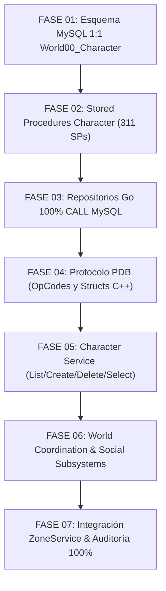

# Plan Maestro de Implementación: WorldService y Character (100% MySQL, Fidelidad Binaria PDB)

## 0. Resumen Ejecutivo y Metas de Fidelidad Absoluta
Este documento define la arquitectura, el modelo de datos relacional y los protocolos de red para la unificación completa del subsistema de Mundo y Persistencia de Personajes de **XelionCore** (`WorldService`), unificando la lógica de coordinación global de `WorldManager.exe` con la capa transaccional de persistencia de `Character.exe` contra la base de datos oficial `World00_Character` en MySQL (`xelion_online`).

### Metas Mandatorias (Reglas de Oro de AGENTS.md)
1. **Fidelidad Binaria PDB 1:1:**
   - 100% de los OpCodes oficiales derivados estrictamente de la fórmula de unión bitfield de 16 bits de `NETCOMMAND`: `(department << 10) | command`.
   - Nombres de paquetes idénticos a los símbolos extraídos de `Character.pdb` y `WorldManager.pdb` (`PROTO_NC_CHAR_*`, `PROTO_NC_WORLD_*`, `PROTO_NC_GUILD_*`, `PROTO_NC_FRIEND_*`, `PROTO_NC_PARTY_*`, `PROTO_NC_KQ_*`, `PROTO_NC_AVATAR_*`). Prohibido terminantemente inventar alias o abreviaciones.
   - Tamaños binarios (`sizeof`) y offsets idénticos al byte (#pragma pack(push, 1)). Cero omisiones o campos resumidos (`...` prohibido).
2. **Cero SQL Inline y Cero Datos Hardcodeados:**
   - 100% de las consultas e inserciones en `pkg/database/mysql_character.go` y subsistemas asociados deben realizarse mediante invocaciones oficiales `CALL <StoredProcedure>(...)` contra `xelion_online`.
   - Prohibido terminantemente ejecutar queries SQL inline (`SELECT`, `INSERT`, `UPDATE`, `DELETE`) en el código de los servicios o repositorios.
   - Prohibido hardcodear datos de personajes, stats base, equipamiento inicial o ubicaciones de spawn: toda la parametrización proviene de `DefaultCharacterData.txt`, `TutorialCharacterData.txt` y los archivos `.shn` oficiales cargados en MySQL o deserializados desde `data/`.
3. **Consistencia Transaccional y Multijugador:**
   - Soft-delete oficial de personajes (`bDeleted = 1`, `dDeletedDate = NOW()`).
   - Validación cruzada de nombres de avatar (case-insensitive, unicidad por clúster).
   - Prevención de desincronizaciones de inventario (`nItemKey` BIGINT autoincremental único por clúster).
   - Control de latidos y concurrencia S2S entre `WorldService` y `ZoneService`.

---

## 1. Inventario de Fuentes de la Verdad (Ground Truth)

| Componente Oficial | Fuente Técnica en el Repositorio | Alcance y Contenido Verificado |
| :--- | :--- | :--- |
| **Tablas Oficiales** | `docs/TablasLegacy.md` | **61 tablas oficiales** de `World00_Character.bak` con PKs, FKs y tipos exactos. |
| **Procedimientos Almacenados** | `docs/sql/procedures/World00_Character_all_procedures.sql` y `docs/ProcedimientosLegacy.md` | **311 Stored Procedures** oficiales de `Character.exe` y `WorldManager.exe`. |
| **Protocolo Character** | `docs/Servicios/Character.md` | **1.369 estructuras de red**, 196 handlers `fc_NC_*`, socket S2S 9033. |
| **Protocolo WorldManager** | `docs/Servicios/WorldManager.md` | **1.379 estructuras de red**, 463 handlers S2S/C2S, coordinación de clúster. |
| **Datos de Configuración** | `data/World/` y `docs/Servicios/Zone.md` | `DefaultCharacterData.txt`, `TutorialCharacterData.txt` y 54+71 archivos `.shn`. |

---

## 2. Catálogo Oficial de Tablas de `World00_Character` (MySQL: `xelion_online`)

El subsistema de personajes y mundo opera sobre las 61 tablas de `World00_Character.bak`, organizadas en 9 dominios relacionales:

### 2.1. Dominio de Personajes y Apariencia
1. **`tCharacter`:** Entidad principal del avatar (`nCharNo` PK, `nUserNo` FK, `sID` VARCHAR(40) UNIQUE, `nAdminLevel`, `nLevel`, `nExp`, `nSlotNo`, `nHP`, `nSP`, `nHPS`, `nSPS`, `nMoney`, `nStrength`, `nConstitute`, `nDexterity`, `nIntelligence`, `nMentalPower`, `nRedistributePoint`, `sLoginZone`, `nLoginZoneX`, `nLoginZoneY`, `nLoginZoneD`, `bDeleted`, `dCreateDate`, `dDeletedDate`, `dLastLoginDate`, `nPlayMin`, `nFame`, `nFlags`).
2. **`tCharacterShape`:** Configuración cosmética y racial (`nCharNo` PK/FK, `nClass`, `nRace`, `nGender`, `nHairType`, `nHairColor`, `nFaceShape`).
3. **`tCharacterState`:** Buffs, debuffs y estados anormales activos al desconectar (`nCharNo`, `nStateNo`, `nKeepTime`, `nStrength`).
4. **`tCharacterTitle`:** Títulos honoríficos adquiridos y equipados (`nCharNo`, `nTitleID`, `bEquipped`, `dAcquireDate`).
5. **`tRestExp`:** Acumulación de experiencia de descanso (`nCharNo` PK, `dRestExpLastExcuteTime`).
6. **`tTutorial`:** Progreso y pasos del tutorial inicial por personaje (`nUserNo`, `nCharNo`, `nState`, `nStep`, `dDate`).

### 2.2. Dominio de Inventario y Objetos
7. **`tItem`:** Inventario personal, almacén y equipamiento (`nItemKey` BIGINT PK, `nOwner` INT FK, `nItemID` INT, `nStorage` TINYINT, `nSlotNo` SMALLINT, `nCount` INT, `nFlag` INT, `dCreateDate` DATETIME).
8. **`tItemOptions`:** Modificadores y stats mágicos por ítem (`nItemKey` BIGINT FK, `nOptionType` TINYINT, `nOptionValue` INT).
9. **`tItemCoolTime`:** Tiempos de reutilización de consumibles guardados (`nCharNo` INT, `nItemCoolType` SMALLINT, `nCoolTime` INT).
10. **`tChargeItemBuff`:** Buffs temporales provenientes de la tienda premium (`nCharNo`, `nGoodsNo`, `dExpireDate`).

### 2.3. Dominio de Habilidades y Árbol de Talentos
11. **`tSkill`:** Habilidades aprendidas y nivel de mejora (`nCharNo` INT, `nSkillNo` SMALLINT, `nSkillLevel` TINYINT, `nSkillExp` INT, `nSkillWriteTime` BIGINT, `nSkillCoolTime` INT).
12. **`tSkillTree`:** Distribución de puntos en el árbol pasivo de talentos (`nCharNo`, `nTreeID`, `nPoint`).

### 2.4. Dominio Social: Gremios y Academia
13. **`tGuild`:** Gremios del mundo (`nGuildNo` INT PK, `sGuildName` VARCHAR(40) UNIQUE, `nMasterCharNo` INT, `nLevel` TINYINT, `nFame` INT, `dCreateDate` DATETIME).
14. **`tGuildMember`:** Miembros de gremio (`nGuildNo` INT, `nCharNo` INT PK, `nGrade` TINYINT, `dJoinDate` DATETIME).
15. **`tGuildAcademy`:** Escuela de entrenamiento del gremio (`nGuildNo` INT PK, `nLevel` TINYINT, `dCreateDate` DATETIME).
16. **`tGuildAcademyMember`:** Alumnos de la academia (`nGuildNo` INT, `nCharNo` INT PK, `dGraduateDate` DATETIME).

### 2.5. Dominio de Amigos y Lista de Bloqueo
17. **`tFriend`:** Relaciones de amistad (`nCharNo` INT, `nFriendCharNo` INT, `nGroupID` TINYINT, `bIsBlocked` TINYINT).
18. **`tFriendGroup`:** Categorías personalizadas de la lista de amigos (`nCharNo` INT, `nGroupID` TINYINT, `sGroupName` VARCHAR(20)).

### 2.6. Dominio de Grupo / Party
19. **`tParty`:** Instancias activas de grupos (`nPartyNo` INT PK, `nMasterCharNo` INT, `nLootRule` TINYINT).
20. **`tPartyMember`:** Integrantes del grupo (`nPartyNo` INT, `nCharNo` INT PK).

### 2.7. Dominio de Misiones y Progresión
21. **`tQuest`:** Misiones en curso y completadas (`nCharNo` INT, `nQuestNo` INT, `nStatus` TINYINT, `sData` VARBINARY(100)).
22. **`tQuestTimes`:** Contador de misiones repetibles (`nCharNo` INT, `nQuestNo` INT, `nTimes` INT, `dLastComplete` DATETIME).

### 2.8. Dominio de Mascotas y Monturas
23. **`tPet`:** Mascotas invocables y atributos (`nPetKey` BIGINT PK, `nOwner` INT, `nPetID` INT, `sAssignName` VARCHAR(24), `nLevel` SMALLINT, `nExp` BIGINT, `nSatiety` TINYINT).
24. **`tPetSkill`:** Habilidades activas de la mascota (`nPetKey` BIGINT, `nSkillNo` INT, `nSkillLevel` TINYINT).

### 2.9. Dominio de Bodas, MiniHouses y Tiendas Personales
25. **`tWedding`:** Vínculo de matrimonio (`nCharNo` INT, `nPartnerCharNo` INT, `dWeddingDate` DATETIME, `nStatus` TINYINT).
26. **`tMiniHouse`:** Casa personal y muebles equipados (`nCharNo` INT PK, `nHouseID` INT, `dBuildDate` DATETIME).
27. **`tStore`:** Tiendas privadas de comercio entre jugadores (`nCharNo` INT PK, `sSign` VARCHAR(60), `nStatus` TINYINT).

---

## 3. Catálogo de Stored Procedures Oficiales de `World00_Character`

Todos los procedimientos almacenados deben residir en `database/procedures_character.sql` respetando estrictamente las firmas y parámetros oficiales de `docs/sql/procedures/World00_Character_all_procedures.sql`:

### 3.1. Procedimientos Críticos de Cuentas y Avatares
- `p_Char_GetListOfUserChar(in_nUserNo, in_nWorldNo)`: Retorna la lista de personajes del usuario en el mundo con su apariencia y equipamiento visible.
- `p_Char_GetLoginData(in_nCharNo, in_sID)`: Carga el estado integral del avatar al iniciar sesión en el mundo.
- `p_Char_Create(in_nUserNo, in_sID, in_nSlotNo, in_nClass, in_nRace, in_nGender, in_nHairType, in_nHairColor, in_nFaceShape, out_nCharNo, out_nRet)`: Alta atómica de personaje y forma base.
- `p_Char_Delete(in_nUserNo, in_nCharNo, out_nRet)`: Baja lógica marcando `bDeleted = 1`.
- `p_Char_Login(in_nCharNo, in_nWorldNo, in_sIP)`: Registra la entrada del personaje al mundo.
- `p_Char_Logout(in_nCharNo, in_nHP, in_nSP, in_nExp, in_nMoney, in_sZone, in_nX, in_nY, in_nD, in_nPlayMin)`: Persistencia completa de desconexión.
- `p_Char_CheckName(in_sID, out_bExists)`: Valida disponibilidad de nombre de avatar.

### 3.2. Procedimientos de Inventario y Equipamiento
- `p_Item_GetList(in_nCharNo, in_nStorage)`: Retorna los ítems de un almacén o inventario.
- `p_Item_Insert(in_nCharNo, in_nItemID, in_nStorage, in_nSlotNo, in_nCount, out_nItemKey, out_nRet)`: Inserción de un nuevo ítem con generación de `nItemKey`.
- `p_Item_UpdateSlot(in_nItemKey, in_nStorage, in_nSlotNo, out_nRet)`: Movimiento de slot o almacén.
- `p_Item_UpdateCount(in_nItemKey, in_nCount, out_nRet)`: Actualización de stack de consumibles.
- `p_Item_Delete(in_nItemKey, out_nRet)`: Eliminación física de ítem.
- `p_Item_SaveOptions(in_nItemKey, in_nOptionType, in_nOptionValue)`: Persistencia de opciones mágicas.

### 3.3. Procedimientos de Habilidades y Progresión
- `p_Skill_GetList(in_nCharNo)`: Carga el repertorio de habilidades del personaje.
- `p_Skill_Insert(in_nCharNo, in_nSkillNo, in_nSkillLevel)`: Registro de aprendizaje de habilidad.
- `p_Char_IncStatPoint(in_nCharNo, in_nStatType, in_nCount, out_nRet)`: Incremento de stat libre (STR, CON, DEX, INT, MEN).

### 3.4. Procedimientos Sociales y Gremios
- `p_Guild_Create(in_nMasterCharNo, in_sGuildName, out_nGuildNo, out_nRet)`: Registro de gremio.
- `p_Guild_AddMember(in_nGuildNo, in_nCharNo, in_nGrade, out_nRet)`: Alta de miembro.
- `p_Friend_GetList(in_nCharNo)`: Carga de lista de amigos.
- `p_Friend_Add(in_nCharNo, in_nFriendCharNo, out_nRet)`: Asociación de amistad.

---

## 4. Fases Modulares de Ejecución

Para garantizar commits limpios, control estricto de cuota de tokens y compilación continua, el trabajo se divide en 7 fases secuenciales:

| Fase | Documento de Especificación | Alcance Técnico Principal | Criterio de Cierre y Commit |
| :---: | :--- | :--- | :--- |
| **01** | `docs/plan/FASE_01_ESQUEMA_DB_WORLD_CHARACTER.md` | Creación de las 61 tablas de `World00_Character` en `database/schema_character.sql` y semillado base. | Control 1 (`information_schema.TABLES`) PASS + `git commit` |
| **02** | `docs/plan/FASE_02_STORED_PROCEDURES_CHARACTER_PDB.md` | Recreación y testeo de los 311 Stored Procedures de Character en `database/procedures_character.sql`. | Control 2 (`information_schema.ROUTINES`) PASS + `git commit` |
| **03** | `docs/plan/FASE_03_REPOSITORIOS_GO_WORLD_CHARACTER_MYSQL.md` | Migración 100% a `CALL` en `pkg/database/mysql_character.go`, eliminación total de SQL inline. | Control 3 (AST Go: cero inline SQL) PASS + `git commit` |
| **04** | `docs/plan/FASE_04_PROTOCOLO_OPCODES_STRUCTS_WORLD_CHARACTER.md` | Definición de estructuras oficiales PDB de `Character.md` y `WorldManager.md` en `pkg/protocol/pdb/`. | Control 4 (OpCodes y sizeof al byte) PASS + `git commit` |
| **05** | `docs/plan/FASE_05_CHARACTER_SERVICE_SELECCION_CREACION_BORRADO.md` | Handlers de ciclo de vida de avatares en `WorldService` (Lista, Creación, Borrado, Selección). | Control 5 (Dispatcher Character) PASS + `git commit` |
| **06** | `docs/plan/FASE_06_WORLD_COORDINATION_TOPOLOGY_SUBSYSTEMS.md` | Coordinación de chat, gremios, amigos, party, KQ y topología S2S con `ZoneService`. | Control 6 (Subsistemas de Mundo) PASS + `git commit` |
| **07** | `docs/plan/FASE_07_INTEGRACION_ZONE_GAMEPLAY_Y_AUDITORIA_FINAL.md` | Traspaso fluido World -> Zone con 54+71 SHNs, E2E forense y ejecución de `verify_world_character_100.sh`. | Control 7 y 8 (Suite 100% PASS) + `git commit` |

---

## 5. Controles Obligatorios de Auditoría (`verify_world_character_100.sh`)

Al igual que en la Etapa 1, la validación se automatiza a través de un script bash ejecutable que evalúa los 8 controles críticos:
1. **Control 1 (Esquema DB 1:1):** Compara las 61 tablas y columnas contra `information_schema`.
2. **Control 2 (Catálogo 100% Stored Procedures):** Valida la existencia de los 311 procedimientos de `World00_Character` en `information_schema.ROUTINES`.
3. **Control 3 (Escaneo AST Cero Inline SQL):** Valida que `pkg/database/mysql_character.go` no contenga literales `SELECT`, `INSERT`, `UPDATE`, `DELETE`.
4. **Control 4 (Paridad de Protocolo y sizeof PDB):** Comprueba `sizeof` y offsets de las estructuras de red contra los PDBs oficiales.
5. **Control 5 (Dispatcher Coverage):** Valida que el 100% de los OpCodes de `Character.exe` y `WorldManager.exe` cuenten con handler registrado.
6. **Control 6 (Verificación SHN Checksum):** Valida la consistencia de los 54 SHNs de `Character.exe` y 71 SHNs de `WorldManager.exe`.
7. **Control 7 (E2E Integral Forense):** Flujo completo desde creación de avatar hasta login en zona verificando las filas en MySQL.
8. **Control 8 (Cero Datos Hardcodeados):** Escaneo AST verificando ausencia total de constantes mágicas en los flujos de creación y spawn.
