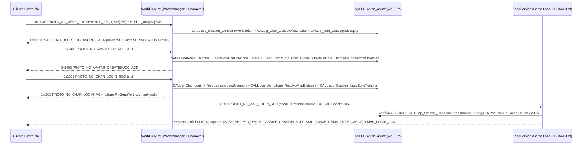

# Plan Maestro Exhaustivo (100% Fidelidad PDB + Binarios + SHN/JSON + MySQL): `WorldService` y `Character`

> [!IMPORTANT]
> **Alcance y Reglas Mandatorias de este Plan (Auto-Contenido para Ejecución Directa):**
> - **Cero omisiones, cero resúmenes y cero datos hardcodeados:** Se inventaría el **100%** de las **114 tablas oficiales** de `World00_Character.bak` (+ **2 tablas operativas** de coordinación S2S en MySQL), los **419 Stored Procedures oficiales** (`311` ODBC de `Character.exe` $\cup$ `405` no-DBA de `World00_Character.bak`, más **6 SPs operativos** = **425 SPs totales**), las **463 entradas no-OpTool** del Dispatcher de `WorldManager.pdb`, las **317 entradas no-OpTool** + **196 handlers `fc_NC_*`** de `Character.pdb`, las **1.343 + 1.369 estructuras C++** de ambos PDBs, y los **54 + 71 archivos `.shn`** (`74` archivos `.shn` únicos) junto con `DefaultCharacterData.txt`, `TutorialCharacterData.txt` y `data/World/`.
> - **100% MySQL (`xelion_online`) + `data/` como únicas fuentes de verdad:** Prohibido terminantemente ejecutar SQL inline (`SELECT`/`INSERT`/`UPDATE`/`DELETE`) en Go, mantener transferencias `World <-> Zone` o grupos solo en memoria sin persistencia MySQL, inventar nombres de tablas o procedimientos, o hardcodear stats, mapas (`"RouN"`), puertos, nombres prohibidos o Kingdom Quests en código Go.
> - **Únicas exclusiones autorizadas (Sección 7):** `OpTool` (`OperatorTool.exe`, Dept `10` / `PROTO_NC_OPTOOL_*`) y los `3` procedimientos de mantenimiento DBA de SQL Server (`Adam_ListProc`, `CommandExecute`, `IndexOptimize`).

---

## 0. Decisiones de Arquitectura Cerradas y Obligatorias

Quien ejecute cualquiera de las fases de esta etapa debe cumplir **sin excepción ni reinterpretación** las siguientes 5 decisiones:

1. **Esquema Único `xelion_online` en MySQL 8.x (114 Tablas Oficiales + 2 Operativas):**
   - Todas las tablas de `Account`, `AccountLog`, `StatisticsData`, `World00_Character` y `World00_GameLog` conviven en la base única **`xelion_online`**.
   - Se mantienen intactas las resoluciones de colisión de la Etapa 1:
     * `tItem` pertenece exclusivamente a `World00_Character.bak` (7 columnas: inventario, equipamiento, almacén, casa, recompensas), mientras que el catálogo de tienda de `Account` vive en `tAccountItem`.
     * `tTutorial` es única y compartida entre `Account` y `World00_Character`.
     * `tUser` pertenece a `Account.bak` (por lo que en los SPs de `World00_Character` como `p_Char_Create`, toda referencia legacy `Account..tUser` apunta directamente a `tUser` dentro de `xelion_online`).
   - Las **114 tablas** de `World00_Character.bak` documentadas en [`docs/TablasLegacy.md`](../TablasLegacy.md) deben existir al 100% en `xelion_online` (`91` creadas en Fase 01 + `5` ya presentes en `database/schema.sql` + las `18` tablas restantes del `.bak` incorporadas en la **Fase 02A**), más **2 tablas operativas MySQL** (`tActiveZoneTransfer` y `tWorldZoneNode`) para eliminar los mapas en memoria de `TransferManager` y los endpoints hardcodeados.
2. **100% Stored Procedures Nativos (`CALL <SP>`) y Convención Pool-Safe para `*sql.DB`:**
   - **Prohibido dejar consultas SQL inline** en `pkg/database/mysql_character*.go`, `pkg/server/world/` o `pkg/server/zone/`.
   - **Regla crítica de salida en MySQL (`proc_logic` + `SELECT` final incondicional):** En `go-sql-driver/mysql` sobre un pool `*sql.DB`, usar `LEAVE sp_body;` antes del `SELECT out_...` final provoca `sql.ErrNoRows` en Go cada vez que ocurre una rama de error o validación (ej. slot ocupado o nombre duplicado en `p_Char_Create`), y consultar `SELECT @out` en otra query corrompe sesiones concurrentes del pool. Por lo tanto, **todo** Stored Procedure con parámetros `OUT` debe estructurarse como:
     ```sql
     proc_logic: BEGIN
         -- validaciones y transacciones usando LEAVE proc_logic;
     END proc_logic;
     SELECT out_var1 AS var1, out_var2 AS var2;
     ```
     De este modo, la firma oficial conserva sus parámetros `OUT` en `information_schema.PARAMETERS` **y** Go consume el resultado atómicamente en un único roundtrip con `db.QueryRowContext(ctx, "CALL p_...", args...).Scan(...)`.
3. **Cero Datos Hardcodeados y Prohibición de Filas Plantilla Falsas en `tCharacter`:**
   - En `Character.exe` oficial, `DefaultCharacterData.txt` y `TutorialCharacterData.txt` se cargan en memoria al iniciar el servicio y sus valores se aplican al nuevo personaje invocando `CALL p_Char_Create`, `CALL p_Char_CreateSetDefaultData`, `CALL p_Item_Create`, `CALL p_Skill_Create`, `CALL p_Quest_Start` y `CALL p_Char_SetShortCut`.
   - **Está terminantemente prohibido insertar personajes plantilla (`Fighter_Template`, `Tutorial_Fighter`, etc.) en `tCharacter` / `tCharacterShape` / `tItem` bajo `nUserNo = 1`**, ya que ensucian la cuenta real `#1` y desbordan el límite de 6 slots del cliente.
   - Toda parametrización estática proviene exclusivamente de `data/DefaultCharacterData.txt` (`data/default_character_data.json`), `data/TutorialCharacterData.txt` (`data/tutorial_character_data.json`), `data/World/ClassParam/<Class>.json` (27 clases), `data/World/Map/*.json` y los **74 archivos `.shn` únicos** (`54` de `Character.exe` $\cup$ `71` de `WorldManager.exe`).
4. **Nomenclatura Oficial 100% Idéntica a los PDBs en `pkg/protocol/`:**
   - Todas las constantes de OpCodes y estructuras viven en **`pkg/protocol/`** (nunca crear un subpaquete paralelo `pkg/protocol/pdb/`).
   - Se deben erradicar los **19 alias de emuladores privados** presentes hoy en `pkg/protocol/opcodes.go` y `pkg/server/world/handler.go` (`PROTO_NC_CHAR_CREATE_REQ` -> `PROTO_NC_AVATAR_CREATE_REQ`, `PROTO_NC_CHAR_DELETE_REQ` -> `PROTO_NC_AVATAR_ERASE_REQ`, `PROTO_NC_MISC_WORLD_CLIENT_KEY_REQ` -> `PROTO_NC_USER_LOGINWORLD_REQ`, `PROTO_NC_CHAR_CLIENT_CHARLIST_ACK` -> `PROTO_NC_USER_LOGINWORLD_ACK`, `PROTO_NC_CHAR_GET_QUICKBAR_REQ` -> `PROTO_NC_CHAR_OPTION_GET_SHORTCUTDATA_REQ`, `PROTO_NC_CHAR_INGAME_REQ` -> `PROTO_NC_KQ_LIST_REFRESH_REQ`, etc.).
5. **Arquitectura Unificada `WorldService` (`WorldManager.exe` + `Character.exe`) en Go:**
   - En el legado, `WorldManager.exe` (0 conexiones ODBC) enviaba paquetes S2S (`PROTO_NC_*_DB_*`) por el puerto `9033` a `Character.exe`, quien ejecutaba los 311 SPs contra SQL Server.
   - En `XelionCore`, `WorldService` procesa directamente los paquetes C2S del cliente y coordina con `ZoneService` ejecutando de forma directa y transaccional los `CALL <SP>` en `xelion_online`, manteniendo además registrados y tipados todos los paquetes y structs S2S oficiales para 100% de fidelidad binaria y compatibilidad multi-nodo.

---

## 1. Diagnóstico Forense de Brechas y 16 Errores Críticos Detectados (Estado Actual)

La auditoría cruzada entre `Character.exe`, `WorldManager.exe`, [`Character.md`](../Servicios/Character.md), [`WorldManager.md`](../Servicios/WorldManager.md), [`TablasLegacy.md`](../TablasLegacy.md), [`World00_Character_all_procedures.sql`](../sql/procedures/World00_Character_all_procedures.sql), lo entregado en Fase 01/02 y el código Go actual reveló **16 desviaciones críticas** que esta hoja de ruta corrige al 100%:

| # | Severidad | Archivo / Componente Actual | Bug / Brecha Detectada | Corrección Oficial (PDB / `.bak` / `.exe`) |
| :---: | :---: | :--- | :--- | :--- |
| **1** | **CRÍTICO** | [`database/seed_character_defaults.sql`](../../database/seed_character_defaults.sql#L211-L278) | Fase 01 insertó 11 personajes falsos (`Fighter_Template`..`Tutorial_Trickster`) con `nUserNo = 1`, `nSlotNo 0..10` y `bDeleted = 0` en `tCharacter`, `tCharacterShape` y `tItem`, corrompiendo la cuenta `#1`, violando el tope de 6 slots del cliente e inventando `RouN` Lv 1 para `Sentinel` (que en `DefaultCharacterData.txt` inicia en `Eld` `12259, 13434` Lv `60`). | **Fase 02A:** Limpiar las 11 filas falsas de `tCharacter`/`tCharacterShape`/`tItem`; cargar `DefaultCharacterData.txt` y `TutorialCharacterData.txt` desde `data/` en Go y aplicarlos vía `CALL p_Char_CreateSetDefaultData`. |
| **2** | **CRÍTICO** | [`data/tutorial_character_data.json`](../../data/tutorial_character_data.json) y [`data/default_character_data.json`](../../data/default_character_data.json) | `tutorial_character_data.json` está vacío (`{}`) porque `TutorialCharacterData.txt` está codificado en UTF-16LE y usa `#DEFINE TUTORIAL_CHARACTER`/`DEFAULT_ITEM`/`TUTORIAL_ITEM`; además `default_character_data.json` omitió los bloques `#DEFINE QUEST` (`starter_quests`). | **Fase 02A:** Regenerar `default_character_data.json` (incluyendo `starter_quests` y los 6 arquetipos `1, 6, 11, 16, 21, 26`) y `tutorial_character_data.json` al 100% desde los `.txt` oficiales sin perder un solo campo. |
| **3** | **CRÍTICO** | [`database/schema_character.sql`](../../database/schema_character.sql) | Faltan **18 tablas** de las **114 tablas oficiales** de `World00_Character.bak` en `xelion_online` (incluyendo la tabla auxiliar `num` referenciada por SPs del `.bak` e historial `tItem_deleted`). | **Fase 02A:** Incorporar las 18 tablas restantes del `.bak` y poblar `num` + agregar `tActiveZoneTransfer` y `tWorldZoneNode` para alcanzar **114/114 tablas del `.bak`**. |
| **4** | **CRÍTICO** | `database/procedures_character.sql` (`scripts/build_procedures_character.py`) | El filtro case-sensitive omitió **14 SPs ODBC reales de `Character.exe`** que no estaban en el `.bak` (`p_Guild_SetMoney`, `usp_Guild_getHistoryList`, `usp_Pet_setDelete`, `usp_LinkScroll_SetDestMap`, `p_MiniHouseURL_Get/Set`, etc.), **25 SPs ODBC con distinto casing** (`p_Guild_Make`, `p_Item_GetList`, `p_Item_Upgrade`, `p_Quest_GetAll`, etc.) y **69 SPs adicionales no-DBA del `.bak`** (`p_KingdomQuest_GetAll`, `p_MasPup_GetAll`, `p_Prison_End`, `p_HolyPromise_CheckRing`, etc.). | **Fase 02A:** Completar la unión exacta `311 ODBC` $\cup$ `405 .bak no-DBA` = **419 SPs oficiales** + **6 SPs operativos S2S** = **425 SPs** verificados en `information_schema.ROUTINES`. |
| **5** | **CRÍTICO** | `database/procedures_character.sql` | Las ramas de error ejecutan `LEAVE sp_body;` **antes** del `SELECT out_...` final, provocando `sql.ErrNoRows` en `db.QueryRow("CALL ...").Scan(...)` en Go ante cualquier validación fallida; además `p_Char_Create` referencia `Options..Auto_GM` y `Account..tUser`. | **Fase 02A:** Encapsular la lógica en `proc_logic: BEGIN ... END proc_logic;` asegurando el `SELECT` final en el 100% de las ramas, y resolver `Account..tUser` contra `tUser` en `xelion_online`. |
| **6** | **CRÍTICO** | [`pkg/database/mysql_character.go`](../../pkg/database/mysql_character.go) | Sus **50 métodos** actuales (`1.648` líneas) usan 100% SQL inline (`SELECT`, `INSERT`, `UPDATE`, `DELETE`) y cubren apenas una fracción de los dominios de `World00_Character`. | **Fase 03:** Reemplazar el 100% por `CALL <SP>(...)` con interfaces tipadas por dominio y verificación AST estricta (Control 3). |
| **7** | **CRÍTICO** | [`pkg/database/transfer.go`](../../pkg/database/transfer.go#L96-L133) | `CreateZoneTransfer` y `ConsumeZoneTransfer` guardan el traspaso `World -> Zone` en un `map` en memoria de Go: al correr `cmd/WorldService` y `cmd/ZoneService` como procesos separados, **el login al mapa falla siempre**. | **Fases 02A, 03 y 07:** Persistir y consumir traspasos de un solo uso en MySQL (`tActiveZoneTransfer` vía `CALL usp_Session_IssueZoneTransfer` / `CALL usp_Session_ConsumeZoneTransfer`) y eliminar `TransferManager` en memoria. |
| **8** | **CRÍTICO** | [`pkg/protocol/opcodes.go`](../../pkg/protocol/opcodes.go) y [`pkg/server/world/handler.go`](../../pkg/server/world/handler.go) | Uso de **19 alias no oficiales** de emuladores privados (`PROTO_NC_CHAR_CREATE_REQ`, `PROTO_NC_CHAR_DELETE_REQ`, `PROTO_NC_CHAR_GET_QUICKBAR_REQ`, `PROTO_NC_CHAR_INGAME_REQ`, `PROTO_NC_CHAR_CLIENT_CHARLIST_ACK`, etc.), violando la Regla de Oro #1 de `AGENTS.md`. | **Fase 04:** Reemplazar todos los alias por los nombres exactos de `WorldManager.pdb` y `Character.pdb` (`PROTO_NC_AVATAR_CREATE_REQ`, `PROTO_NC_AVATAR_ERASE_REQ`, `PROTO_NC_USER_LOGINWORLD_ACK`, `PROTO_NC_CHAR_OPTION_*`, `PROTO_NC_KQ_LIST_REFRESH_REQ`). |
| **9** | **ALTO** | [`pkg/server/world/handler.go`](../../pkg/server/world/handler.go#L482-L560) | `handleCreateCharacter` lee campos con tamaños/offsets manuales y constantes mágicas (`slot > 5`, `len < 3 || len > 16`) sin validar contra `FaceInfo.shn`, `HairInfo.shn`, `HairColorInfo.shn` ni crear `tTutorial` / `StarterQuests`. | **Fase 05:** Deserializar `PROTO_NC_AVATAR_CREATE_REQ` (`32 bytes` exactos del PDB), validar rangos estéticos contra `.shn` + `DefaultCharacterData.txt`, respetar skip de tutorial (`usp_Tutorial_getIsSkip`) y persistir avatar completo vía SPs. |
| **10** | **ALTO** | [`pkg/server/world/static_data.go`](../../pkg/server/world/static_data.go#L97) | `BadNameFilter` hardcodea `subStrings: []string{"admin", "gm", "master", ...}` en código Go y `WorldDataStore` solo carga `26` `.shn` en vez de los **54 `.shn` de `Character.exe` + 71 `.shn` de `WorldManager.exe`** (`74` únicos). | **Fases 05 y 07:** Eliminar el slice hardcodeado (filtrar exclusivamente con `BadNameFilter.shn` oficial) y cargar/verificar los **74 archivos `.shn`** con sus checksums oficiales. |
| **11** | **ALTO** | [`pkg/server/world/kq_manager.go`](../../pkg/server/world/kq_manager.go#L67-L145) | `KQManager` contiene `loadDefaults()` hardcodeado (`"Mara Pirates' Ambition"`, `"Gold Garden"`, etc.), lee nombres de columna erróneos en `KingdomQuest.shn` cayendo en constantes mágicas (`5`, `15`, `3600`), y no persiste en `tKingdomQuest`. | **Fase 06:** Eliminar `loadDefaults()`, leer las columnas reales de `KingdomQuest.shn`, `KingdomQuestMap.shn`, `KQTeam.shn`, `KQIsVote.shn`, `KQVoteMajorityRate.shn` y persistir en MySQL con `CALL p_KingdomQuest_*`. |
| **12** | **ALTO** | [`pkg/server/world/party_manager.go`](../../pkg/server/world/party_manager.go) | Los grupos (`Party`) y `Raid` operan solo en memoria o no existen: nunca invocan `p_Party_*` sobre `tParty` y `tPartyMember`, perdiendo consistencia ante cambios de zona o reinicios. | **Fase 06:** Persistir creación, alta/baja de miembros, cambio de maestro y reglas de botín en `tParty` / `tPartyMember` vía `CALL p_Party_*` e implementar `PROTO_NC_RAID_*` (Dept `44`). |
| **13** | **ALTO** | [`pkg/server/world/friend_manager.go`](../../pkg/server/world/friend_manager.go#L51-L53) | Hardcodea `currentMap = "RouN"` cuando el mapa está vacío y le falta `PROTO_NC_FRIEND_FIND_FRIENDS_REQ` (`0x541F`) y sincronización real de mapa/nivel/clase al cambiar de zona. | **Fase 06:** Leer `sLoginZone` real desde `tCharacter` (`p_Friend_GetAll` / `p_Friend_GetAll2`) y actualizar estado en tiempo real sin constantes `"RouN"`. |
| **14** | **ALTO** | [`pkg/server/world/handler.go`](../../pkg/server/world/handler.go) | Solo cubre `66` OpCodes de los **`167` handlers C2S** de `WorldManager.pdb` (faltan `101` handlers C2S: chat `ACT_WHISPER/NOTICE/PARTYCHAT`, `AVATAR_RENAME`, `CHAR_SET_STYLE`, `ATTENDANCE`, `CHAR_OPTION_IMPROVE_*`, `GUILD_WAR/TOURNAMENT/TOKEN/HISTORY/EMBLEM`, `GUILD_ACADEMY` completo, `HOLY_PROMISE` Master/Pupil, `PRISON`, `REPORT`, `CHAT_RESTRICT`, `INSTANCE_DUNGEON_RANK`, `RAID`, `SPAMMER_*`, `ITEMSHOP_URL`, `WEB_KEY`). | **Fases 05 y 06:** Implementar y registrar el **100% de los 167 handlers C2S** de `WorldManager.pdb` + coordinación S2S completa. |
| **15** | **ALTO** | [`cmd/WorldService/main.go`](../../cmd/WorldService/main.go#L63-L81) | Hardcodea un único `zoneIP = "127.0.0.1"` / `zonePort = 9210` para todos los mapas del mundo, sin resolver el `zoneNumber` del mapa desde `data/World/Map/FieldList.json` ni la tabla de nodos `tWorldZoneNode`. | **Fases 06 y 07:** Resolver dinámicamente IP/Puerto de la instancia `ZoneService` según el `zoneNumber` del mapa en `FieldList.json` y el registro vivo en `tWorldZoneNode` (`CALL usp_WorldZone_ResolveMapEndpoint`). |
| **16** | **ALTO** | [`pkg/server/zone/handler.go`](../../pkg/server/zone/handler.go#L280-L325) | `ZoneService` usa fallback hardcodeado `"RouN"`, envía arrays vacíos en varios paquetes del In-Game Chunk (misiones, buffs pagos, títulos, estados, cartas) y al desconectar no persiste estados/cooltimes/restExp vía SPs oficiales. | **Fase 07:** Cargar los 16 paquetes del In-Game Chunk desde MySQL (`CALL p_Char_*`, `CALL p_Quest_*`, `CALL p_Item_*`, `CALL p_Skill_*`, `CALL p_Collection_*`) + `ClassParam`, y persistir desconexión completa con `CALL p_Char_Logout` y SPs asociados. |

---

## 2. Inventario Exhaustivo de las 114 Tablas Oficiales de `World00_Character.bak` + 2 Tablas Operativas (`xelion_online`)

Listado completo 1:1 extraído de [`docs/TablasLegacy.md`](../TablasLegacy.md) sin omitir ninguna tabla, indicando su ubicación actual en el repositorio:

| # | Tabla Oficial (`World00_Character.bak`) | Estado Actual en Repo | Columnas y Tipos Oficiales |
| :---: | :--- | :---: | :--- |
| 1 | **`QuestItemFix`** | `schema.sql` (Etapa 1) | `QuestID` (int), `ItemID` (int) |
| 2 | **`TEMP_ItemCnt`** | **Agregar en Fase 02A** | `nOwner` (int), `nItemCnt` (int) |
| 3 | **`TEMP_QuestComplete`** | **Agregar en Fase 02A** | `nCharNo` (int), `nQuestCompleteCnt` (int) |
| 4 | **`Temp_Guar`** | **Agregar en Fase 02A** | `nCharNo` (int), `nSkillNo` (smallint), `nSkillLevel` (tinyint), `nSkillExp` (int), `nSkillWriteTime` (bigint), `nSkillCoolTime` (int), `nSkillPowerDemage` (tinyint), `nSkillPowerSP` (tinyint), `nSkillPowerKeepTime` (tinyint), `nSkillPowerCoolTime` (tinyint) |
| 5 | **`Temp_Holy`** | **Agregar en Fase 02A** | `nCharNo` (int), `nSkillNo` (smallint), `nSkillLevel` (tinyint), `nSkillExp` (int), `nSkillWriteTime` (bigint), `nSkillCoolTime` (int), `nSkillPowerDemage` (tinyint), `nSkillPowerSP` (tinyint), `nSkillPowerKeepTime` (tinyint), `nSkillPowerCoolTime` (tinyint) |
| 6 | **`Waits_Sysprocesses`** | **Agregar en Fase 02A** | `logdate` (datetime), `spid` (smallint), `Wait Time (s)` (numeric(17,6)), `lastwaittype` (nchar(32)), `waitresource` (nchar(max)), `dbid` (smallint), `uid` (smallint), `cpu` (int), `physical_io` (bigint), `memusage` (int), `last_batch` (datetime), `open_tran` (smallint), `sid` (binary(86)), `hostname` (nchar(max)), `program_name` (nchar(max)), `nt_username` (nchar(max)), `loginame` (nchar(max)), `sql_text` (varchar(64)) |
| 7 | **`auditCharacterData`** | **Agregar en Fase 02A** | `audit_log_id` (uniqueidentifier), `audit_log_type` (char(3)), `audit_user` (nvarchar(max)), `audit_host` (char(50)), `audit_application` (char(50)), `audit_char_no` (int), `audit_char_money` (int), `audit_changed` (datetime) |
| 8 | **`chr_a`** | **Agregar en Fase 02A** | `nCharNo` (int), `sID` (nvarchar(40)), `nUserNo` (int), `nAdminLevel` (tinyint), `nPS` (int), `nGS` (int), `dCreateDate` (datetime), `bDeleted` (tinyint), `nLoginZoneX` (int), `nLoginZoneY` (int), `nLoginZoneD` (tinyint), `nPKYellowTime` (tinyint), `dDeletedDate` (datetime), `nAP` (smallint), `sLoginZone` (varchar(16)), `nPKCount` (int), `nLevel` (smallint), `nExp` (bigint), `nSlotNo` (tinyint), `nHP` (smallint), `nSP` (smallint), `nHPS` (smallint), `nSPS` (smallint), `dLastLoginDate` (datetime), `nLoginCount` (int), `nCreateWorld` (tinyint), `nFame` (int), `nPrisonMin` (smallint), `nPlayMin` (int), `nFlags` (int), `nMoney` (bigint), `nStrength` (tinyint), `nConstitute` (tinyint), `nDexterity` (tinyint), `nIntelligence` (tinyint), `nMentalPower` (tinyint), `nRedistributePoint` (tinyint), `nKQHandle` (int), `sKQMap` (varchar(16)), `nKQX` (int), `nKQY` (int), `nKQD` (tinyint), `dKQDate` (datetime), `ngrade` (int) |
| 9 | **`chr_b`** | **Agregar en Fase 02A** | `nCharNo` (int), `sID` (nvarchar(40)), `nUserNo` (int), `nAdminLevel` (tinyint), `nPS` (int), `nGS` (int), `dCreateDate` (datetime), `bDeleted` (tinyint), `nLoginZoneX` (int), `nLoginZoneY` (int), `nLoginZoneD` (tinyint), `nPKYellowTime` (tinyint), `dDeletedDate` (datetime), `nAP` (smallint), `sLoginZone` (varchar(16)), `nPKCount` (int), `nLevel` (smallint), `nExp` (bigint), `nSlotNo` (tinyint), `nHP` (smallint), `nSP` (smallint), `nHPS` (smallint), `nSPS` (smallint), `dLastLoginDate` (datetime), `nLoginCount` (int), `nCreateWorld` (tinyint), `nFame` (int), `nPrisonMin` (smallint), `nPlayMin` (int), `nFlags` (int), `nMoney` (bigint), `nStrength` (tinyint), `nConstitute` (tinyint), `nDexterity` (tinyint), `nIntelligence` (tinyint), `nMentalPower` (tinyint), `nRedistributePoint` (tinyint), `nKQHandle` (int), `sKQMap` (varchar(16)), `nKQX` (int), `nKQY` (int), `nKQD` (tinyint), `dKQDate` (datetime), `ngrade` (int) |
| 10 | **`chr_bak`** | **Agregar en Fase 02A** | `nCharNo` (int), `sID` (nvarchar(40)), `nUserNo` (int), `nAdminLevel` (tinyint), `nPS` (int), `nGS` (int), `dCreateDate` (datetime), `bDeleted` (tinyint), `nLoginZoneX` (int), `nLoginZoneY` (int), `nLoginZoneD` (tinyint), `nPKYellowTime` (tinyint), `dDeletedDate` (datetime), `nAP` (smallint), `sLoginZone` (varchar(16)), `nPKCount` (int), `nLevel` (smallint), `nExp` (bigint), `nSlotNo` (tinyint), `nHP` (smallint), `nSP` (smallint), `nHPS` (smallint), `nSPS` (smallint), `dLastLoginDate` (datetime), `nLoginCount` (int), `nCreateWorld` (tinyint), `nFame` (int), `nPrisonMin` (smallint), `nPlayMin` (int), `nFlags` (int), `nMoney` (bigint), `nStrength` (tinyint), `nConstitute` (tinyint), `nDexterity` (tinyint), `nIntelligence` (tinyint), `nMentalPower` (tinyint), `nRedistributePoint` (tinyint), `nKQHandle` (int), `sKQMap` (varchar(16)), `nKQX` (int), `nKQY` (int), `nKQD` (tinyint), `dKQDate` (datetime), `ngrade` (int) |
| 11 | **`deleted_item`** | `schema.sql` (Etapa 1) | `nItemKey` (bigint), `nStorageType` (tinyint), `nOwner` (bigint), `nStorage` (smallint), `nItemID` (int), `nFlags` (int), `dDate` (datetime) |
| 12 | **`num`** | **Agregar en Fase 02A** | `num` (smallint) |
| 13 | **`removeskill`** | `schema.sql` (Etapa 1) | `nCharNo` (int), `skillno` (int), `dDate` (datetime) |
| 14 | **`skilldata`** | `schema.sql` (Etapa 1) | `ID` (int), `BuyPrice` (bigint), `BuyFame` (int) |
| 15 | **`tArenaChallenge`** | `schema_character.sql` (Fase 01) | `nCharNo` (int), `nMonsterLevel` (smallint), `nMonsterMKC` (smallint), `nMonsterKPS` (smallint), `nMonsterKills` (int) |
| 16 | **`tArenaFBZ`** | `schema_character.sql` (Fase 01) | `nFBZWin` (int), `nFBZLose` (int), `nFBZLadder` (int), `nCharNo` (int) |
| 17 | **`tArenaGuild`** | `schema_character.sql` (Fase 01) | `nGuildLose` (int), `nGuildDraw` (int), `nGuildNo` (int), `nGuildWin` (int), `nGuildLadder` (int) |
| 18 | **`tArenaPvP`** | `schema_character.sql` (Fase 01) | `nPvPLadder` (int), `nPvPWin` (int), `nPvPLose` (int), `nCharNo` (int), `nPvPDraw` (int) |
| 19 | **`tAttendance`** | `schema_character.sql` (Fase 01) | `nCharNo` (int), `dAttendanceDate` (datetime) |
| 20 | **`tAttendanceReward`** | `schema_character.sql` (Fase 01) | `nCharNo` (int), `dEventDate` (datetime), `dRewardDate` (datetime), `nRewardID` (int) |
| 21 | **`tAutoMon`** | `schema_character.sql` (Fase 01) | `nCharNo` (int), `nType` (tinyint), `nSlot` (tinyint), `nItemID` (int) |
| 22 | **`tAutoPick`** | `schema_character.sql` (Fase 01) | `nCharNo` (int), `IsAutoPick` (tinyint) |
| 23 | **`tBugReport_20091204`** | **Agregar en Fase 02A** | `charNo` (int), `cnt` (int), `money` (int), `exp` (int), `fame` (int) |
| 24 | **`tCharacter`** | `schema_character.sql` (Fase 01) | `nCharNo` (int), `sID` (nvarchar(40)), `nUserNo` (int), `nAdminLevel` (tinyint), `nPS` (int), `nGS` (int), `dCreateDate` (datetime), `bDeleted` (tinyint), `nLoginZoneX` (int), `nLoginZoneY` (int), `nLoginZoneD` (tinyint), `nPKYellowTime` (tinyint), `dDeletedDate` (datetime), `nAP` (smallint), `sLoginZone` (varchar(16)), `nPKCount` (int), `nLevel` (smallint), `nExp` (bigint), `nSlotNo` (tinyint), `nHP` (smallint), `nSP` (smallint), `nHPS` (smallint), `nSPS` (smallint), `dLastLoginDate` (datetime), `nLoginCount` (int), `nCreateWorld` (tinyint), `nFame` (int), `nPrisonMin` (smallint), `nPlayMin` (int), `nFlags` (int), `nMoney` (bigint), `nStrength` (tinyint), `nConstitute` (tinyint), `nDexterity` (tinyint), `nIntelligence` (tinyint), `nMentalPower` (tinyint), `nRedistributePoint` (tinyint), `nKQHandle` (int), `sKQMap` (varchar(16)), `nKQX` (int), `nKQY` (int), `nKQD` (tinyint), `dKQDate` (datetime), `nFriendPoint` (int), `nLastFriendPoint` (int) |
| 25 | **`tCharacterChangeID`** | `schema_character.sql` (Fase 01) | `nRowNo` (int), `sys_create_date` (datetime), `sys_update_date` (datetime), `nUserNo` (int), `nCharNo` (int), `bFlag` (bit), `bInit` (bit), `sOldID` (nvarchar(50)), `sNewID` (nvarchar(50)) |
| 26 | **`tCharacterChargedBuffer`** | `schema_character.sql` (Fase 01) | `nNo` (int), `nCharNo` (int), `nKey` (int), `nID` (smallint), `dUseDate` (datetime), `dEndDate` (datetime) |
| 27 | **`tCharacterGameOption`** | `schema_character.sql` (Fase 01) | `nCharNo` (int), `sys_create_date` (datetime), `nOptionNo` (smallint), `nValue` (tinyint) |
| 28 | **`tCharacterKeyMap`** | `schema_character.sql` (Fase 01) | `nCharNo` (int), `nFunctionNo` (smallint), `sys_create_date` (datetime), `sys_update_date` (datetime), `nExtendedKey` (tinyint), `nASCIICode` (tinyint) |
| 29 | **`tCharacterLoading`** | `schema_character.sql` (Fase 01) | `nCharNo` (int), `nSeqNo` (int), `dWorldTime` (datetime), `dDBTime` (datetime), `sLoadingMapName` (varchar(16)), `nFailType` (smallint), `nLoadingFailCnt` (smallint) |
| 30 | **`tCharacterOptions`** | `schema_character.sql` (Fase 01) | `nCharNo` (int), `sShortCutData` (varbinary(max)), `sShortCutSize` (varbinary(24)), `sVideo` (varbinary(60)), `sSound` (varbinary(1)), `sGame` (varbinary(64)), `sWindowsPos` (varbinary(136)), `sKeyMapping` (varbinary(52)) |
| 31 | **`tCharacterShape`** | `schema_character.sql` (Fase 01) | `nCharNo` (int), `nClass` (tinyint), `nRace` (tinyint), `nGender` (tinyint), `nHairType` (tinyint), `nHairColor` (tinyint), `nFaceShape` (tinyint) |
| 32 | **`tCharacterShortCut`** | `schema_character.sql` (Fase 01) | `nCharNo` (int), `nSlotNo` (tinyint), `sys_create_date` (datetime), `sys_update_date` (datetime), `nCodeType` (smallint), `nCodeNo` (smallint), `nValue` (int) |
| 33 | **`tCharacterSingleOption`** | `schema_character.sql` (Fase 01) | `nCharNo` (int), `sys_create_date` (datetime), `sys_update_date` (datetime), `bMysteryBolt` (bit), `bAutoPick` (bit), `dRestExpLastExecuteTime` (datetime), `nChatBan` (int), `nAutoBuff` (tinyint), `nAutoChargedBuff` (tinyint) |
| 34 | **`tCharacterState`** | `schema_character.sql` (Fase 01) | `nCharNo` (int), `nStateNo` (smallint), `nStateLevel` (smallint), `nStateTime` (int), `nStateCount` (smallint), `nStatePowerDemage` (tinyint), `nStatePowerSP` (tinyint), `nStatePowerKeepTime` (tinyint), `nStatePowerCoolTime` (tinyint), `nSetItemIndexA` (smallint), `nSetItemValueA` (smallint), `nSetItemIndexB` (smallint), `nSetItemValueB` (smallint), `nSetItemIndexC` (smallint), `nSetItemValueC` (smallint), `nSetItemIndexD` (smallint), `nSetItemValueD` (smallint), `nRestTime` (int), `nCasterLevel` (smallint), `nCasterAttackPower` (int) |
| 35 | **`tCharacterState_Backup`** | **Agregar en Fase 02A** | `nCharNo` (int), `nStateNo` (smallint), `nStateLevel` (smallint), `nStateTime` (int), `nStateCount` (smallint), `nStatePowerDemage` (tinyint), `nStatePowerSP` (tinyint), `nStatePowerKeepTime` (tinyint), `nStatePowerCoolTime` (tinyint) |
| 36 | **`tCharacterState_isSaveZero_BackUp`** | **Agregar en Fase 02A** | `nCharNo` (int), `nStateNo` (smallint), `nStateLevel` (smallint), `nStateTime` (int), `nStateCount` (smallint), `nStatePowerDemage` (tinyint), `nStatePowerSP` (tinyint), `nStatePowerKeepTime` (tinyint), `nStatePowerCoolTime` (tinyint), `nSetItemIndexA` (smallint), `nSetItemValueA` (smallint), `nSetItemIndexB` (smallint), `nSetItemValueB` (smallint), `nSetItemIndexC` (smallint), `nSetItemValueC` (smallint), `nSetItemIndexD` (smallint), `nSetItemValueD` (smallint) |
| 37 | **`tCharacterTitle`** | `schema_character.sql` (Fase 01) | `nNo` (bigint), `dDate` (datetime), `nCharNo` (int), `nType` (tinyint), `nElementNo` (tinyint), `nElementValue` (bigint) |
| 38 | **`tChatBlock`** | `schema_character.sql` (Fase 01) | `nUserNo` (int), `nCharNo` (int), `dDate` (datetime) |
| 39 | **`tChatColor`** | `schema_character.sql` (Fase 01) | `nCharNo` (int), `nFontColorID` (tinyint), `nBalloonColorID` (tinyint), `dDate` (datetime) |
| 40 | **`tCollectionCard`** | `schema_character.sql` (Fase 01) | `nCharNo` (int), `nCardID` (int), `nSerialNo` (bigint), `nStarNumber` (tinyint), `dDate` (datetime) |
| 41 | **`tCollectionFavorites`** | `schema_character.sql` (Fase 01) | `nCharNo` (int), `nSlotNo` (tinyint), `nCardID` (int), `dDate` (datetime) |
| 42 | **`tCollectionReward`** | `schema_character.sql` (Fase 01) | `nCharNo` (int), `nReward` (int), `dDate` (datetime) |
| 43 | **`tCollectionSerialCount`** | `schema_character.sql` (Fase 01) | `nCardID` (int), `sys_create_date` (datetime), `sys_update_date` (datetime), `nCount` (bigint) |
| 44 | **`tDice`** | `schema_character.sql` (Fase 01) | `nGameNo` (int), `nCharNo` (int), `nItemKey` (bigint), `sDice` (nvarchar(3)), `dDate` (datetime) |
| 45 | **`tDiceLog`** | `schema_character.sql` (Fase 01) | `nGameNo` (int), `nCustomCharNo` (int), `nSlotNo` (tinyint), `nBattingMoney` (bigint), `nBattingRate` (int), `bStatus` (bit), `nTaxRate` (int), `nDividend` (bigint) |
| 46 | **`tDicePayLog`** | `schema_character.sql` (Fase 01) | `nCharNo` (int), `nItemKey` (bigint), `nTotalDividend` (bigint), `dDate` (datetime) |
| 47 | **`tDiceResult`** | `schema_character.sql` (Fase 01) | `nGameNo` (int), `nCustomCharNo` (int), `nBeforeMoney` (bigint), `nTotalDividend` (bigint), `nAfterMoney` (bigint) |
| 48 | **`tExp`** | `schema_character.sql` (Fase 01) | `level` (int), `NextExp` (bigint), `sExp` (bigint), `eExp` (bigint) |
| 49 | **`tFriend`** | `schema_character.sql` (Fase 01) | `nCharNo` (int), `nFriendCharNo` (int), `nFlags` (tinyint), `dDate` (datetime) |
| 50 | **`tGMItemReward`** | `schema_character.sql` (Fase 01) | `nGroupNo` (bigint), `sys_create_date` (datetime), `sys_update_date` (datetime), `sOperID` (nvarchar(20)), `sIP` (nvarchar(30)), `sCause` (nvarchar(104)) |
| 51 | **`tGMItemRewardLog`** | `schema_character.sql` (Fase 01) | `nGroupNo` (bigint), `nLogNo` (bigint), `sys_create_date` (datetime), `sys_update_date` (datetime), `nCharNo` (int), `nStorageType` (tinyint), `nItemID` (int), `nItemKey` (bigint) |
| 52 | **`tGambleCoin`** | `schema_character.sql` (Fase 01) | `nCharNo` (int), `sys_update_date` (datetime), `nCoin` (bigint), `dDate` (datetime) |
| 53 | **`tGambleCoinExchangeLog`** | `schema_character.sql` (Fase 01) | `nLogNo` (bigint), `nCharNo` (int), `dDate` (datetime), `nExchangedCoin` (bigint), `nStatus` (tinyint), `nBeforeCoin` (bigint), `nAfterCoin` (bigint), `nBeforeMoney` (bigint), `nAfterMoney` (bigint) |
| 54 | **`tGambleDice`** | `schema_character.sql` (Fase 01) | `nGameNo` (int), `sDice` (nvarchar(3)), `dDate` (datetime) |
| 55 | **`tGambleDiceLog`** | `schema_character.sql` (Fase 01) | `nGameNo` (int), `nCharNo` (int), `nSlotNo` (tinyint), `nBattingMoney` (bigint), `nBattingRate` (int), `bStatus` (bit), `nTaxRate` (int), `nDividend` (bigint), `dDate` (datetime) |
| 56 | **`tGambleDiceResult`** | `schema_character.sql` (Fase 01) | `nGameNo` (int), `nCharNo` (int), `nBeforeMoney` (bigint), `nTotalDividend` (bigint), `nAfterMoney` (bigint), `dDate` (datetime) |
| 57 | **`tGambleJackpot`** | `schema_character.sql` (Fase 01) | `sGameName` (nvarchar(20)), `nBattingUnit` (bigint), `sys_create_date` (datetime), `sys_update_date` (datetime), `nJackpotCoin` (bigint) |
| 58 | **`tGambleJackpotLog`** | `schema_character.sql` (Fase 01) | `nLogNo` (bigint), `sGameName` (nvarchar(20)), `nBattingUnit` (bigint), `sID` (nvarchar(80)), `nJackpotCoin` (bigint), `nGameNo` (bigint) |
| 59 | **`tGambleSlotMachineLog`** | `schema_character.sql` (Fase 01) | `nGameNo` (bigint), `nCharNo` (int), `dDate` (datetime), `nBattingUnit` (bigint), `nBatting` (tinyint), `sGameResult` (nvarchar(10)), `bIsWin` (bit), `nPrizeCoin` (bigint) |
| 60 | **`tGameOptionInit`** | `schema_character.sql` (Fase 01) | `nOptionNo` (smallint), `sys_create_date` (datetime), `sys_update_date` (datetime), `nDefaultValue` (tinyint), `bIsActive` (bit), `sDescription` (nvarchar(100)), `sDescriptionLocal` (nvarchar(100)) |
| 61 | **`tGuild`** | `schema_character.sql` (Fase 01) | `nNo` (int), `sName` (nvarchar(18)), `sPassword` (nvarchar(10)), `nMaxMembers` (smallint), `nMoney` (bigint), `nType` (tinyint), `nGrade` (tinyint), `nFame` (int), `nStoneLevel` (smallint), `nExp` (bigint), `dCreateDate` (datetime), `dWarRequestDate` (datetime), `dWarStartDate` (datetime), `dWarEndDate` (datetime), `nWarEnemy` (int), `nWarWinCount` (int), `nWarLoseCount` (int), `nWarDrawCount` (int), `nDismissStatus` (tinyint), `dDismissDate` (datetime), `sIntro` (nvarchar(max)), `dNotifyDate` (datetime), `sNotifyCharID` (nvarchar(17)), `sNotify` (nvarchar(max)) |
| 62 | **`tGuildAcademy`** | `schema_character.sql` (Fase 01) | `nNo` (int), `nMasterCharNo` (int), `nMaxMember` (smallint), `nMoney` (bigint), `nPoint` (int), `dBuffEndTime` (datetime), `dNotifyDate` (datetime), `sNotify` (varchar(max)), `sIntro` (nvarchar(max)) |
| 63 | **`tGuildAcademyGraduate`** | `schema_character.sql` (Fase 01) | `nNo` (int), `nCharNo` (int), `sID` (nvarchar(40)), `nClass` (tinyint), `nJoinLevel` (smallint), `dJoinDate` (datetime), `nGraduateLevel` (smallint), `dGraduateDate` (datetime) |
| 64 | **`tGuildAcademyHistory`** | `schema_character.sql` (Fase 01) | `nAcademyID` (int), `nCharNo` (int), `sID` (nvarchar(50)), `dDate` (datetime), `nAction` (int) |
| 65 | **`tGuildAcademyMember`** | `schema_character.sql` (Fase 01) | `nNo` (int), `nCharNo` (int), `nJoinLevel` (smallint), `dJoinDate` (datetime), `nGrade` (tinyint), `sIntro` (nvarchar(max)), `nChatBanTime` (int) |
| 66 | **`tGuildAcademyRanking`** | `schema_character.sql` (Fase 01) | `nRowNo` (int), `dDate` (datetime), `nRanking` (int), `nGuildNo` (int), `sGuildName` (nvarchar(18)), `nMasterNo` (int), `sMasterID` (nvarchar(40)), `nPoint` (int), `nCount` (int) |
| 67 | **`tGuildAcademyReward`** | `schema_character.sql` (Fase 01) | `nNo` (int), `nLevel` (smallint), `nTypeID` (tinyint), `nValue` (bigint), `nItemID` (int) |
| 68 | **`tGuildAcademyRewardType`** | `schema_character.sql` (Fase 01) | `nTypeID` (tinyint), `sTypeName` (nvarchar(20)) |
| 69 | **`tGuildAcademy_Backup`** | **Agregar en Fase 02A** | `nNo` (int), `nMasterCharNo` (int), `nMaxMember` (smallint), `nMoney` (bigint), `nPoint` (int), `dBuffEndTime` (datetime), `dNotifyDate` (datetime), `sNotify` (nvarchar(max)), `sIntro` (nvarchar(max)) |
| 70 | **`tGuildEmblem`** | `schema_character.sql` (Fase 01) | `nGuildNo` (int), `nColor` (int), `nIcon` (int), `dCreated` (datetime), `dUpdated` (datetime), `nUnk` (int) |
| 71 | **`tGuildMember`** | `schema_character.sql` (Fase 01) | `nNo` (int), `nCharNo` (int), `dJoinDate` (datetime), `nGrade` (tinyint), `nFlags` (int), `nExpRatio` (smallint), `sIntro` (nvarchar(64)) |
| 72 | **`tGuildToken`** | `schema_character.sql` (Fase 01) | `nNo` (int), `nToken` (bigint) |
| 73 | **`tGuildTournament`** | `schema_character.sql` (Fase 01) | `nGTNo` (int), `nType` (smallint), `nData` (int), `nGuildNo` (int) |
| 74 | **`tGuildTournamentRegist`** | `schema_character.sql` (Fase 01) | `nGTNo` (int), `nNo` (int), `nMoney` (bigint), `dDate` (datetime), `nSeed` (int), `bChoice` (bit) |
| 75 | **`tHolyPromise`** | `schema_character.sql` (Fase 01) | `nCharNo` (int), `nUpCharNo` (int), `nFlags` (tinyint), `dRegDate` (datetime), `dRejoinableDate` (datetime), `dMemberAcceptableDate` (datetime) |
| 76 | **`tHolyPromiseReward`** | `schema_character.sql` (Fase 01) | `nCharNo` (int), `nSeqNo` (int), `nType` (tinyint), `nMoney` (bigint), `nRemainMoney` (bigint), `nReceiptCharNo` (int), `dDate` (datetime) |
| 77 | **`tInGameGuide`** | `schema_character.sql` (Fase 01) | `nCharNo` (int), `nGuideNo` (int) |
| 78 | **`tItem`** | `schema_character.sql` (Fase 01) | `nItemKey` (bigint), `nStorageType` (tinyint), `nOwner` (bigint), `nStorage` (smallint), `nItemID` (int), `nFlags` (int), `dDate` (datetime) |
| 79 | **`tItemActionCoolTime`** | `schema_character.sql` (Fase 01) | `nCharNo` (int), `nActionGroup` (smallint), `sys_create_date` (datetime), `dEndTime` (datetime) |
| 80 | **`tItemEnchant`** | `schema_character.sql` (Fase 01) | `nItemKey` (bigint), `nSlot` (tinyint), `nGemItemID` (int), `nRestCount` (tinyint) |
| 81 | **`tItemMobList`** | `schema_character.sql` (Fase 01) | `nItemKey` (bigint), `nMobID` (smallint), `nGrade` (tinyint), `nKillCount` (int) |
| 82 | **`tItemOptions`** | `schema_character.sql` (Fase 01) | `nItemKey` (bigint), `nOptionType` (smallint), `nOptionData` (bigint) |
| 83 | **`tItemStorageFindEmpty`** | `schema_character.sql` (Fase 01) | `nStorage` (int) |
| 84 | **`tItemTitle`** | `schema_character.sql` (Fase 01) | `nItemKey` (bigint), `nTitleType` (smallint), `sTitle` (nvarchar(24)), `nTitleCharNo` (int) |
| 85 | **`tItem_deleted`** | **Agregar en Fase 02A** | `nItemKey` (bigint), `nStorageType` (tinyint), `nOwner` (bigint), `nStorage` (smallint), `nItemID` (int), `nFlags` (int), `dDate` (datetime) |
| 86 | **`tKeyMapInit`** | `schema_character.sql` (Fase 01) | `nFunctionNo` (smallint), `sys_create_date` (datetime), `sys_update_date` (datetime), `nExtendedKey` (tinyint), `nASCIICode` (tinyint), `sDescription` (nvarchar(104)) |
| 87 | **`tKingdomQuest`** | `schema_character.sql` (Fase 01) | `nQuestNo` (smallint), `sData` (varchar(max)) |
| 88 | **`tLog_GuildMasterChange`** | `schema_character.sql` (Fase 01) | `nRowNo` (bigint), `nGuildNo` (int), `dDate` (datetime), `nOldGuildMaster` (int), `nNewGuildMaster` (int) |
| 89 | **`tMarriage`** | `schema_character.sql` (Fase 01) | `nCharNo` (int), `nPartnerCharNo` (int), `nStatus` (tinyint), `nSubStatus` (tinyint), `dWhen` (datetime), `dSubWhen` (datetime), `nMarriageCount` (tinyint), `nDivorceCancel` (tinyint) |
| 90 | **`tMasterPupils`** | `schema_character.sql` (Fase 01) | `nPupils` (int), `nMaster` (int), `nFlags` (int), `dRegDate` (datetime) |
| 91 | **`tMimic_100610`** | **Agregar en Fase 02A** | `charNo` (int), `cnt` (int) |
| 92 | **`tMinihouse`** | `schema_character.sql` (Fase 01) | `nCharNo` (int), `nVisitor` (int), `dDate` (datetime) |
| 93 | **`tMinihouseGate`** | `schema_character.sql` (Fase 01) | `nCharNo` (int), `nItemID` (int), `bType` (tinyint), `dDate` (datetime), `dEndDate` (datetime) |
| 94 | **`tMinihouseGuest`** | `schema_character.sql` (Fase 01) | `nArticleNo` (int), `nCharNo` (int), `nWriterNo` (int), `sWriterID` (nvarchar(40)), `sContent` (nvarchar(104)), `dDate` (datetime) |
| 95 | **`tParty`** | `schema_character.sql` (Fase 01) | `nFlags` (int), `nMasterCharNo` (int), `nPartyNo` (int) |
| 96 | **`tPartyMember`** | `schema_character.sql` (Fase 01) | `nCharNo` (int), `nFlag` (tinyint), `nPartyNo` (int) |
| 97 | **`tPet`** | `schema_character.sql` (Fase 01) | `nStorage` (smallint), `nPetNumber` (tinyint), `nOwner` (bigint), `nPetKey` (bigint), `nPetID` (int), `sInfo` (varchar(32)), `nFlags` (int), `nAssignName` (nvarchar(24)), `nLevel` (smallint), `nExp` (bigint), `nSatiety` (tinyint), `nSpeed` (tinyint), `nAbilityType` (tinyint), `nAbilityValue` (tinyint), `nSkinColor` (tinyint), `dDate` (datetime) |
| 98 | **`tPetNew`** | `schema_character.sql` (Fase 01) | `nPetNo` (int), `nOwnerNo` (int), `sPetName` (nvarchar(20)), `nPetMind` (tinyint), `nPetStress` (tinyint) |
| 99 | **`tPetSkill`** | `schema_character.sql` (Fase 01) | `nSkillLevel` (tinyint), `nSkillNo` (int), `nSkillExp` (int), `nPetKey` (bigint) |
| 100 | **`tPrison`** | `schema_character.sql` (Fase 01) | `nPrisonNum` (bigint), `nCharID` (int), `dPrisonDate` (datetime), `nMinute` (smallint), `sReason` (nvarchar(16)), `nRegNumber` (bigint), `sGmID` (nvarchar(16)), `sRemark` (nvarchar(64)) |
| 101 | **`tQuest`** | `schema_character.sql` (Fase 01) | `nCharNo` (int), `nQuestNo` (int), `nStatus` (tinyint), `sData` (varbinary(100)) |
| 102 | **`tQuestTimes`** | `schema_character.sql` (Fase 01) | `nCharNo` (int), `nQuestNo` (int), `nTimes` (int), `dLastComplete` (datetime) |
| 103 | **`tQuest_BackUp`** | **Agregar en Fase 02A** | `nCharNo` (int), `nQuestNo` (int), `nStatus` (tinyint), `sData` (varbinary(100)) |
| 104 | **`tRestExp`** | `schema_character.sql` (Fase 01) | `nCharNo` (int), `dRestExpLastExcuteTime` (datetime) |
| 105 | **`tSkill`** | `schema_character.sql` (Fase 01) | `nCharNo` (int), `nSkillNo` (smallint), `nSkillLevel` (tinyint), `nSkillExp` (int), `nSkillWriteTime` (bigint), `nSkillCoolTime` (int), `nSkillPowerDemage` (tinyint), `nSkillPowerSP` (tinyint), `nSkillPowerKeepTime` (tinyint), `nSkillPowerCoolTime` (tinyint) |
| 106 | **`tSpamBlockTime`** | `schema_character.sql` (Fase 01) | `nCharNo` (int), `sys_create_date` (datetime), `sys_update_date` (datetime), `nBlockTime` (int), `nStandbyTime` (int) |
| 107 | **`tSpamFilter`** | `schema_character.sql` (Fase 01) | `nUserNo` (int), `sys_create_date` (datetime), `sys_update_date` (datetime), `bIsSpamSpread` (bit), `bIsSpamBlock` (bit), `nSpamFilterRate` (tinyint) |
| 108 | **`tStatCharLevel`** | `schema_character.sql` (Fase 01) | `dDate` (nvarchar(10)), `nLevel` (smallint), `nTotalBefore` (int), `nBefore` (int), `nTotalAfter` (int), `nAfter` (int) |
| 109 | **`tStatGameMoney`** | `schema_character.sql` (Fase 01) | `dDate` (nvarchar(10)), `nLevel030` (bigint), `nLevel060` (bigint), `nLevel110` (bigint), `nLevel120` (bigint), `nUserMoney` (bigint), `nGuildMoney` (bigint) |
| 110 | **`tStatisticsGameMoney`** | `schema_character.sql` (Fase 01) | `nRowNo` (bigint), `dDate` (datetime), `sCode` (nvarchar(20)), `nMoney` (bigint) |
| 111 | **`tTEMP_ItemClass`** | `schema.sql` (Etapa 1) | `nItemKey` (bigint), `nItemID` (int), `nOptionType` (bigint), `nCount` (int) |
| 112 | **`tTutorial`** | `schema_character.sql` (Fase 01) | `nUserNo` (int), `nCharNo` (int), `nState` (tinyint), `nStep` (tinyint), `dDate` (datetime) |
| 113 | **`tUserMoney`** | `schema_character.sql` (Fase 01) | `nUserNo` (int), `nUserMoney` (bigint) |
| 114 | **`temp_GA`** | **Agregar en Fase 02A** | `nNo` (int), `nCharNo` (int), `num` (int) |

### 2.1. Las 2 Tablas Operativas MySQL S2S (`WorldService <-> ZoneService`, Fase 02A)

Para garantizar **cero estado aislado en memoria** cuando `WorldService` y `ZoneService` corren en procesos separados y **cero IPs/puertos hardcodeados**:

| # | Tabla Operativa (`xelion_online`) | Propósito Técnico | Columnas Exactas |
| :---: | :--- | :--- | :--- |
| **115** | **`tActiveZoneTransfer`** | Tokens de transferencia de un solo uso `World -> Zone` e inter-zona (`PROTO_NC_CHAR_LOGIN_ACK` / `PROTO_NC_MAP_LOGIN_REQ` / `PROTO_NC_CHAR_MAPLOGIN_REQ`). Reemplaza `TransferManager.zoneTransfers`. | `sCharID` VARCHAR(40) PK, `nWorldNo` TINYINT UNSIGNED NOT NULL, `nZoneNo` SMALLINT UNSIGNED NOT NULL, `nUserNo` INT NOT NULL, `sUserID` VARCHAR(60) NOT NULL, `nCharNo` INT NOT NULL, `nRandomID` SMALLINT UNSIGNED NOT NULL, `nAdminLevel` TINYINT UNSIGNED NOT NULL, `sClientIP` VARCHAR(45) NOT NULL, `sTargetMap` VARCHAR(16) NOT NULL, `nTargetX` INT NOT NULL, `nTargetY` INT NOT NULL, `dIssuedAt` DATETIME NOT NULL, `dExpiresAt` DATETIME NOT NULL |
| **116** | **`tWorldZoneNode`** | Topología viva de instancias `ZoneService` por `(nWorldNo, nZoneNo)` para resolver dinámicamente `zoneIP`/`zonePort` según `zoneNumber` de `data/World/Map/FieldList.json`. | `nWorldNo` TINYINT UNSIGNED NOT NULL, `nZoneNo` SMALLINT UNSIGNED NOT NULL, `sZoneIP` VARCHAR(45) NOT NULL, `nZonePort` SMALLINT UNSIGNED NOT NULL, `nCurrentPlayers` INT NOT NULL DEFAULT 0, `bIsOnline` TINYINT(1) NOT NULL DEFAULT 1, `dLastHeartbeat` DATETIME NOT NULL, PRIMARY KEY (`nWorldNo`, `nZoneNo`) |

---

## 3. Catálogo 100% Exhaustivo de los 425 Stored Procedures de `World00_Character` (`419` Oficiales + `6` Operativos)

### 3.1. Los 311 Procedimientos ODBC Invocados Directamente por `Character.exe` (`297` en `.bak` + `14` Exclusivos de `Character.exe`)

| # | Stored Procedure Oficial | Origen | Invocación ODBC en `Character.exe` | Firma de Parámetros en `.bak` / Binario | Estado tras Fase 02 |
| :---: | :--- | :---: | :--- | :--- | :---: |
| 1 | **`p_Char_AddExp`** | `Character.exe` + `.bak` | `{CALL p_Char_AddExp(?,?)}` | `@nCharNo int, @nExp bigint` | En `procedures_character.sql` (revisar `proc_logic`) |
| 2 | **`p_Char_ChangeClass`** | `Character.exe` + `.bak` | `{CALL p_Char_ChangeClass(?,?)}` | `@nCharNo int, @nClass tinyint` | En `procedures_character.sql` (revisar `proc_logic`) |
| 3 | **`p_Char_Create`** | `Character.exe` + `.bak` | `{CALL p_Char_Create( ?, ?, ?, ?, ?, ?, ?, ?, ?, ?, ?, ? )}` | `@nUserNo int, @nCreateWorld tinyint, @nAdminLevel tinyint, @nSlotNo tinyint, @sID nvarchar(40), @nRace tinyint, @nClass tinyint, @nGender...` | En `procedures_character.sql` (revisar `proc_logic`) |
| 4 | **`p_Char_CreateSetDefaultData`** | `Character.exe` + `.bak` | `{CALL p_Char_CreateSetDefaultData(?,?,?,?,?,?,?,?,?,?)}` | `@nCharNo int, @sLoginZone varchar(16), @nLoginZoneX int, @nLoginZoneY int, @nHP smallint, @nSP smallint, @nHPS smallint, @nSPS smallint, ...` | En `procedures_character.sql` (revisar `proc_logic`) |
| 5 | **`p_Char_DelChargedBuff`** | `Character.exe` + `.bak` | `{CALL p_Char_DelChargedBuff(?,?,?)}` | `@nCharNo int, @nKey int, @nRet int OUTPUT` | En `procedures_character.sql` (revisar `proc_logic`) |
| 6 | **`p_Char_DelStateAll`** | `Character.exe` + `.bak` | `{CALL p_Char_DelStateAll(?,?)}` | `@nCharNo int, @nRet int OUTPUT` | En `procedures_character.sql` (revisar `proc_logic`) |
| 7 | **`p_Char_Delete`** | `Character.exe` + `.bak` | `{CALL p_Char_Delete(?,?)}` | `@nCharNo int, @nRet int OUTPUT` | En `procedures_character.sql` (revisar `proc_logic`) |
| 8 | **`p_Char_FameAdd`** | `Character.exe` + `.bak` | `{CALL p_Char_FameAdd(?,?,?)}` | `@nCharNo int, @nAddFame int, @nRet tinyint OUTPUT` | En `procedures_character.sql` (revisar `proc_logic`) |
| 9 | **`p_Char_FameSet`** | `Character.exe` + `.bak` | `{CALL p_Char_FameSet(?,?,?)}` | `@nCharNo int, @nSetFame int, @nRet tinyint OUTPUT` | En `procedures_character.sql` (revisar `proc_logic`) |
| 10 | **`p_Char_GetAllData`** | `Character.exe` + `.bak` | `{CALL p_Char_GetAllData(?)}` | `@nCharNo int` | En `procedures_character.sql` (revisar `proc_logic`) |
| 11 | **`p_Char_GetCharID`** | `Character.exe` + `.bak` | `{CALL p_Char_GetCharID(?,?,?)}` | `@nCharNo int, @sID nvarchar(40) OUTPUT, @nRet int OUTPUT` | En `procedures_character.sql` (revisar `proc_logic`) |
| 12 | **`p_Char_GetCharNo`** | `Character.exe` + `.bak` | `{CALL p_Char_GetCharNo(?,?)}` | `@sID nvarchar(40), @nCharNo int OUTPUT` | En `procedures_character.sql` (revisar `proc_logic`) |
| 13 | **`p_Char_GetChargedBufferAll`** | `Character.exe` + `.bak` | `{CALL p_Char_GetChargedBufferAll(?)}` | `@nCharNo int` | En `procedures_character.sql` (revisar `proc_logic`) |
| 14 | **`p_Char_GetKQMap`** | `Character.exe` + `.bak` | `{CALL p_Char_GetKQMap(?)}` | `@nCharNo int` | En `procedures_character.sql` (revisar `proc_logic`) |
| 15 | **`p_Char_GetListOfUserChar`** | `Character.exe` + `.bak` | `{CALL p_Char_GetListOfUserChar( ? )}` | `@nUserNo int` | En `procedures_character.sql` (revisar `proc_logic`) |
| 16 | **`p_Char_GetListOfUserCharAll`** | `Character.exe` + `.bak` | `{CALL p_Char_GetListOfUserCharAll( ? )}` | `@nUserNo int` | En `procedures_character.sql` (revisar `proc_logic`) |
| 17 | **`p_Char_GetLoginData`** | `Character.exe` + `.bak` | `{CALL p_Char_GetLoginData( ? )}` | `@nCharNo int` | En `procedures_character.sql` (revisar `proc_logic`) |
| 18 | **`p_Char_GetOptGame`** | `Character.exe` + `.bak` | `{CALL p_Char_GetOptGame(?,?,?)}` | `@nCharNo int, @nRet tinyint output, @sData varbinary(64) output` | En `procedures_character.sql` (revisar `proc_logic`) |
| 19 | **`p_Char_GetOptKeyMapping`** | `Character.exe` + `.bak` | `{CALL p_Char_GetOptKeyMapping(?,?,?)}` | `@nCharNo int, @nRet tinyint output, @sData varbinary(308) output` | En `procedures_character.sql` (revisar `proc_logic`) |
| 20 | **`p_Char_GetOptShortCutData`** | `Character.exe` + `.bak` | `{CALL p_Char_GetOptShortCutData(?,?,?)}` | `@nCharNo int, @nRet tinyint output, @sData varbinary(1024) output` | En `procedures_character.sql` (revisar `proc_logic`) |
| 21 | **`p_Char_GetOptShortCutSize`** | `Character.exe` + `.bak` | `{CALL p_Char_GetOptShortCutSize(?,?,?)}` | `@nCharNo int, @nRet tinyint output, @sData varbinary(24) output` | En `procedures_character.sql` (revisar `proc_logic`) |
| 22 | **`p_Char_GetOptSound`** | `Character.exe` + `.bak` | `{CALL p_Char_GetOptSound(?,?,?)}` | `@nCharNo int, @nRet tinyint output, @sData varbinary(1) output` | En `procedures_character.sql` (revisar `proc_logic`) |
| 23 | **`p_Char_GetOptVideo`** | `Character.exe` + `.bak` | `{CALL p_Char_GetOptVideo(?,?,?)}` | `@nCharNo int, @nRet tinyint output, @sData varbinary(60) output` | En `procedures_character.sql` (revisar `proc_logic`) |
| 24 | **`p_Char_GetOptWindowsPos`** | `Character.exe` + `.bak` | `{CALL p_Char_GetOptWindowsPos(?,?,?)}` | `@nCharNo int, @nRet tinyint output, @sData varbinary(392) output` | En `procedures_character.sql` (revisar `proc_logic`) |
| 25 | **`p_Char_GetShape`** | `Character.exe` + `.bak` | `{CALL p_Char_GetShape( ? )}` | `@nCharNo int` | En `procedures_character.sql` (revisar `proc_logic`) |
| 26 | **`p_Char_GetStateAllWithSetItemAndRestTime`** | `Character.exe` + `.bak` | `{CALL p_Char_GetStateAllWithSetItemAndRestTime(?)}` | `@nCharNo int` | En `procedures_character.sql` (revisar `proc_logic`) |
| 27 | **`p_Char_GetTitleAll`** | `Character.exe` + `.bak` | `{CALL p_Char_GetTitleAll(?)}` | `@nCharNo int` | En `procedures_character.sql` (revisar `proc_logic`) |
| 28 | **`p_Char_Login`** | `Character.exe` + `.bak` | `{CALL p_Char_Login(?,?)}` | `@nCharNo int , @nRet int = 0 output` | En `procedures_character.sql` (revisar `proc_logic`) |
| 29 | **`p_Char_Logout`** | `Character.exe` + `.bak` | `{CALL p_Char_Logout(?,?,?)}` | `@nCharNo int , @nPlayMin int , @nRet int OUTPUT` | En `procedures_character.sql` (revisar `proc_logic`) |
| 30 | **`p_Char_MoneyAdd`** | `Character.exe` + `.bak` | `{CALL p_Char_MoneyAdd( ?, ?, ? )}` | `@nCharNo int, @nAddMoney bigint, @nRet tinyint OUTPUT` | En `procedures_character.sql` (revisar `proc_logic`) |
| 31 | **`p_Char_MoneyGet`** | `Character.exe` + `.bak` | `{CALL p_Char_MoneyGet( ?, ?, ? )}` | `@nCharNo int, @nCharMoney bigint OUTPUT, @nRet tinyint OUTPUT` | En `procedures_character.sql` (revisar `proc_logic`) |
| 32 | **`p_Char_MoneyMove`** | `Character.exe` + `.bak` | `{CALL p_Char_MoneyMove(?,?,?,?)}` | `@nCharNoFrom int, @nCharNoTo int, @nMoveMoney bigint, @nRet tinyint OUTPUT` | En `procedures_character.sql` (revisar `proc_logic`) |
| 33 | **`p_Char_MoneySub`** | `Character.exe` + `.bak` | `{CALL p_Char_MoneySub( ?, ?, ? )}` | `@nCharNo int, @nSubMoney bigint, @nRet tinyint OUTPUT` | En `procedures_character.sql` (revisar `proc_logic`) |
| 34 | **`p_Char_Rename`** | `Character.exe` + `.bak` | `{CALL p_Char_Rename(?,?,?)}` | `@nCharNo int, @sID nvarchar(40), @nRet int OUTPUT` | En `procedures_character.sql` (revisar `proc_logic`) |
| 35 | **`p_Char_SaveLevelExpFrame`** | `Character.exe` + `.bak` | `{CALL p_Char_SaveLevelExpFrame(?,?,?,?)}` | `@nCharNo int, @nLevel smallint, @nExp bigint, @nFame int` | En `procedures_character.sql` (revisar `proc_logic`) |
| 36 | **`p_Char_SaveLocation`** | `Character.exe` + `.bak` | `{CALL p_Char_SaveLocation(?,?,?,?, ?,?,?,?)}` | `@nCharNo int, @sLoginZone nvarchar(16), @nLoginZoneX int, @nLoginZoneY int, @nKQHandle int, @sKQMap nvarchar(16), @nKQX int, @nKQY int` | En `procedures_character.sql` (revisar `proc_logic`) |
| 37 | **`p_Char_SavePKCount`** | `Character.exe` + `.bak` | `{CALL p_Char_SavePKCount(?,?)}` | `@nCharNo int, @nPKCount int` | En `procedures_character.sql` (revisar `proc_logic`) |
| 38 | **`p_Char_SaveStat`** | `Character.exe` + `.bak` | `{CALL p_Char_SaveStat(?,?,?,?,?,?,?)}` | `@nCharNo int, @nPS int, @nGS int, @nHPS smallint, @nSPS smallint, @nHP smallint, @nSP smallint` | En `procedures_character.sql` (revisar `proc_logic`) |
| 39 | **`p_Char_SetChargedBuffer`** | `Character.exe` + `.bak` | `{CALL p_Char_SetChargedBuffer(?,?,?,?,?,?)}` | `@nCharNo int, @nKey int, @nID smallint, @dUseDate datetime, @dEndDate datetime, @nRet int OUTPUT` | En `procedures_character.sql` (revisar `proc_logic`) |
| 40 | **`p_Char_SetLevelExp`** | `Character.exe` + `.bak` | `{CALL p_Char_SetLevelExp( ?, ?, ?, ? )}` | `@nCharNo int, @nLevel smallint, @nExp bigint, @nRet int OUTPUT` | En `procedures_character.sql` (revisar `proc_logic`) |
| 41 | **`p_Char_SetOptGame`** | `Character.exe` + `.bak` | `{CALL p_Char_SetOptGame(?,?,?)}` | `@nCharNo int, @sData varbinary(64), @nRet int OUTPUT` | En `procedures_character.sql` (revisar `proc_logic`) |
| 42 | **`p_Char_SetOptKeyMapping`** | `Character.exe` + `.bak` | `{CALL p_Char_SetOptKeyMapping(?,?,?)}` | `@nCharNo int, @sData varbinary(308), @nRet int OUTPUT` | En `procedures_character.sql` (revisar `proc_logic`) |
| 43 | **`p_Char_SetOptShortCutData`** | `Character.exe` + `.bak` | `{CALL p_Char_SetOptShortCutData(?,?,?)}` | `@nCharNo int, @sData varbinary(1024), @nRet int OUTPUT` | En `procedures_character.sql` (revisar `proc_logic`) |
| 44 | **`p_Char_SetOptShortCutSize`** | `Character.exe` + `.bak` | `{CALL p_Char_SetOptShortCutSize(?,?,?)}` | `@nCharNo int, @sData varbinary(24), @nRet int OUTPUT` | En `procedures_character.sql` (revisar `proc_logic`) |
| 45 | **`p_Char_SetOptSound`** | `Character.exe` + `.bak` | `{CALL p_Char_SetOptSound(?,?,?)}` | `@nCharNo int, @sData varbinary(1), @nRet int OUTPUT` | En `procedures_character.sql` (revisar `proc_logic`) |
| 46 | **`p_Char_SetOptVideo`** | `Character.exe` + `.bak` | `{CALL p_Char_SetOptVideo(?,?,?)}` | `@nCharNo int, @sData varbinary(60), @nRet int OUTPUT` | En `procedures_character.sql` (revisar `proc_logic`) |
| 47 | **`p_Char_SetOptWindowsPos`** | `Character.exe` + `.bak` | `{CALL p_Char_SetOptWindowsPos(?,?,?)}` | `@nCharNo int, @sData varbinary(392), @nRet int OUTPUT` | En `procedures_character.sql` (revisar `proc_logic`) |
| 48 | **`p_Char_SetShape`** | `Character.exe` + `.bak` | `{CALL p_Char_SetShape(?,?,?,?,?,?,?,?)}` | `@nCharNo int, @nRace tinyint, @nClass tinyint, @nGender tinyint, @nHairType tinyint, @nHairColor tinyint, @nFaceShape tinyint, @nRet tiny...` | En `procedures_character.sql` (revisar `proc_logic`) |
| 49 | **`p_Char_SetStateWithSetItem`** | `Character.exe` + `.bak` | `{CALL (ERROR, CSQLPCharacter::p_Char_SetStateWithSetItem, nCharNo=%d, nStateNo=%d, nRet=%d (L=%d,T=%d,C=%d,PD=%d,PS=%d,PK=%d,PC=%d, SIA(%d,%d), SIB(%d,%d), SIC(%d,%d), SID(%d,%d)), (%d,%d,%d)CSQLPCharacter::p_Char_SetStatep_Char_SetStateWithSetItemAndRestTimeERROR - CSQLPItem::p_Item_Create, SQLError = %d = SQL_ERRORERROR - CSQLPItem::p_Item_Create, SQLError = %d = unknown return valueERROR - CSQLPItem::p_Item_Create, state = %s error_num = %d error_str = %sERROR - CSQLPItem::p_Item_Create, ret(%d), nRet(%d){CALL p_Item_Create_UseEmptyStorage(?,?,?,?,?,?,? )}` | `@nCharNo int, @nStateNo smallint, @nStateLevel smallint, @nStateTime int, @nStateCount smallint, @nStatePowerDemage tinyint, @nStatePower...` | En `procedures_character.sql` (revisar `proc_logic`) |
| 50 | **`p_Char_SetTitle`** | `Character.exe` + `.bak` | `{CALL p_Char_SetTitle(?,?,?,?,?)}` | `@nCharNo int, @nType tinyint, @nElementNo tinyint, @nElementValue bigint, @nRet tinyint OUTPUT` | En `procedures_character.sql` (revisar `proc_logic`) |
| 51 | **`p_Char_StatPoint_Dec`** | `Character.exe` + `.bak` | `{CALL p_Char_StatPoint_Dec(?,?,?)}` | `@nCharNo int, @nStatPointType tinyint, @nRet int OUTPUT` | En `procedures_character.sql` (revisar `proc_logic`) |
| 52 | **`p_Char_StatPoint_Inc`** | `Character.exe` + `.bak` | `{CALL p_Char_StatPoint_Inc(?,?,?)}` | `@nCharNo int, @nStatPointType tinyint, @nRet int OUTPUT` | En `procedures_character.sql` (revisar `proc_logic`) |
| 53 | **`p_Char_SubExp`** | `Character.exe` + `.bak` | `{CALL p_Char_SubExp(?,?)}` | `@nCharNo int, @nExp bigint` | En `procedures_character.sql` (revisar `proc_logic`) |
| 54 | **`p_Char_WeddingStatus_Get`** | `Character.exe` + `.bak` | `{CALL p_Char_WeddingStatus_Get(?)}` | `@CharNo INT` | En `procedures_character.sql` (revisar `proc_logic`) |
| 55 | **`p_Char_WeddingStatus_Set`** | `Character.exe` + `.bak` | `{CALL p_Char_WeddingStatus_Set(?,?,?,?,?,?,?,?)}` | `@CharNo INT, @PartnerCharNo INT, @Status SMALLINT, @SubStatus SMALLINT, @When DATETIME, @SubWhen DATETIME, @MarriageCount TINYINT, @Divor...` | En `procedures_character.sql` (revisar `proc_logic`) |
| 56 | **`p_Char_Wedding_Cancel_Propose`** | `Character.exe` + `.bak` | `{CALL p_Char_Wedding_Cancel_Propose(?,?,?)}` | `@CharANo INT, @CharBNo INT, @nRet INT OUTPUT` | En `procedures_character.sql` (revisar `proc_logic`) |
| 57 | **`p_Char_Wedding_Divorce_Cancel`** | `Character.exe` + `.bak` | `{CALL p_Char_Wedding_Divorce_Cancel(?,?,?,?,?,?)}` | `@CharANo INT, @CharBNo INT, @IncreseCount TINYINT, @SubStatusA TINYINT OUTPUT, @SubStatusB TINYINT OUTPUT, @nRet INT OUTPUT` | En `procedures_character.sql` (revisar `proc_logic`) |
| 58 | **`p_Char_Wedding_Divorce_Do`** | `Character.exe` + `.bak` | `{CALL p_Char_Wedding_Divorce_Do(?,?,?)}` | `@CharANo INT, @CharBNo INT, @nRet INT OUTPUT` | En `procedures_character.sql` (revisar `proc_logic`) |
| 59 | **`p_Char_Wedding_Divorce_Do_by_Item`** | `Character.exe` + `.bak` | `{CALL p_Char_Wedding_Divorce_Do_by_Item(?,?,?)}` | `@CharANo INT, @CharBNo INT, @nRet INT OUTPUT` | En `procedures_character.sql` (revisar `proc_logic`) |
| 60 | **`p_Char_Wedding_Divorce_by_Agree`** | `Character.exe` + `.bak` | `{CALL p_Char_Wedding_Divorce_by_Agree(?,?,?)}` | `@CharANo INT, @CharBNo INT, @nRet INT OUTPUT` | En `procedures_character.sql` (revisar `proc_logic`) |
| 61 | **`p_Char_Wedding_Divorce_by_Force`** | `Character.exe` + `.bak` | `{CALL p_Char_Wedding_Divorce_by_Force(?,?,?)}` | `@CharANo INT, @CharBNo INT, @nRet INT OUTPUT` | En `procedures_character.sql` (revisar `proc_logic`) |
| 62 | **`p_Char_Wedding_Do`** | `Character.exe` + `.bak` | `{CALL p_Char_Wedding_Do(?,?,?)}` | `@CharANo INT, @CharBNo INT, @nRet INT OUTPUT` | En `procedures_character.sql` (revisar `proc_logic`) |
| 63 | **`p_Char_Wedding_Escape_Divorce_State`** | `Character.exe` + `.bak` | `{CALL p_Char_Wedding_Escape_Divorce_State(?,?)}` | `@CharNo INT, @nRet INT OUTPUT` | En `procedures_character.sql` (revisar `proc_logic`) |
| 64 | **`p_Char_Wedding_Get_Partner_Info`** | `Character.exe` + `.bak` | `{CALL p_Char_Wedding_Get_Partner_Info(?)}` | `@CharNo INT` | En `procedures_character.sql` (revisar `proc_logic`) |
| 65 | **`p_Char_Wedding_Propose`** | `Character.exe` + `.bak` | `{CALL p_Char_Wedding_Propose(?,?,?)}` | `@CharANo INT, @CharBNo INT, @nRet INT OUTPUT` | En `procedures_character.sql` (revisar `proc_logic`) |
| 66 | **`p_Char_Wipe`** | `Character.exe` + `.bak` | `{CALL p_Char_Wipe(?,?)}` | `@nCharNo int, @nRet int OUTPUT` | En `procedures_character.sql` (revisar `proc_logic`) |
| 67 | **`p_Friend_Del`** | `Character.exe` + `.bak` | `{CALL p_Friend_Del(?,?,?)}` | `@nCharNo int, @nFriendCharNo int, @nRet int OUTPUT` | En `procedures_character.sql` (revisar `proc_logic`) |
| 68 | **`p_Friend_Del_All`** | `Character.exe` + `.bak` | `{CALL p_Friend_Del_All(?,?)}` | `@nCharNo int, @nRet int OUTPUT` | En `procedures_character.sql` (revisar `proc_logic`) |
| 69 | **`p_Friend_Get`** | `Character.exe` + `.bak` | `{CALL p_Friend_Get(?,?)}` | `@nCharNo int, @nFriendNo int` | En `procedures_character.sql` (revisar `proc_logic`) |
| 70 | **`p_Friend_GetAll`** | `Character.exe` + `.bak` | `{CALL p_Friend_GetAll(?)}` | `@nCharNo int` | En `procedures_character.sql` (revisar `proc_logic`) |
| 71 | **`p_Friend_GetNumOfFriend`** | `Character.exe` + `.bak` | `{CALL p_Friend_GetNumOfFriend(?,?)}` | `@nCharNo int, @nNumOfFriend int OUTPUT` | En `procedures_character.sql` (revisar `proc_logic`) |
| 72 | **`p_Friend_Set`** | `Character.exe` + `.bak` | `{CALL p_Friend_Set(?,?,?,?,?)}` | `@nMAXFRIEND smallint, @nCharNo int, @nFriendCharNo int, @nFlags tinyint, @nRet int OUTPUT` | En `procedures_character.sql` (revisar `proc_logic`) |
| 73 | **`p_GuildTournament_GetLastMatch`** | `Character.exe` + `.bak` | `{CALL p_GuildTournament_GetLastMatch}` | `` | En `procedures_character.sql` (revisar `proc_logic`) |
| 74 | **`p_GuildTournament_Set`** | `Character.exe` + `.bak` | `{CALL p_GuildTournament_Set(?,?,?,?)}` | `@nGTNo int, @nType smallint, @nData int, @nRet int OUTPUT` | En `procedures_character.sql` (revisar `proc_logic`) |
| 75 | **`p_Guild_Delete`** | `Character.exe` + `.bak` | `{CALL p_Guild_Delete(?,?)}` | `@nNo int, @nRet tinyint output` | En `procedures_character.sql` (revisar `proc_logic`) |
| 76 | **`p_Guild_Get`** | `Character.exe` + `.bak` | `{CALL p_Guild_Get(?)}` | `@nNo int` | En `procedures_character.sql` (revisar `proc_logic`) |
| 77 | **`p_Guild_GetAll`** | `Character.exe` + `.bak` | `{CALL p_Guild_GetAll}` | `` | En `procedures_character.sql` (revisar `proc_logic`) |
| 78 | **`p_Guild_GetMyNo`** | `Character.exe` + `.bak` | `{CALL p_Guild_GetMyNo(?,?)}` | `@nCharNo int, @nNo int output` | En `procedures_character.sql` (revisar `proc_logic`) |
| 79 | **`p_Guild_Make2`** | `Character.exe` + `.bak` | `{CALL p_Guild_Make2(?,?,?,?,?,?,?,?,?)}` | `@sName nvarchar(18), @sPassword nvarchar(9), @nMaxMembers smallint, @nType tinyint, @nMakerCharNo int, @nMakerPay bigint, @nMakerNeedItem...` | En `procedures_character.sql` (revisar `proc_logic`) |
| 80 | **`p_Guild_Member_GetAll`** | `Character.exe` + `.bak` | `{CALL p_Guild_Member_GetAll(?)}` | `@nNo int` | En `procedures_character.sql` (revisar `proc_logic`) |
| 81 | **`p_Guild_Member_Join`** | `Character.exe` + `.bak` | `{CALL p_Guild_Member_Join(?,?,?,?)}` | `@nNo int, @nCharNo int, @nGrade tinyint, @nRet tinyint output` | En `procedures_character.sql` (revisar `proc_logic`) |
| 82 | **`p_Guild_Member_Leave`** | `Character.exe` + `.bak` | `{CALL p_Guild_Member_Leave(?,?,?)}` | `@nNo int, @nCharNo int, @nRet tinyint output` | En `procedures_character.sql` (revisar `proc_logic`) |
| 83 | **`p_Guild_Member_SetGrade`** | `Character.exe` + `.bak` | `{CALL p_Guild_Member_SetGrade(?,?,?,?)}` | `@nNo int , @nCharNo int , @nGrade tinyint , @nRet int = 0 output` | En `procedures_character.sql` (revisar `proc_logic`) |
| 84 | **`p_Guild_Member_SetIntro`** | `Character.exe` + `.bak` | `{CALL p_Guild_Member_SetIntro(?,?,?,?)}` | `@nNo int, @nCharNo int, @sIntro nvarchar(64), @nRet tinyint output` | En `procedures_character.sql` (revisar `proc_logic`) |
| 85 | **`p_Guild_MoneyAdd`** | `Character.exe` + `.bak` | `{CALL p_Guild_MoneyAdd(?,?,?,?,?,?)}` | `@nNo int, @nMemberCharNo int, @nMoneyAdd bigint, @nMemberMoney bigint output, @nTotalMoney bigint output, @nRet tinyint output` | En `procedures_character.sql` (revisar `proc_logic`) |
| 86 | **`p_Guild_MoneySub`** | `Character.exe` + `.bak` | `{CALL p_Guild_MoneySub(?,?,?,?,?,?)}` | `@nNo int, @nMemberCharNo int, @nMoneySub bigint, @nMemberMoney bigint output, @nTotalMoney bigint output, @nRet tinyint output` | En `procedures_character.sql` (revisar `proc_logic`) |
| 87 | **`p_Guild_SetDismiss`** | `Character.exe` + `.bak` | `{CALL p_Guild_SetDismiss(?,?,?,?)}` | `@nNo int, @nDismissStatus tinyint, @dDismissDate datetime, @nRet tinyint output` | En `procedures_character.sql` (revisar `proc_logic`) |
| 88 | **`p_Guild_SetExp`** | `Character.exe` + `.bak` | `{CALL p_Guild_SetExp(?,?,?)}` | `@nNo int, @nExp bigint, @nRet tinyint output` | En `procedures_character.sql` (revisar `proc_logic`) |
| 89 | **`p_Guild_SetFame`** | `Character.exe` + `.bak` | `{CALL p_Guild_SetFame(?,?,?)}` | `@nNo int, @nFame int, @nRet tinyint output` | En `procedures_character.sql` (revisar `proc_logic`) |
| 90 | **`p_Guild_SetIntro`** | `Character.exe` + `.bak` | `{CALL p_Guild_SetIntro(?,?,?)}` | `@nNo int, @sIntro nvarchar(128), @nRet tinyint output` | En `procedures_character.sql` (revisar `proc_logic`) |
| 91 | **`p_Guild_SetMoney`** | **Solo `Character.exe`** | `{CALL p_Guild_SetMoney(?,?,?)}` | `*(Derivar de esquema oficial y llamadas S2S de `Character.pdb`)*` | **Faltante -> Crear en Fase 02A** |
| 92 | **`p_Guild_SetNotify`** | `Character.exe` + `.bak` | `{CALL p_Guild_SetNotify(?,?,?,?)}` | `@nNo int, @sNotifyCharID nvarchar(16), @sNotify nvarchar(512), @nRet tinyint output` | En `procedures_character.sql` (revisar `proc_logic`) |
| 93 | **`p_Guild_SetType`** | `Character.exe` + `.bak` | `{CALL p_Guild_SetType(?,?,?)}` | `@nNo int, @nType tinyint, @nRet tinyint output` | En `procedures_character.sql` (revisar `proc_logic`) |
| 94 | **`p_Guild_SetWar`** | `Character.exe` + `.bak` | `{CALL p_Guild_SetWar(?,?,?,?,?,?)}` | `@nNo int, @dWarRequestDate datetime, @dWarStartDate datetime, @dWarEndDate datetime, @nWarEnemy int, @nRet tinyint output` | En `procedures_character.sql` (revisar `proc_logic`) |
| 95 | **`p_Guild_SetWarResult`** | `Character.exe` + `.bak` | `{CALL p_Guild_SetWarResult(?,?,?,?,?)}` | `@nNo int, @nWarWinCount int, @nWarLoseCount int, @nWarDrawCount int, @nRet tinyint output` | En `procedures_character.sql` (revisar `proc_logic`) |
| 96 | **`p_Guild_setName`** | `Character.exe` + `.bak` | `{CALL p_Guild_setName(?,?,?)}` | `@nNo int , @sName nvarchar(18) , @nRet int = 0 output` | En `procedures_character.sql` (revisar `proc_logic`) |
| 97 | **`p_HolyPromise_Del`** | `Character.exe` + `.bak` | `{CALL p_HolyPromise_Del(?,?)}` | `@nCharNo int, @nRet int OUTPUT` | En `procedures_character.sql` (revisar `proc_logic`) |
| 98 | **`p_HolyPromise_DelChar`** | `Character.exe` + `.bak` | `{CALL p_HolyPromise_DelChar(?,?)}` | `@nDelCharNo int, @nRet int OUTPUT` | En `procedures_character.sql` (revisar `proc_logic`) |
| 99 | **`p_HolyPromise_Get`** | `Character.exe` + `.bak` | `{CALL p_HolyPromise_Get(?,?)}` | `@nCharNo int, @nRet int OUTPUT` | En `procedures_character.sql` (revisar `proc_logic`) |
| 100 | **`p_HolyPromise_GetMember`** | `Character.exe` + `.bak` | `{CALL p_HolyPromise_GetMember(?,?)}` | `@nCharNo int, @nNumOfMember int OUTPUT` | En `procedures_character.sql` (revisar `proc_logic`) |
| 101 | **`p_HolyPromise_Set`** | `Character.exe` + `.bak` | `{CALL p_HolyPromise_Set(?,?,?,?,?)}` | `@nMAXPROMISEMEMBER smallint, @nCharNo int, @nUpCharNo int, @nFlags tinyint, @nRet int OUTPUT` | En `procedures_character.sql` (revisar `proc_logic`) |
| 102 | **`p_HolyPromise_SetDate`** | `Character.exe` + `.bak` | `{CALL p_HolyPromise_SetDate(?,?,?,?)}` | `@nCharNo int, @dRejoinableDate datetime, @dMemberAcceptableDate datetime, @nRet int OUTPUT` | En `procedures_character.sql` (revisar `proc_logic`) |
| 103 | **`p_IsPromotionUser`** | **Solo `Character.exe`** | `{CALL p_IsPromotionUser(?,?,?)}` | `*(Derivar de esquema oficial y llamadas S2S de `Character.pdb`)*` | **Faltante -> Crear en Fase 02A** |
| 104 | **`p_Item_BuyAll`** | `Character.exe` + `.bak` | `{CALL p_Item_BuyAll(?,?,?,?,?,?,?,?,?,?)}` | `@nItemKey bigint, @nOwner int, @nStorageType tinyint, @nStorage smallint, @nItemID int, @nFlags int, @nPrice bigint, @nFame int, @nCoin b...` | En `procedures_character.sql` (revisar `proc_logic`) |
| 105 | **`p_Item_BuyLot`** | `Character.exe` + `.bak` | `{CALL p_Item_BuyLot(?,?,?,?,?,?,?,?)}` | `@nItemKey bigint, @nOwner int, @nOptionType smallint, @nOptionData bigint, @nPrice bigint, @nFame int, @nCoin bigint, @nRet int OUTPUT` | En `procedures_character.sql` (revisar `proc_logic`) |
| 106 | **`p_Item_ClrWeaponTitle`** | `Character.exe` + `.bak` | `{CALL p_Item_ClrWeaponTitle(?,?,?,?,?,?,?)}` | `@nWeaponItemKey bigint, @nMobID smallint, @nLicenseClearItemKey bigint, @bLicenseClearItemDelete tinyint, @nLicenseClearItemOptionType sm...` | En `procedures_character.sql` (revisar `proc_logic`) |
| 107 | **`p_Item_CostumWeapon_Endure_Set`** | `Character.exe` + `.bak` | `{CALL p_Item_CostumWeapon_Endure_Set(?,?,?,?)}` | `@nCostumWeaponKey bigint, @nCostumWeaponEndureOptionType smallint, @nCostumWeaponEndureOptionData bigint, @nRet int OUTPUT` | En `procedures_character.sql` (revisar `proc_logic`) |
| 108 | **`p_Item_CostumWeapon_Endure_Update`** | `Character.exe` + `.bak` | `{CALL p_Item_CostumWeapon_Endure_Update(?,?,?,?,?,?,?,?)}` | `@nOwner int, @nEndureKitKey bigint, @nEndureKitOptionType smallint, @nEndureKitLot smallint, @nCostumWeaponKey bigint, @nCostumWeaponEndu...` | En `procedures_character.sql` (revisar `proc_logic`) |
| 109 | **`p_Item_Create`** | `Character.exe` + `.bak` | `{CALL p_Item_Create(?,?,?,?,?,?,?)}` | `@nItemKey bigint, @nOwner int, @nStorageType tinyint, @nStorage smallint, @nItemID int, @nFlags int, @nRet int OUTPUT` | En `procedures_character.sql` (revisar `proc_logic`) |
| 110 | **`p_Item_Delete`** | `Character.exe` + `.bak` | `{CALL p_Item_Delete( ?, ? )}` | `@nItemKey bigint, @nRet int OUTPUT` | En `procedures_character.sql` (revisar `proc_logic`) |
| 111 | **`p_Item_ExchangeStorage`** | `Character.exe` + `.bak` | `{CALL p_Item_ExchangeStorage( ?, ?, ?, ?, ?, ?, ? )}` | `@nItemKey1 bigint, @nStorageType1 tinyint, @nStorage1 smallint, @nItemKey2 bigint, @nStorageType2 tinyint, @nStorage2 smallint, @nRet tin...` | En `procedures_character.sql` (revisar `proc_logic`) |
| 112 | **`p_Item_ExchangeStorageAndOwner`** | `Character.exe` + `.bak` | `{CALL p_Item_ExchangeStorageAndOwner(?,?,?,?,?,?,?,?,?)}` | `@nItemKey1 bigint, @nOwner1 int, @nStorageType1 tinyint, @nStorage1 smallint, @nItemKey2 bigint, @nOwner2 int, @nStorageType2 tinyint, @n...` | En `procedures_character.sql` (revisar `proc_logic`) |
| 113 | **`p_Item_Furniture_Endure_Update`** | `Character.exe` + `.bak` | `{CALL p_Item_Furniture_Endure_Update(?,?,?,?,?,?,?,?)}` | `@nOwner int, @nEndureKitKey bigint, @nEndureKitOptionType smallint, @nEndureKitLot smallint, @nFurnitureKey bigint, @nFurnitureEndureOpti...` | En `procedures_character.sql` (revisar `proc_logic`) |
| 114 | **`p_Item_GetData`** | `Character.exe` + `.bak` | `{CALL p_Item_GetData(?,?,?,?,?,?,?,?)}` | `@nItemKey bigint, @nOwner int OUTPUT, @nStorageType tinyint OUTPUT, @nStorage smallint OUTPUT, @nItemID int OUTPUT, @nFlags int OUTPUT, @...` | En `procedures_character.sql` (revisar `proc_logic`) |
| 115 | **`p_Item_GetListType`** | `Character.exe` + `.bak` | `{CALL p_Item_GetListType( ?, ? )}` | `@nCharNo int, @nStorageType tinyint` | En `procedures_character.sql` (revisar `proc_logic`) |
| 116 | **`p_Item_GetMobListAll`** | `Character.exe` + `.bak` | `{CALL p_Item_GetMobListAll( ? )}` | `@nItemKey bigint` | En `procedures_character.sql` (revisar `proc_logic`) |
| 117 | **`p_Item_GetOption`** | `Character.exe` + `.bak` | `{CALL p_Item_GetOption( ?, ?, ?, ? )}` | `@nItemKey bigint, @nOptionType smallint, @nOptionData bigint OUTPUT, @nRet int OUTPUT` | En `procedures_character.sql` (revisar `proc_logic`) |
| 118 | **`p_Item_GetOptionAll`** | `Character.exe` + `.bak` | `{CALL p_Item_GetOptionAll( ? )}` | `@nItemKey bigint` | En `procedures_character.sql` (revisar `proc_logic`) |
| 119 | **`p_Item_GetStorageAndOwner`** | `Character.exe` + `.bak` | `{CALL p_Item_GetStorageAndOwner(?,?,?,?,?)}` | `@nItemKey bigint, @nOwner int OUTPUT, @nStorageType tinyint OUTPUT, @nStorage smallint OUTPUT, @nRet tinyint OUTPUT` | En `procedures_character.sql` (revisar `proc_logic`) |
| 120 | **`p_Item_GetStorageEmptyList`** | `Character.exe` + `.bak` | `{CALL p_Item_GetStorageEmptyList( ?, ?, ?, ? )}` | `@nOwner int , @nStorageType int , @nGetStorageCnt int = 1 , @nRet int = 0 output` | En `procedures_character.sql` (revisar `proc_logic`) |
| 121 | **`p_Item_GetStorageListType`** | `Character.exe` + `.bak` | `{CALL p_Item_GetStorageListType(?,?)}` | `@nCharNo int, @nStorageType tinyint` | En `procedures_character.sql` (revisar `proc_logic`) |
| 122 | **`p_Item_GetTitle`** | `Character.exe` + `.bak` | `{CALL p_Item_GetTitle( ?, ?, ?, ?, ? )}` | `@nItemKey bigint, @nTitleType smallint OUTPUT, @nTitleCharNo int OUTPUT, @sTitle nvarchar(24) OUTPUT, @nRet int OUTPUT` | En `procedures_character.sql` (revisar `proc_logic`) |
| 123 | **`p_Item_IsValidOwner`** | `Character.exe` + `.bak` | `{CALL p_Item_IsValidOwner(?,?,?)}` | `@nItemKey bigint, @nOwner int, @nRet tinyint OUTPUT` | En `procedures_character.sql` (revisar `proc_logic`) |
| 124 | **`p_Item_Merge_New`** | `Character.exe` + `.bak` | `{CALL p_Item_Merge_New(?,?,?,?,?,?,?,? )}` | `@nOwnerFrom int, @nOwnerTo int, @nItemKeyFrom bigint, @nItemKeyTo bigint, @nOptionType smallint, @nOptionDataLotSub bigint OUTPUT, @nOpti...` | En `procedures_character.sql` (revisar `proc_logic`) |
| 125 | **`p_Item_MiniHouse_Effect_Resource_Del`** | **Solo `Character.exe`** | `{CALL p_Item_MiniHouse_Effect_Resource_Del(?,?,?,?,?,?)}` | `*(Derivar de esquema oficial y llamadas S2S de `Character.pdb`)*` | **Faltante -> Crear en Fase 02A** |
| 126 | **`p_Item_SellAll_LotCheck`** | `Character.exe` + `.bak` | `{CALL p_Item_SellAll_LotCheck( ?, ?, ?, ?, ?, ? )}` | `@nItemKey bigint, @nOwner int, @nOptionType smallint, @nLot bigint, @nPrice bigint, @nRet int OUTPUT` | En `procedures_character.sql` (revisar `proc_logic`) |
| 127 | **`p_Item_SellLot_LotCheck`** | `Character.exe` + `.bak` | `{CALL p_Item_SellLot_LotCheck( ?, ?, ?, ?, ?, ? )}` | `@nItemKey bigint, @nOwner int, @nOptionType smallint, @nOptionData bigint, @nPrice bigint, @nRet int OUTPUT` | En `procedures_character.sql` (revisar `proc_logic`) |
| 128 | **`p_Item_SetMobList`** | `Character.exe` + `.bak` | `{CALL p_Item_SetMobList( ?, ?, ?, ?, ? )}` | `@nItemKey bigint, @nMobID smallint, @nGrade tinyint, @nKillCount int, @nRet int OUTPUT` | En `procedures_character.sql` (revisar `proc_logic`) |
| 129 | **`p_Item_SetOption`** | `Character.exe` + `.bak` | `{CALL p_Item_SetOption( ?, ?, ?, ? )}` | `@nItemKey bigint, @nOptionType smallint, @nOptionData bigint, @nRet int OUTPUT` | En `procedures_character.sql` (revisar `proc_logic`) |
| 130 | **`p_Item_SetStorage`** | `Character.exe` + `.bak` | `{CALL p_Item_SetStorage( ?, ?, ?, ? )}` | `@nItemKey bigint, @nStorageType tinyint, @nStorage smallint, @nRet tinyint OUTPUT` | En `procedures_character.sql` (revisar `proc_logic`) |
| 131 | **`p_Item_SetStorageAndOwner`** | `Character.exe` + `.bak` | `{CALL p_Item_SetStorageAndOwner(?,?,?,?,?)}` | `@nItemKey bigint, @nOwner int, @nStorageType tinyint, @nStorage smallint, @nRet tinyint OUTPUT` | En `procedures_character.sql` (revisar `proc_logic`) |
| 132 | **`p_Item_SetStorageAndOwner_UseEmptyStorage`** | `Character.exe` + `.bak` | `{CALL p_Item_SetStorageAndOwner_UseEmptyStorage(?,?,?,?,?)}` | `@nItemKey bigint, @nOwner int, @nStorageType tinyint, @nStorage smallint OUTPUT, @nRet tinyint OUTPUT` | En `procedures_character.sql` (revisar `proc_logic`) |
| 133 | **`p_Item_SetTitle`** | `Character.exe` + `.bak` | `{CALL p_Item_SetTitle( ?, ?, ?, ?, ? )}` | `@nItemKey bigint, @nTitleType smallint, @nTitleCharNo int, @sTitle nvarchar(24), @nRet int OUTPUT` | En `procedures_character.sql` (revisar `proc_logic`) |
| 134 | **`p_Item_SetWeaponTitle`** | `Character.exe` + `.bak` | `{CALL p_Item_SetWeaponTitle(?,?,?,?,?,?)}` | `@nWeaponItemKey bigint, @nLicenseItemKey bigint, @nMobID smallint, @nTitleCharNo int, @sTitle nvarchar(24), @nRet int OUTPUT` | En `procedures_character.sql` (revisar `proc_logic`) |
| 135 | **`p_Item_Split_N_Merge_New`** | `Character.exe` + `.bak` | `{CALL p_Item_Split_N_Merge_New(?,?,?,?,?,?,?,?,?,?)}` | `@nItemKeyFrom bigint, @nOwnerFrom int, @nOptionTypeFrom smallint, @nOptionDataFrom bigint OUTPUT, @nItemKeyTo bigint, @nOwnerTo int, @nOp...` | En `procedures_character.sql` (revisar `proc_logic`) |
| 136 | **`p_Item_Upgrade_CelllInAll`** | `Character.exe` + `.bak` | `{CALL p_Item_Upgrade_CelllInAll(?,?,?,?,?,?,?,?,?,?,?,?,?,?,?,?,?,?,?,?,?)}` | `@nOwner int, @nItemKey bigint, @nItemDestroy int, @nUpgradeOptionType smallint, @nUpgradeOptionValue bigint, @nUpgradeFailCountType small...` | En `procedures_character.sql` (revisar `proc_logic`) |
| 137 | **`p_MiniHouseURL_Get`** | **Solo `Character.exe`** | `{CALL p_MiniHouseURL_Get(?,?)}` | `*(Derivar de esquema oficial y llamadas S2S de `Character.pdb`)*` | **Faltante -> Crear en Fase 02A** |
| 138 | **`p_MiniHouseURL_Set`** | **Solo `Character.exe`** | `{CALL p_MiniHouseURL_Set(?,?)}` | `*(Derivar de esquema oficial y llamadas S2S de `Character.pdb`)*` | **Faltante -> Crear en Fase 02A** |
| 139 | **`p_Prison_Add`** | `Character.exe` + `.bak` | `{CALL p_Prison_Add(?,?,?,?,?,?,?)}` | `@sGmUserID nvarchar(16), @sImprison nvarchar(16), @nMinute smallint, @sReason nvarchar(16), @sRemark nvarchar(64), @nImprisonRegNum int, ...` | En `procedures_character.sql` (revisar `proc_logic`) |
| 140 | **`p_Prison_Add2`** | `Character.exe` + `.bak` | `{CALL p_Prison_Add2(?,?,?,?,?,?)}` | `@sGmUserID nvarchar(16), @sImprison nvarchar(16), @nMinute smallint, @sReason nvarchar(16), @sRemark nvarchar(64), @err smallint OUTPUT` | En `procedures_character.sql` (revisar `proc_logic`) |
| 141 | **`p_Prison_Alter`** | `Character.exe` + `.bak` | `{CALL p_Prison_Alter(?,?,?,?,?,?,?)}` | `@sGmUserID nvarchar(16), @sImprison nvarchar(16), @nMinute smallint, @sReason nvarchar(16), @sRemark nvarchar(64), @nImprisonRegNum int, ...` | En `procedures_character.sql` (revisar `proc_logic`) |
| 142 | **`p_Prison_Alter2`** | `Character.exe` + `.bak` | `{CALL p_Prison_Alter2(?,?,?,?,?,?)}` | `@sGmUserID nvarchar(16), @sImprison nvarchar(16), @nMinute smallint, @sReason nvarchar(16), @sRemark nvarchar(64), @err smallint OUTPUT` | En `procedures_character.sql` (revisar `proc_logic`) |
| 143 | **`p_Prison_Get`** | `Character.exe` + `.bak` | `{CALL p_Prison_Get(?)}` | `@nCharID int` | En `procedures_character.sql` (revisar `proc_logic`) |
| 144 | **`p_Prison_UpdateCharPrisonMin`** | `Character.exe` + `.bak` | `{CALL p_Prison_UpdateCharPrisonMin(?,?)}` | `@nImprisonRegNum int, @nMinute smallint` | En `procedures_character.sql` (revisar `proc_logic`) |
| 145 | **`p_Promotion_Get`** | **Solo `Character.exe`** | `{CALL p_Promotion_Get(?,?,?,?,?)}` | `*(Derivar de esquema oficial y llamadas S2S de `Character.pdb`)*` | **Faltante -> Crear en Fase 02A** |
| 146 | **`p_Promotion_Set`** | **Solo `Character.exe`** | `{CALL p_Promotion_Set(?,?,?,?,?)}` | `*(Derivar de esquema oficial y llamadas S2S de `Character.pdb`)*` | **Faltante -> Crear en Fase 02A** |
| 147 | **`p_Quest_Del`** | `Character.exe` + `.bak` | `{CALL p_Quest_Del(?,?,?)}` | `@nCharNo int, @nQuestNo int, @nRet int OUTPUT` | En `procedures_character.sql` (revisar `proc_logic`) |
| 148 | **`p_Quest_GetAllDoing`** | `Character.exe` + `.bak` | `{CALL p_Quest_GetAllDoing(?,?)}` | `@nCharNo int, @nStatusDone tinyint` | En `procedures_character.sql` (revisar `proc_logic`) |
| 149 | **`p_Quest_Set`** | `Character.exe` + `.bak` | `{CALL p_Quest_Set(?,?,?,?,?)}` | `@nCharNo int, @nQuestNo int, @nStatus tinyint, @sData varbinary(100), @nRet int OUTPUT` | En `procedures_character.sql` (revisar `proc_logic`) |
| 150 | **`p_Skill_Del`** | `Character.exe` + `.bak` | `{CALL p_Skill_Del(?,?,?)}` | `@nCharNo int, @nSkillNo smallint, @nRet int OUTPUT` | En `procedures_character.sql` (revisar `proc_logic`) |
| 151 | **`p_Skill_Get`** | `Character.exe` + `.bak` | `{CALL p_Skill_Get(?,?,?,?,?,?,?,?,?,?,?)}` | `@nCharNo int, @nSkillNo smallint, @nSkillLevel tinyint OUTPUT, @nSkillExp int OUTPUT, @nSkillWriteTime bigint OUTPUT, @nSkillCoolTime int...` | En `procedures_character.sql` (revisar `proc_logic`) |
| 152 | **`p_Skill_GetAll`** | `Character.exe` + `.bak` | `{CALL p_Skill_GetAll(?)}` | `@nCharNo int` | En `procedures_character.sql` (revisar `proc_logic`) |
| 153 | **`p_Skill_ResetPower`** | `Character.exe` + `.bak` | `{CALL p_Skill_ResetPower(?,?)}` | `@nCharNo int, @nRet int OUTPUT` | En `procedures_character.sql` (revisar `proc_logic`) |
| 154 | **`p_Skill_Set`** | `Character.exe` + `.bak` | `{CALL p_Skill_Set(?,?,?,?,?,?,?,?,?,?,?)}` | `@nCharNo int, @nSkillNo smallint, @nSkillLevel tinyint, @nSkillExp int, @nSkillWriteTime bigint, @nSkillCoolTime int, @nSkillPowerDemage ...` | En `procedures_character.sql` (revisar `proc_logic`) |
| 155 | **`p_Skill_SetPassive`** | `Character.exe` + `.bak` | `{CALL p_Skill_SetPassive(?,?,?,?,?)}` | `@nCharNo int, @nSkillNewNo smallint, @bSkillOld tinyint, @nSkillOldNo smallint, @nRet int OUTPUT` | En `procedures_character.sql` (revisar `proc_logic`) |
| 156 | **`p_Skill_SetPowerAll`** | `Character.exe` + `.bak` | `{CALL p_Skill_SetPowerAll(?,?,?,?,?,?,?)}` | `@nCharNo int, @nSkillNo smallint, @nSkillPowerDemage tinyint, @nSkillPowerSP tinyint, @nSkillPowerKeepTime tinyint, @nSkillPowerCoolTime ...` | En `procedures_character.sql` (revisar `proc_logic`) |
| 157 | **`p_User_Deposit`** | `Character.exe` + `.bak` | `{CALL p_User_Deposit(?,?,?,?,?)}` | `@nUserNo int, @nCharNo int, @nMoney bigint, @nResultUserMoney bigint OUTPUT, @nRet tinyint OUTPUT` | En `procedures_character.sql` (revisar `proc_logic`) |
| 158 | **`p_User_MoneyGet`** | `Character.exe` + `.bak` | `{CALL p_User_MoneyGet(?,?,?)}` | `@nUserNo int, @nUserMoney bigint OUTPUT, @nRet tinyint OUTPUT` | En `procedures_character.sql` (revisar `proc_logic`) |
| 159 | **`p_User_Withdraw`** | `Character.exe` + `.bak` | `{CALL p_User_Withdraw(?,?,?,?,?)}` | `@nUserNo int, @nCharNo int, @nMoney bigint, @nResultUserMoney bigint OUTPUT, @nRet tinyint OUTPUT` | En `procedures_character.sql` (revisar `proc_logic`) |
| 160 | **`usp_Attendance_getCallDateList`** | `Character.exe` + `.bak` | `{CALL usp_Attendance_getCallDateList(?,?,?,?)}` | `@nCharNo int , @dStartDate datetime , @dEndDate datetime , @nRet int = 0 output` | En `procedures_character.sql` (revisar `proc_logic`) |
| 161 | **`usp_Attendance_getCount`** | `Character.exe` + `.bak` | `{CALL usp_Attendance_getCount(?,?,?,?)}` | `@nCharNo int , @dStartDate datetime , @dEndDate datetime , @nRet int = 0 output` | En `procedures_character.sql` (revisar `proc_logic`) |
| 162 | **`usp_Attendance_getRewardList`** | `Character.exe` + `.bak` | `{CALL usp_Attendance_getRewardList(?,?,?)}` | `@nCharNo int , @dDate datetime , @nRet int = 0 output` | En `procedures_character.sql` (revisar `proc_logic`) |
| 163 | **`usp_Attendance_setCall`** | `Character.exe` + `.bak` | `{CALL usp_Attendance_setCall(?,?,?)}` | `@nCharNo int , @dAttendaceDate datetime , @nRet int = 0 output` | En `procedures_character.sql` (revisar `proc_logic`) |
| 164 | **`usp_Attendance_setReward`** | `Character.exe` + `.bak` | `{CALL usp_Attendance_setReward(?,?,?,?)}` | `@nCharNo int , @dEventDate datetime , @nRewardID int , @nRet int = 0 output` | En `procedures_character.sql` (revisar `proc_logic`) |
| 165 | **`usp_Char_chkCharNo`** | `Character.exe` + `.bak` | `{CALL usp_Char_chkCharNo(?,?,?)}` | `@nCharNo int , @sID nvarchar(40) , @nRet int = 0 output` | En `procedures_character.sql` (revisar `proc_logic`) |
| 166 | **`usp_CharacterLoading`** | `Character.exe` + `.bak` | `{CALL usp_CharacterLoading(?,?,?,?,?,?,?,?,?,?,?)}` | `@nCharNo int, @dWorldTime datetime, @sLoadingMapName nvarchar(16), @nFailType smallint, @nLoadingFailCnt smallint, @nRet int OUTPUT` | En `procedures_character.sql` (revisar `proc_logic`) |
| 167 | **`usp_CharacterLoadingDetailInfo`** | **Solo `Character.exe`** | `{CALL usp_CharacterLoadingDetailInfo(?,?,?,?,?)}` | `*(Derivar de esquema oficial y llamadas S2S de `Character.pdb`)*` | **Faltante -> Crear en Fase 02A** |
| 168 | **`usp_Character_GetDiffFriendPoint`** | `Character.exe` + `.bak` | `{CALL usp_Character_GetDiffFriendpoint(?,?)}` | `@nCharNo int , @nRet int = 0 output` | **Faltante -> Crear en Fase 02A** |
| 169 | **`usp_Character_GetFriendpoint`** | `Character.exe` + `.bak` | `{CALL usp_Character_getFriendpoint(?,?)}` | `@nCharNo int , @nRet int = 0 output` | **Faltante -> Crear en Fase 02A** |
| 170 | **`usp_Character_SetFriendpoint`** | `Character.exe` + `.bak` | `{CALL usp_Character_setFriendpoint(?,?)}` | `@nCharNo int , @nFriendPoint int , @nRet int = 0 output` | **Faltante -> Crear en Fase 02A** |
| 171 | **`usp_Character_chkKeyMap`** | `Character.exe` + `.bak` | `{CALL usp_Character_chkKeyMap(?,?)}` | `@nCharNo int , @nRet int = 0 output` | En `procedures_character.sql` (revisar `proc_logic`) |
| 172 | **`usp_Character_getAutoScroll`** | `Character.exe` + `.bak` | `{CALL usp_Character_getAutoScroll(?,?)}` | `@nCharNo int , @nRet int = 0 output` | En `procedures_character.sql` (revisar `proc_logic`) |
| 173 | **`usp_Character_getChangeIDList`** | `Character.exe` + `.bak` | `{CALL usp_Character_getChangeIDList(?,?)}` | `@nUserNo int , @nRet int = 0 output` | En `procedures_character.sql` (revisar `proc_logic`) |
| 174 | **`usp_Character_getGameOption`** | `Character.exe` + `.bak` | `{CALL usp_Character_getGameOption(?,?)}` | `@nCharNo int , @nRet int = 0 output` | En `procedures_character.sql` (revisar `proc_logic`) |
| 175 | **`usp_Character_getItemActionCoolTime`** | `Character.exe` + `.bak` | `{CALL usp_Character_getItemActionCoolTime(?,?)}` | `@nCharNo int , @nRet int = 0 output` | En `procedures_character.sql` (revisar `proc_logic`) |
| 176 | **`usp_Character_getKeyMap`** | `Character.exe` + `.bak` | `{CALL usp_Character_getKeyMap(?,?)}` | `@nCharNo int , @nRet int = 0 output` | En `procedures_character.sql` (revisar `proc_logic`) |
| 177 | **`usp_Character_getShortCutList`** | `Character.exe` + `.bak` | `{CALL usp_Character_getShortCutList(?,?)}` | `@nCharNo int, @nRet int = 0 output` | En `procedures_character.sql` (revisar `proc_logic`) |
| 178 | **`usp_Character_getSingleOption`** | `Character.exe` + `.bak` | `{CALL usp_Character_getSingleOption(?,?)}` | `@nCharNo int , @nRet int = 0 output` | En `procedures_character.sql` (revisar `proc_logic`) |
| 179 | **`usp_Character_initKeyMap`** | `Character.exe` + `.bak` | `{CALL usp_Character_initKeyMap(?,?)}` | `@nCharNo int , @nRet int = 0 output` | En `procedures_character.sql` (revisar `proc_logic`) |
| 180 | **`usp_Character_setAutoPick`** | `Character.exe` + `.bak` | `{CALL usp_Character_setAutoPick(?,?,?)}` | `@nCharNo int , @bAutoPick bit , @nRet int = 0 output` | En `procedures_character.sql` (revisar `proc_logic`) |
| 181 | **`usp_Character_setBuffScroll`** | `Character.exe` + `.bak` | `{CALL usp_Character_setBuffScroll(?,?,?)}` | `@nCharNo int , @nAutoBuff tinyint , @nRet int = 0 output` | En `procedures_character.sql` (revisar `proc_logic`) |
| 182 | **`usp_Character_setChangeID`** | `Character.exe` + `.bak` | `{CALL usp_Character_setChangeID(?,?,?,?,?,?)}` | `@nRowNo int , @nCharNo int , @sID nvarchar(16) , @bInit bit , @nUserNo int , @nRet int = 0 output` | En `procedures_character.sql` (revisar `proc_logic`) |
| 183 | **`usp_Character_setChangeIDItemUsed`** | `Character.exe` + `.bak` | `{CALL usp_Character_setChangeIDItemUsed(?,?,?,?,?,?,?)}` | `@nCharNo int , @bInit bit , @nUserNo int , @nItemKey bigint , @nItemOption smallint , @nItemLot smallint , @nRet int = 0 output` | En `procedures_character.sql` (revisar `proc_logic`) |
| 184 | **`usp_Character_setChargedbuffScroll`** | `Character.exe` + `.bak` | `{CALL usp_Character_setChargedbuffScroll(?,?,?)}` | `@nCharNo int , @nAutoChargedBuff tinyint , @nRet int = 0 output` | En `procedures_character.sql` (revisar `proc_logic`) |
| 185 | **`usp_Character_setChatBan`** | `Character.exe` + `.bak` | `{CALL usp_Character_setChatBan(?, ?, ?)}` | `@sID nvarchar(40) , @nChatBan int , @nRet int = 0 output` | En `procedures_character.sql` (revisar `proc_logic`) |
| 186 | **`usp_Character_setGameOption`** | `Character.exe` + `.bak` | `{CALL usp_Character_setGameOption(?,?,?,?)}` | `@nCharNo int , @nOptionNo smallint , @nValue tinyint , @nRet int = 0 output` | En `procedures_character.sql` (revisar `proc_logic`) |
| 187 | **`usp_Character_setGameOptionInit`** | `Character.exe` + `.bak` | `{CALL usp_Character_setGameOptionInit(?,?)}` | `@nCharNo int , @nRet int = 0 output` | En `procedures_character.sql` (revisar `proc_logic`) |
| 188 | **`usp_Character_setItemActionCoolTime`** | `Character.exe` + `.bak` | `{CALL usp_Character_setItemActionCoolTime(?,?,?,?)}` | `@nCharNo int , @nActionGroup smallint , @dEndTime datetime , @nRet int = 0 output` | En `procedures_character.sql` (revisar `proc_logic`) |
| 189 | **`usp_Character_setKeyMap`** | `Character.exe` + `.bak` | `{CALL usp_Character_setKeyMap(?,?,?,?,?)}` | `@nCharNo int , @nFunctionNo smallint , @nExtendedKey tinyint , @nASCIICode tinyint , @nRet int = 0 output` | En `procedures_character.sql` (revisar `proc_logic`) |
| 190 | **`usp_Character_setMysteryBolt`** | `Character.exe` + `.bak` | `{CALL usp_Character_setMysteryBolt( ?, ?, ? )}` | `@nCharNo int , @bMysteryBolt bit , @nRet int = 0 output` | En `procedures_character.sql` (revisar `proc_logic`) |
| 191 | **`usp_Character_setRestExpExecTime`** | `Character.exe` + `.bak` | `{CALL usp_Character_setRestExpExecTime(?,?)}` | `@nCharNo int , @nRet int = 0 output` | En `procedures_character.sql` (revisar `proc_logic`) |
| 192 | **`usp_Character_setShortCut`** | `Character.exe` + `.bak` | `{CALL usp_Character_setShortCut(?,?,?,?,?)}` | `@nCharNo int, @nSlotNo tinyint, @nCodeNo smallint, @nValue int, @nRet int = 0 output` | En `procedures_character.sql` (revisar `proc_logic`) |
| 193 | **`usp_Character_setStatPoint`** | `Character.exe` + `.bak` | `{CALL usp_Character_setStatPoint(?,?,?,?,?,?,?,?,?,?,?)}` | `@nCharNo int , @nMaxStatPoint int , @nStrength tinyint , @nConstitute tinyint , @nDexterity tinyint , @nIntelligence tinyint , @nMentalPo...` | En `procedures_character.sql` (revisar `proc_logic`) |
| 194 | **`usp_ChargeItem_Draw`** | `Character.exe` + `.bak` | `{CALL usp_ChargeItem_Draw(?,?,?)}` | `@ROW_NO INT, @USER_NO INT, @RET INT = 0 OUTPUT` | En `procedures_character.sql` (revisar `proc_logic`) |
| 195 | **`usp_ChargeItem_GetList`** | `Character.exe` + `.bak` | `{CALL usp_ChargeItem_GetList(?)}` | `@USER_NO INT` | En `procedures_character.sql` (revisar `proc_logic`) |
| 196 | **`usp_ChargeItem_UseSkillPowerInitDel`** | `Character.exe` + `.bak` | `{CALL usp_ChargeItem_UseSkillPowerInitDel(?,?,?)}` | `@nCharNo int, @nDeleteItemKey bigint, @nRet tinyint OUTPUT` | En `procedures_character.sql` (revisar `proc_logic`) |
| 197 | **`usp_ChargeItem_UseSkillPowerInitLotChange`** | `Character.exe` + `.bak` | `{CALL usp_ChargeItem_UseSkillPowerInitLotChange(?,?,?,?,?)}` | `@nCharNo int, @nChangeItemKey bigint, @nChangeItemOptionType smallint, @nChangeItemOptionData bigint, @nRet tinyint OUTPUT` | En `procedures_character.sql` (revisar `proc_logic`) |
| 198 | **`usp_ChargeItem_UseStatPointDecDel`** | `Character.exe` + `.bak` | `{CALL usp_ChargeItem_UseStatPointDecDel(?,?,?,?)}` | `@nCharNo int, @nStatPointType tinyint, @nDeleteItemKey bigint, @nRet tinyint OUTPUT` | En `procedures_character.sql` (revisar `proc_logic`) |
| 199 | **`usp_ChargeItem_UseStatPointDecLotChange`** | `Character.exe` + `.bak` | `{CALL usp_ChargeItem_UseStatPointDecLotChange(?,?,?,?,?,?)}` | `@nCharNo int, @nStatPointType tinyint, @nChangeItemKey bigint, @nChangeItemOptionType smallint, @nChangeItemOptionData bigint, @nRet tiny...` | En `procedures_character.sql` (revisar `proc_logic`) |
| 200 | **`usp_ChargeItem_UseStatPointInitDel`** | `Character.exe` + `.bak` | `{CALL usp_ChargeItem_UseStatPointInitDel(?,?,?)}` | `@nCharNo int, @nDeleteItemKey bigint, @nRet tinyint OUTPUT` | En `procedures_character.sql` (revisar `proc_logic`) |
| 201 | **`usp_ChargeItem_UseStatPointInitLotChange`** | `Character.exe` + `.bak` | `{CALL usp_ChargeItem_UseStatPointInitLotChange(?,?,?,?,?)}` | `@nCharNo int, @nChangeItemKey bigint, @nChangeItemOptionType smallint, @nChangeItemOptionData bigint, @nRet tinyint OUTPUT` | En `procedures_character.sql` (revisar `proc_logic`) |
| 202 | **`usp_ChatBlock_delBlock`** | `Character.exe` + `.bak` | `{CALL usp_ChatBlock_delBlock(?,?,?)}` | `@nUserNo int , @nCharNo int , @nRet int = 0 output` | En `procedures_character.sql` (revisar `proc_logic`) |
| 203 | **`usp_ChatBlock_delBlockALL`** | `Character.exe` + `.bak` | `{CALL usp_ChatBlock_delBlockALL(?,?)}` | `@nUserNo int , @nRet int = 0 output` | En `procedures_character.sql` (revisar `proc_logic`) |
| 204 | **`usp_ChatBlock_getBlockList`** | `Character.exe` + `.bak` | `{CALL usp_ChatBlock_getBlockList(?,?)}` | `@nUserNo int , @nRet int = 0 output` | En `procedures_character.sql` (revisar `proc_logic`) |
| 205 | **`usp_ChatBlock_setBlock`** | `Character.exe` + `.bak` | `{CALL usp_ChatBlock_setBlock(?,?,?)}` | `@nUserNo int , @sID nvarchar(40) = '' , @nRet int = 0 output` | En `procedures_character.sql` (revisar `proc_logic`) |
| 206 | **`usp_ChatColor_get`** | `Character.exe` + `.bak` | `{CALL usp_ChatColor_get(?,?)}` | `@nCharNo int , @nRet int = 0 output` | En `procedures_character.sql` (revisar `proc_logic`) |
| 207 | **`usp_ChatColor_setBalloon`** | `Character.exe` + `.bak` | `{CALL usp_ChatColor_setBalloon(?,?,?)}` | `@nCharNo int , @nBalloonColorID tinyint , @nRet int = 0 output` | En `procedures_character.sql` (revisar `proc_logic`) |
| 208 | **`usp_ChatColor_setFont`** | `Character.exe` + `.bak` | `{CALL usp_ChatColor_setFont(?,?,?)}` | `@nCharNo int , @nFontColorID tinyint , @nRet int = 0 output` | En `procedures_character.sql` (revisar `proc_logic`) |
| 209 | **`usp_Collection_getCardList`** | `Character.exe` + `.bak` | `{CALL usp_Collection_getCardList(?,?)}` | `@nCharNo int , @nRet int = 0 output` | En `procedures_character.sql` (revisar `proc_logic`) |
| 210 | **`usp_Collection_getFavoritesList`** | `Character.exe` + `.bak` | `{CALL usp_Collection_getFavoritesList(?,?)}` | `@nCharNo int , @nRet int = 0 output` | En `procedures_character.sql` (revisar `proc_logic`) |
| 211 | **`usp_Collection_getRewardList`** | `Character.exe` + `.bak` | `{CALL usp_Collection_getRewardList(?,?)}` | `@nCharNo int , @nRet int = 0 output` | En `procedures_character.sql` (revisar `proc_logic`) |
| 212 | **`usp_Collection_getSerialList`** | `Character.exe` + `.bak` | `{CALL usp_Collection_getSerialList(?)}` | `@nRet int = 0 output` | En `procedures_character.sql` (revisar `proc_logic`) |
| 213 | **`usp_Collection_setCard`** | `Character.exe` + `.bak` | `{CALL usp_Collection_setCard(?,?,?,?,?,?)}` | `@nCharNo int , @nCardID int , @nSerialNo bigint , @nStarNumber tinyint , @nItemKey bigint , @nRet int = 0 output` | En `procedures_character.sql` (revisar `proc_logic`) |
| 214 | **`usp_Collection_setFavorites`** | `Character.exe` + `.bak` | `{CALL usp_Collection_setFavorites(?,?,?,?,?)}` | `@nCharNo int , @nSlotNo tinyint , @nCardID int , @bRegist bit , @nRet int = 0 output` | En `procedures_character.sql` (revisar `proc_logic`) |
| 215 | **`usp_Collection_setReward`** | `Character.exe` + `.bak` | `{CALL usp_Collection_setReward(?,?,?)}` | `@nCharNo int , @nReward int , @nRet int = 0 output` | En `procedures_character.sql` (revisar `proc_logic`) |
| 216 | **`usp_Collection_setSerial`** | `Character.exe` + `.bak` | `{CALL usp_Collection_setSerial(?,?,?)}` | `@nCardID int , @nCount bigint , @nRet int = 0 output` | En `procedures_character.sql` (revisar `proc_logic`) |
| 217 | **`usp_Dice_chgMachineToMoneycard`** | `Character.exe` + `.bak` | `{CALL usp_Dice_chgMachineToMoneycard(?,?,?,?,?,?)}` | `@nItemKey bigint , @nItemIDOld int , @nItemIDNew int , @nOptionType smallint , @nTotalDividend bigint , @nRet int = 0 output` | En `procedures_character.sql` (revisar `proc_logic`) |
| 218 | **`usp_Dice_getDiceExpect`** | `Character.exe` + `.bak` | `{CALL usp_Dice_getDiceExpect(?,?,?)}` | `@nCharNo int , @nItemKey bigint , @nRet int = 0 output` | En `procedures_character.sql` (revisar `proc_logic`) |
| 219 | **`usp_Dice_getDiceRank`** | `Character.exe` + `.bak` | `{CALL usp_Dice_getDiceRank(?,?,?)}` | `@nCharNo int , @nItemKey bigint , @nRet int = 0 output` | En `procedures_character.sql` (revisar `proc_logic`) |
| 220 | **`usp_Dice_setDice`** | `Character.exe` + `.bak` | `{CALL usp_Dice_setDice(?,?,?,?)}` | `@nCharNo int , @nItemKey bigint , @sDice nvarchar(3) , @nRet int = 0 output` | En `procedures_character.sql` (revisar `proc_logic`) |
| 221 | **`usp_Dice_setDiceLog`** | `Character.exe` + `.bak` | `{CALL usp_Dice_setDiceLog(?,?,?,?,?,?,?,?,?)}` | `@nGameNo int , @nCustomCharNo int , @nSlotNo int , @nBattingMoney bigint , @nBattingRate int , @bStatus bit , @nTaxRate int , @nDividend ...` | En `procedures_character.sql` (revisar `proc_logic`) |
| 222 | **`usp_Dice_setDicePay`** | `Character.exe` + `.bak` | `{CALL usp_Dice_setDicePay(?,?,?,?)}` | `@nCharNo int , @nItemKey bigint , @nTotalDividend bigint , @nRet int = 0 output` | En `procedures_character.sql` (revisar `proc_logic`) |
| 223 | **`usp_Dice_setDiceResult`** | `Character.exe` + `.bak` | `{CALL usp_Dice_setDiceResult(?,?,?,?)}` | `@nGameNo int , @nCustomCharNo int , @nTotalDividend bigint , @nRet int = 0 output` | En `procedures_character.sql` (revisar `proc_logic`) |
| 224 | **`usp_Gamble_addCoin`** | `Character.exe` + `.bak` | `{CALL usp_Gamble_addCoin(?,?,?,?)}` | `@nCharNo int , @nItemKey bigint , @nCoin bigint , @nRet int = 0 output` | En `procedures_character.sql` (revisar `proc_logic`) |
| 225 | **`usp_Gamble_getCoin`** | `Character.exe` + `.bak` | `{CALL usp_Gamble_getCoin(?,?)}` | `@nCharNo int , @nRet int = 0 output` | En `procedures_character.sql` (revisar `proc_logic`) |
| 226 | **`usp_Gamble_getDiceRank`** | `Character.exe` + `.bak` | `{CALL usp_Gamble_getDiceRank(?)}` | `@nRet int = 0 output` | En `procedures_character.sql` (revisar `proc_logic`) |
| 227 | **`usp_Gamble_getExchangedCoin`** | `Character.exe` + `.bak` | `{CALL usp_Gamble_getExchangedCoin(?,?,?)}` | `@nCharNo int , @dDate datetime , @nRet int = 0 output` | En `procedures_character.sql` (revisar `proc_logic`) |
| 228 | **`usp_Gamble_getJackpotCoin`** | `Character.exe` + `.bak` | `{CALL usp_Gamble_getJackpotCoin(?,?)}` | `@sGameName nvarchar(20) , @nRet int = 0 output` | En `procedures_character.sql` (revisar `proc_logic`) |
| 229 | **`usp_Gamble_getJackpotRanking`** | `Character.exe` + `.bak` | `{CALL usp_Gamble_getJackpotRanking(?,?,?)}` | `@sGameName nvarchar(20) , @nBattingUnit bigint , @nRet int = 0 output` | En `procedures_character.sql` (revisar `proc_logic`) |
| 230 | **`usp_Gamble_setCoinToMoney`** | `Character.exe` + `.bak` | `{CALL usp_Gamble_setCoinToMoney(?,?,?,?)}` | `@nCharNo int , @nMoney bigint , @nCoin bigint , @nRet int = 0 output` | En `procedures_character.sql` (revisar `proc_logic`) |
| 231 | **`usp_Gamble_setDice`** | `Character.exe` + `.bak` | `{CALL usp_Gamble_setDice(?,?)}` | `@sDice nvarchar(3) , @nRet int = 0 output` | En `procedures_character.sql` (revisar `proc_logic`) |
| 232 | **`usp_Gamble_setDiceLog`** | `Character.exe` + `.bak` | `{CALL usp_Gamble_setDiceLog(?,?,?,?,?,?,?,?,?)}` | `@nGameNo int , @nCharNo int , @nSlotNo int , @nBattingMoney bigint , @nBattingRate int , @bStatus bit , @nTaxRate int , @nDividend bigint...` | En `procedures_character.sql` (revisar `proc_logic`) |
| 233 | **`usp_Gamble_setDiceResult`** | `Character.exe` + `.bak` | `{CALL usp_Gamble_setDiceResult(?,?,?,?)}` | `@nGameNo int , @nCharNo int , @nTotalDividend bigint , @nRet int = 0 output` | En `procedures_character.sql` (revisar `proc_logic`) |
| 234 | **`usp_Gamble_setMoneyToCoin`** | `Character.exe` + `.bak` | `{CALL usp_Gamble_setMoneyToCoin(?,?,?,?,?,?)}` | `@nCharNo int , @nMoney bigint , @nCoin bigint , @nLimit bigint , @dDate datetime , @nRet int = 0 output` | En `procedures_character.sql` (revisar `proc_logic`) |
| 235 | **`usp_Gamble_setSlotMachineResult`** | `Character.exe` + `.bak` | `{CALL usp_Gamble_setSlotMachineResult(?,?,?,?,?,?,?,?,?)}` | `@nCharNo int , @nBattingUnit bigint , @nBatting tinyint , @sGameResult nvarchar(10) , @bIsWin bit , @nPrizeCoin bigint , @bIsJackpot bit ...` | En `procedures_character.sql` (revisar `proc_logic`) |
| 236 | **`usp_GuildAcademy_delMember`** | `Character.exe` + `.bak` | `{CALL usp_GuildAcademy_delMember(?,?,?)}` | `@nNo int , @nCharNo int , @nRet int = 0 output` | En `procedures_character.sql` (revisar `proc_logic`) |
| 237 | **`usp_GuildAcademy_delRewardAll`** | `Character.exe` + `.bak` | `{CALL usp_GuildAcademy_delRewardAll(?,?,?)}` | `@nNo int , @nTypeID tinyint , @nRet int = 0 output` | En `procedures_character.sql` (revisar `proc_logic`) |
| 238 | **`usp_GuildAcademy_depositMoney`** | `Character.exe` + `.bak` | `{CALL usp_GuildAcademy_depositMoney(?,?,?,?)}` | `@nNo int , @nCharNo int , @nMoney bigint , @nRet int = 0 output` | En `procedures_character.sql` (revisar `proc_logic`) |
| 239 | **`usp_GuildAcademy_getGraduateCount`** | `Character.exe` + `.bak` | `{CALL usp_GuildAcademy_getGraduateCount(?,?)}` | `@nNo int , @nRet int = 0 output` | En `procedures_character.sql` (revisar `proc_logic`) |
| 240 | **`usp_GuildAcademy_getGraduateList`** | `Character.exe` + `.bak` | `{CALL usp_GuildAcademy_getGraduateList(?,?)}` | `@nNo int , @nRet int = 0 output` | En `procedures_character.sql` (revisar `proc_logic`) |
| 241 | **`usp_GuildAcademy_getGuildAcademyList`** | `Character.exe` + `.bak` | `{CALL usp_GuildAcademy_getGuildAcademyList(?)}` | `@nRet int = 0 output` | En `procedures_character.sql` (revisar `proc_logic`) |
| 242 | **`usp_GuildAcademy_getGuildNo`** | `Character.exe` + `.bak` | `{CALL usp_GuildAcademy_getGuildNo(?,?)}` | `@nCharNo int , @nRet int = 0 output` | En `procedures_character.sql` (revisar `proc_logic`) |
| 243 | **`usp_GuildAcademy_getHistoryList`** | `Character.exe` + `.bak` | `{CALL usp_GuildAcademy_getHistoryList(?,?,?)}` | `@nAcademyID int, @nAmount int, @nRet int output` | En `procedures_character.sql` (revisar `proc_logic`) |
| 244 | **`usp_GuildAcademy_getMemberList`** | `Character.exe` + `.bak` | `{CALL usp_GuildAcademy_getMemberList(?,?)}` | `@nNo int , @nRet int = 0 output` | En `procedures_character.sql` (revisar `proc_logic`) |
| 245 | **`usp_GuildAcademy_getMoney`** | `Character.exe` + `.bak` | `{CALL usp_GuildAcademy_getMoney(?,?)}` | `@nNo int , @nRet int = 0 output` | En `procedures_character.sql` (revisar `proc_logic`) |
| 246 | **`usp_GuildAcademy_getRanking`** | `Character.exe` + `.bak` | `{CALL usp_GuildAcademy_getRanking(?,?)}` | `@nCount int = 1 , @nRet int = 0 output` | En `procedures_character.sql` (revisar `proc_logic`) |
| 247 | **`usp_GuildAcademy_getReward`** | `Character.exe` + `.bak` | `{CALL usp_GuildAcademy_getReward(?,?,?)}` | `@nNo int , @nLevel tinyint , @nRet int = 0 output` | En `procedures_character.sql` (revisar `proc_logic`) |
| 248 | **`usp_GuildAcademy_getRewardAll`** | `Character.exe` + `.bak` | `{CALL usp_GuildAcademy_getRewardAll(?,?,?)}` | `@nNo int , @nTypeID int , @nRet int = 0 output` | En `procedures_character.sql` (revisar `proc_logic`) |
| 249 | **`usp_GuildAcademy_raiseMember`** | `Character.exe` + `.bak` | `{CALL usp_GuildAcademy_raiseMember(?,?,?,?)}` | `@nNo int , @nCharNo int , @nGrade tinyint , @nRet int = 0 output` | En `procedures_character.sql` (revisar `proc_logic`) |
| 250 | **`usp_GuildAcademy_setChatBanTime`** | `Character.exe` + `.bak` | `{CALL usp_GuildAcademy_setChatBanTime(?,?,?,?)}` | `@nNo int , @nCharNo int , @nChatBanTime int , @nRet int = 0 output` | En `procedures_character.sql` (revisar `proc_logic`) |
| 251 | **`usp_GuildAcademy_setGraduate`** | `Character.exe` + `.bak` | `{CALL usp_GuildAcademy_setGraduate(?,?,?,?,?,?)}` | `@nNo int , @nCharNo int , @sID nvarchar(40) , @nClass tinyint , @nGraduateLevel smallint , @nRet int = 0 output` | En `procedures_character.sql` (revisar `proc_logic`) |
| 252 | **`usp_GuildAcademy_setHistory`** | `Character.exe` + `.bak` | `{CALL usp_GuildAcademy_setHistory(?,?,?,?,?)}` | `@nAcademyID int, @nCharNo int, @sID nvarchar(50), @nAction int, @nRet int output` | En `procedures_character.sql` (revisar `proc_logic`) |
| 253 | **`usp_GuildAcademy_setMaster`** | `Character.exe` + `.bak` | `{CALL usp_GuildAcademy_setMaster(?,?,?)}` | `@nNo int , @nCharNo int , @nRet int = 0 output` | En `procedures_character.sql` (revisar `proc_logic`) |
| 254 | **`usp_GuildAcademy_setMember`** | `Character.exe` + `.bak` | `{CALL usp_GuildAcademy_setMember(?,?,?,?,?)}` | `@nNo int , @nCharNo int , @dJoinDate datetime , @nGrade tinyint = 0 , @nRet int = 0 output` | En `procedures_character.sql` (revisar `proc_logic`) |
| 255 | **`usp_GuildAcademy_setMemberLevelup`** | `Character.exe` + `.bak` | `{CALL usp_GuildAcademy_setMemberLevelup(?,?,?,?)}` | `@nNo int , @nPoint int , @nBuffTime int , @nRet int = 0 output` | En `procedures_character.sql` (revisar `proc_logic`) |
| 256 | **`usp_GuildAcademy_setNotify`** | `Character.exe` + `.bak` | `{CALL usp_GuildAcademy_setNotify(?,?,?)}` | `@nNo int , @sNotify nvarchar(1024) , @nRet int = 0 output` | En `procedures_character.sql` (revisar `proc_logic`) |
| 257 | **`usp_GuildAcademy_setRanking`** | `Character.exe` + `.bak` | `{CALL usp_GuildAcademy_setRanking(?)}` | `@nRet int = 0 output` | En `procedures_character.sql` (revisar `proc_logic`) |
| 258 | **`usp_GuildAcademy_setReward`** | `Character.exe` + `.bak` | `{CALL usp_GuildAcademy_setReward(?,?,?,?,?,?)}` | `@nNo int , @nLevel smallint , @nTypeID tinyint , @nValue bigint , @nItemID int = NULL , @nRet int = 0 output` | En `procedures_character.sql` (revisar `proc_logic`) |
| 259 | **`usp_GuildAcademy_withdrawMoney`** | `Character.exe` + `.bak` | `{CALL usp_GuildAcademy_withdrawMoney(?,?,?,?)}` | `@nNo int , @nCharNo int , @nMoney bigint , @nRet int = 0 output` | En `procedures_character.sql` (revisar `proc_logic`) |
| 260 | **`usp_GuildEmblem_GetInfo`** | `Character.exe` + `.bak` | `{CALL usp_GuildEmblem_GetInfo(?)}` | `@nGuildNo INT` | En `procedures_character.sql` (revisar `proc_logic`) |
| 261 | **`usp_GuildEmblem_GetInfoAll`** | `Character.exe` + `.bak` | `{CALL usp_GuildEmblem_GetInfoAll}` | `` | En `procedures_character.sql` (revisar `proc_logic`) |
| 262 | **`usp_GuildEmblem_SetInfo`** | `Character.exe` + `.bak` | `{CALL usp_GuildEmblem_SetInfo(?,?,?,?,?,?,?)}` | `@nGuildNo int, @nColor int, @nIcon int, @dCreated datetime, @dUpdated datetime, @nUnk int, @nRet int output` | En `procedures_character.sql` (revisar `proc_logic`) |
| 263 | **`usp_GuildTournament_getChoiceList`** | `Character.exe` + `.bak` | `{CALL usp_GuildTournament_getChoiceList(?,?)}` | `@nGTNo int , @nRet int = 0 output` | En `procedures_character.sql` (revisar `proc_logic`) |
| 264 | **`usp_GuildTournament_getMoney`** | `Character.exe` + `.bak` | `{CALL usp_GuildTournament_getMoney(?,?)}` | `@nGTNo int , @nRet int = 0 output` | En `procedures_character.sql` (revisar `proc_logic`) |
| 265 | **`usp_GuildTournament_getRegistList`** | `Character.exe` + `.bak` | `{CALL usp_GuildTournament_getRegistList(?,?)}` | `@nGTNo int , @nRet int = 0 output` | En `procedures_character.sql` (revisar `proc_logic`) |
| 266 | **`usp_GuildTournament_setChoice`** | `Character.exe` + `.bak` | `{CALL usp_GuildTournament_setChoice(?,?,?,?)}` | `@nGTNo int , @nLimitLevel int = 1 , @nLimitMember int = 1 , @nRet int = 0 output` | En `procedures_character.sql` (revisar `proc_logic`) |
| 267 | **`usp_GuildTournament_setRefundNotice`** | **Solo `Character.exe`** | `{CALL usp_GuildTournament_setRefundNotice(?,?,?)}` | `*(Derivar de esquema oficial y llamadas S2S de `Character.pdb`)*` | **Faltante -> Crear en Fase 02A** |
| 268 | **`usp_GuildTournament_setRegist`** | `Character.exe` + `.bak` | `{CALL usp_GuildTournament_setRegist(?,?,?,?,?,?,?)}` | `@nGTNo int , @nNo int , @nCharNo int , @nMoney bigint = 0 , @nLimitLevel int = 1 , @nLimitMember int = 1 , @nRet int = 0 output` | En `procedures_character.sql` (revisar `proc_logic`) |
| 269 | **`usp_GuildTournament_setResult`** | `Character.exe` + `.bak` | `{CALL usp_GuildTournament_SetResult(?,?,?,?,?)}` | `@nGTNo int , @nType smallint , @nData int , @nGuildNo int , @nRet int = 0 output` | **Faltante -> Crear en Fase 02A** |
| 270 | **`usp_Guild_GetToken`** | `Character.exe` + `.bak` | `{CALL usp_Guild_GetToken(?,?,?)}` | `@nNo int, @nToken bigint output, @nRet int output` | En `procedures_character.sql` (revisar `proc_logic`) |
| 271 | **`usp_Guild_GetTokenAll`** | `Character.exe` + `.bak` | `{CALL usp_Guild_GetTokenAll}` | `` | En `procedures_character.sql` (revisar `proc_logic`) |
| 272 | **`usp_Guild_SetToken`** | `Character.exe` + `.bak` | `{CALL usp_Guild_SetToken(?,?,?)}` | `@nNo int, @nToken bigint, @nRet int output` | En `procedures_character.sql` (revisar `proc_logic`) |
| 273 | **`usp_Guild_getHistoryList`** | **Solo `Character.exe`** | `{CALL usp_Guild_getHistoryList(?,?,?)}` | `*(Derivar de esquema oficial y llamadas S2S de `Character.pdb`)*` | **Faltante -> Crear en Fase 02A** |
| 274 | **`usp_Guild_setHistory`** | **Solo `Character.exe`** | `{CALL usp_Guild_setHistory(?,?,?,?,?)}` | `*(Derivar de esquema oficial y llamadas S2S de `Character.pdb`)*` | **Faltante -> Crear en Fase 02A** |
| 275 | **`usp_HolyPromise_getRemainMoney`** | `Character.exe` + `.bak` | `{CALL usp_HolyPromise_getRemainMoney(?,?)}` | `@nCharNo int, @nRet int OUTPUT` | En `procedures_character.sql` (revisar `proc_logic`) |
| 276 | **`usp_HolyPromise_setMoney`** | `Character.exe` + `.bak` | `{CALL usp_HolyPromise_setMoney(?,?,?,?)}` | `@nCharNo int, @nRewardMoney bigint, @nLevelGap int, @nRet int OUTPUT` | En `procedures_character.sql` (revisar `proc_logic`) |
| 277 | **`usp_HolyPromise_withDrawRemainMoney`** | `Character.exe` + `.bak` | `{CALL usp_HolyPromise_withDrawRemainMoney(?,?)}` | `@nCharNo int, @nRet int OUTPUT` | En `procedures_character.sql` (revisar `proc_logic`) |
| 278 | **`usp_InGameGuide_getViewList`** | `Character.exe` + `.bak` | `{CALL usp_InGameGuide_getViewList(?, ?)}` | `@nCharNo int , @nRet int = 0 output` | En `procedures_character.sql` (revisar `proc_logic`) |
| 279 | **`usp_InGameGuide_setGuideNo`** | `Character.exe` + `.bak` | `{CALL usp_InGameGuide_setGuideNo(?, ?, ?)}` | `@nCharNo int , @nGuideNo int , @nRet int = 0 output` | En `procedures_character.sql` (revisar `proc_logic`) |
| 280 | **`usp_Item_Add_EnchantGem`** | `Character.exe` + `.bak` | `{CALL usp_Item_Add_EnchantGem( ?, ?, ?, ?, ?, ?, ? )}` | `@nCharNo INT, @nEquipmentItemKey BIGINT, @nGemItemKey BIGINT, @nGemSocketIndex TINYINT, @nGemID INT, @nRestGemCount TINYINT, @nRet INT = ...` | En `procedures_character.sql` (revisar `proc_logic`) |
| 281 | **`usp_Item_Add_EnchantSocket`** | `Character.exe` + `.bak` | `{CALL usp_Item_Add_EnchantSocket( ?, ?, ?, ?, ?, ?, ? )}` | `@nCharNo INT, @nEquipmentItemKey BIGINT, @nDrillItemKey BIGINT, @nAllSocketCount TINYINT OUTPUT, @nDrillLotType SMALLINT, @nDrillLotValue...` | En `procedures_character.sql` (revisar `proc_logic`) |
| 282 | **`usp_Item_Del_EnchantGem`** | `Character.exe` + `.bak` | `{CALL usp_Item_Del_EnchantGem( ?, ?, ?, ?, ?, ?, ?, ? )}` | `@nCharNo INT, @nEquipmentItemKey BIGINT, @nRemoverItemKey BIGINT, @nResetSocketIndex TINYINT, @bNeedItem TINYINT, @nRemoverLotType SMALLI...` | En `procedures_character.sql` (revisar `proc_logic`) |
| 283 | **`usp_Item_Get_EnchantAll`** | `Character.exe` + `.bak` | `{CALL usp_Item_Get_EnchantAll( ?, ? )}` | `@nEquipmentItemKey BIGINT, @nRet INT = 0 OUTPUT` | En `procedures_character.sql` (revisar `proc_logic`) |
| 284 | **`usp_Item_GuildToken_BuyAll`** | `Character.exe` + `.bak` | `{CALL usp_Item_GuildToken_BuyAll(?,?,?,?,?,?,?,?)}` | `@nItemKey bigint, @nOwner int, @nStorageType tinyint, @nStorage smallint, @nItemID int, @nFlags int, @nPriceGuildToken bigint, @nRet int ...` | En `procedures_character.sql` (revisar `proc_logic`) |
| 285 | **`usp_Item_GuildToken_BuyLot`** | `Character.exe` + `.bak` | `{CALL usp_Item_GuildToken_BuyLot(?,?,?,?,?,?)}` | `@nItemKey bigint, @nOwner int, @nOptionType smallint, @nOptionData bigint, @nPriceGuildToken bigint, @nRet int OUTPUT` | En `procedures_character.sql` (revisar `proc_logic`) |
| 286 | **`usp_Item_Set_EnchantGemLot`** | `Character.exe` + `.bak` | `{CALL usp_Item_Set_EnchantGemLot( ?, ?, ?, ?, ? )}` | `@nCharNo INT, @nEquipmentItemKey BIGINT, @nSlot TINYINT, @nRestGemCount TINYINT, @nRet INT = 0 OUTPUT` | En `procedures_character.sql` (revisar `proc_logic`) |
| 287 | **`usp_Item_getAutoMonList`** | `Character.exe` + `.bak` | `{CALL usp_Item_getAutoMonList(?,?,?)}` | `@nCharNo int , @nType int , @nRet int = 0 output` | En `procedures_character.sql` (revisar `proc_logic`) |
| 288 | **`usp_Item_setAutoMon`** | `Character.exe` + `.bak` | `{CALL usp_Item_setAutoMon(?,?,?,?,?)}` | `@nCharNo int , @nType int , @nSlot int , @nItemID int , @nRet int = 0 output` | En `procedures_character.sql` (revisar `proc_logic`) |
| 289 | **`usp_Item_setPutOnBelonged`** | `Character.exe` + `.bak` | `{CALL usp_Item_setPutOnBelonged( ?, ?, ?, ?, ?, ? )}` | `@nItemKey bigint, @nStorageType tinyint, @nStorage smallint, @nOptionType smallint, @nOptionData bigint, @nRet int OUTPUT` | En `procedures_character.sql` (revisar `proc_logic`) |
| 290 | **`usp_Item_setPutOnBelongedCancel`** | `Character.exe` + `.bak` | `{CALL usp_Item_setPutOnBelongedCancel( ?, ?, ?, ?, ?, ?, ?, ? )}` | `@nCharNo int , @nCancelItemKey bigint , @nCancelOptionType smallint , @nCancelOptionData bigint , @nTargetItemKey bigint , @nTargetOption...` | En `procedures_character.sql` (revisar `proc_logic`) |
| 291 | **`usp_Item_setPutOnBelongedExchange`** | `Character.exe` + `.bak` | `{CALL usp_Item_setPutOnBelongedExchange( ?, ?, ?, ?, ?, ?, ?, ?, ? )}` | `@nItemKey1 bigint, @nStorageType1 tinyint, @nStorage1 smallint, @nItemKey2 bigint, @nStorageType2 tinyint, @nStorage2 smallint, @nOptionT...` | En `procedures_character.sql` (revisar `proc_logic`) |
| 292 | **`usp_LinkScroll_SetDestMap`** | **Solo `Character.exe`** | `{CALL usp_LinkScroll_SetDestMap(?,?,?)}` | `*(Derivar de esquema oficial y llamadas S2S de `Character.pdb`)*` | **Faltante -> Crear en Fase 02A** |
| 293 | **`usp_Minihouse_delGate`** | `Character.exe` + `.bak` | `{CALL usp_Minihouse_delGate(?,?,?)}` | `@nCharNo int , @nItemID int , @nRet int = 0 output` | En `procedures_character.sql` (revisar `proc_logic`) |
| 294 | **`usp_Minihouse_getGateList`** | `Character.exe` + `.bak` | `{CALL usp_Minihouse_getGateList(?,?)}` | `@nCharNo int , @nRet int = 0 output` | En `procedures_character.sql` (revisar `proc_logic`) |
| 295 | **`usp_Minihouse_setGate`** | `Character.exe` + `.bak` | `{CALL usp_Minihouse_setGate(?,?,?,?,?,?)}` | `@nCharNo int , @nItemID int , @bType tinyint , @dEndDate datetime = NULL , @nItemKey bigint , @nRet int = 0 output` | En `procedures_character.sql` (revisar `proc_logic`) |
| 296 | **`usp_Minihouse_setVisitorCount`** | `Character.exe` + `.bak` | `{CALL usp_Minihouse_setVisitorCount(?,?)}` | `@nCharNo int , @nRet int = 0 output` | En `procedures_character.sql` (revisar `proc_logic`) |
| 297 | **`usp_Pet_getInfo`** | `Character.exe` + `.bak` | `{CALL usp_Pet_getInfo(?,?)}` | `@nPetNo int, @nRet int OUTPUT` | En `procedures_character.sql` (revisar `proc_logic`) |
| 298 | **`usp_Pet_setCreate`** | `Character.exe` + `.bak` | `{CALL usp_Pet_setCreate(?,?,?,?,?)}` | `@nOwerNo int, @sPetName nvarchar(16), @nPetMind tinyint, @nPetStress tinyint, @nRet int OUTPUT` | En `procedures_character.sql` (revisar `proc_logic`) |
| 299 | **`usp_Pet_setDelete`** | **Solo `Character.exe`** | `{CALL usp_Pet_setDelete(?,?,?)}` | `*(Derivar de esquema oficial y llamadas S2S de `Character.pdb`)*` | **Faltante -> Crear en Fase 02A** |
| 300 | **`usp_Pet_setName`** | `Character.exe` + `.bak` | `{CALL usp_Pet_setName(?,?,?)}` | `@nPetNo int, @sPetName nvarchar(16), @nRet int OUTPUT` | En `procedures_character.sql` (revisar `proc_logic`) |
| 301 | **`usp_Pet_setTendency`** | **Solo `Character.exe`** | `{CALL usp_Pet_setTendency(?,?,?,?)}` | `*(Derivar de esquema oficial y llamadas S2S de `Character.pdb`)*` | **Faltante -> Crear en Fase 02A** |
| 302 | **`usp_SafeTrade_setAll`** | `Character.exe` + `.bak` | `{CALL usp_SafeTrade_setAll( ?, ?, ?, ?, ?, ?, ? )}` | `@nBuyer int, @nSeller int, @nMoveMoney bigint, @nItemKey bigint, @nStorageType tinyint, @nStorage smallint, @nRet int = 0 output` | En `procedures_character.sql` (revisar `proc_logic`) |
| 303 | **`usp_SafeTrade_setLot`** | `Character.exe` + `.bak` | `{CALL usp_SafeTrade_setLot( ?, ?, ?, ?, ?, ?, ?, ?, ?, ?, ?, ?, ? )}` | `@nBuyer int, @nBuyerItemKey bigint, @nBuyerStorageType tinyint, @nBuyerStorage smallint, @nBuyerItemID int, @nBuyerFlags int, @nBuyerOpti...` | En `procedures_character.sql` (revisar `proc_logic`) |
| 304 | **`usp_SafeTrade_setMerge`** | `Character.exe` + `.bak` | `{CALL usp_SafeTrade_setMerge( ?, ?, ?, ?, ?, ?, ?, ?, ?, ? )}` | `@nBuyer int, @nBuyerItemKey bigint, @nBuyerOptionType smallint, @nSeller int, @nSellerItemKey bigint, @nSellerOptionType smallint, @nMove...` | En `procedures_character.sql` (revisar `proc_logic`) |
| 305 | **`usp_SpamBlock_getTime`** | `Character.exe` + `.bak` | `{CALL usp_SpamBlock_getTime(?,?)}` | `@nCharNo int , @nRet int = 0 output` | En `procedures_character.sql` (revisar `proc_logic`) |
| 306 | **`usp_SpamBlock_setTime`** | `Character.exe` + `.bak` | `{CALL usp_SpamBlock_setTime(?,?,?,?)}` | `@nCharNo int , @nBlockTime int , @nStandbyTime int , @nRet int = 0 output` | En `procedures_character.sql` (revisar `proc_logic`) |
| 307 | **`usp_SpamFilter_get`** | `Character.exe` + `.bak` | `{CALL usp_SpamFilter_get(?,?)}` | `@nUserNo int , @nRet int = 0 output` | En `procedures_character.sql` (revisar `proc_logic`) |
| 308 | **`usp_SpamFilter_set`** | `Character.exe` + `.bak` | `{CALL usp_SpamFilter_set(?,?,?,?,?)}` | `@nUserNo int , @bIsSpamSpread bit , @bIsSpamBlock bit , @nSpamFilterRate tinyint , @nRet int = 0 output` | En `procedures_character.sql` (revisar `proc_logic`) |
| 309 | **`usp_Tutorial_getCharInfo`** | `Character.exe` + `.bak` | `{CALL usp_Tutorial_getCharInfo(?,?)}` | `@nCharNo int , @nRet int = 0 output` | En `procedures_character.sql` (revisar `proc_logic`) |
| 310 | **`usp_Tutorial_getIsSkip`** | `Character.exe` + `.bak` | `{CALL usp_Tutorial_getIsSkip(?,?)}` | `@nUserNo int , @nRet int = 0 output` | En `procedures_character.sql` (revisar `proc_logic`) |
| 311 | **`usp_Tutorial_setCharInfo`** | `Character.exe` + `.bak` | `{CALL usp_Tutorial_setCharInfo(?,?,?,?,?)}` | `@nUserNo int , @nCharNo int , @nState tinyint , @nStep tinyint , @nRet int = 0 output` | En `procedures_character.sql` (revisar `proc_logic`) |

### 3.2. Los 108 Procedimientos Adicionales No-DBA de `World00_Character.bak` (`World00_Character_all_procedures.sql`)

| # | Stored Procedure Oficial (`.bak`) | Firma de Parámetros en `World00_Character_all_procedures.sql` | Estado tras Fase 02 |
| :---: | :--- | :--- | :---: |
| 312 | **`p_Char_ChangeID`** | `@nCharNo int, @sID nvarchar(40), @nRet int OUTPUT` | En `procedures_character.sql` (revisar `proc_logic`) |
| 313 | **`p_Char_CheckOptionsExistance`** | `@nCharNo int, @nRet int OUTPUT` | En `procedures_character.sql` (revisar `proc_logic`) |
| 314 | **`p_Char_DelCharTitle`** | `@nCharNo int, @nType tinyint, @nElementNo tinyint, @nRet tinyint OUTPUT` | **Faltante -> Crear en Fase 02A** |
| 315 | **`p_Char_DelOptions`** | `@nCharNo int, @nRet int OUTPUT` | En `procedures_character.sql` (revisar `proc_logic`) |
| 316 | **`p_Char_DelState`** | `@nCharNo int, @nStateNo smallint, @nRet int OUTPUT` | En `procedures_character.sql` (revisar `proc_logic`) |
| 317 | **`p_Char_FameGet`** | `@nCharNo int, @nCharFame int OUTPUT, @nRet tinyint OUTPUT` | En `procedures_character.sql` (revisar `proc_logic`) |
| 318 | **`p_Char_FameSub`** | `@nCharNo int, @nSubFame int, @nRet tinyint OUTPUT` | En `procedures_character.sql` (revisar `proc_logic`) |
| 319 | **`p_Char_Find`** | `@sID nvarchar(40), @nCharNo int OUTPUT` | En `procedures_character.sql` (revisar `proc_logic`) |
| 320 | **`p_Char_GetChargedBufferCount`** | `@nCharNo int, @nCount int OUTPUT` | En `procedures_character.sql` (revisar `proc_logic`) |
| 321 | **`p_Char_GetIsDeleted`** | `@nCharNo int, @nRet int OUTPUT` | En `procedures_character.sql` (revisar `proc_logic`) |
| 322 | **`p_Char_GetNumOfUserChar`** | `@nUserNo int, @nNumOfUserChar int OUTPUT` | En `procedures_character.sql` (revisar `proc_logic`) |
| 323 | **`p_Char_GetNumOfUserCharAll`** | `@nUserNo int, @nNumOfUserChar int OUTPUT` | En `procedures_character.sql` (revisar `proc_logic`) |
| 324 | **`p_Char_GetState`** | `@nCharNo int, @nStateNo smallint, @nStateLevel smallint OUTPUT, @nStateTime int OUTPUT, @nStateCount smallint OUTPUT, @nStatePowerDemage ...` | En `procedures_character.sql` (revisar `proc_logic`) |
| 325 | **`p_Char_GetStateAll`** | `@nCharNo int` | En `procedures_character.sql` (revisar `proc_logic`) |
| 326 | **`p_Char_GetStateAllWithRestTime`** | `@nCharNo int` | **Faltante -> Crear en Fase 02A** |
| 327 | **`p_Char_GetStateAllWithSetItem`** | `@nCharNo int` | **Faltante -> Crear en Fase 02A** |
| 328 | **`p_Char_GetStateWithRestTime`** | `@nCharNo int, @nStateNo smallint, @nStateLevel smallint OUTPUT, @nStateTime int OUTPUT, @nRestTime int OUTPUT, @nStateCount smallint OUTP...` | **Faltante -> Crear en Fase 02A** |
| 329 | **`p_Char_GetStateWithSetItem`** | `@nCharNo int, @nStateNo smallint, @nStateLevel smallint OUTPUT, @nStateTime int OUTPUT, @nStateCount smallint OUTPUT, @nStatePowerDemage ...` | **Faltante -> Crear en Fase 02A** |
| 330 | **`p_Char_GetStateWithSetItemAndRestTime`** | `@nCharNo int, @nStateNo smallint, @nStateLevel smallint OUTPUT, @nStateTime int OUTPUT, @nRestTime int OUTPUT, @nStateCount smallint OUTP...` | **Faltante -> Crear en Fase 02A** |
| 331 | **`p_Char_GetTitleCount`** | `@nCharNo int, @nCount int OUTPUT` | En `procedures_character.sql` (revisar `proc_logic`) |
| 332 | **`p_Char_GetUserNo`** | `@nCharNo int, @nUserNo int OUTPUT` | En `procedures_character.sql` (revisar `proc_logic`) |
| 333 | **`p_Char_MoneyGetCharsByUserNo`** | `@nUserNo int` | **Faltante -> Crear en Fase 02A** |
| 334 | **`p_Char_MoneyGetGreaterThen`** | `@nMoney bigint` | **Faltante -> Crear en Fase 02A** |
| 335 | **`p_Char_MoneySet`** | `@nCharNo int, @nSetMoney bigint, @nRet tinyint OUTPUT` | **Faltante -> Crear en Fase 02A** |
| 336 | **`p_Char_SetAdminLevel`** | `@nCharNo int, @nAdmin Tinyint, @nRet int OUTPUT` | **Faltante -> Crear en Fase 02A** |
| 337 | **`p_Char_SetAllData`** | `@nCharNo int, @nUserNo int, @nSlotNo tinyint, @sID nvarchar(40), @nLevel smallint, @nExp bigint, @nHP smallint, @nSP smallint, @nAP small...` | **Faltante -> Crear en Fase 02A** |
| 338 | **`p_Char_SetState`** | `@nCharNo int, @nStateNo smallint, @nStateLevel smallint, @nStateTime int, @nStateCount smallint, @nStatePowerDemage tinyint, @nStatePower...` | En `procedures_character.sql` (revisar `proc_logic`) |
| 339 | **`p_Char_SetStateWithRestTime`** | `@nCharNo int, @nStateNo smallint, @nStateLevel smallint, @nStateTime int, @nRestTime int, @nStateCount smallint, @nStatePowerDemage tinyi...` | **Faltante -> Crear en Fase 02A** |
| 340 | **`p_Char_SetStateWithSetItemAndRestTime`** | `@nCharNo int, @nStateNo smallint, @nStateLevel smallint, @nStateTime int, @nRestTime int, @nStateCount smallint, @nStatePowerDemage tinyi...` | En `procedures_character.sql` (revisar `proc_logic`) |
| 341 | **`p_Event_Friend_Reward`** | `@nFriendCharNo int, @nItemKey bigint, @err smallint OUTPUT` | **Faltante -> Crear en Fase 02A** |
| 342 | **`p_Event_WorldCup_Init`** | `@nCharNo int, @bNewJoiner tinyint OUTPUT` | **Faltante -> Crear en Fase 02A** |
| 343 | **`p_Friend_GetAll2`** | `@nCharNo int` | **Faltante -> Crear en Fase 02A** |
| 344 | **`p_GuildTournament_Get`** | `@nGTNo int` | **Faltante -> Crear en Fase 02A** |
| 345 | **`p_GuildTournament_GetAllTournamentList`** | `` | **Faltante -> Crear en Fase 02A** |
| 346 | **`p_Guild_GetCount`** | `@nCount int output` | **Faltante -> Crear en Fase 02A** |
| 347 | **`p_Guild_GetIntro`** | `@nNo int` | **Faltante -> Crear en Fase 02A** |
| 348 | **`p_Guild_GetList`** | `` | **Faltante -> Crear en Fase 02A** |
| 349 | **`p_Guild_GetListDetail`** | `` | **Faltante -> Crear en Fase 02A** |
| 350 | **`p_Guild_GetName`** | `@nNo int` | **Faltante -> Crear en Fase 02A** |
| 351 | **`p_Guild_GetNotify`** | `@nNo int` | **Faltante -> Crear en Fase 02A** |
| 352 | **`p_Guild_Make`** | `@sName nvarchar(18), @sPassword nvarchar(9), @nMaxMembers smallint, @nType tinyint, @nMakerCharNo int, @nMakerPay bigint, @nMakerNeedItem...` | **Faltante -> Crear en Fase 02A** |
| 353 | **`p_Guild_Member_Get`** | `@nNo int, @nCharNo int` | **Faltante -> Crear en Fase 02A** |
| 354 | **`p_Guild_Member_GetCount`** | `@nNo int, @nCount int output` | **Faltante -> Crear en Fase 02A** |
| 355 | **`p_Guild_Member_SetExpRatio`** | `@nNo int, @nCharNo int, @nExpRatio smallint, @nRet tinyint output` | **Faltante -> Crear en Fase 02A** |
| 356 | **`p_Guild_Member_SetFlags`** | `@nNo int, @nCharNo int, @nFlags int, @nRet tinyint output` | **Faltante -> Crear en Fase 02A** |
| 357 | **`p_Guild_Set`** | `@nNo int, @sName nvarchar(18), @sPassword nvarchar(9), @nMaxMembers smallint, @nMoney bigint, @nType tinyint, @nGrade tinyint, @nFame int...` | **Faltante -> Crear en Fase 02A** |
| 358 | **`p_Guild_SetGrade`** | `@nNo int, @nGrade tinyint, @nRet tinyint output` | **Faltante -> Crear en Fase 02A** |
| 359 | **`p_Guild_SetStoneLevel`** | `@nNo int, @nStoneLevel smallint, @nRet tinyint output` | **Faltante -> Crear en Fase 02A** |
| 360 | **`p_HolyPromise_CheckRing`** | `@nCharNo int, @nUpCharNo int, @nRet int OUTPUT` | **Faltante -> Crear en Fase 02A** |
| 361 | **`p_HolyPromise_GetMemberCount`** | `@nCharNo int, @nNumOfMember int OUTPUT` | **Faltante -> Crear en Fase 02A** |
| 362 | **`p_Item_Create_UseEmptyStorage`** | `@nItemKey bigint, @nOwner int, @nStorageType tinyint, @nStorage smallint OUTPUT, @nItemID int, @nFlags int, @nRet int OUTPUT` | En `procedures_character.sql` (revisar `proc_logic`) |
| 363 | **`p_Item_Create_UseEmptyStorage_tmp`** | `@nItemKey bigint, @nOwner int, @nStorageType tinyint, @nStorage smallint OUTPUT, @nItemID int, @nFlags int, @nRet int OUTPUT` | **Faltante -> Crear en Fase 02A** |
| 364 | **`p_Item_GetList`** | `@nCharNo int` | **Faltante -> Crear en Fase 02A** |
| 365 | **`p_Item_GetMobList`** | `@nItemKey bigint, @nMobID smallint, @nGrade tinyint OUTPUT, @nKillCount int OUTPUT, @nRet int OUTPUT` | **Faltante -> Crear en Fase 02A** |
| 366 | **`p_Item_GetNumOfItem`** | `@nCharNo int, @nNumOfItem int OUTPUT` | **Faltante -> Crear en Fase 02A** |
| 367 | **`p_Item_GetOptionCount`** | `@nItemKey bigint, @nOptionCount int OUTPUT` | **Faltante -> Crear en Fase 02A** |
| 368 | **`p_Item_GetStorage`** | `@nItemKey bigint, @nStorageType tinyint OUTPUT, @nStorage smallint OUTPUT, @nRet tinyint = 1 OUTPUT` | **Faltante -> Crear en Fase 02A** |
| 369 | **`p_Item_GetStorageEmpty`** | `@owner int = 0 , @storageType tinyint = 0 , @ret int = 0 output` | **Faltante -> Crear en Fase 02A** |
| 370 | **`p_Item_GetStorageTypeCount`** | `@nOwner int, @nStorageType tinyint, @nItemCount int OUTPUT` | **Faltante -> Crear en Fase 02A** |
| 371 | **`p_Item_Merge`** | `@nOwnerFrom int, @nOwnerTo int, @nItemKeyFrom bigint, @nItemKeyTo bigint, @nOptionType smallint, @nOptionData bigint, @nRet int OUTPUT` | **Faltante -> Crear en Fase 02A** |
| 372 | **`p_Item_SellAll`** | `@nItemKey bigint, @nOwner int, @nPrice bigint, @nRet int OUTPUT` | **Faltante -> Crear en Fase 02A** |
| 373 | **`p_Item_SellLot`** | `@nItemKey bigint, @nOwner int, @nOptionType smallint, @nOptionData bigint, @nPrice bigint, @nRet int OUTPUT` | **Faltante -> Crear en Fase 02A** |
| 374 | **`p_Item_SetData`** | `@nItemKey bigint, @nOwner int, @nStorageType tinyint, @nStorage smallint, @nItemID int, @nFlags int, @dDate datetime, @nRet int OUTPUT` | **Faltante -> Crear en Fase 02A** |
| 375 | **`p_Item_Split_N_Merge`** | `@nItemKeyFrom bigint, @nOwnerFrom int, @nOptionTypeFrom smallint, @nOptionDataFrom bigint, @nItemKeyTo bigint, @nOwnerTo int, @nOptionTyp...` | **Faltante -> Crear en Fase 02A** |
| 376 | **`p_Item_Upgrade`** | `@nOwner int, @nItemKey bigint, @nItemDestroy int, @nUpgradeOptionType smallint, @nUpgradeOptionValue bigint, @nUpgradeFailCountType small...` | **Faltante -> Crear en Fase 02A** |
| 377 | **`p_Item_Upgrade_GOLD_NINE`** | `@nOwner int, @nItemKey bigint, @nItemDestroy int, @nUpgradeOptionType smallint, @nUpgradeOptionValue bigint, @nUpgradeFailCountType small...` | **Faltante -> Crear en Fase 02A** |
| 378 | **`p_Item_Upgrade_OLD`** | `@nOwner int, @nItemKey bigint, @nItemDestroy int, @nUpgradeOptionType smallint, @nUpgradeOptionValue bigint, @nUpgradeFailCountType small...` | **Faltante -> Crear en Fase 02A** |
| 379 | **`p_KingdomQuest_Del`** | `@nQuestNo int, @nRet int OUTPUT` | **Faltante -> Crear en Fase 02A** |
| 380 | **`p_KingdomQuest_Get`** | `@nQuestNo int, @sData varchar(256) OUTPUT, @nRet int OUTPUT` | **Faltante -> Crear en Fase 02A** |
| 381 | **`p_KingdomQuest_GetAll`** | `` | **Faltante -> Crear en Fase 02A** |
| 382 | **`p_KingdomQuest_GetNumOfKQ`** | `@nNumOfKQ int OUTPUT` | **Faltante -> Crear en Fase 02A** |
| 383 | **`p_KingdomQuest_Set`** | `@nQuestNo smallint, @sData varchar(256), @nRet int OUTPUT` | **Faltante -> Crear en Fase 02A** |
| 384 | **`p_MasPup_DelAll`** | `@nCharNo int, @nRet int OUTPUT` | **Faltante -> Crear en Fase 02A** |
| 385 | **`p_MasPup_DelMaster`** | `@nCharNo int,` | **Faltante -> Crear en Fase 02A** |
| 386 | **`p_MasPup_DelPupils`** | `@nCharNo int,` | **Faltante -> Crear en Fase 02A** |
| 387 | **`p_MasPup_GetAll`** | `@nCharNo int` | **Faltante -> Crear en Fase 02A** |
| 388 | **`p_MasPup_SetMaster`** | `@nCharNo int,` | **Faltante -> Crear en Fase 02A** |
| 389 | **`p_MasPup_SetPupils`** | `@nCharNo int,` | **Faltante -> Crear en Fase 02A** |
| 390 | **`p_Prison_End`** | `@nImprisonRegNum int` | **Faltante -> Crear en Fase 02A** |
| 391 | **`p_Quest_Add`** | `@nCharNo int, @nQuestNo int, @nStatus tinyint, @sData varbinary(100), @nRet int OUTPUT` | **Faltante -> Crear en Fase 02A** |
| 392 | **`p_Quest_Get`** | `@nCharNo int, @nQuestNo int, @nStatus tinyint OUTPUT, @sData varbinary(100) OUTPUT, @nRet int OUTPUT` | **Faltante -> Crear en Fase 02A** |
| 393 | **`p_Quest_GetAll`** | `@nCharNo int` | **Faltante -> Crear en Fase 02A** |
| 394 | **`p_Quest_GetAllDone`** | `@nCharNo int, @nStatusDone tinyint` | **Faltante -> Crear en Fase 02A** |
| 395 | **`p_Skill_GetNumOfSkill`** | `@nCharNo int, @nNumOfSkill int OUTPUT` | **Faltante -> Crear en Fase 02A** |
| 396 | **`p_Skill_SetCoolTime`** | `@nCharNo int, @nSkillNo smallint, @nSkillWriteTime bigint, @nSkillCoolTime int, @nRet int OUTPUT` | **Faltante -> Crear en Fase 02A** |
| 397 | **`p_Skill_SetPower`** | `@nCharNo int, @nSkillNo smallint, @nSkillPowerSlot tinyint, @nSkillPowerValue tinyint, @nRet int OUTPUT` | **Faltante -> Crear en Fase 02A** |
| 398 | **`p_User_MoneyAdd`** | `@nUserNo int, @nAddMoney bigint, @nRet tinyint OUTPUT` | **Faltante -> Crear en Fase 02A** |
| 399 | **`p_User_MoneyGetGreaterThen`** | `@nMoney bigint` | **Faltante -> Crear en Fase 02A** |
| 400 | **`p_User_MoneySet`** | `@nUserNo int, @nSetMoney bigint, @nRet tinyint OUTPUT` | **Faltante -> Crear en Fase 02A** |
| 401 | **`p_User_MoneySub`** | `@nUserNo int, @nSubMoney bigint, @nRet tinyint OUTPUT` | **Faltante -> Crear en Fase 02A** |
| 402 | **`p_View_GetData`** | `@QueryExpr nvarchar(512` | **Faltante -> Crear en Fase 02A** |
| 403 | **`usp_Char_GetAutoPick`** | `@nCharNo int, @nRet int OUTPUT` | **Faltante -> Crear en Fase 02A** |
| 404 | **`usp_Char_GetRestExpExecTime`** | `@nCharNo int, @nRet int OUTPUT` | **Faltante -> Crear en Fase 02A** |
| 405 | **`usp_Char_SetAutoPick`** | `@nCharNo int, @nIsAutoPick tinyint, @nRet int OUTPUT` | **Faltante -> Crear en Fase 02A** |
| 406 | **`usp_Char_SetRestExpExecTime`** | `@nCharNo int, @nRet int OUTPUT` | **Faltante -> Crear en Fase 02A** |
| 407 | **`usp_GM_getItemRewardGroupNo`** | `@sOperID nvarchar(20) , @sIP nvarchar(30) , @sCause nvarchar(1000) , @nRet int = 0 output` | **Faltante -> Crear en Fase 02A** |
| 408 | **`usp_GM_getItemRewardList`** | `@nRet int = 0 output` | **Faltante -> Crear en Fase 02A** |
| 409 | **`usp_GM_setItemReward`** | `@nGroupNo bigint , @nCharNo int , @nStorageType tinyint , @nItemID int , @nItemKey bigint , @nRet int = 0 output` | **Faltante -> Crear en Fase 02A** |
| 410 | **`usp_Gamble_subCoin`** | `@nCharNo int , @nCoin bigint , @nRet int = 0 output` | **Faltante -> Crear en Fase 02A** |
| 411 | **`usp_GuildAcademy_delReward`** | `@nNo int , @nLevel smallint , @nTypeID tinyint , @nRet int = 0 output` | **Faltante -> Crear en Fase 02A** |
| 412 | **`usp_GuildAcademy_setAcademy`** | `@nNo int , @nMasterCharNo int , @nMaxMember smallint , @nRet int = 0 output` | **Faltante -> Crear en Fase 02A** |
| 413 | **`usp_Guild_TokenSub`** | `@nGuildNo int, @nSubToken bigint, @nRet int OUTPUT` | **Faltante -> Crear en Fase 02A** |
| 414 | **`usp_Item_getEmptyStorage`** | `@owner int = 0 , @storageType tinyint = 0 , @ret int = 0 output` | **Faltante -> Crear en Fase 02A** |
| 415 | **`usp_Minihouse_getVisitorCount`** | `@nCharNo int , @nRet int = 0 output` | **Faltante -> Crear en Fase 02A** |
| 416 | **`usp_Statistics_getCharacterLevel`** | `@dDate nvarchar(10) = ''` | **Faltante -> Crear en Fase 02A** |
| 417 | **`usp_Statistics_setCharacterLevel`** | `` | **Faltante -> Crear en Fase 02A** |
| 418 | **`usp_Statistics_setGameMoney`** | `` | **Faltante -> Crear en Fase 02A** |
| 419 | **`usp_Statistics_setTotalMoney`** | `` | **Faltante -> Crear en Fase 02A** |

### 3.3. Los 6 Procedimientos Operativos S2S de Transferencia y Topología (`World <-> Zone`)

| # | Stored Procedure Operativo (`xelion_online`) | Propósito y Comportamiento Transaccional |
| :---: | :--- | :--- |
| **420** | **`usp_Session_IssueZoneTransfer`** | `(IN in_nWorldNo TINYINT UNSIGNED, IN in_nZoneNo SMALLINT UNSIGNED, IN in_nUserNo INT, IN in_sUserID VARCHAR(60), IN in_nCharNo INT, IN in_sCharID VARCHAR(40), IN in_nRandomID SMALLINT UNSIGNED, IN in_nAdminLevel TINYINT UNSIGNED, IN in_sClientIP VARCHAR(45), IN in_sTargetMap VARCHAR(16), IN in_nTargetX INT, IN in_nTargetY INT)` -> Registra/reemplaza en `tActiveZoneTransfer` con TTL de 120 segundos. |
| **421** | **`usp_Session_ConsumeZoneTransfer`** | `(IN in_sCharID VARCHAR(40), IN in_nRandomID SMALLINT UNSIGNED, IN in_sClientIP VARCHAR(45))` -> Valida vigencia en `tActiveZoneTransfer`, elimina el token (single-use) y retorna `(nWorldNo, nZoneNo, nUserNo, sUserID, nCharNo, sCharID, nAdminLevel, sTargetMap, nTargetX, nTargetY, nRet)`. |
| **422** | **`usp_WorldZone_UpsertNode`** | `(IN in_nWorldNo TINYINT UNSIGNED, IN in_nZoneNo SMALLINT UNSIGNED, IN in_sZoneIP VARCHAR(45), IN in_nZonePort SMALLINT UNSIGNED)` -> Registra o reactiva un nodo `ZoneService` al iniciar. |
| **423** | **`usp_WorldZone_Heartbeat`** | `(IN in_nWorldNo TINYINT UNSIGNED, IN in_nZoneNo SMALLINT UNSIGNED, IN in_nCurrentPlayers INT)` -> Actualiza `dLastHeartbeat` y `nCurrentPlayers` del nodo de zona. |
| **424** | **`usp_WorldZone_GetList`** | `(IN in_nWorldNo TINYINT UNSIGNED)` -> Lista todos los nodos `ZoneService` activos del mundo (`bIsOnline = 1`). |
| **425** | **`usp_WorldZone_ResolveMapEndpoint`** | `(IN in_nWorldNo TINYINT UNSIGNED, IN in_nZoneNo SMALLINT UNSIGNED)` -> Devuelve `(sZoneIP, nZonePort, bIsOnline)` para el `zoneNumber` indicado (con fallback al nodo `nZoneNo = 0` del mismo mundo si el mapa comparte instancia unificada). |

### 3.4. Mapeo Obligatorio 1:1 de los 50 Métodos Actuales con SQL Inline en `pkg/database/mysql_character.go` a `CALL <SP>`

| # | Método Actual en `mysql_character.go` | Reemplazo Oficial Obligatorio en Fase 03 (`CALL <SP>`) |
| :---: | :--- | :--- |
| 1 | `GetCharactersByAccount` | `CALL p_Char_GetListOfUserChar(accountID)` + `CALL p_Item_GetEquip(charNo)` (o `CALL p_Item_GetUpgradeEquip(charNo)`) |
| 2 | `GetCharacterByName` | `CALL p_Char_GetCharNo(name, @charNo)` + `CALL p_Char_GetLoginData(charNo)` + `CALL p_Char_GetShape(charNo)` |
| 3 | `GetCharacterByID` | `CALL p_Char_GetLoginData(charID)` + `CALL p_Char_GetShape(charID)` |
| 4 | `CreateCharacter` | `CALL p_Char_Create(...)` + `CALL p_Char_CreateSetDefaultData(...)` + `CALL p_Item_Create(...)` + `CALL p_Skill_Create(...)` + `CALL p_Quest_Start(...)` + `CALL p_Char_SetShortCut(...)` |
| 5 | `DeleteCharacter` | `CALL p_Char_Delete(charID, @ret)` (verificando membresía de gremio antes con `CALL p_Guild_Member_Get`) |
| 6 | `UpdateCharacter` | `CALL p_Char_Logout(...)` / `CALL p_Char_SetAllData(...)` |
| 7 | `getCharacterEquips` | `CALL p_Item_GetEquip(charNo)` / `CALL p_Item_GetUpgradeEquip(charNo)` |
| 8 | `GetCharacterItems` | `CALL p_Item_GetList(charNo)` + `CALL p_Item_GetOptions(itemKey)` + `CALL p_Item_GetEnchant(itemKey)` |
| 9 | `GetCharacterShortcuts` | `CALL p_Char_GetShortCut(charNo)` / `CALL p_Get_Char_Option_Improve_Short_Cut_Data(charNo)` |
| 10 | `GetCharacterSkills` | `CALL p_Skill_GetAll(charNo)` |
| 11 | `SaveCharacterItem` | `CALL p_Item_SetData(...)` / `CALL p_Item_Update(...)` |
| 12 | `CreateItem` | `CALL p_Item_Create(...)` / `CALL p_Item_Create_UseEmptyStorage(...)` |
| 13 | `DeleteItem` | `CALL p_Item_Delete(itemKey, @ret)` |
| 14 | `SetItemStorage` | `CALL p_Item_PositionMove(...)` / `CALL p_Item_MoveStorage(...)` |
| 15 | `ExchangeItemStorage` | `CALL p_Item_Exchange(...)` / `CALL p_Item_Split_N_Merge(...)` |
| 16 | `ArrangeInventory` | `CALL p_Item_PositionMove(...)` por lote transaccional sin SQL inline |
| 17 | `UpdateItemFlags` | `CALL p_Item_SetFlags(...)` / `CALL p_Item_SetData(...)` |
| 18 | `GetItemsByStorage` | `CALL p_Item_GetStorage(owner, storageType)` |
| 19 | `AddCharMoney` | `CALL p_Char_MoneyAdd(charNo, amount, @money, @ret)` |
| 20 | `SubCharMoney` | `CALL p_Char_MoneySub(charNo, amount, @money, @ret)` |
| 21 | `SaveCharLocation` | `CALL p_Char_SavePosition(charNo, mapName, x, y, d)` / `CALL p_Char_SaveLink(...)` |
| 22 | `SaveCharStats` | `CALL p_Char_SaveHP_SP(...)` / `CALL p_Char_Logout(...)` |
| 23 | `SaveCharLevelExp` | `CALL p_Char_SetLevelAndExp(charNo, level, exp)` / `CALL p_Char_AddExp(charNo, exp)` |
| 24 | `SaveCharFreeStats` | `CALL p_Char_IncStatPoint(...)` (`p_Char_SetRedistributePoint` / `p_Char_SetStrength`.. en `.bak`) |
| 25 | `SaveCharacterShortcuts` | `CALL p_Char_SetShortCut(...)` / `CALL p_Set_Char_Option_Improve_Short_Cut_Data(...)` |
| 26 | `SaveCharacterSkills` | `CALL p_Skill_Create(...)` / `CALL p_Skill_Update(...)` / `CALL p_Skill_SetCoolTime(...)` |
| 27 | `GetCharacterOptions` | `CALL p_Char_GetOptions(charNo)` + `CALL p_Get_Char_Option_Improve_Data(charNo)` |
| 28 | `SaveCharacterOption` | `CALL p_Char_SetOptions(...)` + `CALL p_Set_Char_Option_Improve_Game_Option_Data(...)` + `CALL p_Set_Char_Option_Improve_Key_Map_Data(...)` |
| 29 | `GetFriends` | `CALL p_Friend_GetAll(charNo)` / `CALL p_Friend_GetAll2(charNo)` |
| 30 | `AddFriend` | `CALL p_Friend_Set(charNo, friendCharNo, @ret)` |
| 31 | `RemoveFriend` | `CALL p_Friend_Del(charNo, friendCharNo, @ret)` |
| 32 | `GetFriendPoints` | `CALL usp_Character_GetFriendpoint(charNo)` |
| 33 | `SetFriendPoints` | `CALL usp_Character_SetFriendpoint(charNo, points)` |
| 34 | `CreateGuild` | `CALL p_Guild_Make(...)` |
| 35 | `GetGuild` | `CALL p_Guild_Get(guildNo)` + `CALL p_Guild_GetIntro(guildNo)` + `CALL p_Guild_GetNotify(guildNo)` |
| 36 | `GetGuildByCharID` | `CALL p_Guild_Member_Get(charID)` + `CALL p_Guild_Get(guildNo)` |
| 37 | `GetGuildMembers` | `CALL p_Guild_Member_GetAll(guildNo)` |
| 38 | `GetAllGuilds` | `CALL p_Guild_GetList()` / `CALL p_Guild_GetListDetail()` |
| 39 | `AddGuildMember` | `CALL p_Guild_Member_Join(guildNo, charNo, grade, @ret)` |
| 40 | `RemoveGuildMember` | `CALL p_Guild_Member_Leave(guildNo, charNo, @ret)` / `CALL p_Guild_Member_Vanish(...)` |
| 41 | `SetGuildMemberGrade` | `CALL p_Guild_Member_SetGrade(guildNo, charNo, grade, @ret)` |
| 42 | `SetGuildNotify` | `CALL p_Guild_SetNotify(guildNo, notify, @ret)` |
| 43 | `DismissGuild` | `CALL p_Guild_Delete(guildNo, @ret)` |
| 44 | `CreateGuildAcademy` | `CALL usp_GuildAcademy_setAcademy(...)` |
| 45 | `GetGuildAcademy` | `CALL p_GuildAcademy_getGuildAcademyList()` / `CALL p_Guild_Academy_GetMyNo(charID)` |
| 46 | `GetAcademyByCharID` | `CALL p_Guild_Academy_GetMyNo(charID)` |
| 47 | `GetAcademyMembers` | `CALL p_Guild_Academy_Member_GetAll(guildNo)` |
| 48 | `AddAcademyMember` | `CALL p_Guild_Academy_Member_Join(...)` |
| 49 | `RemoveAcademyMember` | `CALL p_Guild_Academy_Member_Leave(...)` |
| 50 | `SetAcademyNotify` | `CALL p_Guild_Academy_SetNotify(...)` |

Además de estos 50 métodos migrados, la **Fase 03** agrega repositorios `CALL`-only para todos los subsistemas restantes: **Party** (`p_Party_*`), **Kingdom Quest** (`p_KingdomQuest_*`), **Quest** (`p_Quest_*`), **Attendance** (`p_Attendance_*`), **Holy Promise / Master-Pupil** (`p_HolyPromise_*`, `p_MasPup_*`), **Marriage** (`p_Marriage_*`), **Prison & Chat Restrict / Spam** (`p_Prison_*`, `p_Spam_*`, `p_Char_Chat_Restrict*`), **Guild Tournament / Emblem / Token / History** (`usp_GuildTournament_*`, `p_GuildEmblem_*`, `p_Guild_GetToken/SetToken`, `usp_Guild_getHistoryList/setHistory`), **Collection Cards & Titles** (`p_Collection_*`, `p_Char_GetTitleAll/AddTitle`), **Pets** (`p_Pet_*`, `usp_Pet_*`), **MiniHouse** (`p_Minihouse_*`, `p_MiniHouse_*`), **Dice/Gamble** (`p_Set_TaiSai_*`, `usp_Gamble_*`) y **Zone Topology/Transfer** (`usp_Session_*ZoneTransfer`, `usp_WorldZone_*`).

---

## 4. Especificación 100% Exhaustiva de `WorldManager` (`WorldManager.pdb` / `WorldManager.exe`)

### 4.1. Los 71 Archivos `.shn` Oficiales Cargados por `WorldManager.exe`

Lista exacta extraída del binario `WorldManager.exe` (71 archivos `.shn` que `WorldDataStore` debe cargar y validar en memoria sin omitir ninguno):

- `AbStateView.shn`, `Abstate.shn`, `ActionViewInfo.shn`, `ActiveSkill.shn`, `ActiveSkillView.shn`, `AttendReward.shn`
- `AttendSchedule.shn`, `BadNameFilter.shn`, `CharacterTitleData.shn`, `CharacterTitleStateView.shn`, `ChargedDeletableBuff.shn`, `ChargedEffect.shn`
- `ChatColor.shn`, `ClassName.shn`, `CollectCardView.shn`, `DiceDividind.shn`, `EffectViewInfo.shn`, `GBHouse.shn`
- `GTIView.shn`, `Gather.shn`, `GradeItemOption.shn`, `GuildAcademy.shn`, `GuildAcademyLevelUp.shn`, `GuildAcademyRank.shn`
- `GuildGradeData.shn`, `GuildGradeScoreData.shn`, `GuildLevelScoreData.shn`, `GuildTournament.shn`, `GuildTournamentRequire.shn`, `GuildTournamentReward.shn`
- `ItemDismantle.shn`, `ItemInfo.shn`, `ItemMoney.shn`, `ItemShopView.shn`, `ItemViewEquipTypeInfo.shn`, `ItemViewInfo.shn`
- `KQIsVote.shn`, `KQTeam.shn`, `KQVoteMajorityRate.shn`, `KingdomQuest.shn`, `KingdomQuestMap.shn`, `MapInfo.shn`
- `MapLinkPoint.shn`, `MapViewInfo.shn`, `MapWayPoint.shn`, `MarketSearchInfo.shn`, `MiniHouse.shn`, `MiniHouseEndure.shn`
- `MiniHouseFurniture.shn`, `MiniHouseFurnitureObjEffect.shn`, `MiniHouseObjAni.shn`, `MinimonAutoUseItem.shn`, `MinimonInfo.shn`, `MobInfo.shn`
- `MobViewInfo.shn`, `MsgWorldManager.shn`, `NPCViewInfo.shn`, `NpcSchedule.shn`, `PassiveSkill.shn`, `PassiveSkillView.shn`
- `ProduceView.shn`, `PupMain.shn`, `Riding.shn`, `SingleData.shn`, `SpamerReport.shn`, `SubAbstate.shn`
- `TermExtendMatch.shn`, `UpgradeInfo.shn`, `UseClassTypeInfo.shn`, `WeaponAttrib.shn`, `WeaponTitleData.shn`

### 4.2. Las 463 Entradas No-OpTool del Dispatcher Oficial de `WorldManager.pdb` (`167` C2S + `296` S2S/Admin)

## Dispatcher de Protocolos Oficial (WorldManager.exe)

Mapeo de ingeniería inversa de las tablas de despacho `PROTOCOLFUNCTIONTEMPLETE` del binario oficial `WorldManager.exe` contra `WorldManager.pdb`.

> **Total de Protocolos Oficiales Registrados:** `486` distribuidos en `8` subsistemas/parsers.

### 1. Protocolos Cliente -> WorldManager (C2S - Selección de Personajes, Gremios, Chat)

> **Total:** `167` handlers oficiales.

| OpCode (Hex) | OpCode (Dec) | Dept (Head) | Cmd (Tail) | Función Callback (WorldManager.exe) | Estructura Oficial | Dirección |
| :--- | :--- | :--- | :--- | :--- | :--- | :--- |
| `0x0804` |  2052 |  2 |   4 | `fc_NC_MISC_HEARTBEAT_REQ` | `PROTO_NC_MISC_HEARTBEAT_REQ` | C2S |
| `0x0805` |  2053 |  2 |   5 | `fc_NC_MISC_HEARTBEAT_ACK` | `PROTO_NC_MISC_HEARTBEAT_ACK` | C2S |
| `0x080D` |  2061 |  2 |  13 | `fc_NC_MISC_GAMETIME_REQ` | `PROTO_NC_MISC_GAMETIME_REQ` | C2S |
| `0x080F` |  2063 |  2 |  15 | `fc_NC_MISC_CLIENT_DEBUG_MSG_CMD` | `PROTO_NC_MISC_CLIENT_DEBUG_MSG_CMD` | C2S |
| `0x0813` |  2067 |  2 |  19 | `fc_NC_MISC_PINGTEST_TOOL_WM_CLIENT_ZONE_DB` | `PROTO_NC_MISC_PINGTEST_TOOL_WM_CLIENT_ZONE_DB` | C2S |
| `0x0819` |  2073 |  2 |  25 | `fc_NC_MISC_HEARTBEAT_ACK` | `PROTO_NC_MISC_HEARTBEAT_ACK` | C2S |
| `0x081A` |  2074 |  2 |  26 | `fc_NC_MISC_APEX_CLIENT_DATA_CMD` | `PROTO_NC_MISC_APEX_CLIENT_DATA_CMD` | C2S |
| `0x081B` |  2075 |  2 |  27 | `fc_NC_MISC_WEB_KEY_REQ` | `PROTO_NC_MISC_WEB_KEY_REQ` | C2S |
| `0x0827` |  2087 |  2 |  39 | `fc_NC_MISC_CS_ACK` | `PROTO_NC_MISC_CS_ACK` | C2S |
| `0x0832` |  2098 |  2 |  50 | `fc_NC_MISC_CS_ACK` | `PROTO_NC_MISC_CS_ACK` | C2S |
| `0x0834` |  2100 |  2 |  52 | `fc_NC_MISC_HACK_SCAN_STORE_CMD` | `PROTO_NC_MISC_HACK_SCAN_STORE_CMD` | C2S |
| `0x0836` |  2102 |  2 |  54 | `fc_NC_MISC_APEX_CLIENT_CHCSTART_CMD` | `PROTO_NC_MISC_APEX_CLIENT_CHCSTART_CMD` | C2S |
| `0x0840` |  2112 |  2 |  64 | `fc_NC_MISC_CLIENT_LOADING_BUG_DETECT_CMD` | `PROTO_NC_MISC_CLIENT_LOADING_BUG_DETECT_CMD` | C2S |
| `0x0846` |  2118 |  2 |  70 | `fc_NC_MISC_SET_CHAT_BLOCK_SPAM_FILTER_CMD` | `PROTO_NC_MISC_SET_CHAT_BLOCK_SPAM_FILTER_CMD` | C2S |
| `0x085F` |  2143 |  2 |  95 | `fc_NC_MISC_SPAMMER_REPORT_REQ` | `PROTO_NC_MISC_SPAMMER_REPORT_REQ` | C2S |
| `0x0861` |  2145 |  2 |  97 | `fc_NC_MISC_SPAMMER_CHAT_BAN_REQ` | `PROTO_NC_MISC_SPAMMER_CHAT_BAN_REQ` | C2S |
| `0x086E` |  2158 |  2 | 110 | `fc_NC_MISC_ITEMSHOP_URL_REQ` | `PROTO_NC_MISC_ITEMSHOP_URL_REQ` | C2S |
| `0x0C0F` |  3087 |  3 |  15 | `fc_NC_USER_LOGINWORLD_REQ` | `PROTO_NC_USER_LOGINWORLD_REQ` | C2S |
| `0x0C18` |  3096 |  3 |  24 | `fc_NC_USER_NORMALLOGOUT_CMD` | `PROTO_NC_USER_NORMALLOGOUT_CMD` | C2S |
| `0x0C1F` |  3103 |  3 |  31 | `fc_NC_USER_AVATAR_LIST_REQ` | `PROTO_NC_USER_AVATAR_LIST_REQ` | C2S |
| `0x0C33` |  3123 |  3 |  51 | `fc_NC_USER_WILL_WORLD_SELECT_REQ` | `PROTO_NC_USER_WILL_WORLD_SELECT_REQ` | C2S |
| `0x1001` |  4097 |  4 |   1 | `fc_NC_CHAR_LOGIN_REQ` | `PROTO_NC_CHAR_LOGIN_REQ` | C2S |
| `0x1078` |  4216 |  4 | 120 | `fc_NC_CHAR_SET_STYLE_REQ` | `PROTO_NC_CHAR_SET_STYLE_REQ` | C2S |
| `0x107C` |  4220 |  4 | 124 | `fc_NC_CHAR_SET_STYLE_GET_INFO_REQ` | `PROTO_NC_CHAR_SET_STYLE_GET_INFO_REQ` | C2S |
| `0x10DA` |  4314 |  4 | 218 | `fc_NC_CHAR_NEWBIE_GUIDE_VIEW_SET_CMD` | `PROTO_NC_CHAR_NEWBIE_GUIDE_VIEW_SET_CMD` | C2S |
| `0x10F1` |  4337 |  4 | 241 | `fc_NC_CHAR_EVENT_ATTENDANCE_REWARD_REQ` | `PROTO_NC_CHAR_EVENT_ATTENDANCE_REWARD_REQ` | C2S |
| `0x1111` |  4369 |  4 | 273 | `fc_NC_CHAR_TUTORIAL_POPUP_ACK` | `PROTO_NC_CHAR_TUTORIAL_POPUP_ACK` | C2S |
| `0x1401` |  5121 |  5 |   1 | `fc_NC_AVATAR_CREATE_REQ` | `PROTO_NC_AVATAR_CREATE_REQ` | C2S |
| `0x1407` |  5127 |  5 |   7 | `fc_NC_AVATAR_ERASE_REQ` | `PROTO_NC_AVATAR_ERASE_REQ` | C2S |
| `0x140F` |  5135 |  5 |  15 | `fc_NC_AVATAR_RENAME_REQ` | `PROTO_NC_AVATAR_RENAME_REQ` | C2S |
| `0x200C` |  8204 |  8 |  12 | `fc_NC_ACT_WHISPER_REQ` | `PROTO_NC_ACT_WHISPER_REQ` | C2S |
| `0x2010` |  8208 |  8 |  16 | `fc_NC_ACT_NOTICE_REQ` | `PROTO_NC_ACT_NOTICE_REQ` | C2S |
| `0x2014` |  8212 |  8 |  20 | `fc_NC_ACT_PARTYCHAT_REQ` | `PROTO_NC_ACT_PARTYCHAT_REQ` | C2S |
| `0x3802` | 14338 | 14 |   2 | `fc_NC_PARTY_JOIN_REQ` | `PROTO_NC_PARTY_JOIN_REQ` | C2S |
| `0x3804` | 14340 | 14 |   4 | `fc_NC_PARTY_JOINPROPOSE_ALLOW_ACK` | `PROTO_NC_PARTY_JOINPROPOSE_ALLOW_ACK` | C2S |
| `0x3805` | 14341 | 14 |   5 | `fc_NC_PARTY_JOINPROPOSE_REJECT_ACK` | `PROTO_NC_PARTY_JOINPROPOSE_REJECT_ACK` | C2S |
| `0x380A` | 14346 | 14 |  10 | `fc_NC_PARTY_LEAVE_REQ` | `PROTO_NC_PARTY_LEAVE_REQ` | C2S |
| `0x3814` | 14356 | 14 |  20 | `fc_NC_PARTY_KICKOFF_REQ` | `PROTO_NC_PARTY_KICKOFF_REQ` | C2S |
| `0x3828` | 14376 | 14 |  40 | `fc_NC_PARTY_CHANGEMASTER_REQ` | `PROTO_NC_PARTY_CHANGEMASTER_REQ` | C2S |
| `0x384B` | 14411 | 14 |  75 | `fc_NC_PARTY_ITEM_LOOTING_SET` | `PROTO_NC_PARTY_ITEM_LOOTING_SET` | C2S |
| `0x3850` | 14416 | 14 |  80 | `fc_NC_PARTY_FINDER_ADD_REQ` | `PROTO_NC_PARTY_FINDER_ADD_REQ` | C2S |
| `0x3852` | 14418 | 14 |  82 | `fc_NC_PARTY_FINDER_DELETE_REQ` | `PROTO_NC_PARTY_FINDER_DELETE_REQ` | C2S |
| `0x3854` | 14420 | 14 |  84 | `fc_NC_PARTY_FINDER_LIST_REQ` | `PROTO_NC_PARTY_FINDER_LIST_REQ` | C2S |
| `0x385A` | 14426 | 14 |  90 | `fc_NC_PARTY_SET_LOOTER_REQ` | `PROTO_NC_PARTY_SET_LOOTER_REQ` | C2S |
| `0x5401` | 21505 | 21 |   1 | `fc_NC_FRIEND_SET_REQ` | `PROTO_NC_FRIEND_SET_REQ` | C2S |
| `0x5404` | 21508 | 21 |   4 | `fc_NC_FRIEND_SET_CONFIRM_ACK` | `PROTO_NC_FRIEND_SET_CONFIRM_ACK` | C2S |
| `0x5405` | 21509 | 21 |   5 | `fc_NC_FRIEND_DEL_REQ` | `PROTO_NC_FRIEND_DEL_REQ` | C2S |
| `0x541D` | 21533 | 21 |  29 | `fc_NC_FRIEND_POINT_REQ` | `PROTO_NC_FRIEND_POINT_REQ` | C2S |
| `0x541F` | 21535 | 21 |  31 | `fc_NC_FRIEND_FIND_FRIENDS_REQ` | `PROTO_NC_FRIEND_FIND_FRIENDS_REQ` | C2S |
| `0x5801` | 22529 | 22 |   1 | `fc_NC_KQ_LIST_REQ` | `PROTO_NC_KQ_LIST_REQ` | C2S |
| `0x5803` | 22531 | 22 |   3 | `fc_NC_KQ_STATUS_REQ` | `PROTO_NC_KQ_STATUS_REQ` | C2S |
| `0x5805` | 22533 | 22 |   5 | `fc_NC_KQ_JOIN_REQ` | `PROTO_NC_KQ_JOIN_REQ` | C2S |
| `0x5807` | 22535 | 22 |   7 | `fc_NC_KQ_JOIN_CANCEL_REQ` | `PROTO_NC_KQ_JOIN_CANCEL_REQ` | C2S |
| `0x5809` | 22537 | 22 |   9 | `fc_NC_KQ_SCHEDULE_REQ` | `PROTO_NC_KQ_SCHEDULE_REQ` | C2S |
| `0x581B` | 22555 | 22 |  27 | `fc_NC_KQ_LIST_REFRESH_REQ` | `PROTO_NC_KQ_LIST_REFRESH_REQ` | C2S |
| `0x5827` | 22567 | 22 |  39 | `fc_NC_KQ_VOTE_START_REQ` | `PROTO_NC_KQ_VOTE_START_REQ` | C2S |
| `0x582A` | 22570 | 22 |  42 | `fc_NC_KQ_VOTE_VOTING_REQ` | `PROTO_NC_KQ_VOTE_VOTING_REQ` | C2S |
| `0x5831` | 22577 | 22 |  49 | `fc_NC_KQ_JOIN_LIST_REQ` | `PROTO_NC_KQ_JOIN_LIST_REQ` | C2S |
| `0x5834` | 22580 | 22 |  52 | `fc_NC_KQ_VOTE_START_CHECK_REQ` | `PROTO_NC_KQ_VOTE_START_CHECK_REQ` | C2S |
| `0x5837` | 22583 | 22 |  55 | `fc_NC_KQ_TEAM_SELECT_REQ` | `PROTO_NC_KQ_TEAM_SELECT_REQ` | C2S |
| `0x7001` | 28673 | 28 |   1 | `fc_NC_CHAR_OPTION_GET_ALL_REQ` | `PROTO_NC_CHAR_OPTION_GET_ALL_REQ` | C2S |
| `0x7002` | 28674 | 28 |   2 | `fc_NC_CHAR_OPTION_GET_SHORTCUTDATA_REQ` | `PROTO_NC_CHAR_OPTION_GET_SHORTCUTDATA_REQ` | C2S |
| `0x7004` | 28676 | 28 |   4 | `fc_NC_CHAR_OPTION_GET_SHORTCUTSIZE_REQ` | `PROTO_NC_CHAR_OPTION_GET_SHORTCUTSIZE_REQ` | C2S |
| `0x7006` | 28678 | 28 |   6 | `fc_NC_CHAR_OPTION_GET_VIDEO_REQ` | `PROTO_NC_CHAR_OPTION_GET_VIDEO_REQ` | C2S |
| `0x7008` | 28680 | 28 |   8 | `fc_NC_CHAR_OPTION_GET_SOUND_REQ` | `PROTO_NC_CHAR_OPTION_GET_SOUND_REQ` | C2S |
| `0x700A` | 28682 | 28 |  10 | `fc_NC_CHAR_OPTION_GET_GAME_REQ` | `PROTO_NC_CHAR_OPTION_GET_GAME_REQ` | C2S |
| `0x700C` | 28684 | 28 |  12 | `fc_NC_CHAR_OPTION_GET_WINDOWPOS_REQ` | `PROTO_NC_CHAR_OPTION_GET_WINDOWPOS_REQ` | C2S |
| `0x700E` | 28686 | 28 |  14 | `fc_NC_CHAR_OPTION_GET_KEYMAPPING_REQ` | `PROTO_NC_CHAR_OPTION_GET_KEYMAPPING_REQ` | C2S |
| `0x7010` | 28688 | 28 |  16 | `fc_NC_CHAR_OPTION_SET_SHORTCUTDATA_CMD` | `PROTO_NC_CHAR_OPTION_SET_SHORTCUTDATA_CMD` | C2S |
| `0x7011` | 28689 | 28 |  17 | `fc_NC_CHAR_OPTION_SET_SHORTCUTSIZE_CMD` | `PROTO_NC_CHAR_OPTION_SET_SHORTCUTSIZE_CMD` | C2S |
| `0x7012` | 28690 | 28 |  18 | `fc_NC_CHAR_OPTION_SET_VIDEO_CMD` | `PROTO_NC_CHAR_OPTION_SET_VIDEO_CMD` | C2S |
| `0x7013` | 28691 | 28 |  19 | `fc_NC_CHAR_OPTION_SET_SOUND_CMD` | `PROTO_NC_CHAR_OPTION_SET_SOUND_CMD` | C2S |
| `0x7014` | 28692 | 28 |  20 | `fc_NC_CHAR_OPTION_SET_GAME_CMD` | `PROTO_NC_CHAR_OPTION_SET_GAME_CMD` | C2S |
| `0x7015` | 28693 | 28 |  21 | `fc_NC_CHAR_OPTION_SET_WINDOWPOS_CMD` | `PROTO_NC_CHAR_OPTION_SET_WINDOWPOS_CMD` | C2S |
| `0x7016` | 28694 | 28 |  22 | `fc_NC_CHAR_OPTION_SET_KEYMAPPING_CMD` | `PROTO_NC_CHAR_OPTION_SET_KEYMAPPING_CMD` | C2S |
| `0x7037` | 28727 | 28 |  55 | `fc_NC_CHAR_OPTION_IMPROVE_SET_SHORTCUTDATA_REQ` | `PROTO_NC_CHAR_OPTION_IMPROVE_SET_SHORTCUTDATA_REQ` | C2S |
| `0x7039` | 28729 | 28 |  57 | `fc_NC_CHAR_OPTION_IMPROVE_SET_KEYMAP_REQ` | `PROTO_NC_CHAR_OPTION_IMPROVE_SET_KEYMAP_REQ` | C2S |
| `0x703B` | 28731 | 28 |  59 | `fc_NC_CHAR_OPTION_IMPROVE_SET_GAMEOPTION_REQ` | `PROTO_NC_CHAR_OPTION_IMPROVE_SET_GAMEOPTION_REQ` | C2S |
| `0x7043` | 28739 | 28 |  67 | `fc_NC_CHAR_OPTION_IMPROVE_INIT_KEYMAP_REQ` | `PROTO_NC_CHAR_OPTION_IMPROVE_INIT_KEYMAP_REQ` | C2S |
| `0x7045` | 28741 | 28 |  69 | `fc_NC_CHAR_OPTION_IMPROVE_INIT_GAMEOPTION_REQ` | `PROTO_NC_CHAR_OPTION_IMPROVE_INIT_GAMEOPTION_REQ` | C2S |
| `0x705F` | 28767 | 28 |  95 | `fc_NC_CHAR_OPTION_LOGIN_BLOCKDATA_ERR` | `PROTO_NC_CHAR_OPTION_LOGIN_BLOCKDATA_ERR` | C2S |
| `0x7401` | 29697 | 29 |   1 | `fc_NC_MISC_HEARTBEAT_ACK` | `PROTO_NC_MISC_HEARTBEAT_ACK` | C2S |
| `0x7403` | 29699 | 29 |   3 | `fc_NC_GUILD_LIST_REQ` | `PROTO_NC_GUILD_LIST_REQ` | C2S |
| `0x7405` | 29701 | 29 |   5 | `fc_NC_GUILD_MAKE_REQ` | `PROTO_NC_GUILD_MAKE_REQ` | C2S |
| `0x7407` | 29703 | 29 |   7 | `fc_NC_GUILD_DISMISS_REQ` | `PROTO_NC_GUILD_DISMISS_REQ` | C2S |
| `0x7409` | 29705 | 29 |   9 | `fc_NC_GUILD_MEMBER_INVITE_REQ` | `PROTO_NC_GUILD_MEMBER_INVITE_REQ` | C2S |
| `0x740C` | 29708 | 29 |  12 | `fc_NC_GUILD_MEMBER_JOIN_ACK` | `PROTO_NC_GUILD_MEMBER_JOIN_ACK` | C2S |
| `0x740E` | 29710 | 29 |  14 | `fc_NC_GUILD_MEMBER_VANISH_REQ` | `PROTO_NC_GUILD_MEMBER_VANISH_REQ` | C2S |
| `0x7410` | 29712 | 29 |  16 | `fc_NC_GUILD_NOTIFY_REQ` | `PROTO_NC_GUILD_NOTIFY_REQ` | C2S |
| `0x7412` | 29714 | 29 |  18 | `fc_NC_MISC_HEARTBEAT_ACK` | `PROTO_NC_MISC_HEARTBEAT_ACK` | C2S |
| `0x7414` | 29716 | 29 |  20 | `fc_NC_MISC_HEARTBEAT_ACK` | `PROTO_NC_MISC_HEARTBEAT_ACK` | C2S |
| `0x7416` | 29718 | 29 |  22 | `fc_NC_GUILD_MEMBER_GRADE_REQ` | `PROTO_NC_GUILD_MEMBER_GRADE_REQ` | C2S |
| `0x7418` | 29720 | 29 |  24 | `fc_NC_GUILD_MY_GUILD_INFO_REQ` | `PROTO_NC_GUILD_MY_GUILD_INFO_REQ` | C2S |
| `0x741A` | 29722 | 29 |  26 | `fc_NC_GUILD_MEMBER_LIST_REQ` | `PROTO_NC_GUILD_MEMBER_LIST_REQ` | C2S |
| `0x741C` | 29724 | 29 |  28 | `fc_NC_GUILD_MEMBER_LEAVE_REQ` | `PROTO_NC_GUILD_MEMBER_LEAVE_REQ` | C2S |
| `0x741E` | 29726 | 29 |  30 | `fc_NC_MISC_HEARTBEAT_ACK` | `PROTO_NC_MISC_HEARTBEAT_ACK` | C2S |
| `0x7420` | 29728 | 29 |  32 | `fc_NC_MISC_HEARTBEAT_ACK` | `PROTO_NC_MISC_HEARTBEAT_ACK` | C2S |
| `0x7422` | 29730 | 29 |  34 | `fc_NC_GUILD_WAR_REQ` | `PROTO_NC_GUILD_WAR_REQ` | C2S |
| `0x7424` | 29732 | 29 |  36 | `fc_NC_GUILD_WAR_ABLE_LIST_REQ` | `PROTO_NC_GUILD_WAR_ABLE_LIST_REQ` | C2S |
| `0x7426` | 29734 | 29 |  38 | `fc_NC_GUILD_WAR_LIST_REQ` | `PROTO_NC_GUILD_WAR_LIST_REQ` | C2S |
| `0x7473` | 29811 | 29 | 115 | `fc_NC_GUILD_CHAT_REQ` | `PROTO_NC_GUILD_CHAT_REQ` | C2S |
| `0x7476` | 29814 | 29 | 118 | `fc_NC_GUILD_NAME_REQ` | `PROTO_NC_GUILD_NAME_REQ` | C2S |
| `0x747A` | 29818 | 29 | 122 | `fc_NC_GUILD_TOURNAMENT_JOIN_REQ` | `PROTO_NC_GUILD_TOURNAMENT_JOIN_REQ` | C2S |
| `0x747C` | 29820 | 29 | 124 | `fc_NC_MISC_HEARTBEAT_ACK` | `PROTO_NC_MISC_HEARTBEAT_ACK` | C2S |
| `0x747E` | 29822 | 29 | 126 | `fc_NC_GUILD_TOURNAMENT_LIST_REQ` | `PROTO_NC_GUILD_TOURNAMENT_LIST_REQ` | C2S |
| `0x74BE` | 29886 | 29 | 190 | `fc_NC_GUILD_MY_GUILD_TOKEN_INFO_REQ` | `PROTO_NC_GUILD_MY_GUILD_TOKEN_INFO_REQ` | C2S |
| `0x74C3` | 29891 | 29 | 195 | `fc_NC_GUILD_MY_GUILD_TOURNAMENT_MATCH_TIME_REQ` | `PROTO_NC_GUILD_MY_GUILD_TOURNAMENT_MATCH_TIME_REQ` | C2S |
| `0x74E9` | 29929 | 29 | 233 | `fc_NC_GUILD_TOURNAMENT_JOIN_LIST_REQ` | `PROTO_NC_GUILD_TOURNAMENT_JOIN_LIST_REQ` | C2S |
| `0x74FD` | 29949 | 29 | 253 | `fc_NC_GUILD_HISTORY_LIST_REQ` | `PROTO_NC_GUILD_HISTORY_LIST_REQ` | C2S |
| `0x7501` | 29953 | 29 | 257 | `fc_NC_GUILD_EMBLEM_CHECK_AVAILABILITY_REQ` | `PROTO_NC_GUILD_EMBLEM_CHECK_AVAILABILITY_REQ` | C2S |
| `0x7505` | 29957 | 29 | 261 | `fc_NC_GUILD_EMBLEM_SAVE_REQ` | `PROTO_NC_GUILD_EMBLEM_SAVE_REQ` | C2S |
| `0x7C01` | 31745 | 31 |   1 | `fc_NC_PRISON_ADD_GM_REQ` | `PROTO_NC_PRISON_ADD_GM_REQ` | C2S |
| `0x7C04` | 31748 | 31 |   4 | `fc_NC_PRISON_END_REQ` | `PROTO_NC_PRISON_END_REQ` | C2S |
| `0x7C06` | 31750 | 31 |   6 | `fc_NC_PRISON_GET_REQ` | `PROTO_NC_PRISON_GET_REQ` | C2S |
| `0x7C09` | 31753 | 31 |   9 | `fc_NC_PRISON_ALTER_GM_REQ` | `PROTO_NC_PRISON_ALTER_GM_REQ` | C2S |
| `0x8001` | 32769 | 32 |   1 | `fc_NC_REPORT_ADD_REQ` | `PROTO_NC_REPORT_ADD_REQ` | C2S |
| `0x8003` | 32771 | 32 |   3 | `fc_NC_REPORT_CANCEL_REQ` | `PROTO_NC_REPORT_CANCEL_REQ` | C2S |
| `0x8005` | 32773 | 32 |   5 | `fc_NC_REPORT_GET_REQ` | `PROTO_NC_REPORT_GET_REQ` | C2S |
| `0x9401` | 37889 | 37 |   1 | `fc_NC_HOLY_PROMISE_SET_UP_REQ` | `PROTO_NC_HOLY_PROMISE_SET_UP_REQ` | C2S |
| `0x9405` | 37893 | 37 |   5 | `fc_NC_HOLY_PROMISE_SET_UP_CONFIRM_ACK` | `PROTO_NC_HOLY_PROMISE_SET_UP_CONFIRM_ACK` | C2S |
| `0x9406` | 37894 | 37 |   6 | `fc_NC_HOLY_PROMISE_DEL_UP_REQ` | `PROTO_NC_HOLY_PROMISE_DEL_UP_REQ` | C2S |
| `0x940A` | 37898 | 37 |  10 | `fc_NC_HOLY_PROMISE_DEL_DOWN_REQ` | `PROTO_NC_HOLY_PROMISE_DEL_DOWN_REQ` | C2S |
| `0x9807` | 38919 | 38 |   7 | `fc_NC_GUILD_ACADEMY_MY_GUILD_ACADEMY_INFO_REQ` | `PROTO_NC_GUILD_ACADEMY_MY_GUILD_ACADEMY_INFO_REQ` | C2S |
| `0x9809` | 38921 | 38 |   9 | `fc_NC_GUILD_ACADEMY_MY_ACADEMY_RANK_INFO_REQ` | `PROTO_NC_GUILD_ACADEMY_MY_ACADEMY_RANK_INFO_REQ` | C2S |
| `0x980B` | 38923 | 38 |  11 | `fc_NC_GUILD_ACADEMY_LIST_REQ` | `PROTO_NC_GUILD_ACADEMY_LIST_REQ` | C2S |
| `0x980D` | 38925 | 38 |  13 | `fc_NC_GUILD_ACADEMY_MEMBER_LIST_REQ` | `PROTO_NC_GUILD_ACADEMY_MEMBER_LIST_REQ` | C2S |
| `0x9811` | 38929 | 38 |  17 | `fc_NC_GUILD_ACADEMY_MEMBER_JOIN_REQ` | `PROTO_NC_GUILD_ACADEMY_MEMBER_JOIN_REQ` | C2S |
| `0x9816` | 38934 | 38 |  22 | `fc_NC_GUILD_ACADEMY_MEMBER_VANISH_REQ` | `PROTO_NC_GUILD_ACADEMY_MEMBER_VANISH_REQ` | C2S |
| `0x981B` | 38939 | 38 |  27 | `fc_NC_GUILD_ACADEMY_MEMBER_LEAVE_REQ` | `PROTO_NC_GUILD_ACADEMY_MEMBER_LEAVE_REQ` | C2S |
| `0x981F` | 38943 | 38 |  31 | `fc_NC_GUILD_ACADEMY_MASTER_TELEPORT_REQ` | `PROTO_NC_GUILD_ACADEMY_MASTER_TELEPORT_REQ` | C2S |
| `0x9821` | 38945 | 38 |  33 | `fc_NC_GUILD_ACADEMY_MEMBER_CHAT_BAN_REQ` | `PROTO_NC_GUILD_ACADEMY_MEMBER_CHAT_BAN_REQ` | C2S |
| `0x9824` | 38948 | 38 |  36 | `fc_NC_GUILD_ACADEMY_NOTIFY_REQ` | `PROTO_NC_GUILD_ACADEMY_NOTIFY_REQ` | C2S |
| `0x9829` | 38953 | 38 |  41 | `fc_NC_GUILD_ACADEMY_MEMBER_GUILD_INVITE_REQ` | `PROTO_NC_GUILD_ACADEMY_MEMBER_GUILD_INVITE_REQ` | C2S |
| `0x982C` | 38956 | 38 |  44 | `fc_NC_GUILD_ACADEMY_MEMBER_GUILD_JOIN_ACK` | `PROTO_NC_GUILD_ACADEMY_MEMBER_GUILD_JOIN_ACK` | C2S |
| `0x9831` | 38961 | 38 |  49 | `fc_NC_GUILD_ACADEMY_GET_REWARD_MONEY_REQ` | `PROTO_NC_GUILD_ACADEMY_GET_REWARD_MONEY_REQ` | C2S |
| `0x9835` | 38965 | 38 |  53 | `fc_NC_GUILD_ACADEMY_GET_REWARD_ITEM_REQ` | `PROTO_NC_GUILD_ACADEMY_GET_REWARD_ITEM_REQ` | C2S |
| `0x9839` | 38969 | 38 |  57 | `fc_NC_GUILD_ACADEMY_SET_REWARD_MONEY_REQ` | `PROTO_NC_GUILD_ACADEMY_SET_REWARD_MONEY_REQ` | C2S |
| `0x983D` | 38973 | 38 |  61 | `fc_NC_GUILD_ACADEMY_SET_REWARD_ITEM_REQ` | `PROTO_NC_GUILD_ACADEMY_SET_REWARD_ITEM_REQ` | C2S |
| `0x9841` | 38977 | 38 |  65 | `fc_NC_GUILD_ACADEMY_CLEAR_REWARD_MONEY_REQ` | `PROTO_NC_GUILD_ACADEMY_CLEAR_REWARD_MONEY_REQ` | C2S |
| `0x9845` | 38981 | 38 |  69 | `fc_NC_GUILD_ACADEMY_CLEAR_REWARD_ITEM_REQ` | `PROTO_NC_GUILD_ACADEMY_CLEAR_REWARD_ITEM_REQ` | C2S |
| `0x9849` | 38985 | 38 |  73 | `fc_NC_GUILD_ACADEMY_GET_GRADUATE_REQ` | `PROTO_NC_GUILD_ACADEMY_GET_GRADUATE_REQ` | C2S |
| `0x984D` | 38989 | 38 |  77 | `fc_NC_GUILD_ACADEMY_GET_RANKING_LIST_REQ` | `PROTO_NC_GUILD_ACADEMY_GET_RANKING_LIST_REQ` | C2S |
| `0x9859` | 39001 | 38 |  89 | `fc_NC_GUILD_ACADEMY_SET_MASTER_REQ` | `PROTO_NC_GUILD_ACADEMY_SET_MASTER_REQ` | C2S |
| `0x9868` | 39016 | 38 | 104 | `fc_NC_GUILD_ACADEMY_CHAT_REQ` | `PROTO_NC_GUILD_ACADEMY_CHAT_REQ` | C2S |
| `0x988A` | 39050 | 38 | 138 | `fc_NC_GUILD_ACADEMY_MEMBER_CHAT_BAN_CANCEL_REQ` | `PROTO_NC_GUILD_ACADEMY_MEMBER_CHAT_BAN_CANCEL_REQ` | C2S |
| `0x988F` | 39055 | 38 | 143 | `fc_NC_GUILD_ACADEMY_HISTORY_LIST_REQ` | `PROTO_NC_GUILD_ACADEMY_HISTORY_LIST_REQ` | C2S |
| `0xA41B` | 42011 | 41 |  27 | `fc_NC_INSTANCE_DUNGEON_RANK_TAB_DAMAGEDEALT_REQ` | `PROTO_NC_INSTANCE_DUNGEON_RANK_TAB_DAMAGEDEALT_REQ` | C2S |
| `0xA41C` | 42012 | 41 |  28 | `fc_NC_INSTANCE_DUNGEON_RANK_TAB_DAMAGETAKEN_REQ` | `PROTO_NC_INSTANCE_DUNGEON_RANK_TAB_DAMAGETAKEN_REQ` | C2S |
| `0xA41D` | 42013 | 41 |  29 | `fc_NC_INSTANCE_DUNGEON_RANK_TAB_HEALINGDONE_REQ` | `PROTO_NC_INSTANCE_DUNGEON_RANK_TAB_HEALINGDONE_REQ` | C2S |
| `0xA41E` | 42014 | 41 |  30 | `fc_NC_INSTANCE_DUNGEON_RANK_TAB_MYRANK_REQ` | `PROTO_NC_INSTANCE_DUNGEON_RANK_TAB_MYRANK_REQ` | C2S |
| `0xA803` | 43011 | 42 |   3 | `fc_NC_CHAT_RESTRICT_ADD_REQ` | `PROTO_NC_CHAT_RESTRICT_ADD_REQ` | C2S |
| `0xA807` | 43015 | 42 |   7 | `fc_NC_CHAT_RESTRICT_DEL_REQ` | `PROTO_NC_CHAT_RESTRICT_DEL_REQ` | C2S |
| `0xA80B` | 43019 | 42 |  11 | `fc_NC_CHAT_RESTRICT_DEL_ALL_REQ` | `PROTO_NC_CHAT_RESTRICT_DEL_ALL_REQ` | C2S |
| `0xB001` | 45057 | 44 |   1 | `fc_NC_RAID_MAKE_REQ` | `PROTO_NC_RAID_MAKE_REQ` | C2S |
| `0xB008` | 45064 | 44 |   8 | `fc_NC_RAID_LOOTING_TYPE_REQ` | `PROTO_NC_RAID_LOOTING_TYPE_REQ` | C2S |
| `0xB00C` | 45068 | 44 |  12 | `fc_NC_RAID_INVITATION_REQ` | `PROTO_NC_RAID_INVITATION_REQ` | C2S |
| `0xB00F` | 45071 | 44 |  15 | `fc_NC_RAID_INVITATION_ANSWER_REQ` | `PROTO_NC_RAID_INVITATION_ANSWER_REQ` | C2S |
| `0xB014` | 45076 | 44 |  20 | `fc_NC_RAID_LEAVE_REQ` | `PROTO_NC_RAID_LEAVE_REQ` | C2S |
| `0xB018` | 45080 | 44 |  24 | `fc_NC_RAID_VANISH_REQ` | `PROTO_NC_RAID_VANISH_REQ` | C2S |
| `0xB027` | 45095 | 44 |  39 | `fc_NC_RAID_SLOT_MOVE_REQ` | `PROTO_NC_RAID_SLOT_MOVE_REQ` | C2S |
| `0xB02B` | 45099 | 44 |  43 | `fc_NC_RAID_SET_LEADER_REQ` | `PROTO_NC_RAID_SET_LEADER_REQ` | C2S |
| `0xB030` | 45104 | 44 |  48 | `fc_NC_RAID_SET_SUB_LEADER_REQ` | `PROTO_NC_RAID_SET_SUB_LEADER_REQ` | C2S |
| `0xB035` | 45109 | 44 |  53 | `fc_NC_RAID_DEL_SUB_LEADER_REQ` | `PROTO_NC_RAID_DEL_SUB_LEADER_REQ` | C2S |
| `0xB03A` | 45114 | 44 |  58 | `fc_NC_RAID_SET_LOOTER_REQ` | `PROTO_NC_RAID_SET_LOOTER_REQ` | C2S |
| `0xB03F` | 45119 | 44 |  63 | `fc_NC_RAID_CHAT_REQ` | `PROTO_NC_RAID_CHAT_REQ` | C2S |
| `0xB042` | 45122 | 44 |  66 | `fc_NC_RAID_WARNING_REQ` | `PROTO_NC_RAID_WARNING_REQ` | C2S |
| `0xB409` | 46089 | 45 |   9 | `fc_NC_USER_CONNECTION_CHANGE_CHAR_ID_REQ` | `PROTO_NC_USER_CONNECTION_CHANGE_CHAR_ID_REQ` | C2S |

### 2. Protocolos Character Server -> WorldManager (S2S - Persistencia de Personajes)

> **Total:** `163` handlers oficiales.

| OpCode (Hex) | OpCode (Dec) | Dept (Head) | Cmd (Tail) | Función Callback (WorldManager.exe) | Estructura Oficial | Dirección |
| :--- | :--- | :--- | :--- | :--- | :--- | :--- |
| `0x0801` |  2049 |  2 |   1 | `fc_NC_MISC_S2SCONNECTION_RDY` | `PROTO_NC_MISC_S2SCONNECTION_RDY` | S2S |
| `0x0803` |  2051 |  2 |   3 | `fc_NC_MISC_S2SCONNECTION_ACK` | `PROTO_NC_MISC_S2SCONNECTION_ACK` | S2S |
| `0x0804` |  2052 |  2 |   4 | `fc_NC_MISC_HEARTBEAT_REQ` | `PROTO_NC_MISC_HEARTBEAT_REQ` | S2S |
| `0x0805` |  2053 |  2 |   5 | `fc_NC_MISC_HEARTBEAT_ACK` | `PROTO_NC_MISC_HEARTBEAT_ACK` | S2S |
| `0x0814` |  2068 |  2 |  20 | `fc_NC_MISC_PINGTEST_TOOL_WM_DB` | `PROTO_NC_MISC_PINGTEST_TOOL_WM_DB` | S2S |
| `0x0844` |  2116 |  2 |  68 | `fc_NC_MISC_GET_CHAT_BLOCK_SPAM_FILTER_DB_CMD` | `PROTO_NC_MISC_GET_CHAT_BLOCK_SPAM_FILTER_DB_CMD` | S2S |
| `0x0864` |  2148 |  2 | 100 | `fc_NC_MISC_SPAMMER_SET_DB_CHAT_BAN_ACK` | `PROTO_NC_MISC_SPAMMER_SET_DB_CHAT_BAN_ACK` | S2S |
| `0x0869` |  2153 |  2 | 105 | `fc_NC_MISC_SPAMMER_RELEASE_CHAT_BAN_DB_ACK` | `PROTO_NC_MISC_SPAMMER_RELEASE_CHAT_BAN_DB_ACK` | S2S |
| `0x0871` |  2161 |  2 | 113 | `fc_NC_MISC_ITEMSHOP_URL_DB_ACK` | `PROTO_NC_MISC_ITEMSHOP_URL_DB_ACK` | S2S |
| `0x0C13` |  3091 |  3 |  19 | `fc_NC_USER_AVATARINFO_ACK` | `PROTO_NC_USER_AVATARINFO_ACK` | S2S |
| `0x0C5F` |  3167 |  3 |  95 | `fc_NC_USER_TUTORIAL_CAN_SKIP_CMD` | `PROTO_NC_USER_TUTORIAL_CAN_SKIP_CMD` | S2S |
| `0x1005` |  4101 |  4 |   5 | `fc_NC_CHAR_CHARDATA_ACK` | `PROTO_NC_CHAR_CHARDATA_ACK` | S2S |
| `0x1006` |  4102 |  4 |   6 | `fc_NC_CHAR_CHARDATAFAIL_ACK` | `PROTO_NC_CHAR_CHARDATAFAIL_ACK` | S2S |
| `0x1007` |  4103 |  4 |   7 | `fc_NC_CHAR_BASE_CMD` | `PROTO_NC_CHAR_BASE_CMD` | S2S |
| `0x1008` |  4104 |  4 |   8 | `fc_NC_CHAR_SHAPE_CMD` | `PROTO_NC_CHAR_SHAPE_CMD` | S2S |
| `0x100A` |  4106 |  4 |  10 | `fc_NC_CHAR_QUEST_DOING_CMD` | `PROTO_NC_CHAR_QUEST_DOING_CMD` | S2S |
| `0x100B` |  4107 |  4 |  11 | `fc_NC_CHAR_QUEST_DONE_CMD` | `PROTO_NC_CHAR_QUEST_DONE_CMD` | S2S |
| `0x100C` |  4108 |  4 |  12 | `fc_NC_CHAR_ABSTATE_CMD` | `PROTO_NC_CHAR_ABSTATE_CMD` | S2S |
| `0x100D` |  4109 |  4 |  13 | `fc_NC_CHAR_SKILL_CMD` | `PROTO_NC_CHAR_SKILL_CMD` | S2S |
| `0x100E` |  4110 |  4 |  14 | `fc_NC_CHAR_SKILL_PASSIVE_CMD` | `PROTO_NC_CHAR_SKILL_PASSIVE_CMD` | S2S |
| `0x100F` |  4111 |  4 |  15 | `fc_NC_CHAR_HOUSE_CMD` | `PROTO_NC_CHAR_HOUSE_CMD` | S2S |
| `0x1010` |  4112 |  4 |  16 | `fc_NC_CHAR_FRIEND_CMD` | `PROTO_NC_CHAR_FRIEND_CMD` | S2S |
| `0x1011` |  4113 |  4 |  17 | `fc_NC_CHAR_MASPUP_CMD` | `PROTO_NC_CHAR_MASPUP_CMD` | S2S |
| `0x1012` |  4114 |  4 |  18 | `fc_NC_CHAR_GUILD_CMD` | `PROTO_NC_CHAR_GUILD_CMD` | S2S |
| `0x1013` |  4115 |  4 |  19 | `fc_NC_CHAR_EMBLEM_CMD` | `PROTO_NC_CHAR_EMBLEM_CMD` | S2S |
| `0x1014` |  4116 |  4 |  20 | `fc_NC_CHAR_PET_CMD` | `PROTO_NC_CHAR_PET_CMD` | S2S |
| `0x1015` |  4117 |  4 |  21 | `fc_NC_CHAR_ARENA_CMD` | `PROTO_NC_CHAR_ARENA_CMD` | S2S |
| `0x1016` |  4118 |  4 |  22 | `fc_NC_CHAR_SEAWAR_CMD` | `PROTO_NC_CHAR_SEAWAR_CMD` | S2S |
| `0x1017` |  4119 |  4 |  23 | `fc_NC_CHAR_ITEM_CMD` | `PROTO_NC_CHAR_ITEM_CMD` | S2S |
| `0x1018` |  4120 |  4 |  24 | `fc_NC_CHAR_CHESTINFO_CMD` | `PROTO_NC_CHAR_CHESTINFO_CMD` | S2S |
| `0x1019` |  4121 |  4 |  25 | `fc_NC_CHAR_CHARTITLE_CMD` | `PROTO_NC_CHAR_CHARTITLE_CMD` | S2S |
| `0x101A` |  4122 |  4 |  26 | `fc_NC_CHAR_KQMAP_CMD` | `PROTO_NC_CHAR_KQMAP_CMD` | S2S |
| `0x101B` |  4123 |  4 |  27 | `fc_NC_CHAR_CHARGEDBUFF_CMD` | `PROTO_NC_CHAR_CHARGEDBUFF_CMD` | S2S |
| `0x107B` |  4219 |  4 | 123 | `fc_NC_CHAR_SET_STYLE_DB_ACK` | `PROTO_NC_CHAR_SET_STYLE_DB_ACK` | S2S |
| `0x107F` |  4223 |  4 | 127 | `fc_NC_CHAR_SET_STYLE_GET_INFO_DB_ACK` | `PROTO_NC_CHAR_SET_STYLE_GET_INFO_DB_ACK` | S2S |
| `0x1097` |  4247 |  4 | 151 | `fc_NC_CHAR_GUILD_ACADEMY_CMD` | `PROTO_NC_CHAR_GUILD_ACADEMY_CMD` | S2S |
| `0x10CA` |  4298 |  4 | 202 | `fc_NC_CHAR_GET_CHAT_BLOCK_SPAMER_DB_CMD` | `PROTO_NC_CHAR_GET_CHAT_BLOCK_SPAMER_DB_CMD` | S2S |
| `0x10CC` |  4300 |  4 | 204 | `fc_NC_CHAR_QUEST_READ_CMD` | `PROTO_NC_CHAR_QUEST_READ_CMD` | S2S |
| `0x10CF` |  4303 |  4 | 207 | `fc_NC_CHAR_ITEMACTIONCOOLTIME_CMD` | `PROTO_NC_CHAR_ITEMACTIONCOOLTIME_CMD` | S2S |
| `0x10D2` |  4306 |  4 | 210 | `fc_NC_CHAR_SINGLE_OPTION_CMD` | `PROTO_NC_CHAR_SINGLE_OPTION_CMD` | S2S |
| `0x10D5` |  4309 |  4 | 213 | `fc_NC_CHAR_QUEST_REPEAT_CMD` | `PROTO_NC_CHAR_QUEST_REPEAT_CMD` | S2S |
| `0x10D8` |  4312 |  4 | 216 | `fc_NC_CHAR_NEWBIE_GUIDE_VIEW_LIST_CMD` | `PROTO_NC_CHAR_NEWBIE_GUIDE_VIEW_LIST_CMD` | S2S |
| `0x10DC` |  4316 |  4 | 220 | `fc_NC_CHAR_COININFO_CMD` | `PROTO_NC_CHAR_COININFO_CMD` | S2S |
| `0x10E2` |  4322 |  4 | 226 | `fc_NC_CHAR_CARDCOLLECT_CMD` | `PROTO_NC_CHAR_CARDCOLLECT_CMD` | S2S |
| `0x10E5` |  4325 |  4 | 229 | `fc_NC_CHAR_CARDCOLLECT_BOOKMARK_CMD` | `PROTO_NC_CHAR_CARDCOLLECT_BOOKMARK_CMD` | S2S |
| `0x10E8` |  4328 |  4 | 232 | `fc_NC_CHAR_CARDCOLLECT_REWARD_CMD` | `PROTO_NC_CHAR_CARDCOLLECT_REWARD_CMD` | S2S |
| `0x10EC` |  4332 |  4 | 236 | `fc_NC_CHAR_EVENT_ATTENDANCE_LIST_DB_ACK` | `PROTO_NC_CHAR_EVENT_ATTENDANCE_LIST_DB_ACK` | S2S |
| `0x10EF` |  4335 |  4 | 239 | `fc_NC_CHAR_EVENT_ATTENDANCE_CHECK_DB_ACK` | `PROTO_NC_CHAR_EVENT_ATTENDANCE_CHECK_DB_ACK` | S2S |
| `0x10F4` |  4340 |  4 | 244 | `fc_NC_CHAR_EVENT_ATTENDANCE_REWARD_DB_ACK` | `PROTO_NC_CHAR_EVENT_ATTENDANCE_REWARD_DB_ACK` | S2S |
| `0x1113` |  4371 |  4 | 275 | `fc_NC_CHAR_TUTORIAL_MAKE_ITEM_ACK` | `PROTO_NC_CHAR_TUTORIAL_MAKE_ITEM_ACK` | S2S |
| `0x1114` |  4372 |  4 | 276 | `fc_NC_CHAR_TUTORIAL_INFO_WORLD_CMD` | `PROTO_NC_CHAR_TUTORIAL_INFO_WORLD_CMD` | S2S |
| `0x111E` |  4382 |  4 | 286 | `fc_NC_CHAR_CHAT_COLOR_CMD` | `PROTO_NC_CHAR_CHAT_COLOR_CMD` | S2S |
| `0x1121` |  4385 |  4 | 289 | `fc_NC_CHAR_USEITEM_MINIMON_INFO_CMD` | `PROTO_NC_CHAR_USEITEM_MINIMON_INFO_CMD` | S2S |
| `0x1403` |  5123 |  5 |   3 | `fc_NC_AVATAR_CREATEDATAFAIL_ACK` | `PROTO_NC_AVATAR_CREATEDATAFAIL_ACK` | S2S |
| `0x1405` |  5125 |  5 |   5 | `fc_NC_AVATAR_CREATEDATASUC_ACK` | `PROTO_NC_AVATAR_CREATEDATASUC_ACK` | S2S |
| `0x1409` |  5129 |  5 |   9 | `fc_NC_AVATAR_ERASEDATAFAIL_ACK` | `PROTO_NC_AVATAR_ERASEDATAFAIL_ACK` | S2S |
| `0x140B` |  5131 |  5 |  11 | `fc_NC_AVATAR_ERASEDATASUC_ACK` | `PROTO_NC_AVATAR_ERASEDATASUC_ACK` | S2S |
| `0x1412` |  5138 |  5 |  18 | `fc_NC_AVATAR_RENAME_DB_ACK` | `PROTO_NC_AVATAR_RENAME_DB_ACK` | S2S |
| `0x1414` |  5140 |  5 |  20 | `fc_NC_AVATAR_GUILD_DATA_ACK` | `PROTO_NC_AVATAR_GUILD_DATA_ACK` | S2S |
| `0x1416` |  5142 |  5 |  22 | `fc_NC_AVATAR_GUILD_MEMBER_DATA_ACK` | `PROTO_NC_AVATAR_GUILD_MEMBER_DATA_ACK` | S2S |
| `0x5411` | 21521 | 21 |  17 | `fc_NC_FRIEND_DB_SET_ACK` | `PROTO_NC_FRIEND_DB_SET_ACK` | S2S |
| `0x5413` | 21523 | 21 |  19 | `fc_NC_FRIEND_DB_DEL_ACK` | `PROTO_NC_FRIEND_DB_DEL_ACK` | S2S |
| `0x5415` | 21525 | 21 |  21 | `fc_NC_FRIEND_DB_GET_ACK` | `PROTO_NC_FRIEND_DB_GET_ACK` | S2S |
| `0x541C` | 21532 | 21 |  28 | `fc_NC_FRIEND_DB_POINT_CMD` | `PROTO_NC_FRIEND_DB_POINT_CMD` | S2S |
| `0x7018` | 28696 | 28 |  24 | `fc_NC_CHAR_OPTION_DB_GET_SHORTCUTDATA_ACK` | `PROTO_NC_CHAR_OPTION_DB_GET_SHORTCUTDATA_ACK` | S2S |
| `0x701A` | 28698 | 28 |  26 | `fc_NC_CHAR_OPTION_DB_GET_SHORTCUTSIZE_ACK` | `PROTO_NC_CHAR_OPTION_DB_GET_SHORTCUTSIZE_ACK` | S2S |
| `0x701C` | 28700 | 28 |  28 | `fc_NC_CHAR_OPTION_DB_GET_VIDEO_ACK` | `PROTO_NC_CHAR_OPTION_DB_GET_VIDEO_ACK` | S2S |
| `0x701E` | 28702 | 28 |  30 | `fc_NC_CHAR_OPTION_DB_GET_SOUND_ACK` | `PROTO_NC_CHAR_OPTION_DB_GET_SOUND_ACK` | S2S |
| `0x7020` | 28704 | 28 |  32 | `fc_NC_CHAR_OPTION_DB_GET_GAME_ACK` | `PROTO_NC_CHAR_OPTION_DB_GET_GAME_ACK` | S2S |
| `0x7022` | 28706 | 28 |  34 | `fc_NC_CHAR_OPTION_DB_GET_WINDOWPOS_ACK` | `PROTO_NC_CHAR_OPTION_DB_GET_WINDOWPOS_ACK` | S2S |
| `0x7024` | 28708 | 28 |  36 | `fc_NC_CHAR_OPTION_DB_GET_KEYMAPPING_ACK` | `PROTO_NC_CHAR_OPTION_DB_GET_KEYMAPPING_ACK` | S2S |
| `0x702C` | 28716 | 28 |  44 | `fc_NC_CHAR_OPTION_IMPROVE_DB_GET_DATA_TYPE_CMD` | `PROTO_NC_CHAR_OPTION_IMPROVE_DB_GET_DATA_TYPE_CMD` | S2S |
| `0x702D` | 28717 | 28 |  45 | `fc_NC_CHAR_OPTION_IMPROVE_DB_GET_SHORTCUTDATA_CMD` | `PROTO_NC_CHAR_OPTION_IMPROVE_DB_GET_SHORTCUTDATA_CMD` | S2S |
| `0x702E` | 28718 | 28 |  46 | `fc_NC_CHAR_OPTION_IMPROVE_DB_GET_KEYMAP_CMD` | `PROTO_NC_CHAR_OPTION_IMPROVE_DB_GET_KEYMAP_CMD` | S2S |
| `0x702F` | 28719 | 28 |  47 | `fc_NC_CHAR_OPTION_IMPROVE_DB_GET_GAMEOPTION_CMD` | `PROTO_NC_CHAR_OPTION_IMPROVE_DB_GET_GAMEOPTION_CMD` | S2S |
| `0x704C` | 28748 | 28 |  76 | `fc_NC_CHAR_OPTION_IMPROVE_DB_SET_SHORTCUTDATA_ACK` | `PROTO_NC_CHAR_OPTION_IMPROVE_DB_SET_SHORTCUTDATA_ACK` | S2S |
| `0x704E` | 28750 | 28 |  78 | `fc_NC_CHAR_OPTION_IMPROVE_DB_SET_KEYMAP_ACK` | `PROTO_NC_CHAR_OPTION_IMPROVE_DB_SET_KEYMAP_ACK` | S2S |
| `0x7050` | 28752 | 28 |  80 | `fc_NC_CHAR_OPTION_IMPROVE_DB_SET_GAMEOPTION_ACK` | `PROTO_NC_CHAR_OPTION_IMPROVE_DB_SET_GAMEOPTION_ACK` | S2S |
| `0x7058` | 28760 | 28 |  88 | `fc_NC_CHAR_OPTION_IMPROVE_DB_INIT_KEYMAP_ACK` | `PROTO_NC_CHAR_OPTION_IMPROVE_DB_INIT_KEYMAP_ACK` | S2S |
| `0x705A` | 28762 | 28 |  90 | `fc_NC_CHAR_OPTION_IMPROVE_DB_INIT_GAMEOPTION_ACK` | `PROTO_NC_CHAR_OPTION_IMPROVE_DB_INIT_GAMEOPTION_ACK` | S2S |
| `0x7453` | 29779 | 29 |  83 | `fc_NC_MISC_HEARTBEAT_ACK` | `PROTO_NC_MISC_HEARTBEAT_ACK` | S2S |
| `0x7455` | 29781 | 29 |  85 | `fc_NC_GUILD_DB_MEMBER_ACK` | `PROTO_NC_GUILD_DB_MEMBER_ACK` | S2S |
| `0x7457` | 29783 | 29 |  87 | `fc_NC_GUILD_DB_ALL_ACK` | `PROTO_NC_GUILD_DB_ALL_ACK` | S2S |
| `0x7459` | 29785 | 29 |  89 | `fc_NC_GUILD_DB_MAKE_ACK` | `PROTO_NC_GUILD_DB_MAKE_ACK` | S2S |
| `0x745B` | 29787 | 29 |  91 | `fc_NC_GUILD_DB_DELETE_ACK` | `PROTO_NC_GUILD_DB_DELETE_ACK` | S2S |
| `0x745D` | 29789 | 29 |  93 | `fc_NC_GUILD_DB_DISMISS_ACK` | `PROTO_NC_GUILD_DB_DISMISS_ACK` | S2S |
| `0x745F` | 29791 | 29 |  95 | `fc_NC_MISC_HEARTBEAT_ACK` | `PROTO_NC_MISC_HEARTBEAT_ACK` | S2S |
| `0x7461` | 29793 | 29 |  97 | `fc_NC_MISC_HEARTBEAT_ACK` | `PROTO_NC_MISC_HEARTBEAT_ACK` | S2S |
| `0x7463` | 29795 | 29 |  99 | `fc_NC_GUILD_DB_NOTIFY_ACK` | `PROTO_NC_GUILD_DB_NOTIFY_ACK` | S2S |
| `0x7465` | 29797 | 29 | 101 | `fc_NC_GUILD_TOURNAMENT_DB_SET_RESULT_ACK` | `PROTO_NC_GUILD_TOURNAMENT_DB_SET_RESULT_ACK` | S2S |
| `0x7467` | 29799 | 29 | 103 | `fc_NC_GUILD_DB_WAR_ACK` | `PROTO_NC_GUILD_DB_WAR_ACK` | S2S |
| `0x746A` | 29802 | 29 | 106 | `fc_NC_GUILD_DB_MEMBER_JOIN_ACK` | `PROTO_NC_GUILD_DB_MEMBER_JOIN_ACK` | S2S |
| `0x746C` | 29804 | 29 | 108 | `fc_NC_GUILD_DB_MEMBER_LEAVE_ACK` | `PROTO_NC_GUILD_DB_MEMBER_LEAVE_ACK` | S2S |
| `0x746E` | 29806 | 29 | 110 | `fc_NC_MISC_HEARTBEAT_ACK` | `PROTO_NC_MISC_HEARTBEAT_ACK` | S2S |
| `0x7470` | 29808 | 29 | 112 | `fc_NC_GUILD_DB_MEMBER_GRADE_ACK` | `PROTO_NC_GUILD_DB_MEMBER_GRADE_ACK` | S2S |
| `0x7472` | 29810 | 29 | 114 | `fc_NC_GUILD_DB_MEMBER_VANISH_ACK` | `PROTO_NC_GUILD_DB_MEMBER_VANISH_ACK` | S2S |
| `0x7486` | 29830 | 29 | 134 | `fc_NC_GUILD_TOURNAMENT_DB_GET_ACK` | `PROTO_NC_GUILD_TOURNAMENT_DB_GET_ACK` | S2S |
| `0x748A` | 29834 | 29 | 138 | `fc_NC_GUILD_TOURNAMENT_DB_JOIN_ACK` | `PROTO_NC_GUILD_TOURNAMENT_DB_JOIN_ACK` | S2S |
| `0x748C` | 29836 | 29 | 140 | `fc_NC_GUILD_TOURNAMENT_DB_SET_TYPE_ACK` | `PROTO_NC_GUILD_TOURNAMENT_DB_SET_TYPE_ACK` | S2S |
| `0x748F` | 29839 | 29 | 143 | `fc_NC_GUILD_TOURNAMENT_DB_SET_RESULT_ACK` | `PROTO_NC_GUILD_TOURNAMENT_DB_SET_RESULT_ACK` | S2S |
| `0x7498` | 29848 | 29 | 152 | `fc_NC_GUILD_TOURNAMENT_DB_SET_RESULT_ACK` | `PROTO_NC_GUILD_TOURNAMENT_DB_SET_RESULT_ACK` | S2S |
| `0x749A` | 29850 | 29 | 154 | `fc_NC_GUILD_TOURNAMENT_DB_SET_RESULT_ACK` | `PROTO_NC_GUILD_TOURNAMENT_DB_SET_RESULT_ACK` | S2S |
| `0x74AB` | 29867 | 29 | 171 | `fc_NC_GUILD_TOURNAMENT_DB_REWARD_CREATE_ACK` | `PROTO_NC_GUILD_TOURNAMENT_DB_REWARD_CREATE_ACK` | S2S |
| `0x74B3` | 29875 | 29 | 179 | `fc_NC_GUILD_DB_RENAME_ACK` | `PROTO_NC_GUILD_DB_RENAME_ACK` | S2S |
| `0x74BB` | 29883 | 29 | 187 | `fc_NC_GUILD_DB_RETYPE_ACK` | `PROTO_NC_GUILD_DB_RETYPE_ACK` | S2S |
| `0x74BD` | 29885 | 29 | 189 | `fc_NC_GUILD_DB_TOKEN_ALL_ACK` | `PROTO_NC_GUILD_DB_TOKEN_ALL_ACK` | S2S |
| `0x74E8` | 29928 | 29 | 232 | `fc_NC_GUILD_TOURNAMENT_DB_FINAL_SELECTION_ACK` | `PROTO_NC_GUILD_TOURNAMENT_DB_FINAL_SELECTION_ACK` | S2S |
| `0x74EC` | 29932 | 29 | 236 | `fc_NC_GUILD_TOURNAMENT_DB_JOIN_LIST_ACK` | `PROTO_NC_GUILD_TOURNAMENT_DB_JOIN_LIST_ACK` | S2S |
| `0x74EF` | 29935 | 29 | 239 | `fc_NC_GUILD_DB_DELETE_CANCEL_ACK` | `PROTO_NC_GUILD_DB_DELETE_CANCEL_ACK` | S2S |
| `0x74F7` | 29943 | 29 | 247 | `fc_NC_GUILD_TOURNAMENT_ENTER_LIST_DB_GET_ACK` | `PROTO_NC_GUILD_TOURNAMENT_ENTER_LIST_DB_GET_ACK` | S2S |
| `0x7500` | 29952 | 29 | 256 | `fc_NC_GUILD_HISTORY_DB_LIST_ACK` | `PROTO_NC_GUILD_HISTORY_DB_LIST_ACK` | S2S |
| `0x7504` | 29956 | 29 | 260 | `fc_NC_GUILD_EMBLEM_INFO_DB_ACK` | `PROTO_NC_GUILD_EMBLEM_INFO_DB_ACK` | S2S |
| `0x7508` | 29960 | 29 | 264 | `fc_NC_GUILD_EMBLEM_SAVE_DB_ACK` | `PROTO_NC_GUILD_EMBLEM_SAVE_DB_ACK` | S2S |
| `0x750E` | 29966 | 29 | 270 | `fc_NC_GUILD_EMBLEM_STATE_DB_ACK` | `PROTO_NC_GUILD_EMBLEM_STATE_DB_ACK` | S2S |
| `0x7C0C` | 31756 | 31 |  12 | `fc_NC_DATA_PRISON_ADD_GM_ACK` | `PROTO_NC_DATA_PRISON_ADD_GM_ACK` | S2S |
| `0x7C0F` | 31759 | 31 |  15 | `fc_NC_DATA_PRISON_GET_ACK` | `PROTO_NC_DATA_PRISON_GET_ACK` | S2S |
| `0x7C11` | 31761 | 31 |  17 | `fc_NC_DATA_PRISON_ALTER_GM_ACK` | `PROTO_NC_DATA_PRISON_ALTER_GM_ACK` | S2S |
| `0x941F` | 37919 | 37 |  31 | `fc_NC_HOLY_PROMISE_DB_SET_UP_ACK` | `PROTO_NC_HOLY_PROMISE_DB_SET_UP_ACK` | S2S |
| `0x9421` | 37921 | 37 |  33 | `fc_NC_HOLY_PROMISE_DB_DEL_UP_ACK` | `PROTO_NC_HOLY_PROMISE_DB_DEL_UP_ACK` | S2S |
| `0x9423` | 37923 | 37 |  35 | `fc_NC_HOLY_PROMISE_DB_DEL_DOWN_ACK` | `PROTO_NC_HOLY_PROMISE_DB_DEL_DOWN_ACK` | S2S |
| `0x9425` | 37925 | 37 |  37 | `fc_NC_HOLY_PROMISE_DB_DEL_CHAR_ACK` | `PROTO_NC_HOLY_PROMISE_DB_DEL_CHAR_ACK` | S2S |
| `0x9427` | 37927 | 37 |  39 | `fc_NC_HOLY_PROMISE_DB_GET_UP_ACK` | `PROTO_NC_HOLY_PROMISE_DB_GET_UP_ACK` | S2S |
| `0x9429` | 37929 | 37 |  41 | `fc_NC_HOLY_PROMISE_DB_GET_MEMBER_ACK` | `PROTO_NC_HOLY_PROMISE_DB_GET_MEMBER_ACK` | S2S |
| `0x942B` | 37931 | 37 |  43 | `fc_NC_HOLY_PROMISE_DB_REWARD_ACK` | `PROTO_NC_HOLY_PROMISE_DB_REWARD_ACK` | S2S |
| `0x942D` | 37933 | 37 |  45 | `fc_NC_HOLY_PROMISE_DB_SET_DATE_ACK` | `PROTO_NC_HOLY_PROMISE_DB_SET_DATE_ACK` | S2S |
| `0x9444` | 37956 | 37 |  68 | `fc_NC_HOLY_PROMISE_DB_GET_REMAIN_MONEY_CMD` | `PROTO_NC_HOLY_PROMISE_DB_GET_REMAIN_MONEY_CMD` | S2S |
| `0x9802` | 38914 | 38 |   2 | `fc_NC_GUILD_ACADEMY_START_DB_ALL_ACK` | `PROTO_NC_GUILD_ACADEMY_START_DB_ALL_ACK` | S2S |
| `0x9804` | 38916 | 38 |   4 | `fc_NC_GUILD_ACADEMY_START_DB_GET_RANKING_LIST_ACK` | `PROTO_NC_GUILD_ACADEMY_START_DB_GET_RANKING_LIST_ACK` | S2S |
| `0x9806` | 38918 | 38 |   6 | `fc_NC_GUILD_ACADEMY_START_DB_RANK_BALANCE_ACK` | `PROTO_NC_GUILD_ACADEMY_START_DB_RANK_BALANCE_ACK` | S2S |
| `0x9810` | 38928 | 38 |  16 | `fc_NC_GUILD_ACADEMY_DB_MEMBER_ACK` | `PROTO_NC_GUILD_ACADEMY_DB_MEMBER_ACK` | S2S |
| `0x9815` | 38933 | 38 |  21 | `fc_NC_GUILD_ACADEMY_DB_MEMBER_JOIN_ACK` | `PROTO_NC_GUILD_ACADEMY_DB_MEMBER_JOIN_ACK` | S2S |
| `0x981A` | 38938 | 38 |  26 | `fc_NC_GUILD_ACADEMY_DB_MEMBER_VANISH_ACK` | `PROTO_NC_GUILD_ACADEMY_DB_MEMBER_VANISH_ACK` | S2S |
| `0x981E` | 38942 | 38 |  30 | `fc_NC_GUILD_ACADEMY_DB_MEMBER_LEAVE_ACK` | `PROTO_NC_GUILD_ACADEMY_DB_MEMBER_LEAVE_ACK` | S2S |
| `0x9828` | 38952 | 38 |  40 | `fc_NC_GUILD_ACADEMY_DB_NOTIFY_ACK` | `PROTO_NC_GUILD_ACADEMY_DB_NOTIFY_ACK` | S2S |
| `0x9830` | 38960 | 38 |  48 | `fc_NC_GUILD_ACADEMY_DB_MEMBER_GUILD_JOIN_ACK` | `PROTO_NC_GUILD_ACADEMY_DB_MEMBER_GUILD_JOIN_ACK` | S2S |
| `0x9834` | 38964 | 38 |  52 | `fc_NC_GUILD_ACADEMY_DB_GET_REWARD_MONEY_ACK` | `PROTO_NC_GUILD_ACADEMY_DB_GET_REWARD_MONEY_ACK` | S2S |
| `0x9838` | 38968 | 38 |  56 | `fc_NC_GUILD_ACADEMY_DB_GET_REWARD_ITEM_ACK` | `PROTO_NC_GUILD_ACADEMY_DB_GET_REWARD_ITEM_ACK` | S2S |
| `0x983C` | 38972 | 38 |  60 | `fc_NC_GUILD_ACADEMY_DB_SET_REWARD_MONEY_ACK` | `PROTO_NC_GUILD_ACADEMY_DB_SET_REWARD_MONEY_ACK` | S2S |
| `0x9840` | 38976 | 38 |  64 | `fc_NC_GUILD_ACADEMY_DB_SET_REWARD_ITEM_ACK` | `PROTO_NC_GUILD_ACADEMY_DB_SET_REWARD_ITEM_ACK` | S2S |
| `0x9844` | 38980 | 38 |  68 | `fc_NC_GUILD_ACADEMY_DB_CLEAR_REWARD_MONEY_ACK` | `PROTO_NC_GUILD_ACADEMY_DB_CLEAR_REWARD_MONEY_ACK` | S2S |
| `0x9848` | 38984 | 38 |  72 | `fc_NC_GUILD_ACADEMY_DB_CLEAR_REWARD_ITEM_ACK` | `PROTO_NC_GUILD_ACADEMY_DB_CLEAR_REWARD_ITEM_ACK` | S2S |
| `0x984C` | 38988 | 38 |  76 | `fc_NC_GUILD_ACADEMY_DB_GET_GRADUATE_ACK` | `PROTO_NC_GUILD_ACADEMY_DB_GET_GRADUATE_ACK` | S2S |
| `0x9850` | 38992 | 38 |  80 | `fc_NC_GUILD_ACADEMY_DB_GET_RANKING_LIST_ACK` | `PROTO_NC_GUILD_ACADEMY_DB_GET_RANKING_LIST_ACK` | S2S |
| `0x9852` | 38994 | 38 |  82 | `fc_NC_GUILD_ACADEMY_DB_GRADUATE_JOIN_ACK` | `PROTO_NC_GUILD_ACADEMY_DB_GRADUATE_JOIN_ACK` | S2S |
| `0x9855` | 38997 | 38 |  85 | `fc_NC_GUILD_ACADEMY_DB_LEVEL_UP_ACK` | `PROTO_NC_GUILD_ACADEMY_DB_LEVEL_UP_ACK` | S2S |
| `0x9858` | 39000 | 38 |  88 | `fc_NC_GUILD_ACADEMY_DB_RANK_BALANCE_ACK` | `PROTO_NC_GUILD_ACADEMY_DB_RANK_BALANCE_ACK` | S2S |
| `0x985D` | 39005 | 38 |  93 | `fc_NC_GUILD_ACADEMY_DB_SET_MASTER_ACK` | `PROTO_NC_GUILD_ACADEMY_DB_SET_MASTER_ACK` | S2S |
| `0x9880` | 39040 | 38 | 128 | `fc_NC_GUILD_ACADEMY_DB_SET_MASTER_BY_LEAVE_ACK` | `PROTO_NC_GUILD_ACADEMY_DB_SET_MASTER_BY_LEAVE_ACK` | S2S |
| `0x9882` | 39042 | 38 | 130 | `fc_NC_GUILD_ACADEMY_DB_REWARD_WANT_CMD` | `PROTO_NC_GUILD_ACADEMY_DB_REWARD_WANT_CMD` | S2S |
| `0x9888` | 39048 | 38 | 136 | `fc_NC_GUILD_ACADEMY_MEMBER_DB_CHAT_BAN_ACK` | `PROTO_NC_GUILD_ACADEMY_MEMBER_DB_CHAT_BAN_ACK` | S2S |
| `0x988E` | 39054 | 38 | 142 | `fc_NC_GUILD_ACADEMY_MEMBER_DB_CHAT_BAN_CANCEL_ACK` | `PROTO_NC_GUILD_ACADEMY_MEMBER_DB_CHAT_BAN_CANCEL_ACK` | S2S |
| `0x9892` | 39058 | 38 | 146 | `fc_NC_GUILD_ACADEMY_HISTORY_DB_LIST_ACK` | `PROTO_NC_GUILD_ACADEMY_HISTORY_DB_LIST_ACK` | S2S |
| `0xA002` | 40962 | 40 |   2 | `fc_NC_PROMOTION_USER_ACK` | `PROTO_NC_PROMOTION_USER_ACK` | S2S |
| `0xA005` | 40965 | 40 |   5 | `fc_NC_PROMOTION_DB_REWARD_ACK` | `PROTO_NC_PROMOTION_DB_REWARD_ACK` | S2S |
| `0xA414` | 42004 | 41 |  20 | `fc_NC_INSTANCE_DUNGEON_RANK_SAVE_WORLD_CMD` | `PROTO_NC_INSTANCE_DUNGEON_RANK_SAVE_WORLD_CMD` | S2S |
| `0xA416` | 42006 | 41 |  22 | `fc_NC_INSTANCE_DUNGEON_RANK_UPDATE_DB_ACK` | `PROTO_NC_INSTANCE_DUNGEON_RANK_UPDATE_DB_ACK` | S2S |
| `0xA41F` | 42015 | 41 |  31 | `fc_NC_INSTANCE_DUNGEON_RANK_ACK` | `PROTO_NC_INSTANCE_DUNGEON_RANK_ACK` | S2S |
| `0xA420` | 42016 | 41 |  32 | `fc_NC_INSTANCE_DUNGEON_RANK_MYRANK_CMD` | `PROTO_NC_INSTANCE_DUNGEON_RANK_MYRANK_CMD` | S2S |
| `0xA801` | 43009 | 42 |   1 | `fc_NC_CHAT_RESTRICT_DB_LIST_CMD` | `PROTO_NC_CHAT_RESTRICT_DB_LIST_CMD` | S2S |
| `0xA805` | 43013 | 42 |   5 | `fc_NC_CHAT_RESTRICT_DB_ADD_ACK` | `PROTO_NC_CHAT_RESTRICT_DB_ADD_ACK` | S2S |
| `0xA809` | 43017 | 42 |   9 | `fc_NC_CHAT_RESTRICT_DB_DEL_ACK` | `PROTO_NC_CHAT_RESTRICT_DB_DEL_ACK` | S2S |
| `0xA80D` | 43021 | 42 |  13 | `fc_NC_CHAT_RESTRICT_DB_DEL_ALL_ACK` | `PROTO_NC_CHAT_RESTRICT_DB_DEL_ALL_ACK` | S2S |
| `0xB40B` | 46091 | 45 |  11 | `fc_NC_USER_CONNECTION_DB_CHANGE_CHAR_ID_ACK` | `PROTO_NC_USER_CONNECTION_DB_CHANGE_CHAR_ID_ACK` | S2S |

### 3. Protocolos Zone Server -> WorldManager (S2S - Coordinación de Mapas)

> **Total:** `88` handlers oficiales.

| OpCode (Hex) | OpCode (Dec) | Dept (Head) | Cmd (Tail) | Función Callback (WorldManager.exe) | Estructura Oficial | Dirección |
| :--- | :--- | :--- | :--- | :--- | :--- | :--- |
| `0x0802` |  2050 |  2 |   2 | `fc_NC_MISC_S2SCONNECTION_REQ` | `PROTO_NC_MISC_S2SCONNECTION_REQ` | S2S |
| `0x0804` |  2052 |  2 |   4 | `fc_NC_MISC_HEARTBEAT_REQ` | `PROTO_NC_MISC_HEARTBEAT_REQ` | S2S |
| `0x0805` |  2053 |  2 |   5 | `fc_NC_MISC_HEARTBEAT_ACK` | `PROTO_NC_MISC_HEARTBEAT_ACK` | S2S |
| `0x0815` |  2069 |  2 |  21 | `fc_NC_MISC_PINGTEST_TOOL_WM_ZONE_DB` | `PROTO_NC_MISC_PINGTEST_TOOL_WM_ZONE_DB` | S2S |
| `0x0816` |  2070 |  2 |  22 | `fc_NC_MISC_PINGTEST_TOOL_WM_ZONE` | `PROTO_NC_MISC_PINGTEST_TOOL_WM_ZONE` | S2S |
| `0x0824` |  2084 |  2 |  36 | `fc_NC_MISC_WHSHANDLEFIX_CMD` | `PROTO_NC_MISC_WHSHANDLEFIX_CMD` | S2S |
| `0x082A` |  2090 |  2 |  42 | `fc_NC_MISC_CONNECTFROMWHERE_REQ` | `PROTO_NC_MISC_CONNECTFROMWHERE_REQ` | S2S |
| `0x0837` |  2103 |  2 |  55 | `fc_NC_MISC_EVENT_DONE_MUNSANG_Z2WM` | `PROTO_NC_MISC_EVENT_DONE_MUNSANG_Z2WM` | S2S |
| `0x083D` |  2109 |  2 |  61 | `fc_NC_MISC_GM_CHAT_COLOR_REQ` | `PROTO_NC_MISC_GM_CHAT_COLOR_REQ` | S2S |
| `0x0866` |  2150 |  2 | 102 | `fc_NC_MISC_SPAMMER_RELEASE_CHAT_BAN_REQ` | `PROTO_NC_MISC_SPAMMER_RELEASE_CHAT_BAN_REQ` | S2S |
| `0x0C1A` |  3098 |  3 |  26 | `fc_NC_USER_CONNECTCUT2WORLDMANAGER_CMD` | `PROTO_NC_USER_CONNECTCUT2WORLDMANAGER_CMD` | S2S |
| `0x0C31` |  3121 |  3 |  49 | `fc_NC_USER_POSSIBLE_NEW_CONNECT_CMD` | `PROTO_NC_USER_POSSIBLE_NEW_CONNECT_CMD` | S2S |
| `0x101C` |  4124 |  4 |  28 | `fc_NC_CHAR_ZONE_CHARDATA_REQ` | `PROTO_NC_CHAR_ZONE_CHARDATA_REQ` | S2S |
| `0x104B` |  4171 |  4 |  75 | `fc_NC_CHAR_REGISTNUMBER_REQ` | `PROTO_NC_CHAR_REGISTNUMBER_REQ` | S2S |
| `0x1058` |  4184 |  4 |  88 | `fc_NC_CHAR_CLASSCHANGE_CMD` | `PROTO_NC_CHAR_CLASSCHANGE_CMD` | S2S |
| `0x1073` |  4211 |  4 | 115 | `fc_NC_CHAR_EXP_CHANGED_CMD` | `PROTO_NC_CHAR_EXP_CHANGED_CMD` | S2S |
| `0x1074` |  4212 |  4 | 116 | `fc_NC_CHAR_LEVEL_CHANGED_CMD` | `PROTO_NC_CHAR_LEVEL_CHANGED_CMD` | S2S |
| `0x10C1` |  4289 |  4 | 193 | `fc_NC_CHAR_ZONE_AUTO_PICK_CMD` | `PROTO_NC_CHAR_ZONE_AUTO_PICK_CMD` | S2S |
| `0x111C` |  4380 |  4 | 284 | `fc_NC_CHAR_TUTORIAL_STEP_SAVE_CMD` | `PROTO_NC_CHAR_TUTORIAL_STEP_SAVE_CMD` | S2S |
| `0x180B` |  6155 |  6 |  11 | `fc_NC_MAP_LINKSTART_CMD` | `PROTO_NC_MAP_LINKSTART_CMD` | S2S |
| `0x180C` |  6156 |  6 |  12 | `fc_NC_MAP_LINKEND_CMD` | `PROTO_NC_MAP_LINKEND_CMD` | S2S |
| `0x180D` |  6157 |  6 |  13 | `fc_NC_MAP_LINKRESERVE_REQ` | `PROTO_NC_MAP_LINKRESERVE_REQ` | S2S |
| `0x180F` |  6159 |  6 |  15 | `fc_NC_MAP_REGIST_CMD` | `PROTO_NC_MAP_REGIST_CMD` | S2S |
| `0x2010` |  8208 |  8 |  16 | `fc_NC_ACT_NOTICE_REQ` | `PROTO_NC_ACT_NOTICE_REQ` | S2S |
| `0x207D` |  8317 |  8 | 125 | `fc_NC_ACT_SCRIPT_MSG_WORLD_CMD` | `PROTO_NC_ACT_SCRIPT_MSG_WORLD_CMD` | S2S |
| `0x244A` |  9290 |  9 |  74 | `fc_NC_BAT_PKINPKFIELD_WMS_CMD` | `PROTO_NC_BAT_PKINPKFIELD_WMS_CMD` | S2S |
| `0x2458` |  9304 |  9 |  88 | `fc_NC_BAT_WORLD_MOB_KILL_ANNOUNCE_CMD` | `PROTO_NC_BAT_WORLD_MOB_KILL_ANNOUNCE_CMD` | S2S |
| `0x384E` | 14414 | 14 |  78 | `fc_NC_PARTY_MEMBERINFORM_REQ` | `PROTO_NC_PARTY_MEMBERINFORM_REQ` | S2S |
| `0x3860` | 14432 | 14 |  96 | `fc_NC_PARTY_ZONE_JOIN_CMD` | `PROTO_NC_PARTY_ZONE_JOIN_CMD` | S2S |
| `0x3861` | 14433 | 14 |  97 | `fc_NC_PARTY_ZONE_LEAVE_CMD` | `PROTO_NC_PARTY_ZONE_LEAVE_CMD` | S2S |
| `0x400E` | 16398 | 16 |  14 | `fc_NC_CHARSAVE_2WLDMAN_ALL_CMD` | `PROTO_NC_CHARSAVE_2WLDMAN_ALL_CMD` | S2S |
| `0x400F` | 16399 | 16 |  15 | `fc_NC_CHARSAVE_2WLDMAN_QUEST_DOING_CMD` | `PROTO_NC_CHARSAVE_2WLDMAN_QUEST_DOING_CMD` | S2S |
| `0x4010` | 16400 | 16 |  16 | `fc_NC_CHARSAVE_2WLDMAN_QUEST_DONE_CMD` | `PROTO_NC_CHARSAVE_2WLDMAN_QUEST_DONE_CMD` | S2S |
| `0x4011` | 16401 | 16 |  17 | `fc_NC_CHARSAVE_2WLDMAN_ABSTATE_CMD` | `PROTO_NC_CHARSAVE_2WLDMAN_ABSTATE_CMD` | S2S |
| `0x4012` | 16402 | 16 |  18 | `fc_NC_CHARSAVE_2WLDMAN_SKILL_CMD` | `PROTO_NC_CHARSAVE_2WLDMAN_SKILL_CMD` | S2S |
| `0x4013` | 16403 | 16 |  19 | `fc_NC_CHARSAVE_2WLDMAN_ITEM_CMD` | `PROTO_NC_CHARSAVE_2WLDMAN_ITEM_CMD` | S2S |
| `0x4014` | 16404 | 16 |  20 | `fc_NC_CHARSAVE_2WLDMAN_CHESTINFO_CMD` | `PROTO_NC_CHARSAVE_2WLDMAN_CHESTINFO_CMD` | S2S |
| `0x4015` | 16405 | 16 |  21 | `fc_NC_CHARSAVE_2WLDMAN_GAME_CMD` | `PROTO_NC_CHARSAVE_2WLDMAN_GAME_CMD` | S2S |
| `0x4016` | 16406 | 16 |  22 | `fc_NC_CHARSAVE_2WLDMAN_TITLE_CMD` | `PROTO_NC_CHARSAVE_2WLDMAN_TITLE_CMD` | S2S |
| `0x4017` | 16407 | 16 |  23 | `fc_NC_CHARSAVE_2WLDMAN_MISC_CMD` | `PROTO_NC_CHARSAVE_2WLDMAN_MISC_CMD` | S2S |
| `0x4019` | 16409 | 16 |  25 | `fc_NC_CHARSAVE_2WLDMAN_LINK_FROM_CMD` | `PROTO_NC_CHARSAVE_2WLDMAN_LINK_FROM_CMD` | S2S |
| `0x4021` | 16417 | 16 |  33 | `fc_NC_CHARSAVE_SET_CHAT_BLOCK_SPAMER_WM_CMD` | `PROTO_NC_CHARSAVE_SET_CHAT_BLOCK_SPAMER_WM_CMD` | S2S |
| `0x4029` | 16425 | 16 |  41 | `fc_NC_CHARSAVE_2WLDMAN_QUEST_READ_CMD` | `PROTO_NC_CHARSAVE_2WLDMAN_QUEST_READ_CMD` | S2S |
| `0x402A` | 16426 | 16 |  42 | `fc_NC_CHARSAVE_2WLDMAN_SINGLE_OPTION_CMD` | `PROTO_NC_CHARSAVE_2WLDMAN_SINGLE_OPTION_CMD` | S2S |
| `0x402B` | 16427 | 16 |  43 | `fc_NC_CHARSAVE_2WLDMAN_QUEST_REPEAT_CMD` | `PROTO_NC_CHARSAVE_2WLDMAN_QUEST_REPEAT_CMD` | S2S |
| `0x402C` | 16428 | 16 |  44 | `fc_NC_CHARSAVE_2WLDMAN_COININFO_CMD` | `PROTO_NC_CHARSAVE_2WLDMAN_COININFO_CMD` | S2S |
| `0x4032` | 16434 | 16 |  50 | `fc_NC_CHARSAVE_2WLDMAN_CHAT_COLOR_CMD` | `PROTO_NC_CHARSAVE_2WLDMAN_CHAT_COLOR_CMD` | S2S |
| `0x4033` | 16435 | 16 |  51 | `fc_NC_CHARSAVE_2WLDMAN_PET_LINK_RESUMMON_CMD` | `PROTO_NC_CHARSAVE_2WLDMAN_PET_LINK_RESUMMON_CMD` | S2S |
| `0x4034` | 16436 | 16 |  52 | `fc_NC_CHARSAVE_2WLDMAN_ITEMACTIONCOOLTIME_CMD` | `PROTO_NC_CHARSAVE_2WLDMAN_ITEMACTIONCOOLTIME_CMD` | S2S |
| `0x4036` | 16438 | 16 |  54 | `fc_NC_CHARSAVE_USEITEM_MINIMON_INFO_WORLD_CMD` | `PROTO_NC_CHARSAVE_USEITEM_MINIMON_INFO_WORLD_CMD` | S2S |
| `0x4037` | 16439 | 16 |  55 | `fc_NC_CHARSAVE_SELL_ITEM_INFO_CMD` | `PROTO_NC_CHARSAVE_SELL_ITEM_INFO_CMD` | S2S |
| `0x4820` | 18464 | 18 |  32 | `fc_NC_SKILL_PASSIVESKILL_LEARN_CMD` | `PROTO_NC_SKILL_PASSIVESKILL_LEARN_CMD` | S2S |
| `0x5423` | 21539 | 21 |  35 | `fc_NC_FRIEND_SOMEONE_GET_SPECIALITEM_ZONE_CMD` | `PROTO_NC_FRIEND_SOMEONE_GET_SPECIALITEM_ZONE_CMD` | S2S |
| `0x580E` | 22542 | 22 |  14 | `fc_NC_KQ_Z2W_MAKE_ACK` | `PROTO_NC_KQ_Z2W_MAKE_ACK` | S2S |
| `0x5810` | 22544 | 22 |  16 | `fc_NC_KQ_Z2W_END_CMD` | `PROTO_NC_KQ_Z2W_END_CMD` | S2S |
| `0x6009` | 24585 | 24 |   9 | `fc_NC_CT_LUASCRIPT_SET_WORLD_CMD` | `PROTO_NC_CT_LUASCRIPT_SET_WORLD_CMD` | S2S |
| `0x6401` | 25601 | 25 |   1 | `fc_NC_ANNOUNCE_Z2W_CMD` | `PROTO_NC_ANNOUNCE_Z2W_CMD` | S2S |
| `0x7445` | 29765 | 29 |  69 | `fc_NC_GUILD_ZONE_WAR_KILL_CMD` | `PROTO_NC_GUILD_ZONE_WAR_KILL_CMD` | S2S |
| `0x7446` | 29766 | 29 |  70 | `fc_NC_GUILD_ZONE_LIST_REQ` | `PROTO_NC_GUILD_ZONE_LIST_REQ` | S2S |
| `0x7478` | 29816 | 29 | 120 | `fc_NC_GUILD_GUILDWARCONFIRM_REQ` | `PROTO_NC_GUILD_GUILDWARCONFIRM_REQ` | S2S |
| `0x7482` | 29826 | 29 | 130 | `fc_NC_GUILD_TOURNAMENT_END_CMD` | `PROTO_NC_GUILD_TOURNAMENT_END_CMD` | S2S |
| `0x7495` | 29845 | 29 | 149 | `fc_NC_GUILD_GUILDWARSTATUS_REQ` | `PROTO_NC_GUILD_GUILDWARSTATUS_REQ` | S2S |
| `0x749E` | 29854 | 29 | 158 | `fc_NC_GUILD_STORAGE_WITHDRAW_GRADE_REQ` | `PROTO_NC_GUILD_STORAGE_WITHDRAW_GRADE_REQ` | S2S |
| `0x74AF` | 29871 | 29 | 175 | `fc_NC_GUILD_WORLD_RENAME_REQ` | `PROTO_NC_GUILD_WORLD_RENAME_REQ` | S2S |
| `0x74B1` | 29873 | 29 | 177 | `fc_NC_GUILD_WORLD_RENAME_CMD` | `PROTO_NC_GUILD_WORLD_RENAME_CMD` | S2S |
| `0x74B7` | 29879 | 29 | 183 | `fc_NC_GUILD_WORLD_RETYPE_REQ` | `PROTO_NC_GUILD_WORLD_RETYPE_REQ` | S2S |
| `0x74B9` | 29881 | 29 | 185 | `fc_NC_GUILD_WORLD_RETYPE_CMD` | `PROTO_NC_GUILD_WORLD_RETYPE_CMD` | S2S |
| `0x74C0` | 29888 | 29 | 192 | `fc_NC_GUILD_ZONE_USE_GUILD_TOKEN_CMD` | `PROTO_NC_GUILD_ZONE_USE_GUILD_TOKEN_CMD` | S2S |
| `0x74C6` | 29894 | 29 | 198 | `fc_NC_GUILD_TOURNAMENT_ZONE_MEMBERGRADE_REQ` | `PROTO_NC_GUILD_TOURNAMENT_ZONE_MEMBERGRADE_REQ` | S2S |
| `0x74C8` | 29896 | 29 | 200 | `fc_NC_GUILD_TOURNAMENT_ZONE_FIGHTER_ENTER_CMD` | `PROTO_NC_GUILD_TOURNAMENT_ZONE_FIGHTER_ENTER_CMD` | S2S |
| `0x74C9` | 29897 | 29 | 201 | `fc_NC_GUILD_TOURNAMENT_ZONE_FIGHTER_OUT_CMD` | `PROTO_NC_GUILD_TOURNAMENT_ZONE_FIGHTER_OUT_CMD` | S2S |
| `0x74D9` | 29913 | 29 | 217 | `fc_NC_GUILD_TOURNAMENT_ZONE_OBSERVER_ENTER_REQ` | `PROTO_NC_GUILD_TOURNAMENT_ZONE_OBSERVER_ENTER_REQ` | S2S |
| `0x74E4` | 29924 | 29 | 228 | `fc_NC_GUILD_TOURNAMENT_ZONE_JOIN_NEW_ACK` | `PROTO_NC_GUILD_TOURNAMENT_ZONE_JOIN_NEW_ACK` | S2S |
| `0x750C` | 29964 | 29 | 268 | `fc_NC_GUILD_EMBLEM_LEVELUP_CMD` | `PROTO_NC_GUILD_EMBLEM_LEVELUP_CMD` | S2S |
| `0x7C14` | 31764 | 31 |  20 | `fc_NC_ZONE_PRISON_GO_ACK` | `PROTO_NC_ZONE_PRISON_GO_ACK` | S2S |
| `0x9001` | 36865 | 36 |   1 | `fc_NC_CHARGED_SETBUFF_CMD` | `PROTO_NC_CHARGED_SETBUFF_CMD` | S2S |
| `0x9002` | 36866 | 36 |   2 | `fc_NC_CHARGED_RESETBUFF_CMD` | `PROTO_NC_CHARGED_RESETBUFF_CMD` | S2S |
| `0x9434` | 37940 | 37 |  52 | `fc_NC_HOLY_PROMISE_MYUPPER_REQ` | `PROTO_NC_HOLY_PROMISE_MYUPPER_REQ` | S2S |
| `0x9870` | 39024 | 38 | 112 | `fc_NC_GUILD_ACADEMY_REWARD_STORAGE_WITHDRAW_GRADE_REQ` | `PROTO_NC_GUILD_ACADEMY_REWARD_STORAGE_WITHDRAW_GRADE_REQ` | S2S |
| `0xA401` | 41985 | 41 |   1 | `fc_NC_INSTANCE_DUNGEON_EMPTY_DUNGEON_CMD` | `PROTO_NC_INSTANCE_DUNGEON_EMPTY_DUNGEON_CMD` | S2S |
| `0xA403` | 41987 | 41 |   3 | `fc_NC_INSTANCE_DUNGEON_RESET_COUNTDOWN_CMD` | `PROTO_NC_INSTANCE_DUNGEON_RESET_COUNTDOWN_CMD` | S2S |
| `0xA408` | 41992 | 41 |   8 | `fc_NC_INSTANCE_DUNGEON_LEVEL_SELECT_CHECK_REQ` | `PROTO_NC_INSTANCE_DUNGEON_LEVEL_SELECT_CHECK_REQ` | S2S |
| `0xA40B` | 41995 | 41 |  11 | `fc_NC_INSTANCE_DUNGEON_LEVEL_SELECT_CHECK_ECHO_ACK` | `PROTO_NC_INSTANCE_DUNGEON_LEVEL_SELECT_CHECK_ECHO_ACK` | S2S |
| `0xA40E` | 41998 | 41 |  14 | `fc_NC_INSTANCE_DUNGEON_LEVEL_SELECT_JOIN_REQ` | `PROTO_NC_INSTANCE_DUNGEON_LEVEL_SELECT_JOIN_REQ` | S2S |
| `0xA411` | 42001 | 41 |  17 | `fc_NC_INSTANCE_DUNGEON_LEVEL_SELECT_JOIN_ECHO_ACK` | `PROTO_NC_INSTANCE_DUNGEON_LEVEL_SELECT_JOIN_ECHO_ACK` | S2S |
| `0xA419` | 42009 | 41 |  25 | `fc_NC_INSTANCE_DUNGEON_MAP_REGIST_CMD` | `PROTO_NC_INSTANCE_DUNGEON_MAP_REGIST_CMD` | S2S |
| `0xBC1D` | 48157 | 47 |  29 | `fc_NC_GAMBLE_WORLD_PREVMAPNAME_CMD` | `PROTO_NC_GAMBLE_WORLD_PREVMAPNAME_CMD` | S2S |
| `0xCC0B` | 52235 | 51 |  11 | `fc_NC_MOVER_LINKDATA_WORLD_CMD` | `PROTO_NC_MOVER_LINKDATA_WORLD_CMD` | S2S |

### 4. Protocolos Login Server -> WorldManager (S2S - Transferencia de Sesiones)

> **Total:** `7` handlers oficiales.

| OpCode (Hex) | OpCode (Dec) | Dept (Head) | Cmd (Tail) | Función Callback (WorldManager.exe) | Estructura Oficial | Dirección |
| :--- | :--- | :--- | :--- | :--- | :--- | :--- |
| `0x0801` |  2049 |  2 |   1 | `fc_NC_MISC_S2SCONNECTION_RDY` | `PROTO_NC_MISC_S2SCONNECTION_RDY` | S2S |
| `0x0803` |  2051 |  2 |   3 | `fc_NC_MISC_S2SCONNECTION_ACK` | `PROTO_NC_MISC_S2SCONNECTION_ACK` | S2S |
| `0x0804` |  2052 |  2 |   4 | `fc_NC_MISC_HEARTBEAT_REQ` | `PROTO_NC_MISC_HEARTBEAT_REQ` | S2S |
| `0x0805` |  2053 |  2 |   5 | `fc_NC_MISC_HEARTBEAT_ACK` | `PROTO_NC_MISC_HEARTBEAT_ACK` | S2S |
| `0x0C0D` |  3085 |  3 |  13 | `fc_NC_USER_WILLLOGIN_REQ` | `PROTO_NC_USER_WILLLOGIN_REQ` | S2S |
| `0x0C16` |  3094 |  3 |  22 | `fc_NC_USER_KICKOFFFROMWORLD_CMD` | `PROTO_NC_USER_KICKOFFFROMWORLD_CMD` | S2S |
| `0x0C36` |  3126 |  3 |  54 | `fc_NC_USER_CREATE_OTP_ACK` | `PROTO_NC_USER_CREATE_OTP_ACK` | S2S |

### 5. Protocolos Account Server -> WorldManager (S2S)

> **Total:** `9` handlers oficiales.

| OpCode (Hex) | OpCode (Dec) | Dept (Head) | Cmd (Tail) | Función Callback (WorldManager.exe) | Estructura Oficial | Dirección |
| :--- | :--- | :--- | :--- | :--- | :--- | :--- |
| `0x0801` |  2049 |  2 |   1 | `fc_NC_MISC_S2SCONNECTION_RDY` | `PROTO_NC_MISC_S2SCONNECTION_RDY` | S2S |
| `0x0803` |  2051 |  2 |   3 | `fc_NC_MISC_S2SCONNECTION_ACK` | `PROTO_NC_MISC_S2SCONNECTION_ACK` | S2S |
| `0x0804` |  2052 |  2 |   4 | `fc_NC_MISC_HEARTBEAT_REQ` | `PROTO_NC_MISC_HEARTBEAT_REQ` | S2S |
| `0x0805` |  2053 |  2 |   5 | `fc_NC_MISC_HEARTBEAT_ACK` | `PROTO_NC_MISC_HEARTBEAT_ACK` | S2S |
| `0x081E` |  2078 |  2 |  30 | `fc_NC_MISC_WEB_DB_KEY_ACK` | `PROTO_NC_MISC_WEB_DB_KEY_ACK` | S2S |
| `0x0830` |  2096 |  2 |  48 | `fc_NC_MISC_CONNECTFROMWHERE_DB_ACK` | `PROTO_NC_MISC_CONNECTFROMWHERE_DB_ACK` | S2S |
| `0x0839` |  2105 |  2 |  57 | `fc_NC_MISC_EVENT_DONE_MUNSANG_ACC2WM` | `PROTO_NC_MISC_EVENT_DONE_MUNSANG_ACC2WM` | S2S |
| `0x0C27` |  3111 |  3 |  39 | `fc_NC_USER_TEENAGER_ACK` | `PROTO_NC_USER_TEENAGER_ACK` | S2S |
| `0x0C61` |  3169 |  3 |  97 | `fc_NC_USER_RETURN_CHECK_ACK` | `PROTO_NC_USER_RETURN_CHECK_ACK` | S2S |

### 6. Protocolos AccountLog Server -> WorldManager (S2S)

> **Total:** `10` handlers oficiales.

| OpCode (Hex) | OpCode (Dec) | Dept (Head) | Cmd (Tail) | Función Callback (WorldManager.exe) | Estructura Oficial | Dirección |
| :--- | :--- | :--- | :--- | :--- | :--- | :--- |
| `0x0801` |  2049 |  2 |   1 | `fc_NC_MISC_S2SCONNECTION_RDY` | `PROTO_NC_MISC_S2SCONNECTION_RDY` | S2S |
| `0x0803` |  2051 |  2 |   3 | `fc_NC_MISC_S2SCONNECTION_ACK` | `PROTO_NC_MISC_S2SCONNECTION_ACK` | S2S |
| `0x0804` |  2052 |  2 |   4 | `fc_NC_MISC_HEARTBEAT_REQ` | `PROTO_NC_MISC_HEARTBEAT_REQ` | S2S |
| `0x0805` |  2053 |  2 |   5 | `fc_NC_MISC_HEARTBEAT_ACK` | `PROTO_NC_MISC_HEARTBEAT_ACK` | S2S |
| `0x0809` |  2057 |  2 |   9 | `fc_NC_MISC_CONNECTER_REQ` | `PROTO_NC_MISC_CONNECTER_REQ` | S2S |
| `0x082D` |  2093 |  2 |  45 | `fc_NC_MISC_EVENT_L20_DB_ACK` | `PROTO_NC_MISC_EVENT_L20_DB_ACK` | S2S |
| `0x0C63` |  3171 |  3 |  99 | `fc_NC_USER_LOGOUT_LAST_DAY_ACK` | `PROTO_NC_USER_LOGOUT_LAST_DAY_ACK` | S2S |
| `0x8008` | 32776 | 32 |   8 | `fc_NC_DATA_REPORT_ADD_ACK` | `PROTO_NC_DATA_REPORT_ADD_ACK` | S2S |
| `0x800A` | 32778 | 32 |  10 | `fc_NC_DATA_REPORT_CANCEL_ACK` | `PROTO_NC_DATA_REPORT_CANCEL_ACK` | S2S |
| `0x800C` | 32780 | 32 |  12 | `fc_NC_DATA_REPORT_GET_ACK` | `PROTO_NC_DATA_REPORT_GET_ACK` | S2S |

### 7. Protocolos GameLog Server -> WorldManager (S2S)

> **Total:** `4` handlers oficiales.

| OpCode (Hex) | OpCode (Dec) | Dept (Head) | Cmd (Tail) | Función Callback (WorldManager.exe) | Estructura Oficial | Dirección |
| :--- | :--- | :--- | :--- | :--- | :--- | :--- |
| `0x0801` |  2049 |  2 |   1 | `fc_NC_MISC_S2SCONNECTION_RDY` | `PROTO_NC_MISC_S2SCONNECTION_RDY` | S2S |
| `0x0803` |  2051 |  2 |   3 | `fc_NC_MISC_S2SCONNECTION_ACK` | `PROTO_NC_MISC_S2SCONNECTION_ACK` | S2S |
| `0x0804` |  2052 |  2 |   4 | `fc_NC_MISC_HEARTBEAT_REQ` | `PROTO_NC_MISC_HEARTBEAT_REQ` | S2S |
| `0x0805` |  2053 |  2 |   5 | `fc_NC_MISC_HEARTBEAT_ACK` | `PROTO_NC_MISC_HEARTBEAT_ACK` | S2S |

### 8. Protocolos Herramientas Administrativas / GM (OPTool)

> **Total:** `38` handlers oficiales.

| OpCode (Hex) | OpCode (Dec) | Dept (Head) | Cmd (Tail) | Función Callback (WorldManager.exe) | Estructura Oficial | Dirección |
| :--- | :--- | :--- | :--- | :--- | :--- | :--- |
| `0x0802` |  2050 |  2 |   2 | `fc_NC_MISC_S2SCONNECTION_REQ` | `PROTO_NC_MISC_S2SCONNECTION_REQ` | S2S |
| `0x0804` |  2052 |  2 |   4 | `fc_NC_MISC_HEARTBEAT_REQ` | `PROTO_NC_MISC_HEARTBEAT_REQ` | S2S |
| `0x0805` |  2053 |  2 |   5 | `fc_NC_MISC_HEARTBEAT_ACK` | `PROTO_NC_MISC_HEARTBEAT_ACK` | S2S |
| `0x0813` |  2067 |  2 |  19 | `fc_NC_MISC_PINGTEST_TOOL_WM_CLIENT_ZONE_DB` | `PROTO_NC_MISC_PINGTEST_TOOL_WM_CLIENT_ZONE_DB` | S2S |
| `0x0814` |  2068 |  2 |  20 | `fc_NC_MISC_PINGTEST_TOOL_WM_DB` | `PROTO_NC_MISC_PINGTEST_TOOL_WM_DB` | S2S |
| `0x0815` |  2069 |  2 |  21 | `fc_NC_MISC_PINGTEST_TOOL_WM_ZONE_DB` | `PROTO_NC_MISC_PINGTEST_TOOL_WM_ZONE_DB` | S2S |
| `0x0816` |  2070 |  2 |  22 | `fc_NC_MISC_PINGTEST_TOOL_WM_ZONE` | `PROTO_NC_MISC_PINGTEST_TOOL_WM_ZONE` | S2S |
| `0x2010` |  8208 |  8 |  16 | `fc_NC_ACT_NOTICE_REQ` | `PROTO_NC_ACT_NOTICE_REQ` | S2S |
| `0x384E` | 14414 | 14 |  78 | `fc_NC_PARTY_MEMBERINFORM_REQ` | `PROTO_NC_PARTY_MEMBERINFORM_REQ` | S2S |
| `0x9425` | 37925 | 37 |  37 | `fc_NC_HOLY_PROMISE_DB_DEL_CHAR_ACK` | `PROTO_NC_HOLY_PROMISE_DB_DEL_CHAR_ACK` | S2S |
| `0xD001` | 53249 | 52 |   1 | `fc_NC_EVENT_GET_ALL_EVENT_INFO_REQ` | `PROTO_NC_EVENT_GET_ALL_EVENT_INFO_REQ` | S2S |
| `0xD003` | 53251 | 52 |   3 | `fc_NC_EVENT_ADD_EVENT_REQ` | `PROTO_NC_EVENT_ADD_EVENT_REQ` | S2S |
| `0xD005` | 53253 | 52 |   5 | `fc_NC_EVENT_UPDATE_EVENT_REQ` | `PROTO_NC_EVENT_UPDATE_EVENT_REQ` | S2S |
| `0xD007` | 53255 | 52 |   7 | `fc_NC_EVENT_DEL_EVENT_REQ` | `PROTO_NC_EVENT_DEL_EVENT_REQ` | S2S |
| `0xD009` | 53257 | 52 |   9 | `fc_NC_EVENT_SET_ALL_READY_REQ` | `PROTO_NC_EVENT_SET_ALL_READY_REQ` | S2S |


### 4.3. Estructuras C++ de `WorldManager.pdb` (`1.343` Structs No-OpTool) y Eliminación de Alias Prohibidos

- Las **1.343 estructuras no-OpTool** documentadas en [`docs/Servicios/WorldManager.md`](../Servicios/WorldManager.md) constituyen la única especificación binaria válida (`#pragma pack(push, 1)`).
- Tabla obligatoria de erradicación de los **19 alias no oficiales** detectados actualmente en `pkg/protocol/opcodes.go` y `pkg/server/world/`:

| # | Alias Prohibido Actual | Nombre Oficial Exacto en `WorldManager.pdb` / `Zone.pdb` | OpCode Exacto |
| :---: | :--- | :--- | :---: |
| 1 | `PROTO_NC_MISC_WORLD_CLIENT_KEY_REQ` | `PROTO_NC_USER_LOGINWORLD_REQ` | `0x0C0F` (`(3 << 10) | 15`) |
| 2 | `PROTO_NC_CHAR_CLIENT_CHARLIST_ACK` | `PROTO_NC_USER_LOGINWORLD_ACK` | `0x0C10` (`(3 << 10) | 16`) |
| 3 | `PROTO_NC_CHAR_CREATE_REQ` | `PROTO_NC_AVATAR_CREATE_REQ` | `0x1401` (`(5 << 10) | 1`) |
| 4 | `PROTO_NC_CHAR_CREATE_ACK / FAIL` | `PROTO_NC_AVATAR_CREATESUCC_ACK / PROTO_NC_AVATAR_CREATEFAIL_ACK` | `0x1403` / `0x1402` |
| 5 | `PROTO_NC_CHAR_DELETE_REQ` | `PROTO_NC_AVATAR_ERASE_REQ` | `0x1407` (`(5 << 10) | 7`) |
| 6 | `PROTO_NC_CHAR_DELETE_ACK / FAIL` | `PROTO_NC_AVATAR_ERASESUCC_ACK / PROTO_NC_AVATAR_ERASEFAIL_ACK` | `0x1409` / `0x1408` |
| 7 | `PROTO_NC_CHAR_GET_QUICKBAR_REQ` | `PROTO_NC_CHAR_OPTION_GET_SHORTCUTDATA_REQ` | `0x7002` (`(28 << 10) | 2`) |
| 8 | `PROTO_NC_CHAR_GET_QUICKBAR_STATE_REQ` | `PROTO_NC_CHAR_OPTION_GET_SHORTCUTSIZE_REQ` | `0x7004` (`(28 << 10) | 4`) |
| 9 | `PROTO_NC_CHAR_GET_GAME_SETTINGS_REQ` | `PROTO_NC_CHAR_OPTION_GET_GAME_REQ` | `0x700A` (`(28 << 10) | 10`) |
| 10 | `PROTO_NC_CHAR_GET_CLIENT_SETTINGS_REQ` | `PROTO_NC_CHAR_OPTION_GET_WINDOWPOS_REQ` | `0x700C` (`(28 << 10) | 12`) |
| 11 | `PROTO_NC_CHAR_GET_SHORTCUTS_REQ` | `PROTO_NC_CHAR_OPTION_GET_KEYMAPPING_REQ` | `0x700E` (`(28 << 10) | 14`) |
| 12 | `PROTO_NC_CHAR_SAVE_QUICKBAR_REQ` | `PROTO_NC_CHAR_OPTION_SET_SHORTCUTDATA_CMD` | `0x7010` (`(28 << 10) | 16`) |
| 13 | `PROTO_NC_CHAR_SAVE_QUICKBAR_STATE_REQ` | `PROTO_NC_CHAR_OPTION_SET_SHORTCUTSIZE_CMD` | `0x7011` (`(28 << 10) | 17`) |
| 14 | `PROTO_NC_CHAR_SAVE_GAME_SETTINGS_REQ` | `PROTO_NC_CHAR_OPTION_SET_GAME_CMD` | `0x7014` (`(28 << 10) | 20`) |
| 15 | `PROTO_NC_CHAR_SAVE_CLIENT_SETTINGS_REQ` | `PROTO_NC_CHAR_OPTION_SET_WINDOWPOS_CMD` | `0x7015` (`(28 << 10) | 21`) |
| 16 | `PROTO_NC_CHAR_SAVE_SHORTCUTS_REQ` | `PROTO_NC_CHAR_OPTION_SET_KEYMAPPING_CMD` | `0x7016` (`(28 << 10) | 22`) |
| 17 | `PROTO_NC_CHAR_INGAME_REQ` | `PROTO_NC_KQ_LIST_REFRESH_REQ` | `0x581B` (`(22 << 10) | 27`) |
| 18 | `PROTO_NC_MISC_TIME_SYNC_ACK` | `PROTO_NC_MISC_SERVER_TIME_NOTIFY_CMD` | `(2 << 10) | ...` según PDB |
| 19 | `CreateCharError_* / Job custom names` | `Constantes y enums oficiales `PROTO_NC_AVATAR_*` / `SHN`` | Según `WorldManager.md` |

---

## 5. Especificación 100% Exhaustiva de `Character` (`Character.pdb` / `Character.exe`)

### 5.1. Los 54 Archivos `.shn` Verificados por `shndatafilechecksum.cpp` en `Character.exe`

- `AbStateView.shn`, `Abstate.shn`, `ActionViewInfo.shn`, `ActiveSkill.shn`, `ActiveSkillView.shn`, `AttendReward.shn`
- `CharacterTitleData.shn`, `CharacterTitleStateView.shn`, `ChargedDeletableBuff.shn`, `ChargedEffect.shn`, `ChatColor.shn`, `ClassName.shn`
- `CollectCardView.shn`, `DiceDividind.shn`, `EffectViewInfo.shn`, `FaceInfo.shn`, `GTIView.shn`, `Gather.shn`
- `GradeItemOption.shn`, `HairColorInfo.shn`, `HairInfo.shn`, `HolyPromiseReward.shn`, `ItemDismantle.shn`, `ItemInfo.shn`
- `ItemMoney.shn`, `ItemShopView.shn`, `ItemViewEquipTypeInfo.shn`, `ItemViewInfo.shn`, `MapInfo.shn`, `MapLinkPoint.shn`
- `MapViewInfo.shn`, `MapWayPoint.shn`, `MarketSearchInfo.shn`, `MiniHouse.shn`, `MiniHouseEndure.shn`, `MiniHouseFurniture.shn`
- `MiniHouseFurnitureObjEffect.shn`, `MiniHouseObjAni.shn`, `MinimonAutoUseItem.shn`, `MinimonInfo.shn`, `MobInfo.shn`, `MobViewInfo.shn`
- `NPCViewInfo.shn`, `PassiveSkill.shn`, `PassiveSkillView.shn`, `ProduceView.shn`, `PupMain.shn`, `Riding.shn`
- `SingleData.shn`, `SubAbstate.shn`, `TermExtendMatch.shn`, `UpgradeInfo.shn`, `WeaponAttrib.shn`, `WeaponTitleData.shn`

> **Unión `Character.exe` (54) $\cup$ `WorldManager.exe` (71):** `74` archivos `.shn` únicos (`FaceInfo.shn`, `HairInfo.shn` y `HairColorInfo.shn` son exclusivos de `Character.exe`; otros `20` son exclusivos de `WorldManager.exe`; `51` son compartidos).

### 5.2.Las 317 Entradas S2S No-OpTool del Dispatcher de `Character.pdb`

## Dispatcher de Protocolos Oficial (Character.exe)

Mapeo exacto de la tabla de despacho `pft_Store` (`0x00431160`) del binario oficial `Character.exe`.

> **Total de Protocolos S2S Registrados:** `321`

| OpCode (Hex) | OpCode (Dec) | Dept (Head) | Cmd (Tail) | Función de Callback (Character.exe) | Estructura Oficial | Dirección |
| :--- | :--- | :--- | :--- | :--- | :--- | :--- |
| `0x0801` |  2049 |  2 |   1 | `fc_NC_DEPT2_CMD1` | `PROTO_NC_DEPT2_CMD1` | S2S |
| `0x0802` |  2050 |  2 |   2 | `fc_NC_DEPT2_CMD2` | `PROTO_NC_DEPT2_CMD2` | S2S |
| `0x0803` |  2051 |  2 |   3 | `fc_NC_DEPT2_CMD3` | `PROTO_NC_DEPT2_CMD3` | S2S |
| `0x0804` |  2052 |  2 |   4 | `fc_NC_DEPT2_CMD4` | `PROTO_NC_DEPT2_CMD4` | S2S |
| `0x0805` |  2053 |  2 |   5 | `fc_NC_DEPT2_CMD5` | `PROTO_NC_DEPT2_CMD5` | S2S |
| `0x0812` |  2066 |  2 |  18 | `fc_NC_DEPT2_CMD18` | `PROTO_NC_DEPT2_CMD18` | S2S |
| `0x0813` |  2067 |  2 |  19 | `fc_NC_DEPT2_CMD19` | `PROTO_NC_DEPT2_CMD19` | S2S |
| `0x0814` |  2068 |  2 |  20 | `fc_NC_DEPT2_CMD20` | `PROTO_NC_DEPT2_CMD20` | S2S |
| `0x0815` |  2069 |  2 |  21 | `fc_NC_DEPT2_CMD21` | `PROTO_NC_DEPT2_CMD21` | S2S |
| `0x0823` |  2083 |  2 |  35 | `fc_NC_DEPT2_CMD35` | `PROTO_NC_DEPT2_CMD35` | S2S |
| `0x0841` |  2113 |  2 |  65 | `fc_NC_DEPT2_CMD65` | `PROTO_NC_DEPT2_CMD65` | S2S |
| `0x0847` |  2119 |  2 |  71 | `fc_NC_DEPT2_CMD71` | `PROTO_NC_DEPT2_CMD71` | S2S |
| `0x0863` |  2147 |  2 |  99 | `fc_NC_MISC_SPAMMER_SET_DB_CHAT_BAN_REQ` | `PROTO_NC_MISC_SPAMMER_SET_DB_CHAT_BAN_REQ` | S2S |
| `0x0868` |  2152 |  2 | 104 | `fc_NC_MISC_SPAMMER_RELEASE_CHAT_BAN_DB_REQ` | `PROTO_NC_MISC_SPAMMER_RELEASE_CHAT_BAN_DB_REQ` | S2S |
| `0x0870` |  2160 |  2 | 112 | `fc_NC_GUILD_ACADEMY_MEMBER_DB_CHAT_BAN_CANCEL_REQ` | `PROTO_NC_GUILD_ACADEMY_MEMBER_DB_CHAT_BAN_CANCEL_REQ` | S2S |
| `0x0C12` |  3090 |  3 |  18 | `fc_NC_DEPT3_CMD18` | `PROTO_NC_DEPT3_CMD18` | S2S |
| `0x1004` |  4100 |  4 |   4 | `fc_NC_CHAR_CHARDATA_REQ` | `PROTO_NC_CHAR_CHARDATA_REQ` | S2S |
| `0x1036` |  4150 |  4 |  54 | `fc_NC_CHAR_LOGIN_DB` | `PROTO_NC_CHAR_LOGIN_DB` | S2S |
| `0x1037` |  4151 |  4 |  55 | `fc_NC_CHAR_LOGOUT_DB` | `PROTO_NC_CHAR_LOGOUT_DB` | S2S |
| `0x1056` |  4182 |  4 |  86 | `fc_NC_DEPT4_CMD86` | `PROTO_NC_DEPT4_CMD86` | S2S |
| `0x105D` |  4189 |  4 |  93 | `fc_NC_CHAR_STAT_INCPOINT_DB_REQ` | `PROTO_NC_CHAR_STAT_INCPOINT_DB_REQ` | S2S |
| `0x1063` |  4195 |  4 |  99 | `fc_NC_DEPT4_CMD99` | `PROTO_NC_DEPT4_CMD99` | S2S |
| `0x1070` |  4208 |  4 | 112 | `fc_NC_DEPT4_CMD112` | `PROTO_NC_DEPT4_CMD112` | S2S |
| `0x1076` |  4214 |  4 | 118 | `fc_NC_DEPT4_CMD118` | `PROTO_NC_DEPT4_CMD118` | S2S |
| `0x107A` |  4218 |  4 | 122 | `fc_NC_CHAR_SET_STYLE_DB_REQ` | `PROTO_NC_CHAR_SET_STYLE_DB_REQ` | S2S |
| `0x107E` |  4222 |  4 | 126 | `fc_NC_CHAR_SET_STYLE_GET_INFO_DB_REQ` | `PROTO_NC_CHAR_SET_STYLE_GET_INFO_DB_REQ` | S2S |
| `0x1080` |  4224 |  4 | 128 | `fc_NC_DEPT4_CMD128` | `PROTO_NC_DEPT4_CMD128` | S2S |
| `0x1082` |  4226 |  4 | 130 | `fc_NC_CHAR_WEDDINGDATA_CMD` | `PROTO_NC_CHAR_WEDDINGDATA_CMD` | S2S |
| `0x1083` |  4227 |  4 | 131 | `fc_NC_CHAR_WEDDING_PROPOSE_REQ` | `PROTO_NC_CHAR_WEDDING_PROPOSE_REQ` | S2S |
| `0x1085` |  4229 |  4 | 133 | `fc_NC_CHAR_WEDDING_PROPOSE_CANCEL_REQ` | `PROTO_NC_CHAR_WEDDING_PROPOSE_CANCEL_REQ` | S2S |
| `0x1087` |  4231 |  4 | 135 | `fc_NC_CHAR_WEDDING_ESCAPE_DIVORCE_REQ` | `PROTO_NC_CHAR_WEDDING_ESCAPE_DIVORCE_REQ` | S2S |
| `0x1089` |  4233 |  4 | 137 | `fc_NC_CHAR_WEDDING_DIVORCE_BY_AGREE_REQ` | `PROTO_NC_CHAR_WEDDING_DIVORCE_BY_AGREE_REQ` | S2S |
| `0x108B` |  4235 |  4 | 139 | `fc_NC_CHAR_WEDDING_DIVORCE_BY_FORCE_REQ` | `PROTO_NC_CHAR_WEDDING_DIVORCE_BY_FORCE_REQ` | S2S |
| `0x108D` |  4237 |  4 | 141 | `fc_NC_CHAR_WEDDING_DIVORCE_DO_REQ` | `PROTO_NC_CHAR_WEDDING_DIVORCE_DO_REQ` | S2S |
| `0x108F` |  4239 |  4 | 143 | `fc_NC_CHAR_WEDDING_DIVORCE_CANCEL_REQ` | `PROTO_NC_CHAR_WEDDING_DIVORCE_CANCEL_REQ` | S2S |
| `0x1091` |  4241 |  4 | 145 | `fc_NC_CHAR_WEDDING_DO_REQ` | `PROTO_NC_CHAR_WEDDING_DO_REQ` | S2S |
| `0x1093` |  4243 |  4 | 147 | `fc_NC_CHAR_WEDDING_PARTNER_INFO_REQ` | `PROTO_NC_CHAR_WEDDING_PARTNER_INFO_REQ` | S2S |
| `0x1099` |  4249 |  4 | 153 | `fc_NC_DEPT4_CMD153` | `PROTO_NC_DEPT4_CMD153` | S2S |
| `0x10B3` |  4275 |  4 | 179 | `fc_NC_DEPT4_CMD179` | `PROTO_NC_DEPT4_CMD179` | S2S |
| `0x10D1` |  4305 |  4 | 209 | `fc_NC_DEPT4_CMD209` | `PROTO_NC_DEPT4_CMD209` | S2S |
| `0x10DB` |  4315 |  4 | 219 | `fc_NC_DEPT4_CMD219` | `PROTO_NC_DEPT4_CMD219` | S2S |
| `0x10EB` |  4331 |  4 | 235 | `fc_NC_DEPT4_CMD235` | `PROTO_NC_DEPT4_CMD235` | S2S |
| `0x10EE` |  4334 |  4 | 238 | `fc_NC_DEPT4_CMD238` | `PROTO_NC_DEPT4_CMD238` | S2S |
| `0x10F3` |  4339 |  4 | 243 | `fc_NC_DEPT4_CMD243` | `PROTO_NC_DEPT4_CMD243` | S2S |
| `0x1112` |  4370 |  4 | 274 | `fc_NC_CHAR_TUTORIAL_MAKE_ITEM_REQ` | `PROTO_NC_CHAR_TUTORIAL_MAKE_ITEM_REQ` | S2S |
| `0x1118` |  4376 |  4 | 280 | `fc_NC_CHAR_TUTORIAL_STEP_SAVE_REQ` | `PROTO_NC_CHAR_TUTORIAL_STEP_SAVE_REQ` | S2S |
| `0x111A` |  4378 |  4 | 282 | `fc_NC_CHAR_TUTORIAL_FREESTAT_INIT_REQ` | `PROTO_NC_CHAR_TUTORIAL_FREESTAT_INIT_REQ` | S2S |
| `0x1402` |  5122 |  5 |   2 | `fc_NC_DEPT5_CMD2` | `PROTO_NC_DEPT5_CMD2` | S2S |
| `0x1408` |  5128 |  5 |   8 | `fc_NC_AVATAR_ERASEDATA_REQ` | `PROTO_NC_AVATAR_ERASEDATA_REQ` | S2S |
| `0x1411` |  5137 |  5 |  17 | `fc_NC_DEPT5_CMD17` | `PROTO_NC_DEPT5_CMD17` | S2S |
| `0x1413` |  5139 |  5 |  19 | `fc_NC_DEPT5_CMD19` | `PROTO_NC_DEPT5_CMD19` | S2S |
| `0x1415` |  5141 |  5 |  21 | `fc_NC_AVATAR_GUILD_MEMBER_DATA_REQ` | `PROTO_NC_AVATAR_GUILD_MEMBER_DATA_REQ` | S2S |
| `0x3401` | 13313 | 13 |   1 | `fc_NC_DEPT13_CMD1` | `PROTO_NC_DEPT13_CMD1` | S2S |
| `0x3404` | 13316 | 13 |   4 | `fc_NC_DEPT13_CMD4` | `PROTO_NC_DEPT13_CMD4` | S2S |
| `0x3407` | 13319 | 13 |   7 | `fc_NC_DEPT13_CMD7` | `PROTO_NC_DEPT13_CMD7` | S2S |
| `0x340A` | 13322 | 13 |  10 | `fc_NC_DEPT13_CMD10` | `PROTO_NC_DEPT13_CMD10` | S2S |
| `0x340D` | 13325 | 13 |  13 | `fc_NC_DEPT13_CMD13` | `PROTO_NC_DEPT13_CMD13` | S2S |
| `0x3410` | 13328 | 13 |  16 | `fc_NC_DEPT13_CMD16` | `PROTO_NC_DEPT13_CMD16` | S2S |
| `0x3413` | 13331 | 13 |  19 | `fc_NC_DEPT13_CMD19` | `PROTO_NC_DEPT13_CMD19` | S2S |
| `0x3416` | 13334 | 13 |  22 | `fc_NC_DEPT13_CMD22` | `PROTO_NC_DEPT13_CMD22` | S2S |
| `0x3419` | 13337 | 13 |  25 | `fc_NC_DEPT13_CMD25` | `PROTO_NC_DEPT13_CMD25` | S2S |
| `0x341C` | 13340 | 13 |  28 | `fc_NC_DEPT13_CMD28` | `PROTO_NC_DEPT13_CMD28` | S2S |
| `0x341F` | 13343 | 13 |  31 | `fc_NC_DEPT13_CMD31` | `PROTO_NC_DEPT13_CMD31` | S2S |
| `0x3422` | 13346 | 13 |  34 | `fc_NC_DEPT13_CMD34` | `PROTO_NC_DEPT13_CMD34` | S2S |
| `0x3425` | 13349 | 13 |  37 | `fc_NC_DEPT13_CMD37` | `PROTO_NC_DEPT13_CMD37` | S2S |
| `0x3428` | 13352 | 13 |  40 | `fc_NC_DEPT13_CMD40` | `PROTO_NC_DEPT13_CMD40` | S2S |
| `0x342B` | 13355 | 13 |  43 | `fc_NC_DEPT13_CMD43` | `PROTO_NC_DEPT13_CMD43` | S2S |
| `0x342E` | 13358 | 13 |  46 | `fc_NC_DEPT13_CMD46` | `PROTO_NC_DEPT13_CMD46` | S2S |
| `0x3431` | 13361 | 13 |  49 | `fc_NC_DEPT13_CMD49` | `PROTO_NC_DEPT13_CMD49` | S2S |
| `0x3434` | 13364 | 13 |  52 | `fc_NC_DEPT13_CMD52` | `PROTO_NC_DEPT13_CMD52` | S2S |
| `0x3437` | 13367 | 13 |  55 | `fc_NC_DEPT13_CMD55` | `PROTO_NC_DEPT13_CMD55` | S2S |
| `0x3438` | 13368 | 13 |  56 | `fc_NC_DEPT13_CMD56` | `PROTO_NC_DEPT13_CMD56` | S2S |
| `0x343B` | 13371 | 13 |  59 | `fc_NC_DEPT13_CMD59` | `PROTO_NC_DEPT13_CMD59` | S2S |
| `0x343E` | 13374 | 13 |  62 | `fc_NC_DEPT13_CMD62` | `PROTO_NC_DEPT13_CMD62` | S2S |
| `0x343F` | 13375 | 13 |  63 | `fc_NC_DEPT13_CMD63` | `PROTO_NC_DEPT13_CMD63` | S2S |
| `0x3441` | 13377 | 13 |  65 | `fc_NC_ITEMDB_OPENSTORAGE_REQ` | `PROTO_NC_ITEMDB_OPENSTORAGE_REQ` | S2S |
| `0x3444` | 13380 | 13 |  68 | `fc_NC_ITEMDB_OPENSTORAGE_REQ` | `PROTO_NC_ITEMDB_OPENSTORAGE_REQ` | S2S |
| `0x3447` | 13383 | 13 |  71 | `fc_NC_DEPT13_CMD71` | `PROTO_NC_DEPT13_CMD71` | S2S |
| `0x3449` | 13385 | 13 |  73 | `fc_NC_ITEMDB_QUESTITEMGET_REQ` | `PROTO_NC_ITEMDB_QUESTITEMGET_REQ` | S2S |
| `0x344B` | 13387 | 13 |  75 | `fc_NC_ITEMDB_ITEMTOTALINFORM_REQ` | `PROTO_NC_ITEMDB_ITEMTOTALINFORM_REQ` | S2S |
| `0x344D` | 13389 | 13 |  77 | `fc_NC_DEPT13_CMD77` | `PROTO_NC_DEPT13_CMD77` | S2S |
| `0x3450` | 13392 | 13 |  80 | `fc_NC_DEPT13_CMD80` | `PROTO_NC_DEPT13_CMD80` | S2S |
| `0x3453` | 13395 | 13 |  83 | `fc_NC_DEPT13_CMD83` | `PROTO_NC_DEPT13_CMD83` | S2S |
| `0x3454` | 13396 | 13 |  84 | `fc_NC_DEPT13_CMD84` | `PROTO_NC_DEPT13_CMD84` | S2S |
| `0x3455` | 13397 | 13 |  85 | `fc_NC_DEPT13_CMD85` | `PROTO_NC_DEPT13_CMD85` | S2S |
| `0x3457` | 13399 | 13 |  87 | `fc_NC_DEPT13_CMD87` | `PROTO_NC_DEPT13_CMD87` | S2S |
| `0x3459` | 13401 | 13 |  89 | `fc_NC_DEPT13_CMD89` | `PROTO_NC_DEPT13_CMD89` | S2S |
| `0x345B` | 13403 | 13 |  91 | `fc_NC_DEPT13_CMD91` | `PROTO_NC_DEPT13_CMD91` | S2S |
| `0x345D` | 13405 | 13 |  93 | `fc_NC_ITEMDB_QUESTITEMGET_REQ` | `PROTO_NC_ITEMDB_QUESTITEMGET_REQ` | S2S |
| `0x345F` | 13407 | 13 |  95 | `fc_NC_ITEMDB_DEPOSIT_REQ` | `PROTO_NC_ITEMDB_DEPOSIT_REQ` | S2S |
| `0x3461` | 13409 | 13 |  97 | `fc_NC_ITEMDB_WITHDRAW_REQ` | `PROTO_NC_ITEMDB_WITHDRAW_REQ` | S2S |
| `0x3463` | 13411 | 13 |  99 | `fc_NC_DEPT13_CMD99` | `PROTO_NC_DEPT13_CMD99` | S2S |
| `0x3465` | 13413 | 13 | 101 | `fc_NC_DEPT13_CMD101` | `PROTO_NC_DEPT13_CMD101` | S2S |
| `0x3467` | 13415 | 13 | 103 | `fc_NC_DEPT13_CMD103` | `PROTO_NC_DEPT13_CMD103` | S2S |
| `0x346A` | 13418 | 13 | 106 | `fc_NC_ITEMDB_ITEMBREAK_REQ` | `PROTO_NC_ITEMDB_ITEMBREAK_REQ` | S2S |
| `0x346D` | 13421 | 13 | 109 | `fc_NC_ITEMDB_CHESTITEM_REQ` | `PROTO_NC_ITEMDB_CHESTITEM_REQ` | S2S |
| `0x3471` | 13425 | 13 | 113 | `fc_NC_DEPT13_CMD113` | `PROTO_NC_DEPT13_CMD113` | S2S |
| `0x3474` | 13428 | 13 | 116 | `fc_NC_ITEMDB_GUILD_STORAGE_WITHDRAW_REQ` | `PROTO_NC_ITEMDB_GUILD_STORAGE_WITHDRAW_REQ` | S2S |
| `0x3476` | 13430 | 13 | 118 | `fc_NC_DEPT13_CMD118` | `PROTO_NC_DEPT13_CMD118` | S2S |
| `0x347A` | 13434 | 13 | 122 | `fc_NC_DEPT13_CMD122` | `PROTO_NC_DEPT13_CMD122` | S2S |
| `0x347D` | 13437 | 13 | 125 | `fc_NC_ITEMDB_MINIHOUSE_EFFECT_DEMANDGOOD_REQ` | `PROTO_NC_ITEMDB_MINIHOUSE_EFFECT_DEMANDGOOD_REQ` | S2S |
| `0x347F` | 13439 | 13 | 127 | `fc_NC_DEPT13_CMD127` | `PROTO_NC_DEPT13_CMD127` | S2S |
| `0x3482` | 13442 | 13 | 130 | `fc_NC_DEPT13_CMD130` | `PROTO_NC_DEPT13_CMD130` | S2S |
| `0x3485` | 13445 | 13 | 133 | `fc_NC_ITEMDB_GUILD_ACADEMY_REWARD_STORAGE_WITHDRAW_REQ` | `PROTO_NC_ITEMDB_GUILD_ACADEMY_REWARD_STORAGE_WITHDRAW_REQ` | S2S |
| `0x3487` | 13447 | 13 | 135 | `fc_NC_ITEMDB_GUILD_ACADEMY_REWARD_STORAGE_DEPOSIT_REQ` | `PROTO_NC_ITEMDB_GUILD_ACADEMY_REWARD_STORAGE_DEPOSIT_REQ` | S2S |
| `0x348B` | 13451 | 13 | 139 | `fc_NC_DEPT13_CMD139` | `PROTO_NC_DEPT13_CMD139` | S2S |
| `0x348D` | 13453 | 13 | 141 | `fc_NC_DEPT13_CMD141` | `PROTO_NC_DEPT13_CMD141` | S2S |
| `0x348F` | 13455 | 13 | 143 | `fc_NC_DEPT13_CMD143` | `PROTO_NC_DEPT13_CMD143` | S2S |
| `0x3490` | 13456 | 13 | 144 | `fc_NC_DEPT13_CMD144` | `PROTO_NC_DEPT13_CMD144` | S2S |
| `0x3493` | 13459 | 13 | 147 | `fc_NC_DEPT13_CMD147` | `PROTO_NC_DEPT13_CMD147` | S2S |
| `0x3496` | 13462 | 13 | 150 | `fc_NC_DEPT13_CMD150` | `PROTO_NC_DEPT13_CMD150` | S2S |
| `0x3498` | 13464 | 13 | 152 | `fc_NC_DEPT13_CMD152` | `PROTO_NC_DEPT13_CMD152` | S2S |
| `0x349A` | 13466 | 13 | 154 | `fc_NC_DEPT13_CMD154` | `PROTO_NC_DEPT13_CMD154` | S2S |
| `0x349C` | 13468 | 13 | 156 | `fc_NC_DEPT13_CMD156` | `PROTO_NC_DEPT13_CMD156` | S2S |
| `0x349E` | 13470 | 13 | 158 | `fc_NC_DEPT13_CMD158` | `PROTO_NC_DEPT13_CMD158` | S2S |
| `0x34A0` | 13472 | 13 | 160 | `fc_NC_DEPT13_CMD160` | `PROTO_NC_DEPT13_CMD160` | S2S |
| `0x34A2` | 13474 | 13 | 162 | `fc_NC_DEPT13_CMD162` | `PROTO_NC_DEPT13_CMD162` | S2S |
| `0x34A4` | 13476 | 13 | 164 | `fc_NC_ITEMDB_GETFROMCHEST_REQ` | `PROTO_NC_ITEMDB_GETFROMCHEST_REQ` | S2S |
| `0x34A6` | 13478 | 13 | 166 | `fc_NC_DEPT13_CMD166` | `PROTO_NC_DEPT13_CMD166` | S2S |
| `0x34A8` | 13480 | 13 | 168 | `fc_NC_ITEMDB_ITEMINFO_REQ` | `PROTO_NC_ITEMDB_ITEMINFO_REQ` | S2S |
| `0x34AA` | 13482 | 13 | 170 | `fc_NC_DEPT13_CMD170` | `PROTO_NC_DEPT13_CMD170` | S2S |
| `0x34AC` | 13484 | 13 | 172 | `fc_NC_DEPT13_CMD172` | `PROTO_NC_DEPT13_CMD172` | S2S |
| `0x34AE` | 13486 | 13 | 174 | `fc_NC_DEPT13_CMD174` | `PROTO_NC_DEPT13_CMD174` | S2S |
| `0x34B0` | 13488 | 13 | 176 | `fc_NC_DEPT13_CMD176` | `PROTO_NC_DEPT13_CMD176` | S2S |
| `0x34B1` | 13489 | 13 | 177 | `fc_NC_DEPT13_CMD177` | `PROTO_NC_DEPT13_CMD177` | S2S |
| `0x34B3` | 13491 | 13 | 179 | `fc_NC_DEPT13_CMD179` | `PROTO_NC_DEPT13_CMD179` | S2S |
| `0x34B5` | 13493 | 13 | 181 | `fc_NC_DEPT13_CMD181` | `PROTO_NC_DEPT13_CMD181` | S2S |
| `0x34B7` | 13495 | 13 | 183 | `fc_NC_DEPT13_CMD183` | `PROTO_NC_DEPT13_CMD183` | S2S |
| `0x34B9` | 13497 | 13 | 185 | `fc_NC_DEPT13_CMD185` | `PROTO_NC_DEPT13_CMD185` | S2S |
| `0x34BB` | 13499 | 13 | 187 | `fc_NC_DEPT13_CMD187` | `PROTO_NC_DEPT13_CMD187` | S2S |
| `0x34BD` | 13501 | 13 | 189 | `fc_NC_DEPT13_CMD189` | `PROTO_NC_DEPT13_CMD189` | S2S |
| `0x34BF` | 13503 | 13 | 191 | `fc_NC_ITEMDB_UES_FRIEND_POINT_REQ` | `PROTO_NC_ITEMDB_UES_FRIEND_POINT_REQ` | S2S |
| `0x34C1` | 13505 | 13 | 193 | `fc_NC_DEPT13_CMD193` | `PROTO_NC_DEPT13_CMD193` | S2S |
| `0x34C6` | 13510 | 13 | 198 | `fc_NC_DEPT13_CMD198` | `PROTO_NC_DEPT13_CMD198` | S2S |
| `0x34C8` | 13512 | 13 | 200 | `fc_NC_DEPT13_CMD200` | `PROTO_NC_DEPT13_CMD200` | S2S |
| `0x34C9` | 13513 | 13 | 201 | `fc_NC_DEPT13_CMD201` | `PROTO_NC_DEPT13_CMD201` | S2S |
| `0x34CB` | 13515 | 13 | 203 | `fc_NC_DEPT13_CMD203` | `PROTO_NC_DEPT13_CMD203` | S2S |
| `0x34CD` | 13517 | 13 | 205 | `fc_NC_ITEMDB_RANDOMOPTION_RECOVER_COUNT_LIMIT_REQ` | `PROTO_NC_ITEMDB_RANDOMOPTION_RECOVER_COUNT_LIMIT_REQ` | S2S |
| `0x34CF` | 13519 | 13 | 207 | `fc_NC_DEPT13_CMD207` | `PROTO_NC_DEPT13_CMD207` | S2S |
| `0x34D1` | 13521 | 13 | 209 | `fc_NC_DEPT13_CMD209` | `PROTO_NC_DEPT13_CMD209` | S2S |
| `0x34D3` | 13523 | 13 | 211 | `fc_NC_DEPT13_CMD211` | `PROTO_NC_DEPT13_CMD211` | S2S |
| `0x4001` | 16385 | 16 |   1 | `fc_NC_DEPT16_CMD1` | `PROTO_NC_DEPT16_CMD1` | S2S |
| `0x4003` | 16387 | 16 |   3 | `fc_NC_DEPT16_CMD3` | `PROTO_NC_DEPT16_CMD3` | S2S |
| `0x4004` | 16388 | 16 |   4 | `fc_NC_DEPT16_CMD4` | `PROTO_NC_DEPT16_CMD4` | S2S |
| `0x4005` | 16389 | 16 |   5 | `fc_NC_DEPT16_CMD5` | `PROTO_NC_DEPT16_CMD5` | S2S |
| `0x4007` | 16391 | 16 |   7 | `fc_NC_DEPT16_CMD7` | `PROTO_NC_DEPT16_CMD7` | S2S |
| `0x4009` | 16393 | 16 |   9 | `fc_NC_DEPT16_CMD9` | `PROTO_NC_DEPT16_CMD9` | S2S |
| `0x400B` | 16395 | 16 |  11 | `fc_NC_DEPT16_CMD11` | `PROTO_NC_DEPT16_CMD11` | S2S |
| `0x400D` | 16397 | 16 |  13 | `fc_NC_DEPT16_CMD13` | `PROTO_NC_DEPT16_CMD13` | S2S |
| `0x4018` | 16408 | 16 |  24 | `fc_NC_DEPT16_CMD24` | `PROTO_NC_DEPT16_CMD24` | S2S |
| `0x401A` | 16410 | 16 |  26 | `fc_NC_DEPT16_CMD26` | `PROTO_NC_DEPT16_CMD26` | S2S |
| `0x401C` | 16412 | 16 |  28 | `fc_NC_DEPT16_CMD28` | `PROTO_NC_DEPT16_CMD28` | S2S |
| `0x4022` | 16418 | 16 |  34 | `fc_NC_DEPT16_CMD34` | `PROTO_NC_DEPT16_CMD34` | S2S |
| `0x4023` | 16419 | 16 |  35 | `fc_NC_DEPT16_CMD35` | `PROTO_NC_DEPT16_CMD35` | S2S |
| `0x4027` | 16423 | 16 |  39 | `fc_NC_DEPT16_CMD39` | `PROTO_NC_DEPT16_CMD39` | S2S |
| `0x4031` | 16433 | 16 |  49 | `fc_NC_DEPT16_CMD49` | `PROTO_NC_DEPT16_CMD49` | S2S |
| `0x4035` | 16437 | 16 |  53 | `fc_NC_DEPT16_CMD53` | `PROTO_NC_DEPT16_CMD53` | S2S |
| `0x4403` | 17411 | 17 |   3 | `fc_NC_DEPT17_CMD3` | `PROTO_NC_DEPT17_CMD3` | S2S |
| `0x4405` | 17413 | 17 |   5 | `fc_NC_DEPT17_CMD5` | `PROTO_NC_DEPT17_CMD5` | S2S |
| `0x4409` | 17417 | 17 |   9 | `fc_NC_DEPT17_CMD9` | `PROTO_NC_DEPT17_CMD9` | S2S |
| `0x4418` | 17432 | 17 |  24 | `fc_NC_DEPT17_CMD24` | `PROTO_NC_DEPT17_CMD24` | S2S |
| `0x441A` | 17434 | 17 |  26 | `fc_NC_DEPT17_CMD26` | `PROTO_NC_DEPT17_CMD26` | S2S |
| `0x4801` | 18433 | 18 |   1 | `fc_NC_DEPT18_CMD1` | `PROTO_NC_DEPT18_CMD1` | S2S |
| `0x480B` | 18443 | 18 |  11 | `fc_NC_DEPT18_CMD11` | `PROTO_NC_DEPT18_CMD11` | S2S |
| `0x4812` | 18450 | 18 |  18 | `fc_NC_DEPT18_CMD18` | `PROTO_NC_DEPT18_CMD18` | S2S |
| `0x4825` | 18469 | 18 |  37 | `fc_NC_SKILL_ERASE_REQ` | `PROTO_NC_SKILL_ERASE_REQ` | S2S |
| `0x5410` | 21520 | 21 |  16 | `fc_NC_DEPT21_CMD16` | `PROTO_NC_DEPT21_CMD16` | S2S |
| `0x5412` | 21522 | 21 |  18 | `fc_NC_DEPT21_CMD18` | `PROTO_NC_DEPT21_CMD18` | S2S |
| `0x5414` | 21524 | 21 |  20 | `fc_NC_DEPT21_CMD20` | `PROTO_NC_DEPT21_CMD20` | S2S |
| `0x5815` | 22549 | 22 |  21 | `fc_NC_KQ_REWARD_REQ` | `PROTO_NC_KQ_REWARD_REQ` | S2S |
| `0x5C05` | 23557 | 23 |   5 | `fc_NC_DEPT23_CMD5` | `PROTO_NC_DEPT23_CMD5` | S2S |
| `0x5C07` | 23559 | 23 |   7 | `fc_NC_DEPT23_CMD7` | `PROTO_NC_DEPT23_CMD7` | S2S |
| `0x5C09` | 23561 | 23 |   9 | `fc_NC_DEPT23_CMD9` | `PROTO_NC_DEPT23_CMD9` | S2S |
| `0x5C0B` | 23563 | 23 |  11 | `fc_NC_DEPT23_CMD11` | `PROTO_NC_DEPT23_CMD11` | S2S |
| `0x6005` | 24581 | 24 |   5 | `fc_NC_CT_DB_SET_CMD` | `PROTO_NC_CT_DB_SET_CMD` | S2S |
| `0x6008` | 24584 | 24 |   8 | `fc_NC_DEPT24_CMD8` | `PROTO_NC_DEPT24_CMD8` | S2S |
| `0x7017` | 28695 | 28 |  23 | `fc_NC_DEPT28_CMD23` | `PROTO_NC_DEPT28_CMD23` | S2S |
| `0x7019` | 28697 | 28 |  25 | `fc_NC_DEPT28_CMD25` | `PROTO_NC_DEPT28_CMD25` | S2S |
| `0x701B` | 28699 | 28 |  27 | `fc_NC_DEPT28_CMD27` | `PROTO_NC_DEPT28_CMD27` | S2S |
| `0x701D` | 28701 | 28 |  29 | `fc_NC_DEPT28_CMD29` | `PROTO_NC_DEPT28_CMD29` | S2S |
| `0x701F` | 28703 | 28 |  31 | `fc_NC_DEPT28_CMD31` | `PROTO_NC_DEPT28_CMD31` | S2S |
| `0x7021` | 28705 | 28 |  33 | `fc_NC_DEPT28_CMD33` | `PROTO_NC_DEPT28_CMD33` | S2S |
| `0x7023` | 28707 | 28 |  35 | `fc_NC_DEPT28_CMD35` | `PROTO_NC_DEPT28_CMD35` | S2S |
| `0x7025` | 28709 | 28 |  37 | `fc_NC_DEPT28_CMD37` | `PROTO_NC_DEPT28_CMD37` | S2S |
| `0x7026` | 28710 | 28 |  38 | `fc_NC_DEPT28_CMD38` | `PROTO_NC_DEPT28_CMD38` | S2S |
| `0x7027` | 28711 | 28 |  39 | `fc_NC_DEPT28_CMD39` | `PROTO_NC_DEPT28_CMD39` | S2S |
| `0x7028` | 28712 | 28 |  40 | `fc_NC_DEPT28_CMD40` | `PROTO_NC_DEPT28_CMD40` | S2S |
| `0x7029` | 28713 | 28 |  41 | `fc_NC_DEPT28_CMD41` | `PROTO_NC_DEPT28_CMD41` | S2S |
| `0x702A` | 28714 | 28 |  42 | `fc_NC_DEPT28_CMD42` | `PROTO_NC_DEPT28_CMD42` | S2S |
| `0x702B` | 28715 | 28 |  43 | `fc_NC_DEPT28_CMD43` | `PROTO_NC_DEPT28_CMD43` | S2S |
| `0x704B` | 28747 | 28 |  75 | `fc_NC_DEPT28_CMD75` | `PROTO_NC_DEPT28_CMD75` | S2S |
| `0x704D` | 28749 | 28 |  77 | `fc_NC_DEPT28_CMD77` | `PROTO_NC_DEPT28_CMD77` | S2S |
| `0x704F` | 28751 | 28 |  79 | `fc_NC_DEPT28_CMD79` | `PROTO_NC_DEPT28_CMD79` | S2S |
| `0x7057` | 28759 | 28 |  87 | `fc_NC_CHAR_OPTION_IMPROVE_DB_INIT_KEYMAP_REQ` | `PROTO_NC_CHAR_OPTION_IMPROVE_DB_INIT_KEYMAP_REQ` | S2S |
| `0x7059` | 28761 | 28 |  89 | `fc_NC_CHAR_OPTION_IMPROVE_DB_INIT_GAMEOPTION_REQ` | `PROTO_NC_CHAR_OPTION_IMPROVE_DB_INIT_GAMEOPTION_REQ` | S2S |
| `0x7452` | 29778 | 29 |  82 | `fc_NC_DEPT29_CMD82` | `PROTO_NC_DEPT29_CMD82` | S2S |
| `0x7454` | 29780 | 29 |  84 | `fc_NC_GUILD_DB_MEMBER_REQ` | `PROTO_NC_GUILD_DB_MEMBER_REQ` | S2S |
| `0x7456` | 29782 | 29 |  86 | `fc_NC_GUILD_DB_LIST_REQ` | `PROTO_NC_GUILD_DB_LIST_REQ` | S2S |
| `0x7458` | 29784 | 29 |  88 | `fc_NC_GUILD_DB_MAKE_REQ` | `PROTO_NC_GUILD_DB_MAKE_REQ` | S2S |
| `0x745A` | 29786 | 29 |  90 | `fc_NC_GUILD_DB_DELETE_REQ` | `PROTO_NC_GUILD_DB_DELETE_REQ` | S2S |
| `0x745C` | 29788 | 29 |  92 | `fc_NC_GUILD_DB_DISMISS_REQ` | `PROTO_NC_GUILD_DB_DISMISS_REQ` | S2S |
| `0x745E` | 29790 | 29 |  94 | `fc_NC_GUILD_DB_MONEY_ADD_REQ` | `PROTO_NC_GUILD_DB_MONEY_ADD_REQ` | S2S |
| `0x7460` | 29792 | 29 |  96 | `fc_NC_GUILD_DB_MONEY_SUB_REQ` | `PROTO_NC_GUILD_DB_MONEY_SUB_REQ` | S2S |
| `0x7462` | 29794 | 29 |  98 | `fc_NC_DEPT29_CMD98` | `PROTO_NC_DEPT29_CMD98` | S2S |
| `0x7464` | 29796 | 29 | 100 | `fc_NC_GUILD_DB_INTRO_REQ` | `PROTO_NC_GUILD_DB_INTRO_REQ` | S2S |
| `0x7466` | 29798 | 29 | 102 | `fc_NC_GUILD_DB_WAR_REQ` | `PROTO_NC_GUILD_DB_WAR_REQ` | S2S |
| `0x7468` | 29800 | 29 | 104 | `fc_NC_DEPT29_CMD104` | `PROTO_NC_DEPT29_CMD104` | S2S |
| `0x7469` | 29801 | 29 | 105 | `fc_NC_GUILD_DB_MEMBER_JOIN_REQ` | `PROTO_NC_GUILD_DB_MEMBER_JOIN_REQ` | S2S |
| `0x746B` | 29803 | 29 | 107 | `fc_NC_GUILD_DB_MEMBER_LEAVE_REQ` | `PROTO_NC_GUILD_DB_MEMBER_LEAVE_REQ` | S2S |
| `0x746D` | 29805 | 29 | 109 | `fc_NC_GUILD_DB_MEMBER_INTRO_REQ` | `PROTO_NC_GUILD_DB_MEMBER_INTRO_REQ` | S2S |
| `0x746F` | 29807 | 29 | 111 | `fc_NC_GUILD_DB_MEMBER_GRADE_REQ` | `PROTO_NC_GUILD_DB_MEMBER_GRADE_REQ` | S2S |
| `0x7471` | 29809 | 29 | 113 | `fc_NC_GUILD_DB_MEMBER_VANISH_REQ` | `PROTO_NC_GUILD_DB_MEMBER_VANISH_REQ` | S2S |
| `0x7485` | 29829 | 29 | 133 | `fc_NC_GUILD_TOURNAMENT_DB_GET_REQ` | `PROTO_NC_GUILD_TOURNAMENT_DB_GET_REQ` | S2S |
| `0x7487` | 29831 | 29 | 135 | `fc_NC_GUILD_TOURNAMENT_DB_SET_REQ` | `PROTO_NC_GUILD_TOURNAMENT_DB_SET_REQ` | S2S |
| `0x7489` | 29833 | 29 | 137 | `fc_NC_GUILD_TOURNAMENT_DB_JOIN_REQ` | `PROTO_NC_GUILD_TOURNAMENT_DB_JOIN_REQ` | S2S |
| `0x748B` | 29835 | 29 | 139 | `fc_NC_GUILD_TOURNAMENT_DB_SET_TYPE_REQ` | `PROTO_NC_GUILD_TOURNAMENT_DB_SET_TYPE_REQ` | S2S |
| `0x748E` | 29838 | 29 | 142 | `fc_NC_GUILD_TOURNAMENT_DB_SET_RESULT_REQ` | `PROTO_NC_GUILD_TOURNAMENT_DB_SET_RESULT_REQ` | S2S |
| `0x7497` | 29847 | 29 | 151 | `fc_NC_GUILD_TOURNAMENT_DB_SET_MATCH_REQ` | `PROTO_NC_GUILD_TOURNAMENT_DB_SET_MATCH_REQ` | S2S |
| `0x7499` | 29849 | 29 | 153 | `fc_NC_GUILD_TOURNAMENT_DB_SET_MATCH_REQ` | `PROTO_NC_GUILD_TOURNAMENT_DB_SET_MATCH_REQ` | S2S |
| `0x74AA` | 29866 | 29 | 170 | `fc_NC_DEPT29_CMD170` | `PROTO_NC_DEPT29_CMD170` | S2S |
| `0x74B2` | 29874 | 29 | 178 | `fc_NC_DEPT29_CMD178` | `PROTO_NC_DEPT29_CMD178` | S2S |
| `0x74BA` | 29882 | 29 | 186 | `fc_NC_DEPT29_CMD186` | `PROTO_NC_DEPT29_CMD186` | S2S |
| `0x74BC` | 29884 | 29 | 188 | `fc_NC_GUILD_DB_TOKEN_ALL_REQ` | `PROTO_NC_GUILD_DB_TOKEN_ALL_REQ` | S2S |
| `0x74E5` | 29925 | 29 | 229 | `fc_NC_DEPT29_CMD229` | `PROTO_NC_DEPT29_CMD229` | S2S |
| `0x74E7` | 29927 | 29 | 231 | `fc_NC_GUILD_TOURNAMENT_DB_FINAL_SELECTION_REQ` | `PROTO_NC_GUILD_TOURNAMENT_DB_FINAL_SELECTION_REQ` | S2S |
| `0x74EB` | 29931 | 29 | 235 | `fc_NC_GUILD_TOURNAMENT_DB_JOIN_LIST_REQ` | `PROTO_NC_GUILD_TOURNAMENT_DB_JOIN_LIST_REQ` | S2S |
| `0x74EE` | 29934 | 29 | 238 | `fc_NC_GUILD_DB_DELETE_CANCEL_REQ` | `PROTO_NC_GUILD_DB_DELETE_CANCEL_REQ` | S2S |
| `0x74F6` | 29942 | 29 | 246 | `fc_NC_GUILD_TOURNAMENT_ENTER_LIST_DB_GET_REQ` | `PROTO_NC_GUILD_TOURNAMENT_ENTER_LIST_DB_GET_REQ` | S2S |
| `0x74F9` | 29945 | 29 | 249 | `fc_NC_GUILD_TOURNAMENT_REFUND_NOTICE_DB_SET_REQ` | `PROTO_NC_GUILD_TOURNAMENT_REFUND_NOTICE_DB_SET_REQ` | S2S |
| `0x74FF` | 29951 | 29 | 255 | `fc_NC_GUILD_HISTORY_DB_LIST_REQ` | `PROTO_NC_GUILD_HISTORY_DB_LIST_REQ` | S2S |
| `0x7503` | 29955 | 29 | 259 | `fc_NC_DEPT29_CMD259` | `PROTO_NC_DEPT29_CMD259` | S2S |
| `0x7507` | 29959 | 29 | 263 | `fc_NC_DEPT29_CMD263` | `PROTO_NC_DEPT29_CMD263` | S2S |
| `0x750D` | 29965 | 29 | 269 | `fc_NC_DEPT29_CMD269` | `PROTO_NC_DEPT29_CMD269` | S2S |
| `0x7C0B` | 31755 | 31 |  11 | `fc_NC_DEPT31_CMD11` | `PROTO_NC_DEPT31_CMD11` | S2S |
| `0x7C0D` | 31757 | 31 |  13 | `fc_NC_DEPT31_CMD13` | `PROTO_NC_DEPT31_CMD13` | S2S |
| `0x7C0E` | 31758 | 31 |  14 | `fc_NC_DEPT31_CMD14` | `PROTO_NC_DEPT31_CMD14` | S2S |
| `0x7C10` | 31760 | 31 |  16 | `fc_NC_DEPT31_CMD16` | `PROTO_NC_DEPT31_CMD16` | S2S |
| `0x8C39` | 35897 | 35 |  57 | `fc_NC_MINIHOUSE_DB_OWNERBLOG_GET_REQ` | `PROTO_NC_MINIHOUSE_DB_OWNERBLOG_GET_REQ` | S2S |
| `0x8C3B` | 35899 | 35 |  59 | `fc_NC_MINIHOUSE_DB_OWNERBLOG_SET_REQ` | `PROTO_NC_MINIHOUSE_DB_OWNERBLOG_SET_REQ` | S2S |
| `0x8C59` | 35929 | 35 |  89 | `fc_NC_DEPT35_CMD89` | `PROTO_NC_DEPT35_CMD89` | S2S |
| `0x8C5B` | 35931 | 35 |  91 | `fc_NC_DEPT35_CMD91` | `PROTO_NC_DEPT35_CMD91` | S2S |
| `0x8C5D` | 35933 | 35 |  93 | `fc_NC_DEPT35_CMD93` | `PROTO_NC_DEPT35_CMD93` | S2S |
| `0x8C5F` | 35935 | 35 |  95 | `fc_NC_DEPT35_CMD95` | `PROTO_NC_DEPT35_CMD95` | S2S |
| `0x9001` | 36865 | 36 |   1 | `fc_NC_DEPT36_CMD1` | `PROTO_NC_DEPT36_CMD1` | S2S |
| `0x9002` | 36866 | 36 |   2 | `fc_NC_DEPT36_CMD2` | `PROTO_NC_DEPT36_CMD2` | S2S |
| `0x9005` | 36869 | 36 |   5 | `fc_NC_DEPT36_CMD5` | `PROTO_NC_DEPT36_CMD5` | S2S |
| `0x9006` | 36870 | 36 |   6 | `fc_NC_DEPT36_CMD6` | `PROTO_NC_DEPT36_CMD6` | S2S |
| `0x941E` | 37918 | 37 |  30 | `fc_NC_DEPT37_CMD30` | `PROTO_NC_DEPT37_CMD30` | S2S |
| `0x9420` | 37920 | 37 |  32 | `fc_NC_DEPT37_CMD32` | `PROTO_NC_DEPT37_CMD32` | S2S |
| `0x9422` | 37922 | 37 |  34 | `fc_NC_GUILD_ACADEMY_DB_MEMBER_REQ` | `PROTO_NC_GUILD_ACADEMY_DB_MEMBER_REQ` | S2S |
| `0x9424` | 37924 | 37 |  36 | `fc_NC_DEPT37_CMD36` | `PROTO_NC_DEPT37_CMD36` | S2S |
| `0x9426` | 37926 | 37 |  38 | `fc_NC_DEPT37_CMD38` | `PROTO_NC_DEPT37_CMD38` | S2S |
| `0x9428` | 37928 | 37 |  40 | `fc_NC_DEPT37_CMD40` | `PROTO_NC_DEPT37_CMD40` | S2S |
| `0x942A` | 37930 | 37 |  42 | `fc_NC_DEPT37_CMD42` | `PROTO_NC_DEPT37_CMD42` | S2S |
| `0x942C` | 37932 | 37 |  44 | `fc_NC_HOLY_PROMISE_DB_SET_DATE_REQ` | `PROTO_NC_HOLY_PROMISE_DB_SET_DATE_REQ` | S2S |
| `0x943E` | 37950 | 37 |  62 | `fc_NC_HOLY_PROMISE_DB_GET_CEN_REWARD_REQ` | `PROTO_NC_HOLY_PROMISE_DB_GET_CEN_REWARD_REQ` | S2S |
| `0x9442` | 37954 | 37 |  66 | `fc_NC_HOLY_PROMISE_DB_WITHDRAW_CEN_REWARD_REQ` | `PROTO_NC_HOLY_PROMISE_DB_WITHDRAW_CEN_REWARD_REQ` | S2S |
| `0x9801` | 38913 | 38 |   1 | `fc_NC_GUILD_ACADEMY_START_DB_ALL_REQ` | `PROTO_NC_GUILD_ACADEMY_START_DB_ALL_REQ` | S2S |
| `0x9803` | 38915 | 38 |   3 | `fc_NC_DEPT38_CMD3` | `PROTO_NC_DEPT38_CMD3` | S2S |
| `0x9805` | 38917 | 38 |   5 | `fc_NC_GUILD_ACADEMY_START_DB_RANK_BALANCE_REQ` | `PROTO_NC_GUILD_ACADEMY_START_DB_RANK_BALANCE_REQ` | S2S |
| `0x980F` | 38927 | 38 |  15 | `fc_NC_GUILD_ACADEMY_DB_MEMBER_REQ` | `PROTO_NC_GUILD_ACADEMY_DB_MEMBER_REQ` | S2S |
| `0x9814` | 38932 | 38 |  20 | `fc_NC_GUILD_ACADEMY_DB_MEMBER_JOIN_REQ` | `PROTO_NC_GUILD_ACADEMY_DB_MEMBER_JOIN_REQ` | S2S |
| `0x9819` | 38937 | 38 |  25 | `fc_NC_GUILD_ACADEMY_DB_MEMBER_VANISH_REQ` | `PROTO_NC_GUILD_ACADEMY_DB_MEMBER_VANISH_REQ` | S2S |
| `0x981D` | 38941 | 38 |  29 | `fc_NC_GUILD_ACADEMY_DB_MEMBER_LEAVE_REQ` | `PROTO_NC_GUILD_ACADEMY_DB_MEMBER_LEAVE_REQ` | S2S |
| `0x9827` | 38951 | 38 |  39 | `fc_NC_GUILD_ACADEMY_DB_NOTIFY_REQ` | `PROTO_NC_GUILD_ACADEMY_DB_NOTIFY_REQ` | S2S |
| `0x982F` | 38959 | 38 |  47 | `fc_NC_GUILD_ACADEMY_DB_MEMBER_GUILD_JOIN_REQ` | `PROTO_NC_GUILD_ACADEMY_DB_MEMBER_GUILD_JOIN_REQ` | S2S |
| `0x9833` | 38963 | 38 |  51 | `fc_NC_DEPT38_CMD51` | `PROTO_NC_DEPT38_CMD51` | S2S |
| `0x9837` | 38967 | 38 |  55 | `fc_NC_DEPT38_CMD55` | `PROTO_NC_DEPT38_CMD55` | S2S |
| `0x983B` | 38971 | 38 |  59 | `fc_NC_DEPT38_CMD59` | `PROTO_NC_DEPT38_CMD59` | S2S |
| `0x983F` | 38975 | 38 |  63 | `fc_NC_DEPT38_CMD63` | `PROTO_NC_DEPT38_CMD63` | S2S |
| `0x9843` | 38979 | 38 |  67 | `fc_NC_DEPT38_CMD67` | `PROTO_NC_DEPT38_CMD67` | S2S |
| `0x9847` | 38983 | 38 |  71 | `fc_NC_DEPT38_CMD71` | `PROTO_NC_DEPT38_CMD71` | S2S |
| `0x984B` | 38987 | 38 |  75 | `fc_NC_DEPT38_CMD75` | `PROTO_NC_DEPT38_CMD75` | S2S |
| `0x984F` | 38991 | 38 |  79 | `fc_NC_DEPT38_CMD79` | `PROTO_NC_DEPT38_CMD79` | S2S |
| `0x9851` | 38993 | 38 |  81 | `fc_NC_DEPT38_CMD81` | `PROTO_NC_DEPT38_CMD81` | S2S |
| `0x9854` | 38996 | 38 |  84 | `fc_NC_DEPT38_CMD84` | `PROTO_NC_DEPT38_CMD84` | S2S |
| `0x9857` | 38999 | 38 |  87 | `fc_NC_GUILD_ACADEMY_DB_RANK_BALANCE_REQ` | `PROTO_NC_GUILD_ACADEMY_DB_RANK_BALANCE_REQ` | S2S |
| `0x985C` | 39004 | 38 |  92 | `fc_NC_GUILD_ACADEMY_DB_SET_MASTER_REQ` | `PROTO_NC_GUILD_ACADEMY_DB_SET_MASTER_REQ` | S2S |
| `0x986B` | 39019 | 38 | 107 | `fc_NC_DEPT38_CMD107` | `PROTO_NC_DEPT38_CMD107` | S2S |
| `0x987F` | 39039 | 38 | 127 | `fc_NC_GUILD_ACADEMY_DB_SET_MASTER_BY_LEAVE_REQ` | `PROTO_NC_GUILD_ACADEMY_DB_SET_MASTER_BY_LEAVE_REQ` | S2S |
| `0x9887` | 39047 | 38 | 135 | `fc_NC_GUILD_ACADEMY_MEMBER_DB_CHAT_BAN_REQ` | `PROTO_NC_GUILD_ACADEMY_MEMBER_DB_CHAT_BAN_REQ` | S2S |
| `0x9889` | 39049 | 38 | 137 | `fc_NC_GUILD_ACADEMY_MEMBER_DB_SAVE_CHAT_BAN_TIME_CMD` | `PROTO_NC_GUILD_ACADEMY_MEMBER_DB_SAVE_CHAT_BAN_TIME_CMD` | S2S |
| `0x988D` | 39053 | 38 | 141 | `fc_NC_GUILD_ACADEMY_MEMBER_DB_CHAT_BAN_CANCEL_REQ` | `PROTO_NC_GUILD_ACADEMY_MEMBER_DB_CHAT_BAN_CANCEL_REQ` | S2S |
| `0x9891` | 39057 | 38 | 145 | `fc_NC_GUILD_ACADEMY_HISTORY_DB_LIST_REQ` | `PROTO_NC_GUILD_ACADEMY_HISTORY_DB_LIST_REQ` | S2S |
| `0xA001` | 40961 | 40 |   1 | `fc_NC_DEPT40_CMD1` | `PROTO_NC_DEPT40_CMD1` | S2S |
| `0xA004` | 40964 | 40 |   4 | `fc_NC_DEPT40_CMD4` | `PROTO_NC_DEPT40_CMD4` | S2S |
| `0xA804` | 43012 | 42 |   4 | `fc_NC_DEPT42_CMD4` | `PROTO_NC_DEPT42_CMD4` | S2S |
| `0xA808` | 43016 | 42 |   8 | `fc_NC_DEPT42_CMD8` | `PROTO_NC_DEPT42_CMD8` | S2S |
| `0xA80C` | 43020 | 42 |  12 | `fc_NC_DEPT42_CMD12` | `PROTO_NC_DEPT42_CMD12` | S2S |
| `0xAC0C` | 44044 | 43 |  12 | `fc_NC_DEPT43_CMD12` | `PROTO_NC_DEPT43_CMD12` | S2S |
| `0xAC10` | 44048 | 43 |  16 | `fc_NC_DICE_TAISAI_DB_RECEIPT_INCOME_MONEY_REQ` | `PROTO_NC_DICE_TAISAI_DB_RECEIPT_INCOME_MONEY_REQ` | S2S |
| `0xAC17` | 44055 | 43 |  23 | `fc_NC_DEPT43_CMD23` | `PROTO_NC_DEPT43_CMD23` | S2S |
| `0xAC23` | 44067 | 43 |  35 | `fc_NC_DEPT43_CMD35` | `PROTO_NC_DEPT43_CMD35` | S2S |
| `0xAC25` | 44069 | 43 |  37 | `fc_NC_DEPT43_CMD37` | `PROTO_NC_DEPT43_CMD37` | S2S |
| `0xAC2C` | 44076 | 43 |  44 | `fc_NC_DEPT43_CMD44` | `PROTO_NC_DEPT43_CMD44` | S2S |
| `0xB40A` | 46090 | 45 |  10 | `fc_NC_DEPT45_CMD10` | `PROTO_NC_DEPT45_CMD10` | S2S |
| `0xB411` | 46097 | 45 |  17 | `fc_NC_DEPT45_CMD17` | `PROTO_NC_DEPT45_CMD17` | S2S |
| `0xBC06` | 48134 | 47 |   6 | `fc_NC_DEPT47_CMD6` | `PROTO_NC_DEPT47_CMD6` | S2S |
| `0xBC0A` | 48138 | 47 |  10 | `fc_NC_DEPT47_CMD10` | `PROTO_NC_DEPT47_CMD10` | S2S |
| `0xBC11` | 48145 | 47 |  17 | `fc_NC_DEPT47_CMD17` | `PROTO_NC_DEPT47_CMD17` | S2S |
| `0xBC15` | 48149 | 47 |  21 | `fc_NC_DEPT47_CMD21` | `PROTO_NC_DEPT47_CMD21` | S2S |
| `0xBC19` | 48153 | 47 |  25 | `fc_NC_DEPT47_CMD25` | `PROTO_NC_DEPT47_CMD25` | S2S |
| `0xBC6C` | 48236 | 47 | 108 | `fc_NC_DEPT47_CMD108` | `PROTO_NC_DEPT47_CMD108` | S2S |
| `0xBC78` | 48248 | 47 | 120 | `fc_NC_DEPT47_CMD120` | `PROTO_NC_DEPT47_CMD120` | S2S |
| `0xBC7A` | 48250 | 47 | 122 | `fc_NC_DEPT47_CMD122` | `PROTO_NC_DEPT47_CMD122` | S2S |
| `0xBCD3` | 48339 | 47 | 211 | `fc_NC_DEPT47_CMD211` | `PROTO_NC_DEPT47_CMD211` | S2S |
| `0xBCD5` | 48341 | 47 | 213 | `fc_NC_DEPT47_CMD213` | `PROTO_NC_DEPT47_CMD213` | S2S |
| `0xC402` | 50178 | 49 |   2 | `fc_NC_DEPT49_CMD2` | `PROTO_NC_DEPT49_CMD2` | S2S |
| `0xC409` | 50185 | 49 |   9 | `fc_NC_COLLECT_REGIST_REQ` | `PROTO_NC_COLLECT_REGIST_REQ` | S2S |
| `0xC40D` | 50189 | 49 |  13 | `fc_NC_COLLECT_BOOKMARK_REGIST_DB_REQ` | `PROTO_NC_COLLECT_BOOKMARK_REGIST_DB_REQ` | S2S |
| `0xC411` | 50193 | 49 |  17 | `fc_NC_DEPT49_CMD17` | `PROTO_NC_DEPT49_CMD17` | S2S |
| `0xC414` | 50196 | 49 |  20 | `fc_NC_COLLECT_CHARACTERDB_UP_GET_CARDCOUNT_CMD` | `PROTO_NC_COLLECT_CHARACTERDB_UP_GET_CARDCOUNT_CMD` | S2S |
| `0xD401` | 54273 | 53 |   1 | `fc_NC_PET_SET_TENDENCY_DB_REQ` | `PROTO_NC_PET_SET_TENDENCY_DB_REQ` | S2S |
| `0xD403` | 54275 | 53 |   3 | `fc_NC_PET_SET_NAME_DB_REQ` | `PROTO_NC_PET_SET_NAME_DB_REQ` | S2S |
| `0xD40B` | 54283 | 53 |  11 | `fc_NC_PET_LOAD_INFO_DB_REQ` | `PROTO_NC_PET_LOAD_INFO_DB_REQ` | S2S |
| `0xD40D` | 54285 | 53 |  13 | `fc_NC_PET_CREATE_DB_REQ` | `PROTO_NC_PET_CREATE_DB_REQ` | S2S |
| `0xD40F` | 54287 | 53 |  15 | `fc_NC_PET_REMOVE_DB_REQ` | `PROTO_NC_PET_REMOVE_DB_REQ` | S2S |


### 5.3. Los 196 Handlers `fc_NC_*` de Persistencia de `Character.exe`

## Catálogo de Handlers de Red (`fc_NC_*` en `Character.exe`)
> **Total de Handlers Extraídos del Binario:** `196`

| N° | Función Handler | Propósito Técnico en Base de Datos |
| :--- | :--- | :--- |
| 1 | `fc_NC_AVATAR_ERASEDATA_REQ` | Despacho de persistencia / lectura hacia `World00_Character` |
| 2 | `fc_NC_AVATAR_GUILD_MEMBER_DATA_REQ` | Despacho de persistencia / lectura hacia `World00_Character` |
| 3 | `fc_NC_CHARGED_RESETBUFF_CMD` | Despacho de persistencia / lectura hacia `World00_Character` |
| 4 | `fc_NC_CHARGED_SETBUFF_CMD` | Despacho de persistencia / lectura hacia `World00_Character` |
| 5 | `fc_NC_CHARSAVE_ALL_REQ` | Despacho de persistencia / lectura hacia `World00_Character` |
| 6 | `fc_NC_CHARSAVE_DB_UI_STATE_SAVE_REQ` | Despacho de persistencia / lectura hacia `World00_Character` |
| 7 | `fc_NC_CHARSAVE_ITEMACTIONCOOLTIME_REQ` | Despacho de persistencia / lectura hacia `World00_Character` |
| 8 | `fc_NC_CHARSAVE_SET_CHAT_BLOCK_SPAMER_DB_CMD` | Despacho de persistencia / lectura hacia `World00_Character` |
| 9 | `fc_NC_CHARSAVE_USEITEM_MINIMON_INFO_DB_CMD` | Despacho de persistencia / lectura hacia `World00_Character` |
| 10 | `fc_NC_CHAR_CHARDATA_REQ` | Despacho de persistencia / lectura hacia `World00_Character` |
| 11 | `fc_NC_CHAR_CLASSCHANGE_REQ` | Despacho de persistencia / lectura hacia `World00_Character` |
| 12 | `fc_NC_CHAR_DB_NEWBIE_GUIDE_VIEW_SET_CMD` | Despacho de persistencia / lectura hacia `World00_Character` |
| 13 | `fc_NC_CHAR_EVENT_ATTENDANCE_CHECK_DB_REQ` | Despacho de persistencia / lectura hacia `World00_Character` |
| 14 | `fc_NC_CHAR_EVENT_ATTENDANCE_LIST_DB_REQ` | Despacho de persistencia / lectura hacia `World00_Character` |
| 15 | `fc_NC_CHAR_EVENT_ATTENDANCE_REWARD_DB_REQ` | Despacho de persistencia / lectura hacia `World00_Character` |
| 16 | `fc_NC_CHAR_FREESTAT_SET_DB_REQ` | Despacho de persistencia / lectura hacia `World00_Character` |
| 17 | `fc_NC_CHAR_LOGIN_DB` | Despacho de persistencia / lectura hacia `World00_Character` |
| 18 | `fc_NC_CHAR_LOGOUT_DB` | Despacho de persistencia / lectura hacia `World00_Character` |
| 19 | `fc_NC_CHAR_NEWBIE_GUIDE_VIEW_SET_DB_CMD` | Despacho de persistencia / lectura hacia `World00_Character` |
| 20 | `fc_NC_CHAR_OPTION_IMPROVE_DB_INIT_GAMEOPTION_REQ` | Despacho de persistencia / lectura hacia `World00_Character` |
| 21 | `fc_NC_CHAR_OPTION_IMPROVE_DB_INIT_KEYMAP_REQ` | Despacho de persistencia / lectura hacia `World00_Character` |
| 22 | `fc_NC_CHAR_OPTION_IMPROVE_DB_SET_GAMEOPTION_REQ` | Despacho de persistencia / lectura hacia `World00_Character` |
| 23 | `fc_NC_CHAR_OPTION_IMPROVE_DB_SET_KEYMAP_REQ` | Despacho de persistencia / lectura hacia `World00_Character` |
| 24 | `fc_NC_CHAR_OPTION_IMPROVE_DB_SET_SHORTCUTDATA_REQ` | Despacho de persistencia / lectura hacia `World00_Character` |
| 25 | `fc_NC_CHAR_REGNUM_VARIFICATION_REQ` | Despacho de persistencia / lectura hacia `World00_Character` |
| 26 | `fc_NC_CHAR_SET_STYLE_DB_REQ` | Despacho de persistencia / lectura hacia `World00_Character` |
| 27 | `fc_NC_CHAR_SET_STYLE_GET_INFO_DB_REQ` | Despacho de persistencia / lectura hacia `World00_Character` |
| 28 | `fc_NC_CHAR_STAT_INCPOINT_DB_REQ` | Despacho de persistencia / lectura hacia `World00_Character` |
| 29 | `fc_NC_CHAR_TUTORIAL_FREESTAT_INIT_REQ` | Despacho de persistencia / lectura hacia `World00_Character` |
| 30 | `fc_NC_CHAR_TUTORIAL_MAKE_ITEM_REQ` | Despacho de persistencia / lectura hacia `World00_Character` |
| 31 | `fc_NC_CHAR_TUTORIAL_STEP_SAVE_REQ` | Despacho de persistencia / lectura hacia `World00_Character` |
| 32 | `fc_NC_CHAR_WEDDINGDATA_CMD` | Despacho de persistencia / lectura hacia `World00_Character` |
| 33 | `fc_NC_CHAR_WEDDING_DIVORCE_BY_AGREE_REQ` | Despacho de persistencia / lectura hacia `World00_Character` |
| 34 | `fc_NC_CHAR_WEDDING_DIVORCE_BY_FORCE_REQ` | Despacho de persistencia / lectura hacia `World00_Character` |
| 35 | `fc_NC_CHAR_WEDDING_DIVORCE_CANCEL_REQ` | Despacho de persistencia / lectura hacia `World00_Character` |
| 36 | `fc_NC_CHAR_WEDDING_DIVORCE_DO_REQ` | Despacho de persistencia / lectura hacia `World00_Character` |
| 37 | `fc_NC_CHAR_WEDDING_DO_REQ` | Despacho de persistencia / lectura hacia `World00_Character` |
| 38 | `fc_NC_CHAR_WEDDING_ESCAPE_DIVORCE_REQ` | Despacho de persistencia / lectura hacia `World00_Character` |
| 39 | `fc_NC_CHAR_WEDDING_PARTNER_INFO_REQ` | Despacho de persistencia / lectura hacia `World00_Character` |
| 40 | `fc_NC_CHAR_WEDDING_PROPOSE_CANCEL_REQ` | Despacho de persistencia / lectura hacia `World00_Character` |
| 41 | `fc_NC_CHAR_WEDDING_PROPOSE_REQ` | Despacho de persistencia / lectura hacia `World00_Character` |
| 42 | `fc_NC_COLLECT_BOOKMARK_REGIST_DB_REQ` | Despacho de persistencia / lectura hacia `World00_Character` |
| 43 | `fc_NC_COLLECT_CHARACTERDB_UP_GET_CARDCOUNT_CMD` | Despacho de persistencia / lectura hacia `World00_Character` |
| 44 | `fc_NC_COLLECT_PEEPING_DB_REQ` | Despacho de persistencia / lectura hacia `World00_Character` |
| 45 | `fc_NC_COLLECT_REGIST_REQ` | Despacho de persistencia / lectura hacia `World00_Character` |
| 46 | `fc_NC_COLLECT_REWARD_DB_REQ` | Despacho de persistencia / lectura hacia `World00_Character` |
| 47 | `fc_NC_CT_DB_SET_CMD` | Despacho de persistencia / lectura hacia `World00_Character` |
| 48 | `fc_NC_CT_SET_CURRENT_DB_CMD` | Despacho de persistencia / lectura hacia `World00_Character` |
| 49 | `fc_NC_DICE_TAISAI_DB_RECEIPT_INCOME_MONEY_REQ` | Despacho de persistencia / lectura hacia `World00_Character` |
| 50 | `fc_NC_GAMBLE_COIN_DB_ADD_REQ` | Despacho de persistencia / lectura hacia `World00_Character` |
| 51 | `fc_NC_GAMBLE_COIN_DB_BUY_REQ` | Despacho de persistencia / lectura hacia `World00_Character` |
| 52 | `fc_NC_GAMBLE_COIN_DB_SELL_REQ` | Despacho de persistencia / lectura hacia `World00_Character` |
| 53 | `fc_NC_GAMBLE_COIN_DB_USE_COINITEM_REQ` | Despacho de persistencia / lectura hacia `World00_Character` |
| 54 | `fc_NC_GAMBLE_EXCHANGEDCOIN_DB_INFO_REQ` | Despacho de persistencia / lectura hacia `World00_Character` |
| 55 | `fc_NC_GAMBLE_SLOTMACHINE_DB_GAMEINFO_REQ` | Despacho de persistencia / lectura hacia `World00_Character` |
| 56 | `fc_NC_GAMBLE_SLOTMACHINE_DB_RESULT_REQ` | Despacho de persistencia / lectura hacia `World00_Character` |
| 57 | `fc_NC_GUILD_ACADEMY_DB_ACADEMY_REWARD_REQ` | Despacho de persistencia / lectura hacia `World00_Character` |
| 58 | `fc_NC_GUILD_ACADEMY_DB_CLEAR_REWARD_ITEM_REQ` | Despacho de persistencia / lectura hacia `World00_Character` |
| 59 | `fc_NC_GUILD_ACADEMY_DB_CLEAR_REWARD_MONEY_REQ` | Despacho de persistencia / lectura hacia `World00_Character` |
| 60 | `fc_NC_GUILD_ACADEMY_DB_GET_GRADUATE_REQ` | Despacho de persistencia / lectura hacia `World00_Character` |
| 61 | `fc_NC_GUILD_ACADEMY_DB_GET_RANKING_LIST_REQ` | Despacho de persistencia / lectura hacia `World00_Character` |
| 62 | `fc_NC_GUILD_ACADEMY_DB_GET_REWARD_ITEM_REQ` | Despacho de persistencia / lectura hacia `World00_Character` |
| 63 | `fc_NC_GUILD_ACADEMY_DB_GET_REWARD_MONEY_REQ` | Despacho de persistencia / lectura hacia `World00_Character` |
| 64 | `fc_NC_GUILD_ACADEMY_DB_LEVEL_UP_REQ` | Despacho de persistencia / lectura hacia `World00_Character` |
| 65 | `fc_NC_GUILD_ACADEMY_DB_MEMBER_GUILD_JOIN_REQ` | Despacho de persistencia / lectura hacia `World00_Character` |
| 66 | `fc_NC_GUILD_ACADEMY_DB_MEMBER_JOIN_REQ` | Despacho de persistencia / lectura hacia `World00_Character` |
| 67 | `fc_NC_GUILD_ACADEMY_DB_MEMBER_LEAVE_REQ` | Despacho de persistencia / lectura hacia `World00_Character` |
| 68 | `fc_NC_GUILD_ACADEMY_DB_MEMBER_REQ` | Despacho de persistencia / lectura hacia `World00_Character` |
| 69 | `fc_NC_GUILD_ACADEMY_DB_MEMBER_VANISH_REQ` | Despacho de persistencia / lectura hacia `World00_Character` |
| 70 | `fc_NC_GUILD_ACADEMY_DB_NOTIFY_REQ` | Despacho de persistencia / lectura hacia `World00_Character` |
| 71 | `fc_NC_GUILD_ACADEMY_DB_RANK_BALANCE_REQ` | Despacho de persistencia / lectura hacia `World00_Character` |
| 72 | `fc_NC_GUILD_ACADEMY_DB_SET_MASTER_BY_LEAVE_REQ` | Despacho de persistencia / lectura hacia `World00_Character` |
| 73 | `fc_NC_GUILD_ACADEMY_DB_SET_MASTER_REQ` | Despacho de persistencia / lectura hacia `World00_Character` |
| 74 | `fc_NC_GUILD_ACADEMY_DB_SET_REWARD_ITEM_REQ` | Despacho de persistencia / lectura hacia `World00_Character` |
| 75 | `fc_NC_GUILD_ACADEMY_DB_SET_REWARD_MONEY_REQ` | Despacho de persistencia / lectura hacia `World00_Character` |
| 76 | `fc_NC_GUILD_ACADEMY_HISTORY_DB_LIST_REQ` | Despacho de persistencia / lectura hacia `World00_Character` |
| 77 | `fc_NC_GUILD_ACADEMY_MEMBER_DB_CHAT_BAN_CANCEL_REQ` | Despacho de persistencia / lectura hacia `World00_Character` |
| 78 | `fc_NC_GUILD_ACADEMY_MEMBER_DB_CHAT_BAN_REQ` | Despacho de persistencia / lectura hacia `World00_Character` |
| 79 | `fc_NC_GUILD_ACADEMY_MEMBER_DB_SAVE_CHAT_BAN_TIME_CMD` | Despacho de persistencia / lectura hacia `World00_Character` |
| 80 | `fc_NC_GUILD_ACADEMY_START_DB_ALL_REQ` | Despacho de persistencia / lectura hacia `World00_Character` |
| 81 | `fc_NC_GUILD_ACADEMY_START_DB_GET_RANKING_LIST_REQ` | Despacho de persistencia / lectura hacia `World00_Character` |
| 82 | `fc_NC_GUILD_ACADEMY_START_DB_RANK_BALANCE_REQ` | Despacho de persistencia / lectura hacia `World00_Character` |
| 83 | `fc_NC_GUILD_DB_DELETE_CANCEL_REQ` | Despacho de persistencia / lectura hacia `World00_Character` |
| 84 | `fc_NC_GUILD_DB_DELETE_REQ` | Despacho de persistencia / lectura hacia `World00_Character` |
| 85 | `fc_NC_GUILD_DB_DISMISS_REQ` | Despacho de persistencia / lectura hacia `World00_Character` |
| 86 | `fc_NC_GUILD_DB_INTRO_REQ` | Despacho de persistencia / lectura hacia `World00_Character` |
| 87 | `fc_NC_GUILD_DB_LIST_REQ` | Despacho de persistencia / lectura hacia `World00_Character` |
| 88 | `fc_NC_GUILD_DB_MAKE_REQ` | Despacho de persistencia / lectura hacia `World00_Character` |
| 89 | `fc_NC_GUILD_DB_MEMBER_GRADE_REQ` | Despacho de persistencia / lectura hacia `World00_Character` |
| 90 | `fc_NC_GUILD_DB_MEMBER_INTRO_REQ` | Despacho de persistencia / lectura hacia `World00_Character` |
| 91 | `fc_NC_GUILD_DB_MEMBER_JOIN_REQ` | Despacho de persistencia / lectura hacia `World00_Character` |
| 92 | `fc_NC_GUILD_DB_MEMBER_LEAVE_REQ` | Despacho de persistencia / lectura hacia `World00_Character` |
| 93 | `fc_NC_GUILD_DB_MEMBER_REQ` | Despacho de persistencia / lectura hacia `World00_Character` |
| 94 | `fc_NC_GUILD_DB_MEMBER_VANISH_REQ` | Despacho de persistencia / lectura hacia `World00_Character` |
| 95 | `fc_NC_GUILD_DB_MONEY_ADD_REQ` | Despacho de persistencia / lectura hacia `World00_Character` |
| 96 | `fc_NC_GUILD_DB_MONEY_SUB_REQ` | Despacho de persistencia / lectura hacia `World00_Character` |
| 97 | `fc_NC_GUILD_DB_NOTIFY_REQ` | Despacho de persistencia / lectura hacia `World00_Character` |
| 98 | `fc_NC_GUILD_DB_RENAME_REQ` | Despacho de persistencia / lectura hacia `World00_Character` |
| 99 | `fc_NC_GUILD_DB_REQ` | Despacho de persistencia / lectura hacia `World00_Character` |
| 100 | `fc_NC_GUILD_DB_RESULT_WRITE_CMD` | Despacho de persistencia / lectura hacia `World00_Character` |
| 101 | `fc_NC_GUILD_DB_RETYPE_REQ` | Despacho de persistencia / lectura hacia `World00_Character` |
| 102 | `fc_NC_GUILD_DB_TOKEN_ALL_REQ` | Despacho de persistencia / lectura hacia `World00_Character` |
| 103 | `fc_NC_GUILD_DB_WAR_REQ` | Despacho de persistencia / lectura hacia `World00_Character` |
| 104 | `fc_NC_GUILD_EMBLEM_SAVE_DB_REQ` | Despacho de persistencia / lectura hacia `World00_Character` |
| 105 | `fc_NC_GUILD_EMBLEM_STATE_DB_REQ` | Despacho de persistencia / lectura hacia `World00_Character` |
| 106 | `fc_NC_GUILD_HISTORY_DB_LIST_REQ` | Despacho de persistencia / lectura hacia `World00_Character` |
| 107 | `fc_NC_GUILD_TOURNAMENT_DB_FINAL_SELECTION_REQ` | Despacho de persistencia / lectura hacia `World00_Character` |
| 108 | `fc_NC_GUILD_TOURNAMENT_DB_GET_REQ` | Despacho de persistencia / lectura hacia `World00_Character` |
| 109 | `fc_NC_GUILD_TOURNAMENT_DB_JOIN_LIST_REQ` | Despacho de persistencia / lectura hacia `World00_Character` |
| 110 | `fc_NC_GUILD_TOURNAMENT_DB_JOIN_NEW_REQ` | Despacho de persistencia / lectura hacia `World00_Character` |
| 111 | `fc_NC_GUILD_TOURNAMENT_DB_JOIN_REQ` | Despacho de persistencia / lectura hacia `World00_Character` |
| 112 | `fc_NC_GUILD_TOURNAMENT_DB_REWARD_CREATE_REQ` | Despacho de persistencia / lectura hacia `World00_Character` |
| 113 | `fc_NC_GUILD_TOURNAMENT_DB_SET_MATCH_REQ` | Despacho de persistencia / lectura hacia `World00_Character` |
| 114 | `fc_NC_GUILD_TOURNAMENT_DB_SET_REQ` | Despacho de persistencia / lectura hacia `World00_Character` |
| 115 | `fc_NC_GUILD_TOURNAMENT_DB_SET_RESULT_REQ` | Despacho de persistencia / lectura hacia `World00_Character` |
| 116 | `fc_NC_GUILD_TOURNAMENT_DB_SET_TYPE_REQ` | Despacho de persistencia / lectura hacia `World00_Character` |
| 117 | `fc_NC_GUILD_TOURNAMENT_ENTER_LIST_DB_GET_REQ` | Despacho de persistencia / lectura hacia `World00_Character` |
| 118 | `fc_NC_GUILD_TOURNAMENT_REFUND_NOTICE_DB_SET_REQ` | Despacho de persistencia / lectura hacia `World00_Character` |
| 119 | `fc_NC_HOLY_PROMISE_DB_GET_CEN_REWARD_REQ` | Despacho de persistencia / lectura hacia `World00_Character` |
| 120 | `fc_NC_HOLY_PROMISE_DB_REWARD_REQ` | Despacho de persistencia / lectura hacia `World00_Character` |
| 121 | `fc_NC_HOLY_PROMISE_DB_SET_DATE_REQ` | Despacho de persistencia / lectura hacia `World00_Character` |
| 122 | `fc_NC_HOLY_PROMISE_DB_SET_UP_REQ` | Despacho de persistencia / lectura hacia `World00_Character` |
| 123 | `fc_NC_HOLY_PROMISE_DB_WITHDRAW_CEN_REWARD_REQ` | Despacho de persistencia / lectura hacia `World00_Character` |
| 124 | `fc_NC_ITEMDB_BOOTHTRADE_ALL_REQ` | Despacho de persistencia / lectura hacia `World00_Character` |
| 125 | `fc_NC_ITEMDB_BOOTHTRADE_LOT_REQ` | Despacho de persistencia / lectura hacia `World00_Character` |
| 126 | `fc_NC_ITEMDB_BOOTHTRADE_MERGE_REQ` | Despacho de persistencia / lectura hacia `World00_Character` |
| 127 | `fc_NC_ITEMDB_BUYCAPSULE_REQ` | Despacho de persistencia / lectura hacia `World00_Character` |
| 128 | `fc_NC_ITEMDB_CAPSULEITEM_REQ` | Despacho de persistencia / lectura hacia `World00_Character` |
| 129 | `fc_NC_ITEMDB_CHARGED_WITHDRAW_REQ` | Despacho de persistencia / lectura hacia `World00_Character` |
| 130 | `fc_NC_ITEMDB_CHAT_COLOR_CHANGE_REQ` | Despacho de persistencia / lectura hacia `World00_Character` |
| 131 | `fc_NC_ITEMDB_CHESTITEM_REQ` | Despacho de persistencia / lectura hacia `World00_Character` |
| 132 | `fc_NC_ITEMDB_CLASS_CHANGE_REQ` | Despacho de persistencia / lectura hacia `World00_Character` |
| 133 | `fc_NC_ITEMDB_DEPOSIT_REQ` | Despacho de persistencia / lectura hacia `World00_Character` |
| 134 | `fc_NC_ITEMDB_DESTROY_REQ` | Despacho de persistencia / lectura hacia `World00_Character` |
| 135 | `fc_NC_ITEMDB_DISMANTLE_REQ` | Despacho de persistencia / lectura hacia `World00_Character` |
| 136 | `fc_NC_ITEMDB_DROPALL_REQ` | Despacho de persistencia / lectura hacia `World00_Character` |
| 137 | `fc_NC_ITEMDB_ENCHANT_ADD_GEM_REQ` | Despacho de persistencia / lectura hacia `World00_Character` |
| 138 | `fc_NC_ITEMDB_ENCHANT_ADD_NEW_SOCKET_REQ` | Despacho de persistencia / lectura hacia `World00_Character` |
| 139 | `fc_NC_ITEMDB_ENCHANT_REMOVE_GEM_REQ` | Despacho de persistencia / lectura hacia `World00_Character` |
| 140 | `fc_NC_ITEMDB_ENCHANT_SET_GEM_LOT_REQ` | Despacho de persistencia / lectura hacia `World00_Character` |
| 141 | `fc_NC_ITEMDB_EQUIP_BELONGED_CANCEL_USE_REQ` | Despacho de persistencia / lectura hacia `World00_Character` |
| 142 | `fc_NC_ITEMDB_EQUIP_REQ` | Despacho de persistencia / lectura hacia `World00_Character` |
| 143 | `fc_NC_ITEMDB_GETFROMCHEST_REQ` | Despacho de persistencia / lectura hacia `World00_Character` |
| 144 | `fc_NC_ITEMDB_GUILD_ACADEMY_REWARD_STORAGE_DEPOSIT_REQ` | Despacho de persistencia / lectura hacia `World00_Character` |
| 145 | `fc_NC_ITEMDB_GUILD_ACADEMY_REWARD_STORAGE_OPEN_REQ` | Despacho de persistencia / lectura hacia `World00_Character` |
| 146 | `fc_NC_ITEMDB_GUILD_ACADEMY_REWARD_STORAGE_WITHDRAW_REQ` | Despacho de persistencia / lectura hacia `World00_Character` |
| 147 | `fc_NC_ITEMDB_GUILD_STORAGE_WITHDRAW_REQ` | Despacho de persistencia / lectura hacia `World00_Character` |
| 148 | `fc_NC_ITEMDB_ITEMBREAK_REQ` | Despacho de persistencia / lectura hacia `World00_Character` |
| 149 | `fc_NC_ITEMDB_ITEMINFO_REQ` | Despacho de persistencia / lectura hacia `World00_Character` |
| 150 | `fc_NC_ITEMDB_ITEMMONEY_BUYALL_REQ` | Despacho de persistencia / lectura hacia `World00_Character` |
| 151 | `fc_NC_ITEMDB_ITEMMONEY_BUYLOT_REQ` | Despacho de persistencia / lectura hacia `World00_Character` |
| 152 | `fc_NC_ITEMDB_ITEMREBUILD_REQ` | Despacho de persistencia / lectura hacia `World00_Character` |
| 153 | `fc_NC_ITEMDB_ITEMTOTALINFORM_REQ` | Despacho de persistencia / lectura hacia `World00_Character` |
| 154 | `fc_NC_ITEMDB_MAPLINK_ITEM_COMPARE_MAP_REQ` | Despacho de persistencia / lectura hacia `World00_Character` |
| 155 | `fc_NC_ITEMDB_MAPLINK_ITEM_CONSUME_REQ` | Despacho de persistencia / lectura hacia `World00_Character` |
| 156 | `fc_NC_ITEMDB_MINIHOUSE_EFFECT_DEMANDGOOD_REQ` | Despacho de persistencia / lectura hacia `World00_Character` |
| 157 | `fc_NC_ITEMDB_MIX_ITEM_REQ` | Despacho de persistencia / lectura hacia `World00_Character` |
| 158 | `fc_NC_ITEMDB_MOVER_RAREMOVER_REQ` | Despacho de persistencia / lectura hacia `World00_Character` |
| 159 | `fc_NC_ITEMDB_MOVER_UPGRADE_REQ` | Despacho de persistencia / lectura hacia `World00_Character` |
| 160 | `fc_NC_ITEMDB_MYSTERY_VAULT_MAKEITEM_REQ` | Despacho de persistencia / lectura hacia `World00_Character` |
| 161 | `fc_NC_ITEMDB_NEW_UPGRADE_REQ` | Despacho de persistencia / lectura hacia `World00_Character` |
| 162 | `fc_NC_ITEMDB_OPENSTORAGE_REQ` | Despacho de persistencia / lectura hacia `World00_Character` |
| 163 | `fc_NC_ITEMDB_OPEN_GUILD_STORAGE_REQ` | Despacho de persistencia / lectura hacia `World00_Character` |
| 164 | `fc_NC_ITEMDB_PRODUCE_REQ` | Despacho de persistencia / lectura hacia `World00_Character` |
| 165 | `fc_NC_ITEMDB_QUESTITEMGET_REQ` | Despacho de persistencia / lectura hacia `World00_Character` |
| 166 | `fc_NC_ITEMDB_QUESTREWARD_REQ` | Despacho de persistencia / lectura hacia `World00_Character` |
| 167 | `fc_NC_ITEMDB_RANDOMOPTION_CHANGE_CONSUME_AND_COUNTING_REQ` | Despacho de persistencia / lectura hacia `World00_Character` |
| 168 | `fc_NC_ITEMDB_RANDOMOPTION_CHANGE_REQ` | Despacho de persistencia / lectura hacia `World00_Character` |
| 169 | `fc_NC_ITEMDB_RANDOMOPTION_RECOVER_COUNT_LIMIT_REQ` | Despacho de persistencia / lectura hacia `World00_Character` |
| 170 | `fc_NC_ITEMDB_SELLALL_REQ` | Despacho de persistencia / lectura hacia `World00_Character` |
| 171 | `fc_NC_ITEMDB_SPLIT_REQ` | Despacho de persistencia / lectura hacia `World00_Character` |
| 172 | `fc_NC_ITEMDB_TERMEXTEND_REQ` | Despacho de persistencia / lectura hacia `World00_Character` |
| 173 | `fc_NC_ITEMDB_UES_FRIEND_POINT_REQ` | Despacho de persistencia / lectura hacia `World00_Character` |
| 174 | `fc_NC_ITEMDB_UPGRADE_REQ` | Despacho de persistencia / lectura hacia `World00_Character` |
| 175 | `fc_NC_ITEMDB_WITHDRAW_REQ` | Despacho de persistencia / lectura hacia `World00_Character` |
| 176 | `fc_NC_KQ_REWARD_REQ` | Despacho de persistencia / lectura hacia `World00_Character` |
| 177 | `fc_NC_MINIHOUSE_DB_OWNERBLOG_GET_REQ` | Despacho de persistencia / lectura hacia `World00_Character` |
| 178 | `fc_NC_MINIHOUSE_DB_OWNERBLOG_SET_REQ` | Despacho de persistencia / lectura hacia `World00_Character` |
| 179 | `fc_NC_MINIHOUSE_DB_PORTAL_ADD_REQ` | Despacho de persistencia / lectura hacia `World00_Character` |
| 180 | `fc_NC_MINIHOUSE_DB_PORTAL_DEL_REQ` | Despacho de persistencia / lectura hacia `World00_Character` |
| 181 | `fc_NC_MINIHOUSE_DB_PORTAL_LIST_REQ` | Despacho de persistencia / lectura hacia `World00_Character` |
| 182 | `fc_NC_MINIHOUSE_DB_VISITER_COUNT_REQ` | Despacho de persistencia / lectura hacia `World00_Character` |
| 183 | `fc_NC_MISC_S2SCONNECTION_REQ` | Despacho de persistencia / lectura hacia `World00_Character` |
| 184 | `fc_NC_MISC_SET_CHAT_BLOCK_SPAM_FILTER_DB_CMD` | Despacho de persistencia / lectura hacia `World00_Character` |
| 185 | `fc_NC_MISC_SPAMMER_RELEASE_CHAT_BAN_DB_REQ` | Despacho de persistencia / lectura hacia `World00_Character` |
| 186 | `fc_NC_MISC_SPAMMER_SET_DB_CHAT_BAN_REQ` | Despacho de persistencia / lectura hacia `World00_Character` |
| 187 | `fc_NC_PET_CREATE_DB_REQ` | Despacho de persistencia / lectura hacia `World00_Character` |
| 188 | `fc_NC_PET_LOAD_INFO_DB_REQ` | Despacho de persistencia / lectura hacia `World00_Character` |
| 189 | `fc_NC_PET_REMOVE_DB_REQ` | Despacho de persistencia / lectura hacia `World00_Character` |
| 190 | `fc_NC_PET_SET_NAME_DB_REQ` | Despacho de persistencia / lectura hacia `World00_Character` |
| 191 | `fc_NC_PET_SET_TENDENCY_DB_REQ` | Despacho de persistencia / lectura hacia `World00_Character` |
| 192 | `fc_NC_PROMOTION_DB_REWARD_REQ` | Despacho de persistencia / lectura hacia `World00_Character` |
| 193 | `fc_NC_QUEST_DB_DONE_REQ` | Despacho de persistencia / lectura hacia `World00_Character` |
| 194 | `fc_NC_SKILL_EMPOWALLOC_DB_REQ` | Despacho de persistencia / lectura hacia `World00_Character` |
| 195 | `fc_NC_SKILL_ERASE_REQ` | Despacho de persistencia / lectura hacia `World00_Character` |
| 196 | `fc_NC_USER_AVATARINFO_REQ` | Despacho de persistencia / lectura hacia `World00_Character` |


---

## 6. Arquitectura de Integración Transversal `WorldService <-> ZoneService` (100% MySQL + `data/`)



1. **Resolución de Zona Cero-Hardcode:** al iniciar `cmd/ZoneService`, registra sus mapas/zonas en `tWorldZoneNode` (`CALL usp_WorldZone_UpsertNode`) y mantiene latido periódico (`CALL usp_WorldZone_Heartbeat`). Cuando un avatar entra al juego (`0x1001`) o cruza un portal inter-mapa (`LinkTable.json` / `MapLinkPoint.shn`), se consulta `zoneNumber` en `data/World/Map/FieldList.json` y se resuelve `(sZoneIP, nZonePort)` con `CALL usp_WorldZone_ResolveMapEndpoint`.
2. **Carga Completa del In-Game Chunk en `ZoneService`:** ninguno de los 16 paquetes de entrada puede enviar listas vacías artificiales; cada uno consulta su SP oficial (`p_Char_GetLoginData`, `p_Char_GetShape`, `p_Quest_GetAll`, `p_Quest_GetAllDone`, `p_Quest_GetRepeat`, `p_Skill_GetAll`, `p_Char_GetChargedBufferAll`, `p_Item_GetList` + `p_Item_GetOptions` + `p_Item_GetEnchant`, `p_Char_GetTitleAll`, `p_Collection_Get`, `p_Char_GetStateAll`, `p_Character_getItemActionCoolTime`, `usp_Char_GetRestExpExecTime`) y combina los stats base desde `data/World/ClassParam/<Class>.json` con los puntos redistribuidos de `tCharacter`.
3. **Desconexión y Guardado Periódico Transaccional:** al salir o cambiar de zona, `ZoneService` ejecuta `CALL p_Char_Logout`, `CALL p_Char_SetStateWithRestTime`, `CALL p_Character_setItemActionCoolTime`, `CALL usp_Char_SetRestExpExecTime` y notifica desconexión social a gremio, academia, amigos, party y raid.

---

## 7. Registro Explícito de Exclusiones Autorizadas (`OpTool` y Mantenimiento DBA)

Siguiendo el mismo criterio estricto de trazabilidad de la Etapa 1, las **únicas** entidades excluidas de implementación son:

1. **Los 3 Procedimientos DBA de Mantenimiento de SQL Server en `World00_Character.bak`:** `Adam_ListProc`, `CommandExecute`, `IndexOptimize` (`408 - 3 = 405` SPs del `.bak` implementados al 100%).
2. **Las 23 Entradas `OpTool` del Dispatcher de `WorldManager.pdb`:**
   - `| `0x0828` |  2088 |  2 |  40 | `fc_NC_MISC_XTRAP2_OPTOOL_READ_CODEMAP_REQ` | `PROTO_NC_MISC_XTRAP2_OPTOOL_READ_CODEMAP_REQ` | S2S |`
   - `| `0x2801` | 10241 | 10 |   1 | `fc_NC_OPTOOL_S2SCONNECT_LIST_REQ` | `PROTO_NC_OPTOOL_S2SCONNECT_LIST_REQ` | S2S |`
   - `| `0x2803` | 10243 | 10 |   3 | `fc_NC_OPTOOL_CLOSE_SERVER_REQ` | `PROTO_NC_OPTOOL_CLOSE_SERVER_REQ` | S2S |`
   - `| `0x2805` | 10245 | 10 |   5 | `fc_NC_MISC_XTRAP2_OPTOOL_READ_CODEMAP_REQ` | `PROTO_NC_MISC_XTRAP2_OPTOOL_READ_CODEMAP_REQ` | S2S |`
   - `| `0x2807` | 10247 | 10 |   7 | `fc_NC_OPTOOL_CONNECT_BRIF_REQ` | `PROTO_NC_OPTOOL_CONNECT_BRIF_REQ` | S2S |`
   - `| `0x2809` | 10249 | 10 |   9 | `fc_NC_OPTOOL_KQ_SCHEDULE_REQ` | `PROTO_NC_OPTOOL_KQ_SCHEDULE_REQ` | S2S |`
   - `| `0x280B` | 10251 | 10 |  11 | `fc_NC_OPTOOL_KQ_CHANGE_CMD` | `PROTO_NC_OPTOOL_KQ_CHANGE_CMD` | S2S |`
   - `| `0x280C` | 10252 | 10 |  12 | `fc_NC_OPTOOL_KQ_MAP_ALLOC_INFO_REQ` | `PROTO_NC_OPTOOL_KQ_MAP_ALLOC_INFO_REQ` | S2S |`
   - `| `0x280E` | 10254 | 10 |  14 | `fc_NC_OPTOOL_SET_CLIENT_NUM_OF_USER_LIMIT` | `PROTO_NC_OPTOOL_SET_CLIENT_NUM_OF_USER_LIMIT` | S2S |`
   - `| `0x280F` | 10255 | 10 |  15 | `fc_NC_OPTOOL_REQ_CLIENT_NUM_OF_USER_LIMIT` | `PROTO_NC_OPTOOL_REQ_CLIENT_NUM_OF_USER_LIMIT` | S2S |`
   - `| `0x2811` | 10257 | 10 |  17 | `fc_NC_OPTOOL_KQ_DELETE_CMD` | `PROTO_NC_OPTOOL_KQ_DELETE_CMD` | S2S |`
   - `| `0x2815` | 10261 | 10 |  21 | `fc_NC_OPTOOL_GUILD_TOURNAMENT_CHANGE_CMD` | `PROTO_NC_OPTOOL_GUILD_TOURNAMENT_CHANGE_CMD` | S2S |`
   - `| `0x281A` | 10266 | 10 |  26 | `fc_NC_MISC_HEARTBEAT_ACK` | `PROTO_NC_MISC_HEARTBEAT_ACK` | S2S |`
   - `| `0x281B` | 10267 | 10 |  27 | `fc_NC_OPTOOL_WM_SEND_PACKET_STATISTICS_REQ` | `PROTO_NC_OPTOOL_WM_SEND_PACKET_STATISTICS_REQ` | S2S |`
   - `| `0x281D` | 10269 | 10 |  29 | `fc_NC_OPTOOL_CHARACTER_DELETE_REQ` | `PROTO_NC_OPTOOL_CHARACTER_DELETE_REQ` | S2S |`
   - `| `0x281F` | 10271 | 10 |  31 | `fc_NC_OPTOOL_CHARACTER_DELETE_CMD` | `PROTO_NC_OPTOOL_CHARACTER_DELETE_CMD` | S2S |`
   - `| `0x2820` | 10272 | 10 |  32 | `fc_NC_OPTOOL_GUILD_CHANGE_MEMBER_GRADE_REQ` | `PROTO_NC_OPTOOL_GUILD_CHANGE_MEMBER_GRADE_REQ` | S2S |`
   - `| `0x2822` | 10274 | 10 |  34 | `fc_NC_OPTOOL_GUILD_TOURNAMENT_SCHEDULE_RESET_REQ` | `PROTO_NC_OPTOOL_GUILD_TOURNAMENT_SCHEDULE_RESET_REQ` | S2S |`
   - `| `0x2824` | 10276 | 10 |  36 | `fc_NC_OPTOOL_GUILD_DATA_CHANGE_REQ` | `PROTO_NC_OPTOOL_GUILD_DATA_CHANGE_REQ` | S2S |`
   - `| `0x2826` | 10278 | 10 |  38 | `fc_NC_OPTOOL_KQ_ALL_RESET_CMD` | `PROTO_NC_OPTOOL_KQ_ALL_RESET_CMD` | S2S |`
   - `| `0x2827` | 10279 | 10 |  39 | `fc_NC_OPTOOL_FIND_USER_REQ` | `PROTO_NC_OPTOOL_FIND_USER_REQ` | S2S |`
   - `| `0x2829` | 10281 | 10 |  41 | `fc_NC_OPTOOL_KICK_USER_REQ` | `PROTO_NC_OPTOOL_KICK_USER_REQ` | S2S |`
   - `| `0x282B` | 10283 | 10 |  43 | `fc_NC_OPTOOL_GUILD_DISMISS_CANCEL_REQ` | `PROTO_NC_OPTOOL_GUILD_DISMISS_CANCEL_REQ` | S2S |`
3. **Las 4 Entradas `OpTool` del Dispatcher de `Character.pdb`:**
   - `| `0x2801` | 10241 | 10 |   1 | `fc_NC_DEPT10_CMD1` | `PROTO_NC_DEPT10_CMD1` | S2S |`
   - `| `0x2803` | 10243 | 10 |   3 | `fc_NC_DEPT10_CMD3` | `PROTO_NC_DEPT10_CMD3` | S2S |`
   - `| `0x2805` | 10245 | 10 |   5 | `fc_NC_DEPT10_CMD5` | `PROTO_NC_DEPT10_CMD5` | S2S |`
   - `| `0x2807` | 10247 | 10 |   7 | `fc_NC_DEPT10_CMD7` | `PROTO_NC_DEPT10_CMD7` | S2S |`
4. **Las 36 Estructuras C++ `PROTO_NC_OPTOOL_*` de `WorldManager.pdb`:**
   - `CGuildManager::Send_NC_OPTOOL_GUILD_DATA_CHANGE_ACK::__l2::PROTO_NC_OPTOOL_GUILD_DATA_CHANGE_ACK_SEND`, `CGuildManager::Send_NC_OPTOOL_GUILD_DISMISS_CANCEL_ACK::__l2::PROTO_NC_OPTOOL_GUILD_DISMISS_CANCEL_ACK_SEND`, `PROTO_NC_MISC_XTRAP2_OPTOOL_READ_CODEMAP_REQ`, `PROTO_NC_OPTOOL_ACK_CLIENT_NUM_OF_USER_LIMIT`
   - `PROTO_NC_OPTOOL_CHARACTER_DELETE_ACK`, `PROTO_NC_OPTOOL_CHARACTER_DELETE_CMD`, `PROTO_NC_OPTOOL_CHARACTER_DELETE_REQ`, `PROTO_NC_OPTOOL_CLOSE_SERVER_ACK`
   - `PROTO_NC_OPTOOL_CONNECT_BRIF_ACK`, `PROTO_NC_OPTOOL_CONNECT_BRIF_REQ`, `PROTO_NC_OPTOOL_FIND_USER_ACK`, `PROTO_NC_OPTOOL_FIND_USER_REQ`
   - `PROTO_NC_OPTOOL_GUILD_CHANGE_MEMBER_GRADE_ACK`, `PROTO_NC_OPTOOL_GUILD_CHANGE_MEMBER_GRADE_REQ`, `PROTO_NC_OPTOOL_GUILD_DATA_CHANGE_ACK`, `PROTO_NC_OPTOOL_GUILD_DATA_CHANGE_REQ`
   - `PROTO_NC_OPTOOL_GUILD_DISMISS_CANCEL_ACK`, `PROTO_NC_OPTOOL_GUILD_DISMISS_CANCEL_REQ`, `PROTO_NC_OPTOOL_GUILD_TOURNAMENT_CHANGE_ACK`, `PROTO_NC_OPTOOL_GUILD_TOURNAMENT_CHANGE_CMD`
   - `PROTO_NC_OPTOOL_GUILD_TOURNAMENT_SCHEDULE_RESET_ACK`, `PROTO_NC_OPTOOL_GUILD_TOURNAMENT_SCHEDULE_RESET_REQ`, `PROTO_NC_OPTOOL_KICK_USER_ACK`, `PROTO_NC_OPTOOL_KICK_USER_REQ`
   - `PROTO_NC_OPTOOL_KQ_CHANGE_CMD`, `PROTO_NC_OPTOOL_KQ_DELETE_CMD`, `PROTO_NC_OPTOOL_KQ_MAP_ALLOC_INFO_ACK`, `PROTO_NC_OPTOOL_KQ_MAP_ALLOC_INFO_REQ`
   - `PROTO_NC_OPTOOL_KQ_SCHEDULE_ACK`, `PROTO_NC_OPTOOL_KQ_SCHEDULE_REQ`, `PROTO_NC_OPTOOL_REQ_CLIENT_NUM_OF_USER_LIMIT`, `PROTO_NC_OPTOOL_S2SCONNECT_LIST_ACK`
   - `PROTO_NC_OPTOOL_S2SCONNECT_LIST_REQ`, `PROTO_NC_OPTOOL_SET_CLIENT_NUM_OF_USER_LIMIT`, `PROTO_NC_OPTOOL_WM_SEND_PACKET_STATISTICS_ACK`, `PROTO_NC_OPTOOL_WM_SEND_PACKET_STATISTICS_ACK::<unnamed-type-Data>`

---

## 8. Hoja de Ruta Modular en 8 Fases (Compilación Continua + `git commit` por Fase)

| Orden | Fase | Archivo de Especificación | Objetivo Técnico Exacto | Control que Activa |
| :---: | :---: | :--- | :--- | :---: |
| **1** | **Fase 01** | [`FASE_01_ESQUEMA_DB_WORLD_CHARACTER.md`](./FASE_01_ESQUEMA_DB_WORLD_CHARACTER.md) | 91 tablas iniciales y semillas base en `xelion_online` *(ya commiteada en `45cc76d`)*. | Control 1 (base) |
| **2** | **Fase 02** | [`FASE_02_STORED_PROCEDURES_CHARACTER_PDB.md`](./FASE_02_STORED_PROCEDURES_CHARACTER_PDB.md) | Transpilación inicial de 311 SPs en `database/procedures_character.sql` *(en curso)*. | Control 2 (base) |
| **2A** | **Fase 02A** | [`FASE_02A_SANEAMIENTO_DB_SEMILLAS_Y_425_PROCEDURES.md`](./FASE_02A_SANEAMIENTO_DB_SEMILLAS_Y_425_PROCEDURES.md) | **Fase intermedia de cierre 100% DB/Data:** agrega las 18 tablas faltantes (`114/114` `.bak`) + `tActiveZoneTransfer` + `tWorldZoneNode`, limpia los 11 `*_Template` falsos de `tCharacter`, regenera `default_character_data.json` (`+QUEST`) y `tutorial_character_data.json` (UTF-16LE), completa los **425 SPs** (`311 ODBC` $\cup$ `405 .bak` + `6 S2S`) y corrige `proc_logic` + `SELECT` final pool-safe. | **Controles 1 y 2 al 100%** |
| **3** | **Fase 03** | [`FASE_03_REPOSITORIOS_GO_WORLD_CHARACTER_MYSQL.md`](./FASE_03_REPOSITORIOS_GO_WORLD_CHARACTER_MYSQL.md) | Migración de los 50 métodos con SQL inline + creación de todos los repositorios de dominio en `pkg/database/` usando **100% `CALL <SP>`**, y eliminación de mapas en memoria de `TransferManager`. | **Control 3 (AST Cero SQL Inline)** |
| **4** | **Fase 04** | [`FASE_04_PROTOCOLO_OPCODES_STRUCTS_WORLD_CHARACTER.md`](./FASE_04_PROTOCOLO_OPCODES_STRUCTS_WORLD_CHARACTER.md) | Definición del 100% de OpCodes y structs C++ no-OpTool de `WorldManager.md` y `Character.md` en `pkg/protocol/`, erradicación de los 19 alias privados y verificación automática de `sizeof` al byte. | **Control 4 (Paridad PDB + `sizeof`)** |
| **5** | **Fase 05** | [`FASE_05_CHARACTER_SERVICE_SELECCION_CREACION_BORRADO.md`](./FASE_05_CHARACTER_SERVICE_SELECCION_CREACION_BORRADO.md) | Ciclo completo de cuenta/avatares en `WorldService`: `LOGINWORLD`, `AVATAR_LIST`, `AVATAR_CREATE`, `AVATAR_ERASE`, `AVATAR_RENAME`, `CHAR_LOGIN`, `CHAR_SET_STYLE`, `CHAR_OPTION_*`, `CHAR_OPTION_IMPROVE_*`, `TUTORIAL`, `ATTENDANCE` y `74` `.shn` cargados sin hardcode. | **Control 5A (Dispatcher Avatar/Char)** |
| **6** | **Fase 06** | [`FASE_06_WORLD_COORDINATION_TOPOLOGY_SUBSYSTEMS.md`](./FASE_06_WORLD_COORDINATION_TOPOLOGY_SUBSYSTEMS.md) | Completar el **100% de los 167 handlers C2S** y coordinación S2S de `WorldService`: Chat (`ACT_WHISPER/NOTICE/PARTYCHAT`, `CHAT_RESTRICT`, `SPAMMER`), `GUILD` (24 handlers + War + Tournament + Token + Emblem + History), `GUILD_ACADEMY` (24 handlers), `PARTY` (11 handlers en MySQL), `RAID` (13 handlers), `FRIEND` (5 handlers), `KQ` (11 handlers sin `loadDefaults`), `HOLY_PROMISE`/`MasPup`, `PRISON`, `REPORT`, `INSTANCE_DUNGEON_RANK` y topología `tWorldZoneNode`. | **Control 5B (100% 167 C2S + S2S)** |
| **7** | **Fase 07** | [`FASE_07_INTEGRACION_ZONE_GAMEPLAY_Y_AUDITORIA_FINAL.md`](./FASE_07_INTEGRACION_ZONE_GAMEPLAY_Y_AUDITORIA_FINAL.md) | Integración transversal `WorldService <-> ZoneService` vía `tActiveZoneTransfer`, carga real de los 16 paquetes del In-Game Chunk desde MySQL + `ClassParam`, portales inter-zona, logout completo, checksums de los `54+71` `.shn`, suite forense E2E y script `scripts/verify_world_character_100.sh`. | **Controles 6, 7 y 8 (`8/8 PASS`)** |

---

## 9. Auditoría Automatizada de Completitud 100% (`8 Controles Obligatorios` — `scripts/verify_world_character_100.sh`)

1. **Control 1 (`information_schema.TABLES/COLUMNS`):** Verifica la presencia y tipos exactos de las **114 tablas oficiales** de `World00_Character.bak` + las **2 tablas operativas** (`tActiveZoneTransfer`, `tWorldZoneNode`), que `tCharacter` **no** contenga filas `*_Template` falsas, y que `default_character_data.json` y `tutorial_character_data.json` tengan todas sus clases, ítems, skills, quests y shortcuts.
2. **Control 2 (`information_schema.ROUTINES` + Pruebas Pool-Safe):** Verifica la existencia exacta de los **425 Stored Procedures** de `World/Character` en `xelion_online` y prueba funcionalmente ramas de éxito y de error sobre `*sql.DB` comprobando que ninguna retorne `sql.ErrNoRows` por `LEAVE` prematuro.
3. **Control 3 (Escaneo AST Go — Cero SQL Inline y Cero Transferencias en Memoria):** Recorre el AST de `pkg/database/mysql_character*.go`, `pkg/database/transfer.go` y `pkg/server/world/*.go` asegurando que el 100% de las llamadas a DB comiencen con `CALL ` y que no existan mapas en memoria para `ZoneTransfer`.
4. **Control 4 (Paridad Automática de OpCodes y `sizeof` contra `WorldManager.md` y `Character.md`):** Parsea ambos archivos `.md` generados desde los PDBs, verifica `NETCOMMAND = (department << 10) | command`, comprueba `sizeof` al byte y falla si existe cualquiera de los 19 alias prohibidos o algún archivo bajo `pkg/protocol/pdb/`.
5. **Control 5 (Cobertura 100% del Dispatcher `WorldService`):** Verifica que las **167 entradas C2S** de `WorldManager.pdb` y todas las operaciones S2S/persistencia de `Character.pdb` estén registradas y operativas.
6. **Control 6 (Carga y Checksums de los 54 + 71 Archivos `.shn`):** Verifica la lectura real sin errores de los **54 `.shn` de `Character.exe`** y los **71 `.shn` de `WorldManager.exe`** (`74` únicos) desde `data/`.
7. **Control 7 (Prueba E2E Integral Forense Multi-Servicio contra `xelion_online`):** Ejecuta el flujo completo `LoginService -> WorldService (LOGINWORLD 64B -> AVATAR_CREATE -> Guild/Friend/Party/Option -> CHAR_LOGIN) -> ZoneService (MAP_LOGIN con 49 SHN Checksums -> 16 paquetes In-Game Chunk -> Movimiento/Items/LevelUp -> Logout)` inspeccionando directamente las filas persistidas en MySQL.
8. **Control 8 (Escaneo AST Cero Datos Hardcodeados):** Escanea `pkg/server/world/` y `pkg/server/zone/` prohibiendo slices de nombres bloqueados hardcodeados (`"onson"`, `"gamigo"`), `loadDefaults()` en KQ (`"Mara Pirates"`), mapas fallback mágicos (`"RouN"` en lógica de sesión) o endpoints fijos sin pasar por configuración/`tWorldZoneNode`.
