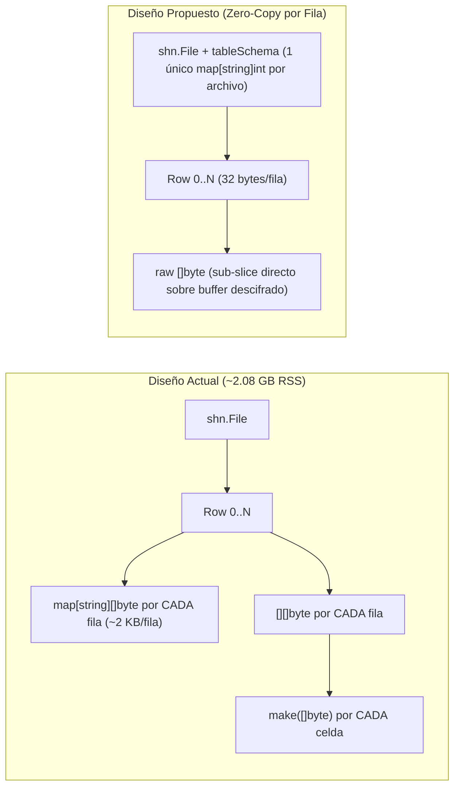

# Plan de Optimización de Memoria RAM del Motor `.shn` (`pkg/data/shn`) y `DataStore`

## 1. Objetivo
Reducir drásticamente el consumo de memoria RAM de `ZoneService` (actualmente **~2.08 GB RSS** con `ZONE_PRELOAD_ALL=true`, a pesar de que toda la carpeta `data/` pesa **271 MB** en disco) optimizando la representación en memoria de [`pkg/data/shn/shn.go`](../../pkg/data/shn/shn.go) y eliminando cargas duplicadas en [`pkg/server/zone/data_store.go`](../../pkg/server/zone/data_store.go), manteniendo **100% intacta la API pública** y pasando todos los controles de auditoría.

---

## 2. Diagnóstico de Causa Raíz

Actualmente, en [`pkg/data/shn/shn.go`](../../pkg/data/shn/shn.go#L401-L429), el parser ejecuta por **cada fila** de cada uno de los 180 archivos `.shn`:

1. **`rowVals := make(map[string][]byte, colCount)` por fila:**  
   Cada `shn.Row` instancia su propio `map[string][]byte`. En tablas como `ItemInfo.shn` (14.999 filas × 57 columnas), `NpcDialogData.shn` (23.197 filas), `ActiveSkill.shn` (2.791 filas), `MobInfo.shn` (2.878 filas), etc., cientos de miles de `map` en Go agregan más de **~1.2 GB** únicamente en cabeceras y buckets de hash para repetir exactamente los mismos nombres de columna de la tabla.
2. **`rowCols := make([][]byte, colCount)` + `make([]byte, col.Size)` por celda:**  
   Además del mapa, cada fila aloca un slice `[][]byte` (`colCount * 24` bytes) y realiza millones de copias individuales `make([]byte, col.Size)` por cada celda en vez de referenciar por offset el buffer descifrado `full`.
3. **Doble copia al descifrar en `Parse`:**  
   `Decrypt(data[36:])` aloca un slice nuevo y luego `Parse` vuelve a alocar `full = make([]byte, 36+len(decrypted))` copiando el cuerpo por segunda vez.
4. **Lectura duplicada de tablas en `LoadAllData`:**  
   En [`pkg/server/zone/data_store.go`](../../pkg/server/zone/data_store.go#L251-L310), `ActiveSkill.shn`, `PassiveSkill.shn` y `MobInfo.shn` se leen del disco individualmente y luego `LoadAllSHNTables(dataDir)` vuelve a leer y parsear los 180 archivos `.shn` desde cero.



---

## 3. Cambios Propuestos

### 3.1 Motor Binario SHN (`pkg/data/shn`)

#### [MODIFY] [pkg/data/shn/shn.go](../../pkg/data/shn/shn.go)
- Introducir un descriptor compartido por archivo (`tableSchema`) que almacene **una sola vez por tabla**:
  - `colIndex map[string]int`: mapeo `nombreColumna -> índice posicional` (respetando que si un `.shn` repite nombre de columna, prevalece el último índice igual que hacía `rowVals[col.Name] = val`).
  - `colOffsets []int`: offset relativo en bytes dentro de `rowBytes` para cada columna (`0..colCount-1`).
  - `colSizes []int`: tamaño fijo de cada columna.
  - `hasVarCol bool`: flag indicando si la última columna es `TypeListVarStr` (`26`).
- Redefinir `Row` como vista liviana sin `map` ni `make([]byte)` por celda:
  ```go
  type tableSchema struct {
      colIndex   map[string]int
      colOffsets []int
      colSizes   []int
      hasVarCol  bool
  }

  type Row struct {
      schema *tableSchema
      raw    []byte   // sub-slice de la fila cruda (después de los 2 bytes row_len)
      cols   [][]byte // usado únicamente por el formato especial CQuestData (QuestData.shn, 7 columnas)
  }
  ```
- Mantener **exactamente las mismas firmas y semántica** de todos los métodos públicos de `Row` y `File`:
  - `ColumnCount() int`
  - `GetBytesAt(idx int) []byte`
  - `GetBytes(colName string) []byte`
  - `RawBytes(colName string) []byte`
  - `GetByteAt`, `GetUint16At`, `GetInt16At`, `GetUint32At`, `GetInt32At`, `GetIntAt`
  - `GetByte`, `GetUint16`, `GetInt16`, `GetUint32`, `GetInt`, `GetInt64`, `GetString`
  - `ColumnIndex`, `FindRows`, `FindRow`, `FindRowInt`
- Optimizar `Decrypt` / `Parse` para descifrar en un único buffer sin doble alocación de `full`.

---

### 3.2 Deduplicación en `DataStore` (`pkg/server/zone`)

#### [MODIFY] [pkg/server/zone/data_store.go](../../pkg/server/zone/data_store.go)
- Cargar primero `ds.SHNTables, err = LoadAllSHNTables(dataDir)` y reutilizar `ds.GetSHN("ActiveSkill")`, `ds.GetSHN("PassiveSkill")` y `ds.GetSHN("MobInfo")` para `ds.ActiveSkillSHN`, `ds.PassiveSkillSHN` y `ds.MobInfoSHN` (con fallback a `shn.ReadFile` si no estuvieran en el catálogo), evitando parsear y retener dos copias en RAM de esas tres tablas.

---

## 4. Plan de Verificación

### 4.1 Pruebas Automatizadas
1. Ejecutar los tests unitarios del parser y checksums SHN:
   ```bash
   go test -v -count=1 ./pkg/data/shn/...
   ```
2. Ejecutar los tests de `pkg/server/zone`, `pkg/server/world` y `pkg/audit` que verifican las 180 tablas `.shn` y catálogos en RAM:
   ```bash
   go test -v -p 1 -count=1 ./pkg/server/zone -run "TestFase10|TestFase14|TestFase15|TestFase16"
   go test -v -p 1 -count=1 ./pkg/audit -run "TestFase10_Control6_"
   ```

### 4.2 Verificación de Consumo de RAM (`RSS`)
- Compilar/reiniciar `ZoneService` con `ZONE_PRELOAD_ALL=true` y medir el `RSS` real mediante `ps` antes y después para confirmar la reducción de memoria.

