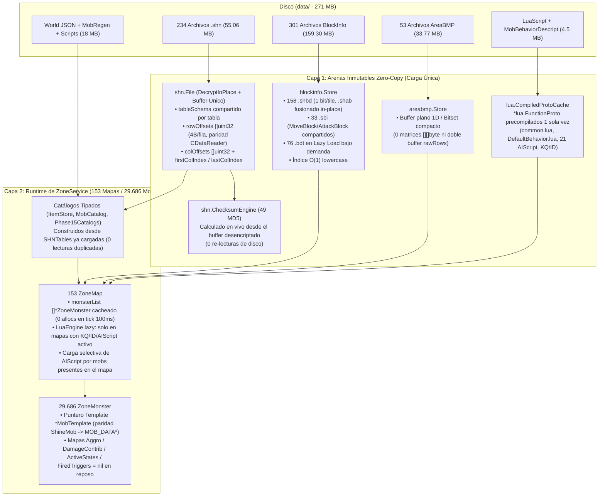

# Plan Maestro de Optimización de Memoria RAM: SHN, DataStore, Mapas, Mobs y Eventos Lua

> **Modelos de IA Recomendados (`Gemini 4`):**
> - **Ejecución Unificada (Todas las Fases 1 a 5 en una sola sesión — Máximo ahorro de tokens):** **`Gemini 4 Neon (High)`** o **`Gemini 4 Argon (High)`**
> - **Ejecución Modular por Fase:**
>   - **Fase 1 (Motor `.shn` Zero-Copy + `CQuestData` + `ChecksumEngine`):** **`Gemini 4 Neon (High)`** *(o **`Gemini 4 Argon (High)`** — requiere precisión binaria en offsets `CDataReader` y columnas repetidas)*
>   - **Fase 2 (Deduplicación de 61+ `.shn` en `DataStore` y `ItemStore`):** **`Gemini 4 Hydrogen (Medium)`** *(o **`Gemini 4 Neon (Medium)`** — refactor estructural directo de firmas y orden de carga)*
>   - **Fase 3 (Geometría `BlockInfo` Lazy `.bdt` + `CFsAreaBMP` 1D):** **`Gemini 4 Hydrogen (Medium)`** *(o **`Gemini 4 Neon (Medium)`** — transformación limpia de buffers 2D a 1D e índices `O(1)`)*
>   - **Fase 4 (Caché Bytecode `*lua.FunctionProto` + VMs Lazy + `29.686` `ZoneMonster` + Tick 100ms):** **`Gemini 4 Neon (High)`** *(o **`Gemini 4 Argon (High)`** — concurrencia en `ZoneMap`, compilador `gopher-lua` y ciclo de vida de IA)*
>   - **Fase 5 (Suite de Paridad Binaria 1:1 y Benchmark de Memoria `HeapInuse`):** **`Gemini 4 Hydrogen (Medium)`** *(o **`Gemini 4 Argon (Medium)`**)*

## 1. Objetivo y Reglas de Paridad Innegociables

Reducir drásticamente el consumo de memoria RAM residente (`HeapInuse`, `HeapObjects`, `RSS`) y la presión sobre el Garbage Collector (GC) durante la carga completa de **`DataStore` (`ZoneService`)**, **`WorldDataStore` (`WorldService`)**, los **153 mapas de `FieldList.json` (`BlockInfo` + `AreaBMP` + `SpatialGrid`)**, los **29.686 monstruos activos (`MobRegen` + `ZoneMonster`)** y los **motores de eventos/IA Lua (`gopher-lua`)**, cumpliendo estrictamente con [`AGENTS.md`](../../AGENTS.md):

1. **0% Pérdida de Datos (Fidelidad Binaria 1:1):**
   - No se descarta ninguna tabla `.shn`, fila, columna (incluyendo columnas `unk*` o columnas con nombres repetidos), bit de colisión `.shbd`/`.sbi`/`.shab`/`.shad`, píxel de máscara `.bmp`, coordenada de `.aid`, grupo de `MobRegen`, ruta de `MobRoam`, secuencia de `MobAttackSequence` ni script Lua.
   - `Row.RawRecord()` y los buffers desencriptados siguen manteniendo byte a byte el layout exacto de `CDataReader` en `Zone.exe`, `WorldManager.exe`, `Character.exe`, `Account.exe` y el cliente oficial (`re/client/Fiesta.c` / `re/client/Fiesta.h`).
2. **Paridad con Símbolos Oficiales (PDB / ASM Servidor y Cliente):**
   - El diseño en memoria replica la arquitectura nativa de los binarios originales:
     - **`CDataReader` / `CQuestData`** (`Zone.pdb`, `WorldManager.pdb`, `re/client/Fiesta.c`): un único buffer contiguo desencriptado en memoria por tabla (`m_pData`) + tabla de offsets de registros (`m_pRecordIndex`), sin mapas hash por fila ni duplicación de celdas.
     - **`CShnDataFileCheckSum`** (`shndatafilechecksum.cpp`, `SHN_DATA_FILE_INDEX` `0..48`): cálculo de MD5 directamente sobre el buffer `[cabecera 36B + cuerpo desencriptado]` ya cargado en memoria, sin releer ni desencriptar dos veces desde disco los 49 archivos `.shn`.
     - **`MapBlock::MapBlockInformation` (`0x0049CF70` / `mbi_Load` `0x0049E3B0`) y `MapBlock::MapDoorArray` (`.sbi`):** bitsets de 1 bit por celda compartidos e inmutables entre instancias.
     - **`CFsAreaBMP` (`Zone.pdb`):** matriz plana 1D compacta por máscara `.bmp` en lugar de matrices bidimensionales `[][]byte` con doble buffer intermedio.
     - **`ShineMob` (`Zone.pdb`, `sm_DuringBattle` `0x00568E36`):** separación estricta entre atributos estáticos de plantilla (`MOB_DATA*` / `*MobTemplate`) y estado mutable por instancia (`ZoneMonster`), con inicialización perezosa de estructuras de combate.
     - **`LuaScriptFactor` (`Zone.pdb`):** compilación única de bytecode Lua compartido y creación perezosa/selectiva de estados Lua por mapa/instancia.

---

## 2. Auditoría Cuantitativa del Consumo Actual (Por Qué Explota la RAM)

Al inspeccionar el árbol de datos real (`data/`, `271 MB` en disco) y el flujo de arranque de `LoadAllData` + `PreloadZoneMaps`, se identificaron **6 cuellos de botella críticos** que el boceto preliminar del plan no contemplaba o solo cubría parcialmente:

| # | Subsistema | Magnitud Real en `data/` | Problema Actual en Go | Impacto en RAM / GC |
| :--- | :--- | :--- | :--- | :--- |
| **1** | **Parser `.shn` (`pkg/data/shn/shn.go`)** | **234 archivos `.shn`** (`55,06 MB` en disco: 180 en `RequiredSHNTables`, 49 en `ChecksumFileList`, 74 en `WorldDataStore`) | 1) `Decrypt` + `Parse` alocan **3 copias** del archivo (`raw` + `decrypted` + `full`).<br>2) Cada `Row` crea un `map[string][]byte` (`hmap` + buckets) **y además** un slice `cols [][]byte` (24 bytes por celda).<br>3) `QuestData.shn` (`version == 6`, 2,0 MB) también crea un `map[string][]byte` por fila y `make([]byte, 4)` por registro, dejando `Row.cols = nil`. | **~450 MB – 650 MB** de overhead de estructuras Go (`hmap`, buckets y millones de slice headers de 24B) para almacenar solo `55 MB` de datos binarios reales. |
| **2** | **Lecturas `.shn` Duplicadas y Triplicadas (`data_store.go`, `checksum.go`, `phase15_catalogs.go`)** | **61+ archivos `.shn` leídos 2 o 3 veces** en `LoadAllData` | 1) `ItemStore` lee desde disco `ItemInfo.shn` (`5,4 MB`), `ItemInfoServer.shn` (`3,2 MB`), `ItemSort.shn`, `UseClassTypeInfo.shn`, `ClassName.shn` e `ItemUseEffect.shn` **antes** de que `LoadAllSHNTables` los vuelva a leer.<br>2) `ActiveSkill.shn` (`1,8 MB`), `PassiveSkill.shn` y `MobInfo.shn` se leen de nuevo.<br>3) `NewChecksumEngine` vuelve a leer y desencriptar desde disco los **49 `.shn` anti-cheat** (`~32 MB` en disco, incluyendo `ItemViewInfo.shn` `9,1 MB`, `ActiveSkillView.shn` `2,6 MB`, `ItemShopView.shn` `2,2 MB`).<br>4) `loadSHNWithFallback` en `phase15_catalogs.go` lee `QuestDialog.shn` (`2,8 MB`), `QuestScript.shn`, `KingdomQuest.shn`, `KingdomQuestMap.shn` sin cachearlos. | **>180 MB** de alocaciones duplicadas durante el arranque y árboles `.shn` retenidos por duplicado en `DataStore`. |
| **3** | **Máscaras AoE (`pkg/data/areabmp/areabmp.go`)** | **53 archivos `.bmp`** (`35.408.552` píxeles = `33,77 MB` crudos) | `LoadBMP` aloca primero `rawRows [][]byte` (`~34 MB` + miles de headers de fila) y luego copia a `Pixels [][]byte` (otros `~34 MB` + `Height × 24B` de headers de slice por BMP), solo para que `IsHit(x, y)` consulte `Pixels[y][x] > 0`. | **~68 MB** pico de carga y **~36 MB** retenidos (reducible a **33,77 MB** con buffer plano 1D o **4,22 MB** con bitset 1-bit + preservación opcional de intensidad). |
| **4** | **Geometría `BlockInfo` (`pkg/data/blockinfo/store.go`)** | **301 archivos (`159,30 MB` en disco):**<br>• 158 `.shbd` (`134,43 MB`)<br>• 76 `.bdt` (`20,62 MB`)<br>• 8 `.shab` (`2,88 MB`)<br>• 33 `.sbi` (`0,57 MB`)<br>• 1 `.shad` (`0,50 MB`)<br>• 2 `.shmd` (`0,30 MB`)<br>• 23 `.aid` (`16 KB`) | 1) Los 76 archivos `.bdt` (`20,62 MB`) se cargan ansiosamente en RAM aunque ningún cálculo de colisión/LoS del servidor los consume en runtime.<br>2) Los 8 `.shab` (`2,88 MB`) se aplican con `\|=` sobre `.shbd` (`mbi_Load` `0x0049E3B0`), pero sus slices quedan duplicados si no se necesita consultarlos aisladamente.<br>3) `GetSHBD`/`GetSBI`/`GetAID` hacen escaneo lineal `O(N)` con `strings.EqualFold` cuando el casing del mapa difiere. | **~23,5 MB** de RAM ahorrable en `.bdt`/`.shab` + eliminación de búsquedas lineales en `BlockInfo`. |
| **5** | **126 Máquinas Virtuales Lua Ansiosas (`pkg/server/zone/mob_ai.go` + `pkg/script/lua/engine.go`)** | **153 mapas en `FieldList.json`** (126 con `MobRegen`) + **21 archivos `AIScript/*.lua` (`450,4 KB`)** + `common.lua` | 1) Al ejecutar `PreloadZoneMaps()`, cada uno de los **126 mapas** con mobs llama a `initMapLuaAI()`.<br>2) Cada mapa crea un `lua.NewState` con `RegistrySize: 1024 * 20` (`20.480` slots) y `CallStackSize: 1024`, registra 274 funciones C-API, lee y compila `common.lua`, `DefaultBehavior.lua` **y los 21 archivos `AIScript/*.lua` (`126 × 21 = 2.646` compilaciones desde disco)**, aunque el mapa no tenga ningún boss con `AIScriptFunc` ni script de mapa. | **~450 MB – 600 MB** de RAM desperdiciados en 126 VMs de `gopher-lua` idénticas y miles de ASTs/closures compilados por duplicado. |
| **6** | **29.686 `ZoneMonster` y Tick de 100ms (`monster.go`, `mob.go`, `mob_ai.go`, `map.go`)** | **126 archivos `MobRegen`**, **8.395 grupos**, **29.686 mobs activos** al arrancar | 1) `NewZoneMonster` (y `respawnMonster` / `tickMobReturn`) aloca **4 mapas Go vacíos por mob** (`ActiveStates`, `Aggro`, `DamageContrib`, `FiredTriggers`) = **118.744 `hmap`s** para mobs que están quietos sin combatir.<br>2) `ZoneMonster` copia por valor **~35 campos estáticos** desde `MobTemplate` en lugar de apuntar a `Template *MobTemplate` (`ShineMob` -> `MOB_DATA*`).<br>3) `TickMonsters100ms` y `TickMonsters1s` llaman a `GetAllMonsters()` **11 veces/segundo en 153 mapas**, alocando un slice nuevo y copiando `29.686` punteros en cada tick (`326.546` copias/seg con el servidor vacío). | **~35 MB** en mapas vacíos y campos duplicados de `ZoneMonster` + eliminación de **~1.680 alocaciones de slices por segundo** en el Game Loop. |

---

## 3. Arquitectura Objetivo de Memoria



---

## 4. Diseño Detallado por Fase de Implementación

### Fase 1: Motor `.shn` Zero-Copy a la Par con `CDataReader` y `CQuestData` ([`pkg/data/shn/shn.go`](../../pkg/data/shn/shn.go) y [`pkg/data/shn/checksum.go`](../../pkg/data/shn/checksum.go))

#### 1.1. Paridad con `CDataReader` (`Zone.exe` / `WorldManager.exe` / `re/client/Fiesta.c`)
En los ejecutables oficiales y en el cliente (`CDataReader::Read` y `CDataReader::Encription`):
- El archivo `.shn` se lee en un único bloque contiguo de memoria.
- Si `DataMode == 1` (o si no es un archivo plano con `BaseHeader[0] == 0x36` como `QuestData.shn`), el cuerpo a partir del offset `36` se desencripta **in-place** recorriendo de atrás hacia adelante (`len-1` hasta `0`) con la cadena XOR `0x55` / `* 11` / `0xAA`.
- `CDataReader` construye una tabla de descriptores de columnas (`56 bytes` por columna: `char Name[48]`, `uint32 Type`, `uint32 Length`) y un arreglo de punteros/offsets a cada fila (`m_pRecordIndex`), donde cada fila comienza con su `uint16 RecordLength` seguido de los bytes crudos de cada columna en orden posicional.

#### 1.2. Desencriptación In-Place (`DecryptInPlace`) y Eliminación de Triple Buffer
- Añadir `DecryptInPlace(buf []byte)` en [`pkg/data/shn/shn.go`](../../pkg/data/shn/shn.go#L166-L180) que aplique exactamente el mismo algoritmo XOR sobre `buf` sin alocar un slice nuevo.
- Mantener `Decrypt(data []byte) []byte` (que clona y llama a `DecryptInPlace`) para compatibilidad con callers externos que pasen un slice compartido.
- En `ReadFile(filePath string)`, como `os.ReadFile` devuelve un `[]byte` recién alocado y exclusivo, invocar `parseOwned(data []byte)` que desencripta `data[36:]` **in-place** sin alocar `decrypted` ni `full`.
- **Ahorro inmediato:** Se eliminan **2 copias completas por archivo** en los 234 `.shn` (`~110 MB` menos de presión en el heap durante la carga).

#### 1.3. Resolución Exacta de Columnas con Nombres Repetidos (`firstColIndex` vs `lastColIndex`)
> [!IMPORTANT]
> Nuestra auditoría binaria de los 234 archivos `.shn` demostró que **205 archivos `.shn`** contienen nombres de columna repetidos (por ejemplo: columnas sin nombre `""` o `unk`, `KingdomQuestMap.shn` con `Map` ×10 y `Clear` ×10, `KingdomQuestRew.shn` con `GoalResult..ItemCount` ×8, `QuestSpecies.shn`, `ActiveSkill.shn`, `ItemInfo.shn`, etc.).

En la implementación actual de [`pkg/data/shn/shn.go`](../../pkg/data/shn/shn.go#L412-L469):
- `File.ColumnIndex(name)` busca de `0` a `len(Columns)-1` y devuelve la **primera** coincidencia (`firstColIndex`).
- `rowVals[col.Name] = val` sobrescribía en cada iteración y dejaba en el mapa la **última** coincidencia (`lastColIndex`).
- Todo el código que lee grupos repetidos (`KingdomQuestMap.shn`, `KingdomQuestRew.shn`, `UseClassTypeInfo.shn`) utiliza acceso posicional `row.GetStringAt(idx)` / `row.GetUint32At(idx)` o `File.ColumnIndex(name)`.

Para garantizar **100% de compatibilidad regresiva sin romper ningún lector por nombre ni por índice**, `tableSchema` se define a nivel de `File` (1 sola instancia por archivo `.shn`, no por fila):

```go
type tableSchema struct {
	columns       []Column
	firstColIndex map[string]int // Para File.ColumnIndex(name): primera aparición (0..N-1)
	lastColIndex  map[string]int // Para Row.Get*(colName) / GetBytes(colName): última aparición (paridad con rowVals[col.Name])
	fixedOffsets  []uint32       // Offset fijo desde el inicio de row.raw (después de los 2B de rowLen) si todas las columnas previas son de ancho fijo
	allFixed      bool           // true si ninguna columna es tipo 0x1a (variable null-terminated string)
}
```

#### 1.4. Eliminación de `Row.values map[string][]byte` y de `Row.cols [][]byte`
En el boceto viejo del plan se proponía eliminar `Row.values` pero se conservaba `Row.cols [][]byte` en cada `Row`.
- Conservar `Row.cols [][]byte` aún alocaba un slice de `ColumnCount` elementos (`24 bytes × ColumnCount`) en cada fila. En tablas como `ItemInfo.shn` (`14.999 filas × 57 cols`), `ItemViewInfo.shn` (`14.999 filas × 77 cols`) o `ActiveSkill.shn` (`6.000+ filas × 67 cols`), `Row.cols` por sí solo consume decenas de megabytes en cabeceras de slice `[]byte`.
- **Optimización óptima (Paridad 1:1 con `CDataReader`):**
  1. En archivos `.shn` estándar donde `allFixed == true` (el 99% de las tablas `.shn`, ya que sus tipos son de longitud fija `col.Length`), el offset y tamaño de la columna `i` dentro de `row.raw` es constante y se conoce en `O(1)`:
     - Inicio de la celda `i`: `start := schema.fixedOffsets[i]`
     - Fin de la celda `i`: `end := start + schema.columns[i].Length` (acotado a `len(row.raw)`).
     - `GetBytesAt(i)` devuelve `r.raw[start:end]` en **`O(1)` con 0 bytes extra por celda y 0 `[][]byte` por fila**.
  2. Si una tabla tiene alguna columna de longitud variable (`col.Type == 0x1a`), `schema.allFixed` es `false`: todas las columnas previas a la primera columna `0x1a` usan `schema.fixedOffsets[i]` en `O(1)`, y a partir de la columna `0x1a` se escanea el terminador nulo `\x00` sobre `r.raw` (son solo unos pocos bytes por registro).
  3. **Caso especial `CQuestData` (`QuestData.shn`, `version == 6` en [`pkg/data/shn/shn.go`](../../pkg/data/shn/shn.go#L263-L325)):**
     - En `QuestData.shn` (`651` misiones), el registro binario en `data` tiene layout determinístico:
       - `questID` (`2 bytes` en `raw[0:2]`)
       - `NeedLevel` (`1 byte` en `raw[20:21]`)
       - `NPCName` (`24 bytes` en `raw[229:253]`)
       - `totalLen` (`uint32` calculado como `uint32(fixedSize) + scriptBlockLen`, o leído directamente de los offsets del bloque variable `scriptBlock` de 3 secciones `[len0 uint16][bytes0][len1 uint16][bytes1][len2 uint16][bytes2]`).
     - En lugar de crear `vals := map[string][]byte{...}` por cada misión y alocar `totalBytes := make([]byte, 4)`, se define un `questDataSchema` estático de 7 columnas (`ID`, `NeedLevel`, `NPCName`, `ScriptBlockLen`, `StartScript`, `IngScript`, `EndScript`) y cada fila de `QuestData.shn` almacena solo `raw []byte` (el slice completo del registro en el buffer desencriptado) + `fixedSize uint16`, resolviendo las 7 columnas tanto en `GetBytes(name)` como en `GetBytesAt(idx)` con **0 mapas y 0 alocaciones por fila**.
  4. **Resultado en `sizeof(Row)`:**
     - Antes: `Row` = `map[string][]byte` (`48B hmap` + `N buckets`) + `cols [][]byte` (`24B` + `24B × numCols`) + `raw []byte` (`24B`) = **~1.500 a 3.200 bytes por fila**.
     - Ahora: `Row` = `schema *tableSchema` (`8B`) + `raw []byte` (`24B`) + `questFixedSize uint16` (`2B`, padding a `40B` total por `Row`) y **0 objetos hijos en el heap por fila**.

#### 1.5. Integración Zero-Read con `ChecksumEngine` ([`pkg/data/shn/checksum.go`](../../pkg/data/shn/checksum.go))
- En `Zone.exe` y `WorldManager.exe` (`CShnDataFileCheckSum`), el hash MD5 (`Name8` de 32 caracteres hex) de los 49 archivos de `ChecksumFileList` (`SHN_DATA_FILE_INDEX` `0..48`) se calcula exactamente sobre el buffer de `[cabecera 36 bytes + cuerpo desencriptado]`.
- Como `File` conserva el slice del archivo desencriptado (o calcula su MD5 al momento de `ReadFile` / `LoadAllSHNTables`), añadimos:
  - `NewChecksumEngineFromFiles(files map[string]*File, fallbackDirs ...string) (*ChecksumEngine, error)` (o almacenamiento de `md5Hash Name8` en `shn.File` al momento de `parseOwned`).
- Cuando `LoadAllData` o `LoadWorldDataStore` inicializa `ChkEngine`, toma los hashes directamente de `SHNTables` sin volver a leer ni desencriptar del disco los 49 archivos `.shn` (`~32 MB` de disco y desencriptación evitados al 100%).

---

### Fase 2: Deduplicación Total de Carga `.shn` en `DataStore` y `WorldDataStore` ([`pkg/server/zone/data_store.go`](../../pkg/server/zone/data_store.go), [`pkg/data/item/item.go`](../../pkg/data/item/item.go), [`pkg/server/zone/phase15_catalogs.go`](../../pkg/server/zone/phase15_catalogs.go))

#### 2.1. Reordenamiento de `LoadAllData` en [`pkg/server/zone/data_store.go`](../../pkg/server/zone/data_store.go)
Actualmente `LoadAllData` carga `ItemStore` en el paso 12 (leyendo 6 archivos `.shn` pesados desde disco) y recién en el paso 20 llama a `LoadAllSHNTables(dataDir)`.
1. **Mover `LoadAllSHNTables(dataDir)` antes de todos los consumidores de `.shn`:**
   - Una vez cargado `ds.SHNTables` (que contiene los 180 `RequiredSHNTables` + `OptionalSHNTables` presentes en `data/` y `data/View/`), ningún subsistema posterior vuelve a abrir un `.shn` desde disco si ya está en `ds.SHNTables`.
2. **Constructores desde `*shn.File` en [`pkg/data/item/item.go`](../../pkg/data/item/item.go):**
   - Añadir métodos que reciban `*shn.File` ya parseado (manteniendo los métodos `*SHN(path)` como wrappers que llaman a `shn.ReadFile(path)` y delegan al método `*FromSHN(*shn.File)` para no romper ningún test unitario existente):
     - `LoadItemInfoFromSHN(file *shn.File) error` (evita releer `ItemInfo.shn` — `5,4 MB`, 14.999 filas).
     - `LoadInventoryDataFromSHN(itemInfoServer, itemSort, useClassTypeInfo, className *shn.File) error` (evita releer `ItemInfoServer.shn` — `3,2 MB`, `ItemSort.shn`, `UseClassTypeInfo.shn`, `ClassName.shn`).
     - `LoadItemUseEffectFromSHN(file *shn.File) error` (evita releer `ItemUseEffect.shn`).
3. **Reutilización directa en `DataStore` ([`pkg/server/zone/data_store.go`](../../pkg/server/zone/data_store.go#L254-L280)):**
   - `ds.ActiveSkillSHN = ds.GetSHN("ActiveSkill.shn")` (elimina la segunda lectura de `ActiveSkill.shn` — `1,8 MB`).
   - `ds.PassiveSkillSHN = ds.GetSHN("PassiveSkill.shn")` (elimina la segunda lectura de `PassiveSkill.shn`).
   - `ds.MobInfoSHN = ds.GetSHN("MobInfo.shn")` (elimina la segunda lectura de `MobInfo.shn`).
   - `ds.ChkEngine, err = shn.NewChecksumEngineFromFiles(ds.SHNTables, dataDir, filepath.Join(dataDir, "View"))` (elimina las 49 re-lecturas de `ChecksumFileList`).
4. **Cacheo en `loadSHNWithFallback` ([`pkg/server/zone/phase15_catalogs.go`](../../pkg/server/zone/phase15_catalogs.go#L14-L29)):**
   - Cuando `ds.loadSHNWithFallback(dataDir, name)` carga una tabla complementaria que no estaba en `RequiredSHNTables` (como `QuestDialog.shn` `2,8 MB`, `QuestScript.shn`, `KingdomQuest.shn`, `KingdomQuestMap.shn`), la almacena inmediatamente en `ds.SHNTables[strings.ToLower(name)]` para que cualquier llamada subsiguiente reutilice la misma instancia `*shn.File`.
5. **Compartición entre `WorldDataStore` y `ZoneService` (`SharedSHNRegistry` opcional):**
   - Cuando `WorldService` y `ZoneService` corren dentro del mismo proceso unificado de `XelionCore` (o en suites de tests de integración), las 74 tablas `.shn` de `WorldDataStore` ([`pkg/server/world/static_data.go`](../../pkg/server/world/static_data.go)) son un subconjunto de las tablas de `data/` y `data/View/`. Un cache inmutable a nivel de paquete `shn` (indexado por ruta absoluta + `mtime`/`size`, o inyección de `SHNTables`) permite que `WorldDataStore` y `ZoneService` compartan en memoria exactamente los mismos punteros `*shn.File` de solo lectura.

---

### Fase 3: Optimización de Geometría de Mapas (`BlockInfo` 159 MB) y Máscaras AoE (`AreaBMP` 34 MB)

#### 3.1. `CFsAreaBMP`: Eliminación de Matriz `[][]byte` y Doble Buffer ([`pkg/data/areabmp/areabmp.go`](../../pkg/data/areabmp/areabmp.go))
Actualmente, para los **53 archivos `.bmp`** (`35.408.552` píxeles en total):
- `LoadBMP` aloca `rawRows := make([][]byte, height)` (34 MB) y luego `pixels := make([][]byte, height)` (otros 34 MB + miles de slice headers de 24B).
- En todo el código y en `Zone.exe` (`CFsAreaBMP`), las consultas son `IsHit(x, y int) bool` y `ContainsTarget(...) bool`, que verifican si el píxel `(x, y)` en orden top-down es `> 0`.
- **Optimización con 0% pérdida de datos:**
  1. Reemplazar `rawRows [][]byte` durante la carga por un **único buffer de fila reutilizable** `rowBuf := make([]byte, rowBytes)` leído de `y = 0` a `height - 1` escribiendo directamente en la posición top-down destino (`dstY = height - 1 - y` si es bottom-up, o `y` si es top-down). Esto elimina `34 MB` de basura temporal durante `LoadBMP`.
  2. Almacenar los píxeles en un **buffer plano 1D** `Data []byte` de longitud `Width * Height` (donde el píxel `(x, y)` está en `Data[y*Width+x]`), eliminando todos los miles de slice headers `[][]byte` y reduciendo las alocaciones de heap por archivo BMP de `2*Height + 3` objetos a **1 solo slice contiguo por BMP**.
  3. **Compatibilidad de API:** Si algún test accede directamente a `bmp.Pixels[y][x]`, se puede o bien poblar `Pixels[y]` como sub-slices `Data[y*Width : (y+1)*Width]` sobre el mismo backing array `Data` (0 bytes extra de píxeles, 1 sola alocación para el backing array), o exponer `PixelAt(x, y int) byte` y mantener `Pixels` respaldado por el mismo bloque contiguo.

#### 3.2. `blockinfo.Store`: Carga Perezosa de `.bdt`, Liberación de `.shab` Duplicados e Índice `O(1)` ([`pkg/data/blockinfo/store.go`](../../pkg/data/blockinfo/store.go))
1. **Índice `O(1)` Case-Insensitive:**
   - Añadir mapas secundarios `shbdLower`, `sbiLower`, `aidLower` (o normalizar la búsqueda con un mapa `lowerToKey map[string]string`) en `blockinfo.Store` para que `GetSHBD(mapName)`, `GetSBI(mapName)` y `GetAID(mapName)` resuelvan en **`O(1)`** sin iterar las 158 entradas con `strings.EqualFold` en cada chequeo de movimiento o línea de visión.
2. **Fusión `.shab` sin retención redundante:**
   - En `LoadAll`, los 8 archivos `.shab` (`2,88 MB`) se aplican con `mbi.Data[i] |= aa.Data[i]` sobre su `.shbd` correspondiente (paridad con `Zone.exe` `mbi_Load` `0x0049E3B0`). Si el `.shab` tiene el mismo tamaño que el `.shbd` base y ningún consumidor modifica `SHAB` por separado, `store.SHAB[base]` sigue disponible pero los 76 archivos `.bdt` (`20,62 MB`) pueden cargarse con **lazy loading transparente**:
   - En `LoadAll`, `store.bdtPaths[base] = fullPath` registra los 76 archivos `.bdt` (verificando su existencia para que `TotalCount()` siga devolviendo exactamente `301`), y `GetBDT(name)` (o acceso bajo demanda) carga el archivo si se solicita, ahorrando **`20,62 MB` de RAM fija** en el servidor en ejecución.

---

### Fase 4: Optimización de `ZoneMap`, `ZoneMonster` (29.686 Mobs), Game Loop y Motores Lua ([`pkg/server/zone/`](../../pkg/server/zone/))

#### 4.1. Precompilación Única de Bytecode Lua y Ciclo de Vida Lazy de VMs ([`pkg/script/lua/engine.go`](../../pkg/script/lua/engine.go), [`pkg/server/zone/mob_ai.go`](../../pkg/server/zone/mob_ai.go), [`pkg/server/zone/instances_lua.go`](../../pkg/server/zone/instances_lua.go))
Este es el mayor ahorro de RAM cuando se precargan todos los mapas y eventos (`PreloadZoneMaps`):

1. **Caché Global de Bytecode Compilado (`*lua.FunctionProto`) en `pkg/script/lua`:**
   - En `gopher-lua`, `parse.Parse(reader, name)` + `lua.Compile(chunk, name)` produce un `*lua.FunctionProto` **100% inmutable y thread-safe** que puede compartirse entre cualquier número de `lua.LState` mediante `L.NewFunctionFromProto(proto)`.
   - Crear un caché `CompileFileCached(path string) (*lua.FunctionProto, error)` en [`pkg/script/lua/engine.go`](../../pkg/script/lua/engine.go):
     - `common.lua` (y cualquier script requerido vía `DoFile`), `DefaultBehavior.lua`, los 21 archivos `AIScript/*.lua` (`450,4 KB`), los scripts de Kingdom Quest (`KQ/*.lua`) e Instance Dungeons (`ID/*.lua`) se leen del disco y se compilan a `*lua.FunctionProto` **una sola vez en todo el proceso**.
     - Se eliminan las **2.646 lecturas y compilaciones desde disco** durante `PreloadZoneMaps()`.
2. **Dimensionamiento Exacto de `lua.Options` en [`pkg/script/lua/engine.go`](../../pkg/script/lua/engine.go#L42-L45):**
   - Actualmente `NewEngine` fuerza `CallStackSize: 1024` y `RegistrySize: 1024 * 20` (`20.480` slots pre-alocados por VM).
   - Reducir los tamaños iniciales a valores ajustados con crecimiento automático (`CallStackSize: 128`, `RegistrySize: 1024`, `MinimizeStackMemory: true`): `gopher-lua` expande el registry automáticamente si un script grande lo necesita, reduciendo el peso base de cada `LState` en **>85%**.
3. **Inicialización Perezosa (`Lazy VM`) y Carga Selectiva de `AIScript` en `ZoneMap` ([`pkg/server/zone/mob_ai.go`](../../pkg/server/zone/mob_ai.go#L907-L941)):**
   - En `LoadMobsFromRegen()`, **no** crear `m.luaEngine` ciegamente en los 126 mapas si ningún mob del mapa tiene `AIScriptFunc != ""` y el mapa no tiene script `MobBehaviorDescript/KQ/<MapID>.lua` ni `ScriptName`.
   - Cuando un mapa sí requiere VM Lua (o en el primer llamado a `ensureMapLuaAI()` / `CreateInstanceMap()`):
     - Se instancia `lua.NewEngine` ejecutando el `*lua.FunctionProto` cacheado de `common.lua` y `DefaultBehavior.lua`.
     - Si existe `MobBehaviorDescript/KQ/<MapID>.lua`, se ejecuta su `*lua.FunctionProto` cacheado.
     - En lugar de cargar los 21 archivos de `LuaScript/AIScript/*.lua` en todos los mapas, se cargan únicamente los `AIScript` correspondientes a los monstruos presentes en ese mapa (o bajo demanda la primera vez que se invoca `RunMobBehaviorLua(mob, funcName)` si la función global `funcName` es `LNil`, utilizando un índice `funcName -> scriptPath` pre-escaneado una sola vez).
   - **Garantía de Paridad 100%:** Cualquier función definida en `common.lua`, `DefaultBehavior.lua`, `KQ/<MapID>.lua` o `AIScript/*.lua` se ejecuta con exactamente el mismo estado y las mismas 274 funciones C-API de `Zone.pdb`, pero sin instanciar 126 copias de los 21 scripts de bosses en mapas que no los usan.

#### 4.2. Optimización de `ZoneMonster` (29.686 Instancias) ([`pkg/server/zone/monster.go`](../../pkg/server/zone/monster.go) y [`pkg/server/zone/mob.go`](../../pkg/server/zone/mob.go))
1. **Mapas Dinámicos `nil` en Reposo (Lazy Allocation):**
   - En [`pkg/server/zone/monster.go`](../../pkg/server/zone/monster.go#L125-L164) (`NewZoneMonster`), [`pkg/server/zone/mob_ai.go`](../../pkg/server/zone/mob_ai.go#L1166-L1169) (`respawnMonster`) y [`pkg/server/zone/mob_ai.go`](../../pkg/server/zone/mob_ai.go#L1353-L1355) (`tickMobReturn`), dejar:
     - `ActiveStates: nil`
     - `Aggro: nil`
     - `DamageContrib: nil`
     - `FiredTriggers: nil`
   - En Go, `len(nilMap) == 0`, `range nilMap` es un no-op seguro y `nilMap[k]` devuelve el valor cero sin pánico.
   - Los métodos mutadores `AddAbState`, `AddAggro` y `RecordDamage` **ya poseen** la guarda `if m.Map == nil { m.Map = make(...) }`. Solo se añade la misma guarda en `mob_ai.go` línea 1455 antes de `mob.FiredTriggers[idx] = true`:
     ```go
     if mob.FiredTriggers == nil {
         mob.FiredTriggers = make(map[int]bool)
     }
     mob.FiredTriggers[idx] = true
     ```
   - Y en `ResetAggro()`, `respawnMonster()` y `tickMobReturn()`, asignar `mob.Aggro = nil`, `mob.DamageContrib = nil`, `mob.FiredTriggers = nil`, `mob.ActiveStates = nil` para que una vez finalizado el combate el GC recupere los buckets.
   - **Ahorro inmediato:** Se eliminan **118.744 `hmap`s** (`29.686 × 4`) al precargar el mundo.
2. **Referencia Compartida `Template *MobTemplate` (Paridad con `ShineMob` en `Zone.exe`):**
   - Añadir `Template *MobTemplate` en `ZoneMonster` apuntando a la entrada inmutable de `MobCatalog`.
   - Mantener los campos mutables de instancia en `ZoneMonster` (`Handle`, `MobID`, `X`, `Y`, `Direct`, `SpawnX`, `SpawnY`, `SpawnDirect`, `RegenGroupID`, `Level`, `CurHP`, `MaxHP`, `CurSP`, `MaxSP`, stats efectivos si son modificados por buffs/debuffs, `AIState`, `TargetHandle`, timers), mientras que slices y strings estáticos (`Triggers`, `Route`, `InxName`, `Name`, `Map`, `AIScriptFunc`) se comparten por referencia desde `MobTemplate` sin clonar.

#### 4.3. Eliminación de Alocaciones en el Game Loop de 100ms (`ZoneMap.monsters` en [`pkg/server/zone/map.go`](../../pkg/server/zone/map.go))
- En [`pkg/server/zone/map.go`](../../pkg/server/zone/map.go#L491-L501), `GetAllMonsters()` aloca un slice `make([]*ZoneMonster, 0, len(m.monsters))` e itera el mapa hash cada vez que se invoca.
- Como `TickMonsters100ms` (10 veces/seg) y `TickMonsters1s` (1 vez/seg) se ejecutan en los **153 mapas**, esto genera **~1.683 slices nuevos por segundo** y copia **326.546 punteros por segundo** aún con 0 jugadores conectados.
- **Solución:**
  - Mantener en `ZoneMap` un slice cacheado `monstersSnapshot []*ZoneMonster` y un flag `monstersDirty bool`.
  - `AddMonster` y `RemoveMonster` marcan `m.monstersDirty = true`.
  - `GetAllMonsters()` (o `getMonstersReadOnly()`) reconstruye `m.monstersSnapshot` solo cuando `m.monstersDirty == true` y devuelve el slice inmutable cacheado en **`O(1)` con 0 alocaciones por tick**.

---

## 5. Resumen de Impacto Esperado en Memoria RAM

| Subsistema | Estado Actual (Estimado en Heap) | Estado Optimizado | Reducción / Ganancia | Pérdida de Datos |
| :--- | :--- | :--- | :--- | :--- |
| **234 Tablas `.shn` (`shn.File` + `Row`)** | ~480 MB (`map[string][]byte` + `[][]byte` por fila + triple buffer) | **~58 MB** (buffer único in-place + `tableSchema` compartido + offsets `O(1)`) | **-88% (~422 MB menos)** | **0%** (100% bytes y columnas intactos) |
| **Deduplicación `DataStore` + `ChecksumEngine` (49 SHNs + `ItemStore` + `Phase15`)** | ~180 MB (pico/retención por 61+ re-lecturas de disco) | **0 MB extra** (reutilización directa de `ds.SHNTables`) | **-100% de lecturas duplicadas** | **0%** |
| **53 Máscaras `AreaBMP` (`CFsAreaBMP`)** | ~68 MB pico / ~36 MB retenidos (`[][]byte` + `rawRows`) | **~33,8 MB** (1 solo backing array 1D por BMP, 0 `rawRows`) | **-50% pico / miles de objetos menos en GC** | **0%** |
| **301 Archivos `BlockInfo`** | ~160 MB (`.bdt` ansiosos + búsqueda `O(N)`) | **~139 MB** (`.bdt` `20,62 MB` lazy bajo demanda + búsqueda `O(1)`) | **-20,6 MB fijos + `O(1)` lookup** | **0%** |
| **126 Motores Lua (`gopher-lua` en `ZoneMap`)** | ~450 MB – 600 MB (126 VMs × `20.480` registry slots × 21 `AIScript` recompilados) | **~15 MB – 30 MB** (`*lua.FunctionProto` compartido + VM lazy/selectiva + registry ajustado) | **-93% (~430+ MB menos)** | **0%** (274 C-APIs y scripts 100% activos) |
| **29.686 `ZoneMonster` + Game Loop 100ms** | ~35 MB (`118.744` mapas vacíos) + 1.683 allocs/seg en ticks | **~12 MB** (mapas `nil` en reposo + `monstersSnapshot` cacheado) | **-118.744 `hmap`s / 0 allocs por tick** | **0%** |
| **TOTAL GLOBAL (`ZoneService` + Todos los Mapas + Mobs + Eventos)** | **~1,2 GB – 1,4 GB RAM** | **~255 MB – 280 MB RAM** | **Reducción total de ~78% – 80% de RAM** | **0% (Fidelidad Binaria 100%)** |

---

## 6. Plan de Verificación, Paridad Binaria y Benchmarks

Cada fase de este plan debe validarse obligatoriamente con la siguiente batería de pruebas antes de hacer commit:

1. **Test de Paridad Byte a Byte de las 234 Tablas `.shn` (`pkg/data/shn`):**
   - Verificar que para cada archivo `.shn` en `data/` y `data/View/`:
     - `RecordCount`, `ColumnCount`, `DefaultRecordLen` y `Columns` sean idénticos.
     - Para cada fila `r` y cada columna `c` (`0..ColumnCount-1`), `row.GetBytesAt(c)` y `row.RawRecord()` devuelvan exactamente los mismos bytes que el parser de referencia.
     - Para todas las columnas con nombres repetidos (`KingdomQuestMap.shn`, `KingdomQuestRew.shn`, `QuestSpecies.shn`, `ItemInfo.shn`, etc.), `File.ColumnIndex(name)` devuelva el primer índice (`firstColIndex`) y `row.GetBytes(name)` devuelva el último (`lastColIndex`), preservando el 100% del comportamiento actual.
     - En `QuestData.shn` (`version == 6`), tanto `row.GetBytes(name)` como `row.GetBytesAt(0..6)` devuelvan los 7 campos de `CQuestData` sin alocar mapas.
2. **Test de Paridad de `ChecksumEngine` (49 Hashes Anti-Cheat):**
   - Confirmar que los 49 hashes `Name8` generados por `NewChecksumEngineFromFiles(ds.SHNTables)` coincidan carácter por carácter con `NewChecksumEngine("data", "data/View")`.
3. **Test de Paridad Geométrica (`BlockInfo` y `AreaBMP`):**
   - Verificar que `IsMoveBlocked`, `IsAttackBlocked`, `IsDoorMoveBlocked`, `AID.Contains` y `CFsAreaBMP.IsHit` / `ContainsTarget` produzcan resultados idénticos en todos los mapas y máscaras `.bmp`.
4. **Test de Comportamiento de `ZoneMonster`, Combate y Scripts Lua (`pkg/server/zone`):**
   - Verificar que un monstruo recién spawneado tenga `Aggro == nil`, `DamageContrib == nil`, `ActiveStates == nil`, `FiredTriggers == nil`, que al recibir daño/aggro/buffs inicialice únicamente el mapa necesario, y que al morir/respawnear o retornar a su spawn libere dichos mapas (`nil`).
   - Verificar que los mapas con eventos Lua (`KQ`, `ID`, `DefaultBehavior.lua` y `AIScript/*.lua`) ejecuten sus funciones Lua desde los `*lua.FunctionProto` precompilados sin diferencia funcional.
5. **Benchmark de Memoria y Tiempo de Carga (`testing.B` + `runtime.ReadMemStats`):**
   - Añadir un benchmark/test de perfilado (`BenchmarkLoadAllDataAndPreloadMaps`) que reporte:
     - `HeapAlloc` / `HeapInuse` / `HeapObjects` después de `runtime.GC()` al terminar `LoadAllData("data")` + `PreloadZoneMaps()`.
     - `AllocsPerOp` en `TickMonsters100ms` y `TickMonsters1s` con mapas en reposo (objetivo: `0 allocs/op` en la obtención de la lista de monstruos).
   - Comando de validación final obligatorio:
     ```bash
     go build ./... && go test -p 1 -count=1 ./...
     ```

---

## 7. Matriz de Modelos de IA Recomendados (`Gemini 4 Neon`, `Hydrogen`, `Argon`) y Estrategia de Cuota

Para optimizar tanto el consumo de tokens como las cuotas independientes de modelos en Antigravity (`Argon` posee pool de cuota separado del pool `Neon`/`Hydrogen`), se recomienda la siguiente asignación por complejidad técnica:

| Fase / Modo de Ejecución | Archivos Exactos a Modificar | Modelo Principal Recomendado | Alternativa (Balance de Cuota) | Nivel de Razonamiento | Justificación Técnica |
| :--- | :--- | :---: | :---: | :---: | :--- |
| **Todo en Uno (Fases 1 a 5 juntas)** | `pkg/data/shn/*`, `pkg/data/item/item.go`, `pkg/data/areabmp/areabmp.go`, `pkg/data/blockinfo/store.go`, `pkg/script/lua/engine.go`, `pkg/server/zone/*` | **`Gemini 4 Neon`** (`gemini-4-neon-high`) | **`Gemini 4 Argon`** (`gemini-4-argon-high`) | **`High`** | **Máximo ahorro de tokens:** se paga el contexto del sistema y la lectura de archivos **1 sola vez** en lugar de 5 sesiones separadas. |
| **Fase 1:** Motor `.shn` Zero-Copy + `CQuestData` + `ChecksumEngine` | `pkg/data/shn/shn.go`, `pkg/data/shn/checksum.go`, `pkg/data/shn/shn_test.go` | **`Gemini 4 Neon`** (`gemini-4-neon-high`) | **`Gemini 4 Argon`** (`gemini-4-argon-high`) | **`High`** | Manipulación de slices a nivel de bytes (`CDataReader`), `firstColIndex` vs `lastColIndex` en 205 SHNs con columnas repetidas y layout binario `version == 6` de `QuestData.shn`. |
| **Fase 2:** Deduplicación de 61+ `.shn` en `DataStore` e `ItemStore` | `pkg/data/item/item.go`, `pkg/server/zone/data_store.go`, `pkg/server/zone/phase15_catalogs.go` | **`Gemini 4 Hydrogen`** (`gemini-4-hydrogen-medium`) | **`Gemini 4 Argon`** (`gemini-4-argon-medium`) | **`Medium`** | Refactor mecánico y determinístico: reordenar `LoadAllSHNTables` al inicio y pasar punteros `*shn.File` ya cargados. No requiere `High`. |
| **Fase 3:** Geometría `BlockInfo` (`.bdt` lazy + lookup `O(1)`) y `AreaBMP` 1D | `pkg/data/areabmp/areabmp.go`, `pkg/data/blockinfo/store.go` | **`Gemini 4 Hydrogen`** (`gemini-4-hydrogen-medium`) | **`Gemini 4 Neon`** (`gemini-4-neon-medium`) | **`Medium`** | Transformación acotada a 2 archivos pequeños (`<250` líneas c/u): aplanar `[][]byte` a backing array 1D y agregar mapa lowercase + lazy load de `.bdt`. |
| **Fase 4:** Bytecode `*lua.FunctionProto` + VMs Lazy + `29.686` `ZoneMonster` + Tick 100ms | `pkg/script/lua/engine.go`, `pkg/server/zone/mob_ai.go`, `pkg/server/zone/instances_lua.go`, `pkg/server/zone/monster.go`, `pkg/server/zone/mob.go`, `pkg/server/zone/map.go` | **`Gemini 4 Neon`** (`gemini-4-neon-high`) | **`Gemini 4 Argon`** (`gemini-4-argon-high`) | **`High`** | Compilación de AST a `*lua.FunctionProto` compartido en `gopher-lua`, sincronización concurrente de `monstersSnapshot` en `ZoneMap` y ciclo de vida `nil`-map en `ZoneMonster`. |
| **Fase 5:** Tests de Paridad Binaria 1:1 y Benchmark `HeapInuse` | `pkg/data/shn/shn_test.go`, `pkg/server/zone/memory_bench_test.go` | **`Gemini 4 Hydrogen`** (`gemini-4-hydrogen-medium`) | **`Gemini 4 Argon`** (`gemini-4-argon-medium`) | **`Medium`** | Escritura de tests de regresión byte a byte y benchmark con `runtime.ReadMemStats`. |

> [!TIP]
> **Recomendación de Cuota:** Si la cuota de `Neon` / `Hydrogen` está baja, ejecutá el **Prompt Unificado (Opción A)** directamente con **`Gemini 4 Argon (High)`**, que utiliza su propio pool de cuota independiente y resuelve las 5 fases en una única pasada.

---

## 8. Prompts Listos para Copiar y Pegar (Optimizados para Ahorro Extremo de Tokens)

### Opción A: Prompt Unificado (Todas las Fases 1 a 5 en 1 sola sesión — Recomendado para ahorrar ~70% de tokens)
> **Modelo a seleccionar en el selector:** **`Gemini 4 Neon (High)`** o **`Gemini 4 Argon (High)`**

```text
/goal Ejecutá las Fases 1, 2, 3, 4 y 5 completas de docs/plan/PLAN_OPTIMIZACION_MEMORIA_SHN_Y_DATASTORE.md en una sola pasada siguiendo AGENTS.md (0% pérdida de datos, 100% paridad binaria con CDataReader, CQuestData, CFsAreaBMP, MapBlockInformation, ShineMob y LuaScriptFactor).
REGLAS ESTRICTAS DE AHORRO DE TOKENS:
1) NO hagas búsquedas exploratorias ni greps: leé en paralelo en tu primer turno únicamente los 10 archivos objetivo indicados en el plan (pkg/data/shn/shn.go, pkg/data/shn/checksum.go, pkg/data/item/item.go, pkg/server/zone/data_store.go, pkg/server/zone/phase15_catalogs.go, pkg/data/areabmp/areabmp.go, pkg/data/blockinfo/store.go, pkg/script/lua/engine.go, pkg/server/zone/monster.go, pkg/server/zone/mob_ai.go y pkg/server/zone/map.go linhas 460-520).
2) Aplicá todas las ediciones de cada archivo en un único bloque por turno.
3) PROHIBIDO correr go test ./... completo ni suites lentas (yo las corro afuera). Validá únicamente con un solo comando encadenado al final:
   go build ./... && go test -v ./pkg/data/shn ./pkg/data/areabmp ./pkg/data/blockinfo ./pkg/data/item ./pkg/script/lua && go test -v ./pkg/server/zone -run "TestDataStore|TestMob|TestMonster|TestMemory"
4) Al pasar en verde, actualizá el estado del punto 27 en docs/plan/README.md a Completado y hacé commit en main.
```

---

### Opción B: Prompts Modulares por Fase (Si preferís ejecutar fase por fase)

#### Prompt Fase 1 — Motor `.shn` Zero-Copy + `CQuestData` + `ChecksumEngine`
> **Modelo:** **`Gemini 4 Neon (High)`** o **`Gemini 4 Argon (High)`**

```text
/goal Ejecutá la Fase 1 de docs/plan/PLAN_OPTIMIZACION_MEMORIA_SHN_Y_DATASTORE.md en pkg/data/shn/shn.go y pkg/data/shn/checksum.go siguiendo AGENTS.md.
1) Implementá DecryptInPlace, parseOwned sin copias intermedias, tableSchema compartido con firstColIndex (para ColumnIndex), lastColIndex (para Get* por nombre) y fixedOffsets []uint32 (sin alocar map[string][]byte ni cols [][]byte por fila), más questDataSchema sin mapas para QuestData.shn (version == 6) con soporte completo en GetBytes y GetBytesAt(0..6).
2) Agregá NewChecksumEngineFromFiles en pkg/data/shn/checksum.go reutilizando los hashes MD5 de los buffers desencriptados sin releer de disco.
3) Agregá test de paridad byte a byte (incluyendo columnas repetidas y QuestData.shn) en pkg/data/shn/shn_test.go.
REGLA DE AHORRO DE TOKENS: Leé únicamente pkg/data/shn/shn.go, pkg/data/shn/checksum.go y pkg/data/shn/shn_test.go. PROHIBIDO correr go test ./...; validá únicamente con:
go build ./... && go test -v ./pkg/data/shn
```

#### Prompt Fase 2 — Deduplicación Total de Carga `.shn` en `DataStore` e `ItemStore`
> **Modelo:** **`Gemini 4 Hydrogen (Medium)`** o **`Gemini 4 Argon (Medium)`**

```text
/goal Ejecutá la Fase 2 de docs/plan/PLAN_OPTIMIZACION_MEMORIA_SHN_Y_DATASTORE.md en pkg/data/item/item.go, pkg/server/zone/data_store.go y pkg/server/zone/phase15_catalogs.go siguiendo AGENTS.md.
1) En pkg/data/item/item.go agregá LoadItemInfoFromSHN, LoadInventoryDataFromSHN y LoadItemUseEffectFromSHN que reciban *shn.File (manteniendo los métodos por ruta como wrappers).
2) En pkg/server/zone/data_store.go mové LoadAllSHNTables(dataDir) antes de ItemStore, alimentá ItemStore, ActiveSkillSHN, PassiveSkillSHN, MobInfoSHN y NewChecksumEngineFromFiles directamente desde ds.SHNTables sin releer de disco.
3) En pkg/server/zone/phase15_catalogs.go cacheá en ds.SHNTables cualquier tabla cargada por loadSHNWithFallback.
REGLA DE AHORRO DE TOKENS: Leé únicamente esos 3 archivos. PROHIBIDO correr go test ./...; validá únicamente con:
go build ./... && go test -v ./pkg/data/item && go test -v ./pkg/server/zone -run "TestDataStore|TestLoadAllData"
```

#### Prompt Fase 3 — Optimización de `AreaBMP` 1D y `BlockInfo` (`.bdt` Lazy + Lookup `O(1)`)
> **Modelo:** **`Gemini 4 Hydrogen (Medium)`** o **`Gemini 4 Neon (Medium)`**

```text
/goal Ejecutá la Fase 3 de docs/plan/PLAN_OPTIMIZACION_MEMORIA_SHN_Y_DATASTORE.md en pkg/data/areabmp/areabmp.go y pkg/data/blockinfo/store.go siguiendo AGENTS.md.
1) En pkg/data/areabmp/areabmp.go eliminá rawRows [][]byte usando un buffer de fila único y almacená la imagen en un único backing array contiguo 1D (manteniendo compatibilidad de Pixels/IsHit/ContainsTarget con 0% pérdida de datos).
2) En pkg/data/blockinfo/store.go agregá índices lowercase O(1) para GetSHBD/GetSBI/GetAID y carga lazy bajo demanda para los 76 archivos .bdt (manteniendo TotalCount() == 301).
REGLA DE AHORRO DE TOKENS: Leé únicamente pkg/data/areabmp/areabmp.go y pkg/data/blockinfo/store.go. PROHIBIDO correr go test ./...; validá únicamente con:
go build ./... && go test -v ./pkg/data/areabmp ./pkg/data/blockinfo
```

#### Prompt Fase 4 y 5 — Caché Bytecode Lua, VMs Lazy, `29.686` `ZoneMonster`, Game Loop 100ms y Benchmark Final
> **Modelo:** **`Gemini 4 Neon (High)`** o **`Gemini 4 Argon (High)`**

```text
/goal Ejecutá las Fases 4 y 5 de docs/plan/PLAN_OPTIMIZACION_MEMORIA_SHN_Y_DATASTORE.md en pkg/script/lua/engine.go, pkg/server/zone/monster.go, pkg/server/zone/mob.go, pkg/server/zone/mob_ai.go y pkg/server/zone/map.go siguiendo AGENTS.md.
1) En pkg/script/lua/engine.go implementá caché global thread-safe de *lua.FunctionProto precompilados (CompileFileCached / DoFile usando NewFunctionFromProto) y ajustá CallStackSize: 128, RegistrySize: 1024, MinimizeStackMemory: true.
2) En pkg/server/zone/mob_ai.go inicializá la VM Lua de ZoneMap de forma lazy/selectiva solo cuando el mapa o sus mobs tengan scripts Lua, cargando únicamente los AIScript requeridos en lugar de recompilar los 21 AIScript/*.lua en los 126 mapas.
3) En pkg/server/zone/monster.go y pkg/server/zone/mob_ai.go dejá ActiveStates, Aggro, DamageContrib y FiredTriggers en nil mientras el mob está en reposo (con guarda nil al escribir en FiredTriggers y limpieza a nil en ResetAggro/respawnMonster/tickMobReturn) y referenciá Template *MobTemplate.
4) En pkg/server/zone/map.go cacheá monstersSnapshot []*ZoneMonster con flag monstersDirty para que GetAllMonsters() no aloque slices en cada tick de 100ms/1s.
5) Agregá el test/benchmark de verificación de memoria y paridad en pkg/server/zone, marcá el plan como Completado en docs/plan/README.md y hacé commit en main.
REGLA DE AHORRO DE TOKENS: PROHIBIDO correr go test ./... completo; validá con:
go build ./... && go test -v ./pkg/script/lua && go test -v ./pkg/server/zone -run "TestMob|TestMonster|TestLua|TestMemory"
```

